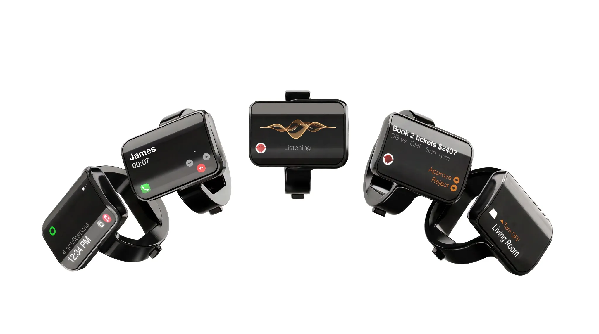

Perkembangan perangkat wearable pintar dalam beberapa tahun terakhir terasa agak monoton. Sebagian besar pabrikan berlomba meluncurkan cincin pintar yang sekadar berfungsi sebagai pelacak metrik kebugaran pasif, seperti memantau detak jantung, kadar oksigen dalam darah, dan fase tidur pengguna. Namun, startup peranti keras bernama Aina mengambil pendekatan yang sama sekali berbeda dengan memperkenalkan produk perdananya, Aina Ring.

Alih-alih menjadi gelang atau cincin pemantau kesehatan pasif, Aina Ring diposisikan sebagai pengendali aktif untuk menjembatani interaksi manusia dengan komputer, ponsel pintar, dan sistem kecerdasan buatan. Perangkat mungil ini membenamkan layar tampilan mandiri, joystick fisik mini, pengeras suara mikro, serta mikrofon langsung di lingkar jari tangan.

## Jawaban Ringkas Fitur dan Spesifikasi Aina Ring

Aina Ring adalah cincin pintar interaktif seharga $399 yang dilengkapi layar OLED lengkung 0,9 inci, pengontrol joystick mikro Shifter, speaker, dan mikrofon untuk navigasi komputasi serta interaksi agen AI. Cincin ini mendukung kontrol panggilan telepon langsung, pintasan rapat online di komputer Mac, kendali perangkat rumah pintar, serta baterai harian tahan hingga 18 jam dengan sertifikasi tahan air IP65.

Awalnya saya kira Aina Ring hanya akan mengulang konsep cincin pintar berbasis ketukan permukaan sentuh yang sering kali tidak responsif ketika jari tangan sedikit berkeringat. Kalau diperhatikan lebih jauh, ternyata tim rekayasa Aina yang dipimpin mantan petinggi perangkat keras Ultrahuman memilih memasang tuas mekanis dua sumbu yang sangat kecil bernama Shifter di permukaan atas cincin.

## Mengubah Cincin Pintar Menjadi Alat Kendali Interaktif

Latar belakang lahirnya Aina Ring berakar dari pergeseran cara kerja aplikasi modern. Saat ini, sistem komputasi tidak lagi hanya menunggu perintah pasif yang diketik pengguna di papan ketik atau diklik melalui mouse. Banyak sistem agen kecerdasan buatan mulai berjalan di latar belakang untuk menyiapkan draf surat elektronik, menyusun jadwal pertemuan, atau menyaring tagihan langganan.

Ketika puluhan proses otomatis tersebut membutuhkan konfirmasi manusia, membuka kunci ponsel atau mencari kursor mouse di monitor berukuran besar sering kali memecah konsentrasi kerja. Aina Ring menawarkan solusi jalan tengah dengan memindahkan prompt keputusan singkat itu ke punggung jari telunjuk.

Pengguna cukup melirik layar kecil di lingkar cincin untuk melihat konteks permintaan, lalu memberikan persetujuan atau penolakan hanya dengan jentikan ibu jari. Konsep interaksi fisik instan ini melengkapi ekosistem perangkat komputasi modern yang kian personal, serupa dengan kepraktisan yang ditawarkan [kacamata komputasi spasial XREAL AURA](/xreal-aura-kacamata-android-xr-pertama/) maupun perangkat pelacak mandiri seperti [Google Find Hub](/google-find-hub-pengingat-barang-tertinggal/).

## Mekanisme Joystick Shifter dan Kendali Jentikan Jempol

Pusat kendali utama Aina Ring berada pada modul bernama Shifter. Modul ini berupa joystick planar datar yang dilindungi oleh kaca melengkung Corning Gorilla Glass 3. Bentuk tuasnya dirancang khusus mengikuti kelengkungan jari telunjuk tangan kanan maupun kiri, sehingga ibu jari dapat bergerak alami ke segala arah tanpa perlu meraba raba tombol fisik yang tersembunyi.

*Sumber: [Aina](https://www.aina.com/)*

Secara teknis, gestur jempol pada tuas Shifter dipetakan ke berbagai perintah dasar yang fleksibel:

- Geser ke atas: Menyetujui tindakan agen AI, menerima panggilan masuk, atau melanjutkan tugas antrean.
- Geser ke bawah: Menolak permintaan otomatis, mematikan dering telepon, atau keluar dari sesi aplikasi.
- Geser ke kiri dan kanan: Berpindah antarmenu, memilih opsi alternatif, atau melewati lagu pada pemutar audio.
- Tekan bagian tengah: Membuka kunci antarmuka cincin dan mengonfirmasi pilihan yang disorot.
- Tahan bagian tengah: Mengaktifkan mikrofon terintegrasi untuk mendiktekan teks atau berbicara langsung ke asisten suara Aina Voice.

Layar yang digunakan merupakan panel OLED 0,9 inci berdensitas 180 piksel per inci. Ukuran ini terbukti cukup tajam untuk menampilkan teks pendek berbaris dua, nama pemanggil yang tersimpan di kontak, maupun indikator volume dan status koneksi nirkabel Bluetooth.

## Integrasi Rapat Komputer Mac dan Panggilan Suara

Yang membuat penasaran justru keberadaan pengeras suara mikro dan mikrofon di dalam bodi cincin yang demikian ringkas. Komponen audio ini memungkinkan pengguna mengangkat panggilan telepon darurat langsung dari tangan tanpa perlu merogoh saku untuk mengambil ponsel. Kualitas suaranya dioptimalkan untuk percakapan jarak dekat, di mana pengguna cukup mendekatkan punggung tangan ke area mulut saat berbicara.

Bagi pekerja kantoran yang sering menghabiskan waktu di depan komputer Mac atau laptop kerja, Aina Ring memiliki profil integrasi khusus untuk aplikasi konferensi video. Saat sesi rapat online di Google Meet atau Zoom sedang berlangsung, cincin ini secara otomatis beralih fungsi menjadi pengendali mikrofon dan kamera:

- Menahan geseran ke atas akan mengaktifkan atau membisukan mikrofon ruangan (mute dan unmute) seketika.
- Menahan geseran ke bawah memungkinkan pengguna meninggalkan ruang rapat tanpa harus mencari tombol merah di layar laptop.
- Saat mengetik dokumen di aplikasi pengolah kata, menahan tombol tengah cincin akan menyalakan fitur dikte suara nirkabel berlatensi rendah.

Selain mengontrol komputer, Aina Ring juga dapat difungsikan sebagai remote pengendali media untuk memutar musik di Spotify, mengontrol tayangan video di YouTube atau Netflix, hingga menavigasi menu pada Apple TV di ruang keluarga.

## Rincian Spesifikasi Teknis Aina Ring

Untuk pembaca yang ingin mengetahui komponen internal dan daya tahan cincin cerdas ini, berikut tabel spesifikasi resmi yang dirilis oleh Aina:

- Layar: Panel OLED monokrom 0,9 inci lengkung, kerapatan 180 ppi
- Pelindung Layar: Kaca Corning Gorilla Glass 3 berkontur khusus
- Modul Kontrol: Joystick mikro planar Shifter dua sumbu dengan sensor klik sentral
- Komponen Suara: Mikrofon omnidirectional peredam derau dan speaker mikro terintegrasi
- Ketahanan Fisik: Sertifikasi debu dan semburan air IP65
- Daya Tahan Baterai: Hingga 18 jam penggunaan aktif harian
- Pengisian Daya: Dudukan magnetik nirkabel khusus, terisi penuh di bawah 2 jam
- Kompatibilitas: Perangkat Apple iPhone berbasis iOS dan komputer macOS
- Opsi Ukuran: 7 variasi ukuran lingkar jari telunjuk
- Pilihan Varian: Eclipse Black, Slate Titanium, Mercury Silver, dan Amber Gold
- Harga Awal: $399 untuk pemesanan Super Early Bird (harga ritel resmi $499)

## Harga dan Masa Depan Perangkat Wearable Aksi

Aina membuka sesi pemesanan awal cincin pintar ini melalui skema Super Early Bird dengan banderol mulai dari $399 atau setara kisaran Rp6,2 jutaan. Setelah periode promosi awal berakhir, harga ritel resminya akan naik menjadi $499 atau sekitar Rp7,8 jutaan. Perusahaan menargetkan pengiriman unit perdana ke tangan konsumen mulai Januari 2027 mendatang lengkap bersama dermaga pengisi daya magnetik.

Meskipun menyuguhkan konsep yang sangat segar, ada beberapa catatan realistis yang perlu diperhatikan. Daya tahan baterai sekitar 18 jam berarti pengguna wajib membiasakan diri menaruh cincin di atas stasiun pengisi daya setiap malam sebelum tidur, berbeda dengan cincin kesehatan pasif yang bisa bertahan 5 hingga 7 hari berturut turut. Selain itu, rating ketahanan air IP65 menandakan bahwa cincin ini aman terkena cipratan air hujan atau keringat saat berolahraga, tetapi tidak boleh dipakai berenang atau menyelam.

Namun di luar keterbatasan daya tersebut, kehadiran Aina Ring membuktikan bahwa inovasi cincin pintar tidak harus terpaku pada grafik denyut nadi dan catatan waktu tidur. Menjadikan cincin sebagai pusat aksi instan dengan joystick fisik mini membuka babak baru yang sangat menarik bagi masa depan perangkat pendamping komputasi harian.

> **Baca Juga:**
> - [XREAL AURA Meluncur Resmi, Kacamata Android XR Pertama](/xreal-aura-kacamata-android-xr-pertama/)
> - [Google Find Hub Hadirkan Fitur Pengingat Barang Tertinggal](/google-find-hub-pengingat-barang-tertinggal/)

Sumber: [Aina](https://www.aina.com/)
