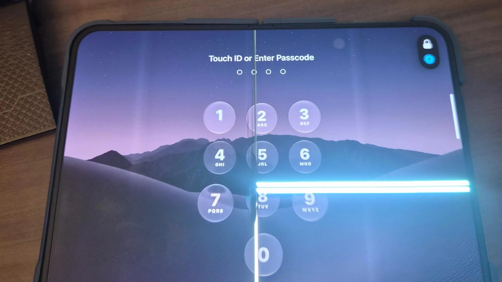

Kabar penting datang bagi siapa pun yang mengikuti peluncuran ponsel lipat perdana Apple. Baru sekitar sepekan iPhone Duo mendarat di tangan para pemesan awal, gelombang keluhan seputar layar bagian dalam yang retak mulai bermunculan. Apple bergerak cepat di balik layar dengan membagikan panduan teknis khusus kepada seluruh jaringan gerai resmi Apple Store dan mitra teknisi resminya.

Langkah internal ini menjadi sinyal nyata bahwa laporan kerusakan fisik pada gawai berbanderol $2.000 (sekitar Rp31 jutaan) tersebut bukan sekadar kasus terisolasi yang bisa diabaikan begitu saja.

## Ringkasan Memo Apple Soal Layar iPhone Duo

Apple resmi mendistribusikan memo internal ke Apple Store dan Apple Authorized Service Provider untuk memandu teknisi memeriksa keretakan layar bagian dalam iPhone Duo. Dokumen tersebut menginstruksikan staf Genius Bar agar segera memproses perbaikan atau penukaran unit baru bagi pelanggan yang terdampak sesuai prosedur standar AppleCare tanpa biaya tambahan.

Awalnya saya sempat mengira kabar keretakan layar ini hanya dibesar-besarkan oleh segelintir pengguna di media sosial. Namun setelah membaca salinan dokumen yang diperoleh oleh rekan media dari kalangan rantai servis Apple, perusahaan asal Cupertino tersebut tampaknya ingin memastikan setiap unit yang bermasalah langsung ditangani sebelum kegaduhan publik meluas.

## Gejala Keretakan Layar dan Istilah Crackgate di Kalangan Pengguna

Isu ini mencuat ke permukaan hanya beberapa hari setelah iPhone Duo resmi didistribusikan ke konsumen pada pekan lalu. Sejumlah pembeli perdana mengunggah foto dan video gawai mereka ke forum komunitas Apple dan Reddit. Pola kerusakannya hampir seragam, yaitu muncul garis retak mikro vertikal persis di lekukan engsel tengah layar fleksibel, yang kerap disusul oleh garis piksel terang berwarna hijau atau putih di sisi kanan panel.

Yang membuat penasaran justru durasi munculnya kerusakan tersebut. Seorang pengguna asal Australia menceritakan bahwa panel bagian dalamnya retak setelah ponsel dibuka kurang dari dua puluh kali pemakaian normal tanpa pernah terbentur atau jatuh.

*Sumber: [MacRumors](https://images.macrumors.com/article-new/2026/10/iPhone-Duo-Display-Cracking.jpg)*

Di jagat maya, para pencinta gadget mulai melabeli insiden ini dengan sebutan crackgate. Fenomena semacam ini sebetulnya mengingatkan kita pada masa-masa awal kehadiran ponsel lipat generasi pertama dari kompetitor beberapa tahun silam, di mana ketahanan mekanis layar lipat selalu menjadi titik paling rentan.

## Investigasi Bongkar Perangkat dan Dugaan Cacat Engsel

Melihat banyaknya laporan yang masuk, tim pembongkar gawai independen iFixit segera melakukan analisis mendalam terhadap konstruksi lipatan iPhone Duo. Dari hasil pembedahan komponen, ditemukan indikasi bahwa kendala utama kemungkinan besar bukan terletak pada kualitas kaca fleksibel Ultra Thin Glass itu sendiri, melainkan pada toleransi mekanis mekanisme engsel di bawahnya.

Ketika bodi ponsel dibuka dan direntangkan penuh hingga sudut seratus delapan puluh derajat, ada bagian penopang logam pada modul engsel yang diduga memberikan tekanan berlebih ke arah permukaan belakang panel OLED. Gesekan atau tekanan titik tumpu mikro yang berulang ini akhirnya memicu retakan halus dari dalam kaca fleksibel, yang lambat laun merusak lapisan sirkuit display di atasnya.

Apple sendiri dalam pernyataan resminya menyatakan bahwa insiden ini hanya berdampak pada sebagian kecil unit iPhone Duo. Perusahaan juga menegaskan bahwa cacat bawaan tersebut biasanya terlihat sangat cepat sejak awal pemakaian oleh konsumen.

## Sikap Apple dan Prosedur Penggantian Unit Pengguna

Hingga saat ini, Apple belum mengumumkan penarikan produk massal atau recall secara terbuka. Perusahaan juga belum merilis laman khusus Program Servis Mandiri di situs dukungannya, seperti yang biasanya dilakukan jika ada cacat manufaktur skala besar pada papan sirkuit atau baterai MacBook.

Instruksi dalam memo internal Apple mengarahkan staf toko untuk memverifikasi gejala fisik pada gawai konsumen. Apabila retakan terjadi di sepanjang garis engsel tanpa ditemukan tanda benturan fisik eksternal yang disengaja, teknisi diminta untuk memfasilitasi penggantian unit secara menyeluruh atau penggantian modul layar bagian dalam secara gratis di bawah skema garansi aktif AppleCare.

Bagi pelanggan yang mengalami kendala serupa, Apple menyarankan untuk langsung menjadwalkan kunjungan ke Genius Bar di Apple Store terdekat atau menghubungi saluran bantuan telepon 1-800-APL-CARE guna memperoleh penggantian perangkat.

Melihat langkah cepat Apple menerbitkan panduan internal ke meja teknisi, jelas terlihat kehati-hatian perusahaan dalam menjaga reputasi lini ponsel lipat perdananya. Kita nantikan apakah pembaruan pada lini produksi pabrik berikutnya mampu menuntaskan masalah tekanan engsel ini, sehingga pembeli gawai premium berikutnya bisa membuka layar tanpa rasa waswas.

Sumber: [MacRumors](https://www.macrumors.com/2026/10/30/apple-alerts-stores-to-iphone-duo-display-cracking/)
