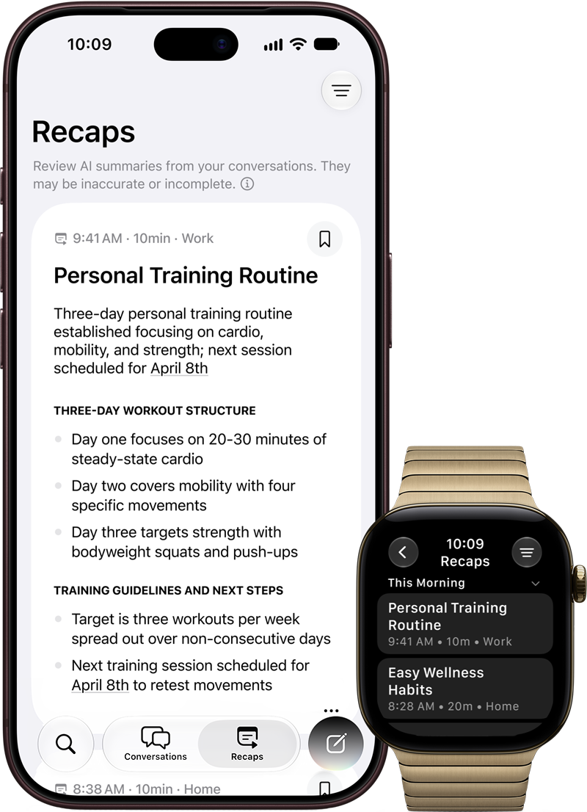

Isu perangkat pintar yang terus mendengarkan percakapan di sekitar kita sering kali memicu kekhawatiran besar seputar privasi. Belakangan ini banyak produk wearable AI seperti kacamata pintar atau liontin rekaman audio yang menuai kritik karena dianggap berisiko merekam orang lain tanpa izin. Apple tampaknya mengambil jalur berbeda dengan mulai menguji coba serangkaian kemampuan kecerdasan buatan berbasis audio langsung di pergelangan tangan pengguna.

Fitur baru bertajuk Audio Intelligence tersebut kini resmi memasuki tahap uji coba pengembang, membawa sejumlah fungsi praktis untuk membantu mengingat percakapan penting tanpa harus merekam suara secara terang-terangan.

## Apple Gulirkan Audio Intelligence di Pembaruan Pengembang

Apple mulai merilis uji coba Audio Intelligence pada versi beta pengembang watchOS dan iOS 27.3. Fitur ini menghadirkan kemampuan merangkum poin pembicaraan harian melalui Siri Recap serta memutar ulang suara 15 detik terakhir lewat Live Rewind khusus bagi pengguna Apple Watch Series 12 dan Apple Watch Ultra 4.

Peluncuran versi beta ini merupakan langkah awal sebelum Apple membukanya untuk pengujian publik yang lebih luas. Di dalam ekosistem Audio Intelligence, terdapat empat fitur utama yang disiapkan:

- Sound Recognition untuk mendeteksi suara penting seperti sirene atau bel pintu bagi penyandang disabilitas pendengaran.
- Music Recognition berbasis Shazam untuk mengenali lagu di latar belakang secara otomatis.
- Live Rewind untuk membaca kembali kalimat yang baru saja diucapkan seseorang.
- Siri Recap untuk menyusun ringkasan poin obrolan penting sepanjang hari.

Dari keempat fitur tersebut, dua fungsi terakhir menjadi sorotan utama karena bersinggungan langsung dengan percakapan manusia sehari-hari.

## Live Rewind Bantu Mengingat Obrolan yang Terlewat

Pernahkah Anda sedang mengobrol di sebuah tempat yang bising, lalu melewatkan sepatah kata penting yang baru saja diucapkan lawan bicara? Live Rewind dirancang khusus untuk skenario semacam itu.

Ketika pengguna merasa melewatkan instruksi lisan atau rincian menu pesanan, pengguna cukup menekan Digital Crown dua kali. Layar Apple Watch akan langsung menampilkan potongan teks dari apa yang diucapkan dalam rentang 15 detik terakhir.

Untuk mencegah kekhawatiran orang di sekitar bahwa mereka sedang direkam diam-diam, Apple menyematkan mekanisme keterbukaan visual dan audio. Saat Live Rewind aktif, jam tangan akan memutar nada getar lembut serta menampilkan animasi mikrofon khusus di layar. Potongan teks tersebut juga bersifat sangat sementara. Jika pengguna tidak memilih untuk menyimpannya ke aplikasi Siri, teks percakapan akan otomatis lenyap dalam waktu 30 detik.

*Sumber: [Apple Support](https://support.apple.com/en-us/148354)*

## Siri Recap Hasilkan Catatan Penting Tanpa Merekam Suara Mentah

Awalnya saya kira fitur rangkuman obrolan ini bakal bekerja seperti aplikasi perekam suara biasa yang menumpuk fail audio berukuran besar di memori. Setelah membaca penjelasan teknisnya, ternyata Siri Recap sama sekali tidak menyimpan rekaman suara mentah pengguna.

Siri Recap tidak membuat transkrip kata demi kata. Sistem hanya mengekstrak inti pembicaraan menjadi satu kalimat pembuka padat yang diikuti beberapa poin ringkas. Rangkuman ini menyorot informasi penting yang biasanya perlu dicatat manual, seperti tanggal pertemuan, tenggat pekerjaan, janji temu, atau rincian harga yang disepakati.

Kalau diperhatikan, ternyata Apple juga memasang filter ketat pada sistem pemrosesan bahasanya. Siri Recap secara otomatis menyaring dan mengabaikan data sensitif, mulai dari nomor identitas kependudukan, informasi rekening perbankan, kode sandi otentikasi, hingga informasi pribadi yang berisiko. Seluruh rangkuman yang tidak disimpan secara manual juga akan terhapus otomatis dari sistem setelah tujuh hari.

## Arsitektur Privasi Chip S11 dan Private Cloud Compute

Yang membuat penasaran justru arsitektur komputasi di balik layarnya. Mengolah audio secara berkelanjutan biasanya menuntut daya baterai besar dan menimbulkan celah keamanan. Namun Apple memecah beban kerja ini ke dalam beberapa lapisan perangkat keras dan perangkat lunak terisolasi.

Prosesor Apple S11 di dalam Apple Watch Series 12 dan Ultra 4 dibekali Secure Enclave dengan penyangga audio khusus. Model kecerdasan buatan lokal berdaya rendah bertugas mendeteksi apakah pemakai jam sedang terlibat dalam sebuah percakapan aktif.

Jika terdeteksi, data audio diteruskan secara aman ke Secure Enclave pada iPhone yang terhubung. Model pemrosesan lokal di ponsel pintar kemudian membersihkan kata-kata pengisi percakapan dan mengubahnya menjadi teks ringkas terenkripsi. Teks padat tersebut barulah dikirimkan ke Private Cloud Compute milik Apple untuk disusun menjadi rangkuman akhir.

Pihak Apple menegaskan bahwa Private Cloud Compute langsung menghapus data pemrosesan tersebut seketika setelah hasil rangkuman dikirim kembali ke perangkat. Apple maupun pihak ketiga tidak memiliki akses terhadap rekaman maupun hasil teks tersebut. Sinkronisasi antarperangkat melalui iCloud juga dilindungi enkripsi menyeluruh dari ujung ke ujung.

## Kendali Penuh Pengguna dan Ketersediaan Perangkat

Seluruh fitur dalam Audio Intelligence ini sepenuhnya bersifat opsional atau harus diaktifkan secara sadar oleh pengguna. Pemilik jam tangan bebas mengatur jadwal pengaktifan Siri Recap, mematikannya kapan saja lewat Pusat Kontrol, atau mengatur aplikasi mana saja yang boleh menyimpan hasil catatan.

Untuk saat ini, fitur Live Rewind dan Siri Recap masih terbatas pada Apple Watch Series 12 dan Apple Watch Ultra 4 yang dipasangkan dengan iPhone yang mendukung ekosistem Apple Intelligence. Fitur ini juga dibatasi secara ketat berdasarkan profil akun, tidak tersedia bagi pengguna di bawah umur 13 tahun, serta memerlukan persetujuan orang tua untuk akun keluarga.

Uji coba perdana ini baru mendukung interaksi dalam Bahasa Inggris, dengan dukungan bahasa lain yang dijanjikan menyusul pada rilis pembaruan berikutnya.

Melihat langkah ini, jam tangan pintar tampak mulai bergeser peran dari sekadar pelacak kebugaran menjadi asisten pencatat aktivitas harian. Pendekatan Apple yang mengunci pemrosesan pada chip lokal dan Private Cloud Compute memperlihatkan bahwa fitur pendengaran aktif tetap bisa dihadirkan tanpa harus mengorbankan privasi percakapan di ruang terbuka.

> **Baca Juga:**
> - [Cara Melacak HP Hilang Android Lewat Fitur Find My Device](/cara-melacak-hp-hilang-android/)
> - [Ray-Ban Meta Sempat Merekam Suara Pengguna Tanpa Izin](/ray-ban-meta-rekam-suara-tanpa-izin/)

Sumber: [Apple Support](https://support.apple.com/en-us/148354)
