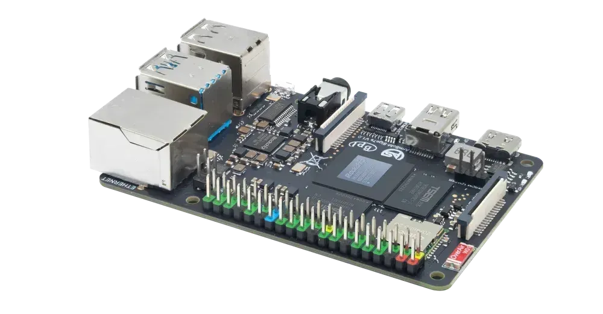

Persaingan di dunia komputer papan tunggal atau single board computer semakin memanas dengan kehadiran perangkat baru yang menyasar performa komputasi tinggi tanpa mengorbankan portabilitas. Produsen perangkat keras ArmSoM resmi memperkenalkan produk teranyarnya, ArmSoM Sige7s. Papan mini ini membawa prosesor delapan inti bertenaga kecerdasan buatan dalam dimensi fisik yang persis menyerupai Raspberry Pi standar.

Perangkat ini dibanderol mulai dari 153 dolar AS melalui laman resmi ArmSoM. Kehadirannya menarik perhatian kalangan pegiat teknologi karena mencoba menjembatani celah besar antara performa komputasi papan mini kelas atas dan kemudahan bentuk ringkas yang ramah saku.

## Tenaga Flagship Rockchip Dipadatkan ke Format Kartu Kredit

Awalnya saya mengira papan pengembang berbasis chipset kencang Rockchip RK3588 akan selalu hadir dalam bentuk bongsor yang membutuhkan ruang sasis lapang. Namun pada seri Sige7s ini, ArmSoM memilih varian RK3588S, yaitu versi miniatur dari silikon unggulan Rockchip yang diproduksi dengan fabrikasi 8 nanometer.

Di dalam cip tersebut tersimpan konfigurasi delapan inti yang terdiri dari empat inti kencang ARM Cortex-A76 berkecepatan 2,4 GHz dan empat inti hemat daya Cortex-A55 berkecepatan 1,8 GHz. Untuk kebutuhan olah grafis, unit pemroses GPU Mali-G610 MP4 siap menangani rendering antarmuka 4K hingga grafis 3D modern. Yang membuat penasaran justru keberadaan unit akselerator kecerdasan buatan atau NPU terintegrasi dengan daya komputasi hingga 6 TOPS.

Kemampuan NPU sebesar 6 TOPS ini mendukung pemrosesan presisi campuran INT4, INT8, hingga INT16. Bagi pengembang yang ingin menjalankan model visi komputer populer seperti YOLO atau ResNet langsung di perangkat lokal (on-device AI), angka komputasi ini memberikan ruang eksekusi yang leluasa tanpa harus membebani komputasi awan. Seluruh tenaga prosesor dan NPU tersebut dipadatkan ke atas papan sirkuit berukuran hanya 85 x 56 milimeter, sama persis dengan ukuran kartu ATM maupun jejak fisik Raspberry Pi 4 atau 5.

*Sumber: [ArmSoM](https://www.armsom.org/sige7s)*

## Modul Penyimpanan Lepas Pasang dan Toleransi Voltase Lega

Kalau diperhatikan, ada dua keputusan desain dari para insinyur ArmSoM yang patut diacungi jempol karena sangat memahami kerepotan teknisi di lapangan. Pertama adalah sektor media penyimpanan internal. Alih-alih menyolder cip eMMC secara permanen di atas papan sirkuit, ArmSoM justru menggunakan modul eMMC lepas-pasang (removable module).

Pendekatan soket modular ini memudahkan pengguna untuk meningkatkan kapasitas penyimpanan mulai dari 16 GB hingga 128 GB tanpa perlu mengganti keseluruhan papan. Selain itu, bila sistem operasi mengalami kerusakan data (data corruption) saat proses pengujian, kita bisa mencopot modul eMMC tersebut untuk diformat ulang menggunakan pembaca kartu di komputer lain, persis seperti memperlakukan kartu microSD tetapi dengan kecepatan baca-tulis jauh lebih tinggi. Papan ini tentu tetap menyediakan slot microSD terpisah bagi kebutuhan penyimpanan cadangan.

Keputusan desain kedua yang sangat melegakan adalah toleransi input voltase yang luar biasa fleksibel, yaitu mulai dari 5V hingga 23V melalui soket USB Type-C khusus daya. Bagi siapa pun yang sering berkutat dengan SBC modern, pasokan daya sering kali menjadi mimpi buruk karena perangkat menolak menyala jika kepala charger tidak memiliki protokol USB Power Delivery yang presisi. Dengan rentang tegangan lebar ini, Sige7s bisa ditenagai oleh adaptor laptop USB-C standar, catu daya industri 12V, atau bahkan baterai pack portabel tanpa drama negosiasi daya yang rumit.

## Kompatibilitas Pin Raspberry Pi untuk Kebutuhan AI Lokal

Setelah membaca lebih jauh, ternyata ArmSoM merancang tata letak konektor 40-pin GPIO pada Sige7s agar kompatibel dengan ekosistem Raspberry Pi. Artinya, aneka modul tambahan seperti Pi HAT, layar sentuh resmi 7 inci, modul kamera berbasis sensor IMX219, hingga kipas pendingin standar Raspberry Pi 4 dapat dipasangkan langsung ke papan ini.

Untuk urusan antarmuka keluaran video, Sige7s dibekali port HDMI 2.1 berukuran penuh yang sanggup mengalirkan resolusi hingga 8K pada 60 frame per detik, lengkap dengan kemampuan dekoder video perangkat keras 8K H.265 dan VP9. Jalur tampilan kedua dapat dialirkan lewat DisplayPort 1.4 melalui colokan USB Type-C serbaguna, didampingi antarmuka MIPI DSI untuk panel layar bawaan. Pengguna juga mendapatkan sepasang port USB 3.0, dua port USB 2.0, port Gigabit Ethernet dengan dukungan Power over Ethernet (PoE) via modul opsional, serta konektivitas nirkabel Wi-Fi 6 dan Bluetooth 5.0 yang sudah terpasang langsung.

Dukungan memori RAM juga tergolong masif, dengan pilihan kapasitas LPDDR4X hingga 32 GB. Besaran RAM sebesar ini membuka peluang pemanfaatan Sige7s sebagai stasiun kerja mini Linux portabel, server multimedia rumahan yang sanggup melakukan transcoding video 8K, atau mesin inferensi kecerdasan buatan lokal untuk analisis kamera keamanan pintar.

## Alternatif Compute Module untuk Kebutuhan Industri Tertanam

Menyadari bahwa tidak semua proyek memerlukan deretan port fisik USB dan HDMI berukuran besar, ArmSoM turut merilis varian modul komputasi bernama ArmSoM CM7s seharga 179 dolar AS. Varian ini mengusung silikon RK3588S yang sama persis, namun hadir dalam bentuk modul mini berdimensi 55 x 40 milimeter mirip kartu Raspberry Pi Compute Module 5.

Modul CM7s dirancang khusus untuk disematkan langsung ke dalam papan sirkuit kustom pada perangkat industri, robotika, papan reklame digital (digital signage), atau sistem otomotif. Untuk memberikan kepastian bagi kalangan industri yang merancang produk komersial, ArmSoM memberikan komitmen siklus hidup produksi jangka panjang untuk CM7s minimal hingga bulan Agustus 2034.

Langkah ArmSoM menghadirkan RK3588S dalam ukuran papan yang begitu familiar membuktikan bahwa papan mini berkinerja tinggi tidak lagi harus berbentuk besar dan boros daya. Bagi penghobi oprek maupun profesional yang membutuhkan tenaga komputasi kencang dengan dukungan NPU terpadu, Sige7s menjadi alternatif segar yang sangat memikat di pasar perangkat keras saat ini.

Sumber: [ArmSoM](https://www.armsom.org/sige7s)
