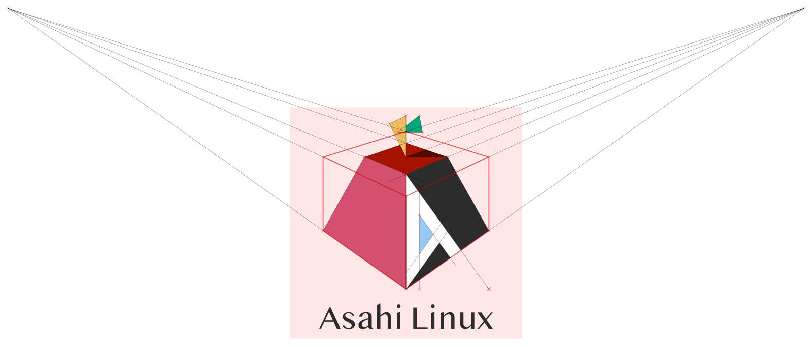

Proyek Asahi Linux resmi memutuskan untuk memindahkan seluruh repositori kode mereka dari lisensi permisif MIT ke GNU General Public License versi 2 atau versi lebih baru. Langkah tegas ini diambil setelah tim pengembang mendapati maraknya aksi pencucian kode berbasis model kecerdasan buatan, ketika pihak tidak bertanggung jawab mencomot kode mentah dari *fork* pribadi lalu menyamarkannya menggunakan bantuan LLM untuk kepentingan komersialisasi sepihak.

Kalau ente mengikuti perkembangan ekosistem Linux di perangkat Apple Silicon, Asahi Linux adalah fondasi utama yang memungkinkan distribusi Linux modern bisa menyala mulus di atas cip Apple M-series. Selama bertahun-tahun, tim inti proyek ini sengaja merilis sebagian besar komponen di bawah naungan lisensi MIT. Tujuannya sangat mulia, om, yaitu memberi kebebasan seluas-luasnya agar proyek sistem operasi lain seperti keluarga BSD bisa ikut memanfaatkan hasil kerja keras mereka tanpa ganjalan lisensi yang kaku.

Namun, keterbukaan tanpa batas tersebut belakangan ini justru menjadi bumerang bagi pengembang aslinya.

## Modus Pencucian Kode dan Celah di Lisensi Permisif

Praktik pencucian kode atau *license laundering* sejatinya bukan trik baru di ranah perangkat lunak. Sebelum era ledakan model bahasa besar, aksi culas ini menuntut pelaku untuk merombak sintaksis secara manual baris demi baris, mengganti nama variabel, serta memecah fungsi agar struktur aslinya tersamarkan dari audit hak cipta. Kini berkat kehadiran generative AI, proses pengaburan jejak karya orang lain bisa diselesaikan hanya dalam beberapa detik lewat instruksi sederhana.

Pengembang Asahi Linux menemukan bukti nyata bahwa sejumlah kode fitur yang masih dalam tahap penggodokan aktif di *fork* pribadi pengembang telah diambil tanpa izin. Kode setengah matang tersebut kemudian dilewatkan ke model AI untuk dibersihkan jejak atribusinya, lalu dipublikasikan ulang sebagai karya sendiri guna membangun distro tandingan berbayar di atas Apple Silicon.

Lisensi permisif seperti MIT pada dasarnya hanya mewajibkan pencantuman catatan hak cipta asli tanpa menuntut penerima kode membagikan kembali perubahan yang mereka buat. Sayangnya, lisensi ini tidak memiliki klausul perlindungan terhadap pihak yang bertindak dengan itikad buruk. Begitu pelaku menjalankan skrip AI untuk mengaburkan kode sumber, membuktikan pelanggaran hak cipta atas lisensi MIT menjadi perkara hukum yang sangat abu-abu dan melelahkan.

## Belajar dari Sejarah Pahit WINE Dua Dekade Silam

Dalam laporan perkembangan terbarunya, pengembang Asahi Linux James Calligeros menarik benang merah yang sangat relevan dengan peristiwa yang dialami proyek WINE sekitar dua puluh tahun silam. Generasi lama pegiat sumber terbuka tentu ingat bahwa WINE pada awalnya juga dirilis menggunakan lisensi MIT.

Pada akhir era 1990-an hingga awal 2000-an, sejumlah korporasi perangkat lunak mengambil basis kode WINE secara cuma-cuma, menutup akses kodenya, lalu menjual varian komersial tanpa menyumbang balik perbaikan apa pun ke repositori hulu (*upstream*). Praktik parasitik ini kala itu nyaris mematikan proyek WINE akibat fragmentasi yang parah. Demi menyelamatkan ekosistem, tim WINE akhirnya beralih ke lisensi LGPL pada tahun 2002 untuk memotong jalan pintas para pemburu keuntungan sepihak.

*Sumber: [Asahi Linux](https://github.com/AsahiLinux/artwork)*

Pengembang Asahi Linux menegaskan bahwa pihak yang melupakan sejarah ditakdirkan untuk mengulangi kesalahan yang sama. Upaya merekayasa balik (*reverse engineering*) cip Apple Silicon membutuhkan keringat ribuan jam untuk membedah interupsi, manajemen daya PMGR, kontroler Thunderbolt kustom, hingga arsitektur GPU Apple yang rumit. Membiarkan hasil riset mendalam tersebut ditunggangi pihak luar yang bermodal *prompt* AI jelas bukan pilihan bijak bagi kelangsungan proyek.

## Dampak Skema Copyleft dan Reaksi Komunitas BSD

Pilihan beralih ke GPL v2 atau yang lebih baru membawa kekuatan hukum *copyleft* yang sangat tegas. Di bawah payung GPL, siapa pun yang mendistribusikan biner atau sistem turunan wajib merilis kode sumber lengkap di bawah lisensi yang setara. Celah untuk mengunci kode menjadi produk tertutup dan menarik tarif komersial di atas kerja keras Asahi Linux kini resmi tertutup rapat secara hukum.

Meskipun demikian, keputusan besar ini tidak sepenuhnya disambut gembira oleh semua kalangan. Komunitas BSD menjadi pihak yang paling merasakan dampaknya secara langsung. Pengembang OpenBSD Bryan Steele sempat menyuarakan kekecewaannya di media sosial terkait langkah relisensi komponen vital seperti *bootloader* m1n1 dan kumpulan *driver* perangkat keras. Kompatibilitas lisensi antara GPL dan BSD yang berseberangan dikhawatirkan dapat menghambat integrasi kode pendorong Apple Silicon ke dalam proyek *kernel* non-Linux.

Bagi tim Asahi Linux, pertaruhan ini adalah bentuk pertahanan diri yang mutlak di tengah perubahan lanskap perangkat lunak modern. Membuka kode selebar-lebarnya demi kebebasan kolaborasi tetap menjadi komitmen mereka, namun kebebasan tersebut tidak boleh lagi ditunggangi oleh aksi pencurian kode yang bersembunyi di balik polesan kecerdasan buatan.

> **Baca Juga:**
> - [Kmorph Pulihkan Kernel Linux dari Crash Tanpa Perlu Reboot](/kmorph-pulihkan-kernel-linux-tanpa-reboot/)
> - [Fedora 45 Resmi Rilis Bawa KMSCON dan Storage Stratis](/fedora-45-resmi-rilis-bawa-kmscon-dan-stratis/)

Sumber: [Asahi Linux](https://asahilinux.org/2026/11/progress-report-7-3/)
