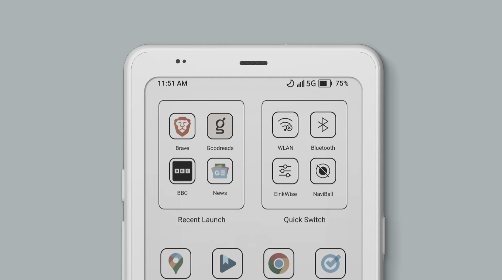

Membaca buku atau artikel panjang di layar ponsel sering kali berakhir dengan mata perih dan kepala pusing. Di sisi lain, membawa tablet e-reader seperti Kindle ukuran standar terasa agak merepotkan kalau hanya ingin diselipkan ke saku celana atau tas kecil. Menjawab dilema tersebut, Onyx Boox resmi meluncurkan perangkat terbarunya, Boox Palma 2 Pro.

Perangkat ini mengambil bentuk yang tidak lazim untuk sebuah e-reader, yaitu persis menyerupai ukuran sebuah ponsel pintar modern, lengkap dengan rasio layar memanjang dan bobot yang sangat ringan. Boox membanderol Palma 2 Pro dengan harga 379,99 dolar AS melalui toko resminya.

## Menghadirkan Warna Lembut di Layar Kertas Elektronik

Awalnya saya mengira seri Palma generasi kedua ini hanya akan menjadi pembaruan minor dari seri Palma pendahulunya yang masih mengandalkan layar monokrom hitam putih. Namun saat membaca lembar spesifikasi resminya, peningkatan paling mencolok justru terletak pada adopsi panel e-paper warna Kaleido 3 berukuran 6,13 inci.

Panel Kaleido 3 ini mampu menampilkan hingga 4.096 warna dengan nuansa lembut menyerupai cetakan koran atau buku komik berwarna, bukan pancaran piksel menyilaukan seperti panel OLED atau LCD ponsel. Untuk teks hitam putih biasa, ketajamannya tetap prima di angka 300 ppi dengan resolusi 824 x 1648 piksel. Sementara saat menampilkan gambar atau ilustrasi berwarna, kerapatannya berada di angka 150 ppi dengan resolusi 412 x 824 piksel.

Yang membuat penasaran justru pengaturan lampu depannya (front light). Boox menyematkan teknologi lampu dua warna (cold and warm light) yang bisa diatur tingkat kehangatannya sesuai suasana ruangan. Berbeda dari layar ponsel yang menembakkan cahaya langsung ke retina mata, sistem lampu depan pada layar kertas digital memantulkan cahaya dari tepi panel ke permukaan layar. Hasilnya, pembaca tetap bisa membaca dengan nyaman di kamar tidur yang gelap gulita tanpa menyilaukan mata atau mengganggu orang lain yang sedang tidur di samping.

## Bodi Ringkas 175 Gram Pengganti Kebiasaan Gulir Layar Ponsel

Kalau diperhatikan, dimensi fisik Palma 2 Pro berada di kisaran 159 x 80 x 8,8 milimeter dengan bobot hanya 175 gram. Sebagai perbandingan, ponsel kelas atas seperti iPhone 16 Pro Max atau seri Ultra memiliki bobot jauh di atas 220 gram. Perbedaan bobot puluhan gram ini sangat terasa saat perangkat digenggam dengan satu tangan sambil rebahan santai di tempat tidur.

Bentuk ergonomis yang memanjang membuat perangkat ini sangat mudah dibawa bepergian, mulai dari menunggu antrean dokter, perjalanan di dalam kereta, hingga saat duduk santai di kedai kopi. Di momen ketika tangan kita biasanya otomatis meraih ponsel untuk sekadar menggulir media sosial tanpa arah, perangkat ini menawarkan alternatif yang jauh lebih menenangkan untuk membaca buku atau artikel simpanan.

*Sumber: [The Official BOOX Store](https://shop.boox.com/products/palma2pro)*

Selain kenyamanan fisik, Boox juga menyematkan kamera belakang beresolusi 16 megapiksel yang dilengkapi lampu kilat LED. Kamera ini bukan ditujukan untuk bersaing dengan hasil jepretan kamera ponsel, melainkan dirancang khusus sebagai pemindai dokumen (document scanner). Pengguna cukup mengarahkan kamera ke halaman buku fisik atau dokumen kertas untuk mengubahnya menjadi teks digital.

## Kartu SIM 5G dan Fleksibilitas Android 15 Murni

Setelah membaca lebih jauh, ternyata ada lompatan besar lain di sektor konektivitas. Berbeda dari kebanyakan e-reader yang hanya mengandalkan sambungan Wi-Fi rumahan, Boox Palma 2 Pro dibekali slot kartu SIM hybrid yang sudah mendukung jaringan seluler data hingga 5G. Pengguna bisa memasang kartu SIM data atau memanfaatkan slot tersebut untuk menambah kartu memori microSD hingga kapasitas 2 TB.

Kehadiran koneksi seluler data mandiri ini melengkapi sistem operasi Android 15 murni yang sudah terpasang langsung di dalamnya. Menariknya, perangkat ini tidak dikunci ke satu ekosistem toko buku tertentu. Boox menyertakan Google Play Store bawaan yang sudah tersertifikasi penuh, sehingga pengguna bebas mengunduh aplikasi bacaan favorit mereka.

Aplikasi seperti Kindle, Kobo, Gramedia Digital, Libby, hingga layanan simpan artikel seperti Pocket dan artikel berita peramban web dapat berjalan langsung di perangkat ini. Tidak hanya aplikasi teks, pengguna juga bisa memasang Spotify atau pemutar podcast untuk mendengarkan buku audio (audiobook) lewat pengeras suara bawaan, mikrofon ganda, atau earphone nirkabel melalui Bluetooth 5.1.

Dapur pacunya ditenagai oleh prosesor octa-core yang dipadukan dengan RAM 8 GB serta media penyimpanan internal 128 GB. Kapasitas RAM yang tergolong lega untuk ukuran e-reader ini dipadukan dengan teknologi eksklusif BOOX Super Refresh (BSR). Teknologi BSR menyediakan empat pilihan mode penyegaran layar yang dapat disesuaikan, mulai dari mode membaca teks santai hingga mode cepat untuk menjelajah halaman web.

## Dukungan Pena Stylus dan Kompromi Khas Layar E-Paper

Fitur baru lain yang turut dihadirkan adalah dukungan terhadap pena stylus aktif BOOX InkSense Plus dengan 4.096 tingkat sensitivitas tekanan. Pengguna yang suka mencorat-coret catatan singkat di dokumen PDF atau membuat memo cepat bisa memanfaatkan stylus ini tanpa perlu menyambungkan koneksi Bluetooth.

Untuk urusan catu daya, baterai berkapasitas 3.950 mAh sanggup menemani aktivitas membaca harian selama sekitar lima hingga tujuh hari dalam sekali pengisian. Ketahanan baterai ini memang lebih singkat dibanding e-reader monokrom standar yang bisa bertahan berminggu-minggu, hal yang wajar mengingat perangkat ini menjalankan sistem operasi Android utuh dengan prosesor kencang dan konektivitas data aktif.

Kompromi lain yang perlu dipahami calon pembeli tentu datang dari sifat alami teknologi layar e-paper itu sendiri. Tampilan warna pada panel Kaleido 3 tidak akan sepekat atau secerah layar ponsel pintar, serta efek bayangan samar (ghosting) dari halaman sebelumnya sesekali masih muncul saat berpindah halaman secara cepat. Beruntung, Boox menyematkan tombol fisik pintar di sisi bodi yang bisa ditekan sekali untuk melakukan penyegaran penuh (full refresh) layar secara instan.

Secara keseluruhan, Boox Palma 2 Pro menawarkan proposisi yang sangat memikat bagi pembaca yang ingin melepaskan diri dari ketergantungan layar ponsel tanpa harus kehilangan portabilitas dan fleksibilitas aplikasi modern.

Sumber: [The Official BOOX Store](https://shop.boox.com/products/palma2pro)
