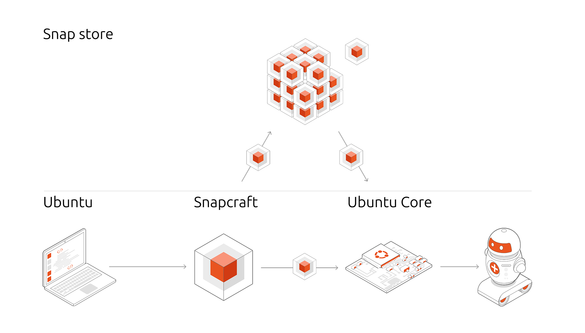

Kalau ente mengikuti perkembangan sistem operasi Linux beberapa tahun belakangan, konsep sistem immutable atau sistem berkas read-only yang kebal oprekan liar makin ramai dibicarakan. Canonical selaku pengembang Ubuntu rupanya tidak mau ketinggalan langkah di ranah ini. Sempat adem ayem setelah pamer pratinjau awal pada tahun 2023 silam, Canonical kini resmi mengumumkan percepatan proyek Ubuntu Core Desktop dengan target ketersediaan image harian menjelang rilis Ubuntu 27.04.

Langkah strategis ini diumumkan langsung oleh Jon Seager, Vice President of Engineering di Canonical, lewat forum resmi komunitas Ubuntu. Canonical bahkan sudah membentuk divisi khusus lintas fungsi yang fokus penuh membenahi fondasi teknis desktop serba snap ini. Ubuntu Core Desktop dirancang menjadi sistem operasi desktop yang tidak mudah rusak akibat salah konfigurasi, mudah dipulihkan saat pembaruan bermasalah, serta memberikan kendali izin akses aplikasi yang jauh lebih ketat kepada pengguna.

## Kebangkitan Proyek Desktop yang Sempat Tertidur

Bagi praktisi perangkat IoT dan robotika, nama Ubuntu Core sebenarnya bukan barang baru. Distro minimalis yang mengemas seluruh komponen sistem operasi ke dalam paket snap terisolasi ini sudah bertahun-tahun diandalkan di lingkungan industri komputasi tepi (*edge computing*). Namun, memboyong konsep tersebut ke meja kerja komputer harian (*desktop*) ternyata menghadirkan tantangan teknis yang jauh lebih rumit.

Pratinjau pengembang yang dirilis Canonical pada 2023 dinilai belum memuaskan. Saat itu, tim pengembang membundel display manager GDM, lingkungan desktop GNOME, hingga peramban web ke dalam satu base snap monolitik raksasa. Pendekatan jalan pintas tersebut memang berhasil memunculkan tampilan desktop dengan cepat, tetapi merusak filosofi utama Ubuntu Core yang seharusnya modular dan independen.

Kini, tim Ubuntu Core Desktop memulai kembali pengembangan dengan merombak total pondasi tersebut. Image sistem dialihkan ke basis `core26` dan komponen desktop dipecah agar tidak lagi menjadi satu gumpalan kode yang kaku.

*Sumber: [Canonical](https://ubuntu.com/core)*

## Tiga Skenario Penggunaan Utama di Garis Depan

Menghadirkan desktop yang seratus persen mengandalkan aplikasi snap terkekang (*strictly confined*) jelas bukan perkara mudah. Seager mengakui bahwa ketersediaan aplikasi adalah ganjalan terbesar. Oleh karena itu, Canonical memilih untuk tidak langsung menyasar semua tipe pengguna, melainkan memprioritaskan tiga skenario pemakaian spesifik pada tahap awal siklus Ubuntu 27.04.

### Mesin Peramban Web Ringan

Skenario pertama adalah komputer yang aktivitas utamanya berpusat di peramban web (*browser-centric machine*). Di era aplikasi web dan perkakas modern, banyak pengguna yang menghabiskan seluruh jam kerjanya di dalam browser. Skenario ini dipandang paling matang karena Canonical sudah bertahun-tahun mengapalkan Firefox dan Chromium dalam format snap yang stabil. Tim pengembang tinggal mematangkan sistem dialog izin akses perangkat keras seperti mikrofon dan kamera agar privasi pengguna tetap aman.

### Stasiun Kerja Developer dan Kontainer LXD

Bagi para programmer dan sysadmin, sistem berkas yang dikunci read-only sering kali terasa membatasi kebebasan ngoprek perkakas kompilasi. Untuk menjawab tantangan tersebut, Canonical mengandalkan integrasi LXD dan ekosistem Canonical Workshop.

Lewat pendekatan ini, perkakas pengembangan, pustaka dependensi, hingga agen pengkodean otomatis dijalankan di dalam kontainer terisolasi yang aman. Pengembang tetap bisa menggunakan Visual Studio Code dan perkakas CLI favorit mereka tanpa khawatir merusak stabilitas sistem induk. Pendekatan ini mirip dengan cara kerja WSLg di lingkungan Windows, di mana aplikasi berjalan di dalam lingkungan terisolasi namun jendelanya tetap tampil menyatu di layar utama.

### Perangkat Gaming Berbasis Steam Snap

Skenario ketiga menyasar perangkat gaming portabel dan komputer game rumahan. Keberhasilan Steam Deck dan lapisan kompatibilitas Proton membuktikan bahwa Linux sangat mumpuni untuk bermain game modern. Canonical berniat memaksimalkan paket Steam snap yang sudah memiliki kurungan ketat.

Melalui fitur *content snaps* dan komponen modular, driver kartu grafis serta runtime Mesa dapat diperbarui secara independen tanpa risiko membuat sistem gagal booting. Jika pengujian ini sukses, Ubuntu Core Desktop berpeluang menjadi alternatif sistem operasi yang solid untuk handheld gaming PC.

## Rombak Arsitektur Monolitik Menuju Desain Modular

Kunci pembeda antara Ubuntu Core Desktop dengan distro immutable berbasis image konvensional terletak pada modularitasnya. Pada distro immutable biasa, pembaruan kecil sering kali mewajibkan unduhan image sistem utuh dalam ukuran gigabyte.

Pada arsitektur baru Ubuntu Core Desktop, batas antar-komponen didefinisikan secara tegas melalui antarmuka snap yang baku. Display manager, desktop environment, server multimedia Audio PipeWire, hingga subsistem jaringan dapat menerima pembaruan secara terpisah tanpa perlu membangun ulang keseluruhan image sistem operasi.

Selain itu, Canonical juga menyematkan kerangka kerja *permissions prompting* tingkat lanjut. Mekanisme ini bekerja di level panggilan sistem (*system call*) dengan menghubungkan kernel Linux, modul keamanan AppArmor, dan snapd. Pengguna akan dimintai izin secara transparan saat sebuah aplikasi mencoba membaca direktori home atau mengaktifkan webcam, mirip dengan sistem izin yang lumrah dijumpai pada perangkat ponsel cerdas.

## Dukungan KDE Plasma dan Masa Depan Paket Deb Tradisional

Kabar baik lainnya datang bagi pencinta tampilan KDE. Canonical menegaskan bahwa Ubuntu Core Desktop tidak akan menjadi benteng eksklusif bagi ekosistem GNOME. Canonical kembali menjalin kemitraan resmi dengan tim pengembang enioka Haute Couture dan komunitas pengembang KDE Neon Core.

Kolaborasi ini memastikan bahwa lingkungan desktop KDE Plasma dan pustaka Qt dapat berjalan mulus di atas basis `core26`. Langkah ini sekaligus menjadi bukti bahwa antarmuka sistem yang dibangun Canonical benar-benar agnostik dan terbuka untuk berbagai cita rasa (*flavours*) desktop Linux.

Satu pertanyaan penting yang kerap muncul di benak pengguna setia, apakah Ubuntu versi tradisional berbasis paket Deb bakal dimatikan? Jon Seager menegaskan dengan lugas bahwa Ubuntu Desktop klasik tidak akan dihapus atau ditinggalkan. Keduanya akan berjalan berdampingan dalam masa transisi panjang.

Bagi ane pribadi, langkah Canonical ini menunjukkan keseriusan mereka menjawab era baru keamanan sistem operasi desktop. Membangun desktop immutable berbasis kurungan ketat memang menuntut kerja keras ekstra di sisi pengemasan paket, namun jika Canonical berhasil mengeksekusi integrasi container dan modularitas driver grafis dengan mulus, pengguna Linux bakal mendapatkan sistem harian yang luar biasa tangguh dan sulit dijebol.

Sumber: [Ubuntu Discourse](https://discourse.ubuntu.com/t/accelerating-ubuntu-core-desktop/90547)
