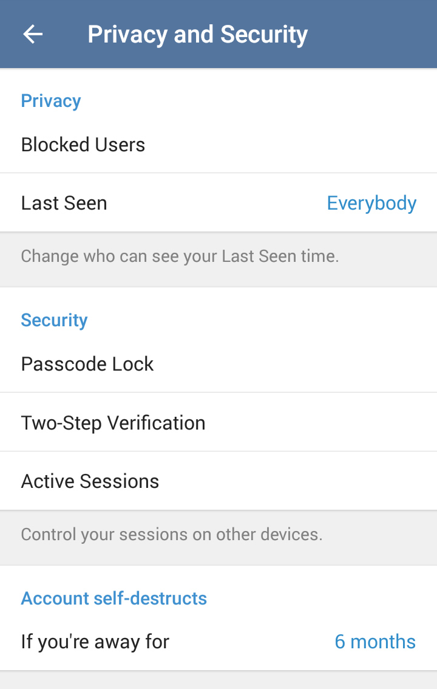

Aplikasi pesan instan Telegram kian menjadi pilihan utama bagi jutaan pengguna di seluruh dunia. Kecepatan sinkronisasi multiperangkat, kapasitas grup super besar, hingga kebebasan berbagi dokumen berukuran raksasa membuat platform ini sangat fleksibel untuk kebutuhan harian maupun urusan profesional. Namun, di balik segala keunggulannya, popularitas Telegram yang melonjak juga menjadikannya incaran empuk para peretas (hacker) dan penipu daring.

Mungkin Anda pernah mendengar teman tiba-tiba mengirimkan pesan pinjaman uang melalui akun Telegram mereka, padahal ponsel mereka sedang dipegang sendiri. Atau mungkin Anda pernah menerima notifikasi aneh berisi permintaan kode masuk perangkat baru dari kota yang belum pernah Anda kunjungi. Kasus pengambilalihan akun seperti ini bukanlah hal baru. Kabar baiknya, Telegram telah menyediakan barisan benteng keamanan canggih di dalam aplikasinya yang sering kali belum dimaksimalkan oleh para pengguna.

Jika Anda ingin melindungi percakapan pribadi, data penting, dan reputasi digital Anda, memahami cara amankan akun telegram dari hacker adalah langkah wajib yang harus dilakukan sekarang juga. Mari kita bedah setelan privasi dan fitur keamanan terbaik yang bisa Anda aktifkan dalam beberapa menit saja.

## Mengapa Akun Telegram Sangat Rawan Diincar Peretas

Banyak orang mengira peretasan akun Telegram selalu melibatkan teknik pembobolan sistem server tingkat tinggi. Faktanya, sebagian besar kasus pengambilalihan akun justru terjadi akibat kelemahan pada rantai komunikasi dasar pengguna, antara lain:

1. **Penyadapan dan Rekayasa SMS OTP (*SIM Swap*):** Secara baku, Telegram mengirimkan kode verifikasi login melalui SMS ke nomor ponsel Anda. Jika nomor Anda terkena duplikasi kartu SIM (*SIM swap fraud*) atau ponsel Anda terinfeksi aplikasi jahat pembaca SMS, peretas dapat meminta kode login tanpa sepengetahuan Anda.
2. **Rekayasa Sosial dan Phishing Bot:** Modus paling lazim saat ini adalah akun palsu yang berpura-pura menjadi tim dukungan Telegram atau bot verifikasi grup. Korban diminta mengklik tautan khusus atau memasukkan nomor ponsel dan kode verifikasi untuk memvalidasi akun, yang langsung dikirimkan ke tangan peretas.
3. **Pencurian Sesi Login Komputer (*Session Hijacking*):** Pengguna yang sering login di Telegram Desktop atau Telegram Web pada komputer kantor atau kafe internet rentan disusupi malware tipe *info-stealer*. Malware ini mampu menyalin berkas sesi lokal sehingga peretas bisa langsung masuk tanpa meminta kode baru.
4. **Kebocoran Alamat IP:** Secara bawaan, panggilan suara dan video Telegram dapat menghubungkan dua perangkat secara langsung (*peer-to-peer*). Bila fitur ini tidak diatur, pihak ketiga dapat menganalisis paket data untuk menemukan alamat IP asli Anda dan mengetahui perkiraan lokasi fisik Anda.

Melihat beragam celah tersebut, mengandalkan proteksi standar bawaan pabrik jelas tidak cukup. Anda memerlukan beberapa lapis perlindungan tambahan.

## Langkah Demi Langkah Mengamankan Akun Telegram

Berikut adalah panduan lengkap dan teruji untuk memperkuat pertahanan akun Telegram Anda agar kebal terhadap berbagai metode peretasan modern.

### 1. Aktifkan Verifikasi Dua Langkah (Two-Step Verification)

Ini adalah tameng terpenting yang wajib dimiliki setiap pemilik akun Telegram. Tanpa fitur ini, siapa pun yang berhasil membaca SMS verifikasi login Anda dapat langsung mengambil alih akun. Dengan Verifikasi Dua Langkah, Telegram mewajibkan kata sandi tambahan (*cloud password*) setiap kali ada upaya login baru dari perangkat mana pun.

Langkah mengaktifkannya:
1. Buka aplikasi **Telegram** di ponsel Anda.
2. Ketuk ikon garis tiga di pojok kiri atas (Android) atau menu **Settings** di pojok kanan bawah (iOS).
3. Masuk ke menu **Privasi dan Keamanan** (*Privacy and Security*).
4. Gulir ke bawah dan ketuk opsi **Verifikasi Dua Langkah** (*Two-Step Verification*).
5. Pilih tombol **Atur Kata Sandi Tambahan** (*Set Password*).
6. Buat kata sandi yang kuat (kombinasi huruf besar, huruf kecil, angka, dan simbol khusus).
7. Buat petunjuk kata sandi (*hint*) yang hanya dipahami oleh Anda sendiri.
8. Masukkan alamat email pemulihan yang aktif. Langkah ini sangat krusial agar Anda tetap dapat memulihkan akun jika suatu saat lupa kata sandi.
9. Buka kotak masuk email Anda, lalu masukkan kode konfirmasi yang dikirimkan Telegram untuk menyelesaikan proses aktivasi.

*Sumber: [Telegram Blog](https://telegram.org/blog/sessions-and-2-step-verification)*

### 2. Audit dan Putus Sesi Perangkat yang Mencurigakan

Fitur sinkronisasi multiperangkat Telegram memang sangat nyaman, tetapi juga bisa menjadi bumerang bila ada sesi yang tertinggal di perangkat lain. Anda harus secara rutin memeriksa daftar perangkat yang sedang terhubung ke akun Anda.

Cara meninjau dan menghapus sesi asing:
1. Buka **Pengaturan** > **Perangkat** (*Devices*). Pada beberapa versi aplikasi lama, opsi ini berada di dalam *Privasi dan Keamanan* > *Sesi Aktif* (*Active Sessions*).
2. Perhatikan bagian **Sesi Aktif** (*Active Sessions*). Di sana tercantum merek ponsel, sistem operasi komputer, perkiraan lokasi geografis, dan alamat IP perangkat yang sedang login.
3. Jika Anda melihat perangkat aneh yang tidak Anda kenali, segera ketuk nama perangkat tersebut lalu pilih **Hentikan Sesi** (*Terminate Session*).
4. Anda juga dapat memilih opsi **Hentikan Semua Sesi Lainnya** (*Terminate all other sessions*) untuk langsung mengeluarkan seluruh perangkat selain ponsel utama yang sedang Anda genggam.
5. Manfaatkan fitur **Putuskan sesi secara otomatis jika tidak aktif** (*Automatically terminate old sessions*). Anda bisa memilih jangka waktu, misalnya 1 minggu, 1 bulan, atau 3 bulan, agar sesi di komputer yang sudah lama tidak dipakai akan otomatis terputus sendiri.

### 3. Kunci Aplikasi Telegram dengan Kode Sandi (Passcode Lock)

Jika ponsel Anda sering dipinjam oleh kerabat, rekan kerja, atau tertinggal di atas meja, siapa pun bisa membaca obrolan pribadi Anda secara fisik. Mengaktifkan kunci kode sandi internal Telegram akan memberikan proteksi ganda bahkan saat layar ponsel utama sedang dalam keadaan terbuka.

Cara menyalakan kunci aplikasi:
1. Masuk ke **Pengaturan** > **Privasi dan Keamanan**.
2. Pilih menu **Kunci Kode Sandi** (*Passcode Lock*).
3. Geser sakelar ke posisi aktif, lalu tentukan 4 digit PIN atau kata sandi alfanumerik yang berbeda dari kunci layar utama ponsel Anda.
4. Aktifkan opsi **Buka dengan Biometrik** (*Unlock with Fingerprint* atau *Face ID*) untuk akses yang cepat dan nyaman.
5. Atur menu **Kunci Otomatis** (*Auto-lock*) ke opsi *Jika keluar selama 1 menit* atau *5 menit*. Dengan setelan ini, aplikasi Telegram akan langsung terkunci begitu Anda beralih ke aplikasi lain.

### 4. Batasi Visibilitas Nomor Telepon dan Panggilan Suara

Nomor ponsel adalah identitas utama akun Telegram Anda. Jika nomor ini terlihat oleh sembarang orang di grup publik, pelaku kejahatan dapat menggunakannya sebagai target serangan rekayasa sosial atau panggilan penipuan terarah.

Setelan privasi nomor dan panggilan yang disarankan:
- **Nomor Telepon (*Phone Number*):** Masuk ke *Pengaturan* > *Privasi dan Keamanan* > *Nomor Telepon*. Ubah opsi *Siapa yang dapat melihat nomor saya* menjadi **Tidak Ada** (*Nobody*) atau **Kontak Saya** (*My Contacts*). Pada opsi *Siapa yang dapat menemukan saya dengan nomor saya*, pastikan memilih **Kontak Saya**. Setelan ini mencegah orang asing mencocokkan nomor bocor di internet dengan profil Telegram Anda.
- **Panggilan Suara dan Video (*Calls*):** Masuk ke menu *Panggilan*. Pada bagian *Peer-to-Peer*, ubah dari *Semua Orang* menjadi **Kontak Saya** atau **Jangan Pernah** (*Never*). Dengan menonaktifkan sambungan langsung peer-to-peer, seluruh panggilan telepon akan dirutekan melalui peladen Telegram yang terenkripsi, sehingga alamat IP asli perangkat Anda tetap aman dan tersembunyi.
- **Pesan Diteruskan (*Forwarded Messages*):** Atur opsi ini ke **Kontak Saya** atau **Tidak Ada**. Dengan demikian, saat seseorang meneruskan pesan Anda ke ruang obrolan lain, tautan profil asli Anda tidak dapat diklik oleh penerima pesan tersebut.

### 5. Batasi Undangan Grup dan Saluran Otomatis

Pernahkah akun Anda mendadak masuk ke grup investasi bodong, lelang fiktif, atau channel kripto mencurigakan tanpa persetujuan Anda? Para spammer menggunakan bot otomatis untuk menarik ribuan pengguna secara acak ke dalam sarang penipuan mereka.

Untuk menghentikan praktik menjengkelkan ini:
1. Buka **Pengaturan** > **Privasi dan Keamanan** > **Grup dan Saluran** (*Groups & Channels*).
2. Ubah pengaturan *Siapa yang dapat menambahkan saya* dari opsi *Semua Orang* (*Everybody*) menjadi **Kontak Saya** (*My Contacts*).
3. Bila ada kontak tertentu yang sering menambahkan Anda ke grup spam keluarga atau kantor tanpa izin, Anda bisa memasukkan mereka ke dalam daftar pengecualian (*Never Allow*).

### 6. Matikan Unduh Otomatis Berkas dan Waspadai Bot Phishing

Peretas kerap memanfaatkan berkas media untuk menyisipkan program jahat. Dokumen dengan ekstensi berbahaya seperti file installer Android palsu (.apk), skrip komputer (.scr atau .bat), atau berkas arsip (.zip) sering kali disamarkan dengan nama-nama menarik di dalam channel dan grup.

Langkah pencegahan tambahan:
- **Atur Unduh Media Otomatis (*Automatic Media Download*):** Masuk ke menu *Pengaturan* > *Data dan Penyimpanan* (*Data and Storage*). Matikan unduhan otomatis untuk kategori *Berkas* (*Files*), baik saat menggunakan data seluler maupun jaringan Wi-Fi. Dengan demikian, tidak ada berkas asing yang terunduh ke memori ponsel Anda tanpa izin manual.
- **Jangan Pernah Bagikan Kode OTP:** Telegram resmi tidak akan pernah mengirimkan pesan pribadi (*direct message*) untuk meminta kode verifikasi, tautan reset, atau kata sandi cloud Anda. Jika Anda menerima pesan dari akun berlabel resmi palsu yang mendesak Anda mengirimkan tangkapan layar kode login, segera laporkan dan blokir akun tersebut.

Mengamankan akun digital bukanlah tugas yang rumit, melainkan soal kedisiplinan menerapkan langkah pencegahan sejak awal. Dengan meluangkan waktu sejenak untuk menyalakan verifikasi dua langkah, memutus sesi yang tidak terpakai, dan memperketat setelan privasi di atas, akun Telegram Anda akan memiliki benteng pertahanan yang sangat kokoh dan sulit ditembus oleh peretas.

> **Baca Juga:**
> - [Panduan Lengkap Amankan Akun Instagram](/panduan-lengkap-amankan-akun-instagram/)
> - [Panduan Lengkap Cek Kebocoran Data Nomor HP](/panduan-lengkap-cek-kebocoran-data-nomor-hp/)

Sumber: [Telegram FAQ](https://telegram.org/faq)
