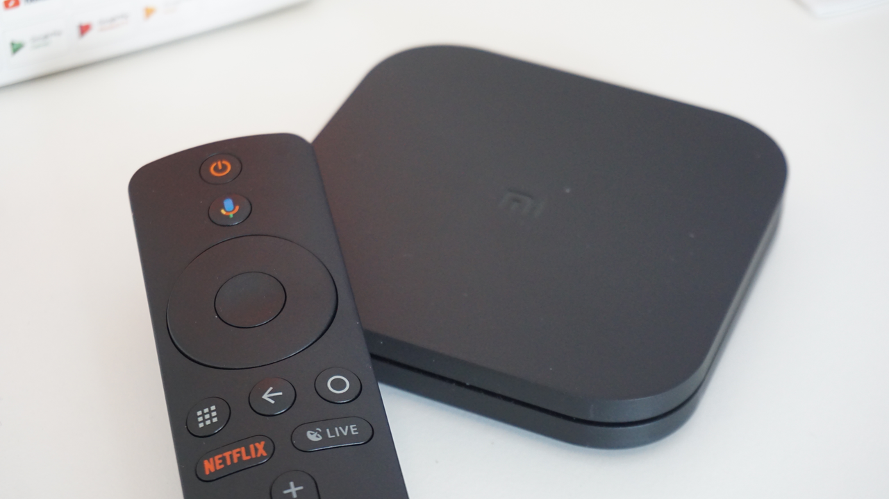

Pernahkah Anda menyalakan Smart TV di ruang keluarga, berniat menonton serial akhir pekan, tetapi navigasi remote terasa sangat berat dan patah-patah?

Aplikasi streaming seperti YouTube, Netflix, atau Vidio yang biasanya terbuka dalam hitungan detik tiba-tiba berhenti di layar logo atau bahkan keluar sendiri ke menu beranda. Reaksi pertama kebanyakan orang biasanya menyalahkan koneksi Wi-Fi yang dianggap sedang lambat atau remote TV yang kehabisan baterai.

Awalnya saya juga mengira hal serupa saat smart TV di rumah mulai terasa lemot. Namun, setelah memeriksa lebih teliti, akar masalahnya sering kali bukan pada sinyal internet, melainkan tumpukan file sampah sementara atau cache aplikasi yang sudah memenuhi ruang penyimpanan internal televisi.

Memahami cara kerja cache dan langkah membersihkannya secara teratur adalah solusi paling praktis untuk mengembalikan kelincahan Android TV tanpa perlu melakukan reset pabrik.

## Mengapa Penyimpanan Android TV Cepat Penuh

Berbeda dengan smartphone masa kini yang rata-rata sudah dibekali memori internal 128 GB hingga 256 GB, sebagian besar Android TV dan smart TV box di pasaran hanya memiliki ruang penyimpanan bawaan sebesar 8 GB atau paling banyak 16 GB. Dari kapasitas kotor tersebut, separuhnya sudah terpotong oleh sistem operasi Android dan aplikasi bawaan pabrik.

Pengguna praktis hanya memiliki ruang bebas sekitar 3 GB sampai 4 GB untuk memasang aplikasi hiburan baru.

Di sisi lain, kebiasaan aplikasi pada layar televisi menuntut pengelolaan data yang cukup rakus. Berdasarkan dokumentasi resmi pengembang Android TV, aplikasi hiburan di layar besar harus memuat puluhan poster film beresolusi tinggi, banner cuplikan video berukuran penuh, serta buffer streaming ke dalam memori.

Setiap kali Anda menjelajahi katalog tontonan, gambar pratinjau tersebut disimpan ke memori penyimpanan lokal sebagai cache agar tidak perlu diunduh berulang-ulang dari internet. Seiring berjalannya waktu, cache dari satu aplikasi saja bisa membengkak hingga ratusan megabita atau bahkan hitungan gigabita. Saat ruang penyimpanan internal tersisa di bawah 500 MB, sistem Android TV akan mulai kepayahan menjalankan proses dasar di latar belakang.

*Sumber: [Xiaomi / Wikimedia Commons](https://commons.wikimedia.org/wiki/File:Xiaomi_Mi_Box_S.jpg)*

## Perbedaan Hapus Cache dan Hapus Data

Kekhawatiran yang paling sering muncul saat ingin membersihkan TV adalah takut kehilangan riwayat tontonan atau harus memasukkan ulang kata sandi aplikasi streaming yang panjang menggunakan remote TV.

Kabar baiknya, sistem Android memisahkan dengan sangat tegas antara opsi **Hapus Cache** (*Clear Cache*) dan **Hapus Data** (*Clear Data*).

- **Hapus Cache:** Tindakan ini hanya menghapus file-file sementara seperti thumbnail gambar poster, potongan file pemutaran video lama, dan berkas pratinjau yang tidak krusial. Akun login Anda, riwayat tontonan, daftar film favorit (*watchlist*), serta profil pengguna di dalam aplikasi tetap utuh dan tidak terhapus.
- **Hapus Data:** Opsi ini mereset aplikasi sepenuhnya ke kondisi awal saat baru dipasang. Semua informasi login, berkas unduhan luring, dan preferensi pengaturan akan terhapus. Opsi ini sebaiknya hanya dipilih jika aplikasi mengalami galat (*error*) parah yang tidak kunjung sembuh setelah cache dibersihkan.

Untuk pemeliharaan rutin harian atau bulanan, Anda cukup memilih opsi Hapus Cache saja.

## Langkah Praktis Membersihkan Cache di Android TV

Prosedur pembersihan ini dapat diterapkan pada hampir semua televisi pintar beroperasi Android TV murni maupun antarmuka Google TV modern seperti Sony Bravia, Xiaomi TV, TCL, Coocaa, realme TV, hingga perangkat TV box dan TV stick.

Berikut tahapan lengkapnya:

1. **Buka Menu Setelan (Settings):**
   Nyalakan televisi Anda, lalu arahkan remote control ke pojok kanan atas layar beranda dan klik ikon roda gigi **Setelan**. Pada beberapa remote TV, Anda juga bisa langsung menekan tombol bergambar roda gigi khusus.

2. **Pilih Menu Aplikasi:**
   Pada daftar pengaturan yang muncul di sisi kanan layar, gulir ke bawah dan pilih menu **Aplikasi** (*Apps*). Selanjutnya, klik opsi **Lihat semua aplikasi** (*See all apps*) agar seluruh perangkat lunak yang terpasang ditampilkan lengkap.

3. **Pilih Aplikasi Streaming Utama:**
   Cari aplikasi yang paling sering digunakan untuk menonton dan mendengarkan musik, seperti YouTube, Netflix, Disney+ Hotstar, Prime Video, Spotify, atau peramban web TV. Aplikasi-aplikasi inilah yang biasanya menjadi penyumbang cache terbesar.

4. **Eksekusi Hapus Cache:**
   Klik pada nama aplikasi tersebut untuk membuka jendela rincian informasi. Gulir ke bawah hingga menemukan baris **Hapus cache** (*Clear cache*). Klik opsi tersebut, lalu konfirmasi dengan memilih **Oke** saat kotak dialog muncul. Anda akan melihat angka ukuran cache langsung berubah menjadi nol bita atau beberapa kilobita kecil.

5. **Ulangi pada Aplikasi Lain dan Layanan Google:**
   Ulangi langkah pembersihan di atas pada dua atau tiga aplikasi hiburan utama lainnya. Jika toko aplikasi sering gagal mengunduh atau memperbarui aplikasi, Anda juga bisa membersihkan cache untuk **Google Play Store** dan **Layanan Google Play** yang berada di kelompok aplikasi sistem.

6. **Lakukan Mulai Ulang (Restart) Penuh:**
   Setelah membersihkan cache aplikasi utama, sangat dianjurkan untuk me-restart televisi. Jangan hanya menekan tombol power remote yang biasanya sekadar memicu mode siaga (*standby*). Buka menu **Setelan** > **Preferensi Perangkat** atau **Sistem** > **Tentang**, lalu pilih opsi **Mulai Ulang** (*Restart*). Anda juga bisa mencabut colokan listrik televisi selama sekitar tiga puluh detik lalu memasangnya kembali.

## Tips Menjaga Kinerja TV Android Tetap Responsif

Membersihkan cache secara berkala setiap beberapa minggu sekali memang sangat membantu menjaga kelancaran televisi. Namun, ada beberapa kebiasaan baik lain yang bisa diterapkan agar performa TV tidak cepat loyo:

- **Hindari Memasang Aplikasi Pembersih Pihak Ketiga:**
  Di Google Play Store banyak tersedia aplikasi bertajuk *cleaner*, *ram booster*, atau *task killer*. Di Android TV, aplikasi semacam ini justru sering berjalan terus-menerus di latar belakang, memakan alokasi RAM yang berharga, dan memunculkan notifikasi promosi yang mengganggu. Fitur bawaan sistem Android sudah lebih dari cukup.
- **Hapus Aplikasi dan Game yang Tidak Pernah Digunakan:**
  Jika Anda pernah memasang game atau aplikasi coba-coba beberapa bulan lalu yang kini tidak lagi disentuh, segera copot pemasangannya (*uninstall*). Hal ini akan memberikan napas lega bagi memori internal perangkat.
- **Cek Pembaruan Firmware Sistem Secara Teratur:**
  Produsen televisi dan Google secara berkala merilis pembaruan perangkat lunak untuk menambal celah keamanan serta mengoptimalkan konsumsi memori sistem. Periksa menu **Setelan** > **Tentang** > **Update Software Sistem** untuk memastikan televisi menjalankan versi terbaru.

Langkah sederhana membersihkan cache ini terbukti ampuh mengembalikan kelancaran navigasi smart TV tanpa biaya dan tanpa risiko kehilangan data tontonan kesayangan keluarga.

Sumber: [Google Android TV Help](https://support.google.com/androidtv/answer/7308736?hl=id)
