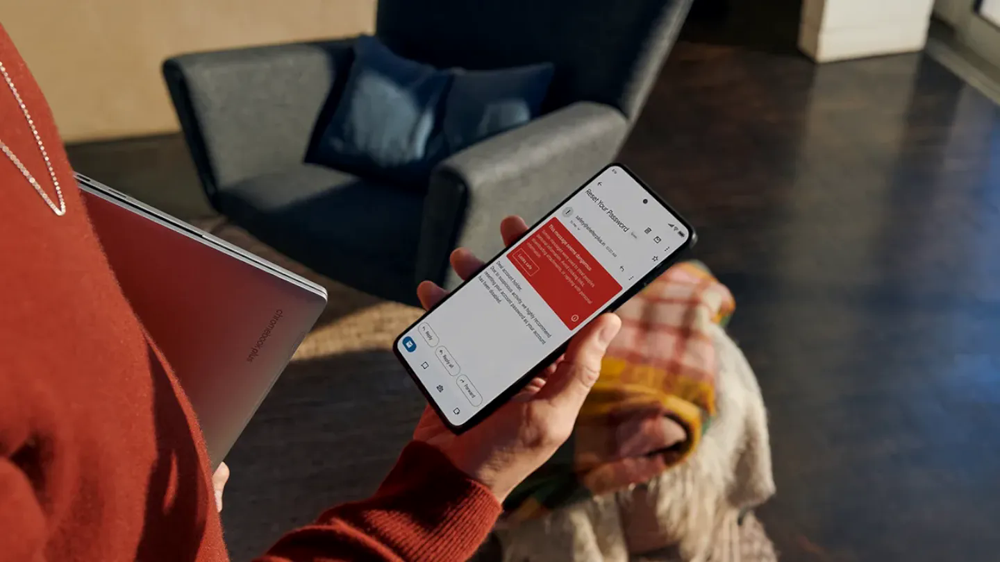

Pernahkah Anda sedang asyik menyelesaikan pekerjaan penting atau sedang beristirahat di akhir pekan, tiba-tiba smartphone Xiaomi kesayangan Anda berdering nyaring? Begitu diangkat, ternyata suara robot otomatis atau sales yang menawarkan pinjaman online tanpa jaminan, asuransi yang tidak pernah Anda minta, hingga tawaran undian berhadiah mencurigakan. Situasi seperti ini tentu sangat menjengkelkan dan membuang waktu berharga Anda.

Panggilan spam dan pesan penipuan melalui SMS saat ini kian marak terjadi di Indonesia. Para pelaku sering memanfaatkan sistem pemanggil otomatis (robocall) dan teknik manipulasi identitas (caller spoofing) untuk menyasar ribuan nomor secara acak. Kabar baiknya, Anda tidak perlu terburu-buru memasang aplikasi pelacak pihak ketiga yang kerap meminta izin kontak berlebihan, menghabiskan memori RAM, atau menyisipkan iklan yang tidak kalah mengganggu.

Smartphone Xiaomi, Redmi, maupun POCO yang menjalankan antarmuka MIUI hingga Xiaomi HyperOS terbaru telah dibekali serangkaian fitur perlindungan spam tingkat lanjut. Memahami cara blokir nomor spam di hp xiaomi dengan tepat akan membantu Anda mengembalikan ketenangan hari-hari Anda tanpa perlu khawatir melewatkan panggilan penting dari keluarga atau rekan kerja.

Mari kita bahas secara menyeluruh bagaimana sistem penyaringan nomor di ponsel Xiaomi bekerja serta langkah demi langkah mengaktifkannya.

## Memahami Sistem Pemblokir Spam di HP Xiaomi

Sebelum masuk ke panduan teknis, penting untuk mengetahui bahwa ponsel Xiaomi yang beredar resmi di Indonesia dan pasar global menggunakan dua pilar perlindungan utama:

1. **Aplikasi Telepon dan Pesan Bawaan Google:** Sebagian besar lini ponsel Xiaomi, Redmi, dan POCO generasi modern hadir dengan aplikasi Google Phone (Telepon) dan Google Messages sebagai dialer default. Sistem ini terintegrasi langsung dengan database keamanan Google yang secara otomatis mencocokkan nomor penelepon dengan jutaan laporan spam global.
2. **Aplikasi Keamanan Bawaan Xiaomi (Security App):** Xiaomi melengkapi sistem operasinya dengan modul perlindungan privasi yang mampu menyaring panggilan dan pesan berdasarkan aturan ketat, seperti memblokir nomor tersembunyi (private number), awalan nomor tertentu, hingga kata kunci promosi.

Kedua lapisan pertahanan ini dapat Anda maksimalkan secara gratis tanpa memerlukan aplikasi tambahan apa pun.

## Langkah 1: Aktifkan ID Penelepon dan Filter Panggilan Spam

Langkah pertama dan paling mendasar adalah mengaktifkan teknologi kecerdasan buatan Google untuk menyaring panggilan masuk sebelum ponsel Anda berdering. Fitur ini akan memeriksa nomor asing ke database server keamanan secara instan.

Berikut cara mengaktifkannya:

1. Buka aplikasi **Telepon** (*Phone*) di HP Xiaomi Anda.
2. Ketuk ikon **titik tiga** di sudut kanan atas layar.
3. Pilih opsi **Setelan** (*Settings*).
4. Masuk ke menu **ID Penelepon & spam** (*Caller ID & spam*).
5. Aktifkan sakelar **Lihat ID penelepon dan spam** (*See caller and spam ID*).
6. Selanjutnya, aktifkan juga opsi **Filter panggilan spam** (*Filter spam calls*).

Ketika fitur Filter panggilan spam aktif, setiap panggilan yang teridentifikasi kuat sebagai telemarketing nakal, robot penipuan, atau debt collector ilegal akan langsung ditolak oleh sistem tanpa membunyikan nada dering atau getaran. Anda tetap bisa melihat jejak panggilan tersebut di riwayat panggilan tanpa pernah terdistraksi saat panggilan berlangsung.

## Langkah 2: Blokir Nomor Tak Dikenal dan Nomor Privat

Spammer dan oknum penipu sering kali menggunakan fitur penyembunyi identitas (*Private Number* atau *Unknown*) agar nomor mereka tidak dapat dilacak. Anda bisa memerintahkan HP Xiaomi untuk secara otomatis menolak panggilan dari nomor-nomor tanpa identitas tersebut.

Ikuti tahapan berikut:

1. Masuk kembali ke aplikasi **Telepon** lalu buka menu **Setelan*.*
2. Gulir ke bawah dan ketuk opsi **Nomor yang diblokir** (*Blocked numbers*).
3. Geser toggle pada opsi **Tidak dikenal** (*Unknown*) ke posisi aktif.

Perlu dicatat bahwa opsi ini memblokir panggilan dari penelepon yang sengaja menyembunyikan nomor atau tidak menampilkan ID penelepon. Panggilan dari kurir pengantar paket atau rekan baru yang nomornya tetap terlihat jelas namun belum tersimpan di kontak Anda tetap akan masuk secara normal.

## Langkah 3: Blokir Nomor Pengganggu Secara Manual dan Laporkan

Jika ada satu nomor sales gigih atau nomor asing tertentu yang masih berhasil lolos dari filter otomatis, Anda dapat menghentikannya secara permanen melalui riwayat panggilan:

1. Buka tab **Terbaru** (*Recents*) pada aplikasi Telepon.
2. Cari nomor telepon mencurigakan yang baru saja menghubungi Anda.
3. Sentuh dan tahan nomor tersebut selama 1-2 detik hingga menu sembulan muncul.
4. Pilih opsi **Blokir / laporkan spam** (*Block / report spam*).
5. Beri tanda centang pada kotak *Laporkan panggilan sebagai spam*, lalu tekan tombol **Blokir**.

Dengan mencentang opsi pelaporan spam, nomor tersebut tidak hanya diblokir dari ponsel Anda, namun informasinya juga akan dikirimkan ke server untuk memperkuat perlindungan bagi seluruh pengguna Android lainnya di Indonesia.

*Sumber: [Android Official Blog](https://www.android.com/intl/en_uk/articles/stop-spam-calls-android/)*

## Langkah 4: Tangkal SMS Spam dan Tautan Phishing di Aplikasi Pesan

Selain lewat telepon suara, teror spam yang sangat berbahaya adalah melalui pesan SMS. Modus penipuan berkedok tagihan tilang elektronik, undangan pernikahan palsu berformat APK, serta tautan judi online kerap menyusup ke kotak masuk Anda.

Anda dapat memblokir pesan-pesan berbahaya ini secara otomatis melalui fitur proteksi bawaan:

1. Buka aplikasi **Pesan** (*Messages*) di ponsel Xiaomi Anda.
2. Ketuk ikon foto profil akun Anda di sudut kanan atas.
3. Pilih menu **Setelan Pesan** (*Messages settings*).
4. Gulir ke bawah lalu ketuk menu **Perlindungan spam** (*Spam protection*).
5. Geser sakelar **Aktifkan perlindungan spam** (*Enable spam protection*) ke posisi aktif.

Setelah diaktifkan, sistem akan memindai pola teks dan tautan yang mencurigakan. Setiap SMS promosi liar atau upaya phishing akan langsung dialihkan ke folder khusus bernama *Spam & diblokir* tanpa memicu notifikasi berisik di bilah status ponsel Anda.

## Langkah 5: Maksimalkan Daftar Blokir di Aplikasi Keamanan Xiaomi

Bagi pengguna ponsel Xiaomi dengan ROM tertentu yang masih menggunakan dialer khas MIUI atau ingin perlindungan tambahan berbasis sistem HyperOS, Anda dapat memanfaatkan aplikasi **Keamanan** (*Security*):

1. Buka aplikasi **Keamanan** bawaan yang berikon perisai hijau di layar utama.
2. Gulir ke bagian bawah pada menu alat dan pilih **Daftar Blokir** (*Blocklist*).
3. Ketuk ikon **gerigi setelan** di sudut kanan atas untuk membuka konfigurasi lanjutan:
   - **Daftar blokir panggilan:** Anda dapat memilih untuk memblokir panggilan dari orang asing, memblokir nomor tersembunyi, atau memblokir nomor dari luar negeri (panggilan internasional).
   - **Daftar blokir SMS:** Anda dapat menambahkan kata kunci tertentu (seperti pinjol, dana cepat, slot, menang undian) ke daftar kata kunci yang diblokir, sehingga pesan yang mengandung kata-kata tersebut akan langsung dibuang otomatis.
   - **Nomor yang diblokir:** Anda bisa memasukkan awalan nomor (prefix) tertentu yang sering kali menjadi sumber telepon promosi massal.

## Cara Memeriksa dan Membuka Kembali Nomor yang Terblokir

Terkadang, ada situasi di mana nomor kontak rekan kerja, sekolah anak, atau penyedia layanan penting tidak sengaja ikut terblokir. Anda dapat memeriksa dan memulihkannya kapan saja dengan cara yang sangat mudah:

1. Buka aplikasi **Telepon**, ketuk ikon titik tiga di pojok kanan atas, lalu masuk ke **Setelan*.*
2. Pilih menu **Nomor yang diblokir*.*
3. Di halaman ini, Anda akan melihat daftar lengkap seluruh nomor telepon yang pernah Anda blokir sebelumnya.
4. Untuk menghapus nomor dari daftar blokir, cukup ketuk ikon tanda silang (X) di samping nomor yang bersangkutan, kemudian konfirmasi dengan mengetuk **Buka blokir** (*Unblock*).

Nomor tersebut kini bisa kembali menghubungi dan mengirimkan pesan ke smartphone Anda secara normal.

## Tips Menjaga Nomor HP Agar Tidak Menjadi Sasaran Spammer

Penyaringan di tingkat perangkat merupakan benteng pertahanan terakhir. Agar nomor ponsel Anda tidak terus-menerus diincar oleh sindikat telemarketing nakal, terapkan kebiasaan digital yang bijak berikut:

- **Jangan Sembarangan Mengisi Formulir Publik:** Hindari mencantumkan nomor telepon pribadi pada kuesioner acak di pusat perbelanjaan, giveaway media sosial yang tidak jelas legalitasnya, atau formulir daring publik.
- **Gunakan Nomor Sekunder untuk Transaksi Online:** Jika Anda sering berbelanja di berbagai marketplace atau mendaftar aplikasi kurir, pertimbangkan untuk memiliki kartu SIM khusus atau nomor virtual terpisah dari nomor utama perbankan dan keluarga.
- **Waspadai Jebakan Konfirmasi Panggilan:** Jika Anda menerima panggilan dari nomor mencurigakan dan terdengar suara robot yang meminta Anda menekan angka 1 atau berbicara, segera tutup panggilan tersebut. Merespons panggilan otomatis justru mengonfirmasi kepada mesin spammer bahwa nomor Anda aktif digunakan.
- **Selalu Perbarui Patch Keamanan HyperOS:** Xiaomi secara rutin merilis pembaruan keamanan bulanan. Pembaruan ini penting untuk memastikan algoritma deteksi ancaman di ponsel Anda selalu mutakhir dalam mengenali metode manipulasi penipuan terbaru.

Menerapkan panduan cara blokir nomor spam di hp xiaomi secara menyeluruh di atas memastikan privasi dan ketenangan Anda saat beraktivitas sehari-hari akan terjaga optimal tanpa gangguan dering telepon palsu yang menguras energi.

> **Baca Juga:**
> - [Cara Hapus Malware di HP Samsung Tanpa Reset Pabrik](/cara-hapus-malware-di-hp-samsung/)
> - [Cara Blokir Panggilan Spam di iPhone Tanpa Aplikasi Tambahan](/cara-blokir-panggilan-spam-di-iphone/)

Sumber: [Xiaomi Support](https://www.mi.com/global/support/faq/details/KA-539342)