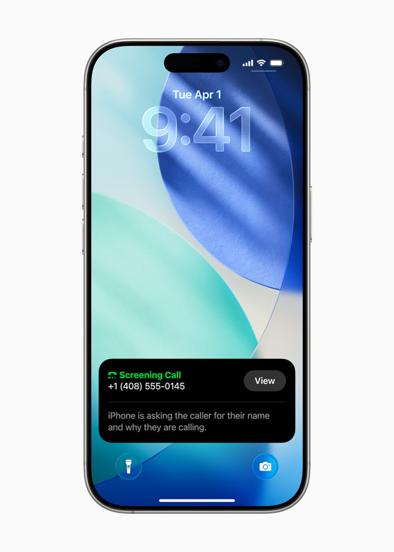

Pernahkah Anda sedang asyik menyelesaikan pekerjaan penting, menikmati istirahat makan siang, atau bahkan tengah tertidur lelap, lalu mendadak nada dering iPhone berbunyi kencang? Saat layar dilihat, yang muncul hanyalah deretan angka tidak dikenal dengan awalan kode wilayah asing. Begitu panggilan diangkat, suara rekaman otomatis langsung menawarkan pinjaman online kilat, promo kartu kredit, atau malah hening tanpa suara karena panggilan tersebut digerakkan oleh mesin *robocall*.

Pengalaman seperti ini jelas sangat menjengkelkan. Selain membuang waktu, panggilan spam dan potensi penipuan (*scam*) berisiko menjebak pengguna yang kurang waspada. Sebagian orang memilih menolak panggilan satu per satu secara manual. Sayangnya, para pelaku telemarketing gelap dan sindikat penipuan kerap berganti-ganti nomor dengan sangat cepat, sehingga memblokir satu nomor saja hampir tidak pernah menuntaskan masalah.

Untungnya, sistem operasi iOS pada iPhone telah dibekali serangkaian alat pertahanan yang sangat mumpuni untuk menangani gangguan ini. Anda tidak perlu langsung memasang aplikasi pihak ketiga yang rakus izin akses kontak. Dengan memahami cara blokir panggilan spam di iphone lewat pengaturan bawaan, Anda bisa menikmati hari-hari yang lebih tenang tanpa dering ponsel yang mengganggu.

## Mengapa Panggilan Spam Begitu Sering Masuk ke Ponsel Kita?

Sebelum melangkah ke panduan teknis, ada baiknya kita memahami mengapa nomor ponsel kita bisa menjadi sasaran empuk panggilan spam. Di era digital saat ini, nomor telepon sering kali menjadi identitas utama saat kita mendaftar di lokapasar, mengisi formulir undian, memesan transportasi online, hingga menyerahkan kontak saat bertransaksi di gerai luring.

Celah kebocoran data (*data breach*) dari platform yang kurang aman, pialang data (*data broker*) nakal, hingga mesin pembuat nomor acak (*auto-dialer*) bekerja setiap hari untuk menyortir nomor-nomor aktif. Menariknya, kebiasaan langsung mengangkat lalu mematikan panggilan asing justru mengirimkan sinyal konfirmasi ke server pelaku bahwa nomor Anda benar-benar aktif dan dipantau manusia. Akibatnya, nomor Anda justru akan dimasukkan ke dalam daftar prioritas target panggilan berikutnya.

*Sumber: [Apple Newsroom](https://www.apple.com/newsroom/2025/06/apple-elevates-the-iphone-experience-with-ios-26/)*

## Tiga Lapis Pertahanan Bawaan iOS untuk Menangkal Spam

Apple merancang pendekatan keamanan panggilan dengan konsep berlapis. Anda memiliki kendali penuh untuk menentukan seberapa ketat iPhone menyaring panggilan masuk, mulai dari mematikan dering nomor tak dikenal hingga meminta alasan panggilan sebelum ponsel berdering.

### 1. Heningkan Penelepon yang Tidak Dikenal (*Silence Unknown Callers*)

Fitur ini merupakan benteng paling ampuh jika Anda sudah sangat muak dengan serbuan panggilan promosi. Saat fitur ini aktif, iPhone tidak akan berdering maupun bergetar untuk nomor yang belum pernah terhubung dengan Anda. Panggilan tersebut akan langsung dibisukan, dialihkan ke pesan suara jika tersedia, dan tetap dicatat rapi di daftar riwayat panggilan (*Recents*) agar Anda bisa memeriksanya kemudian.

Pertanyaannya, bagaimana jika ada panggilan penting dari nomor baru yang belum sempat Anda simpan? iOS menerapkan kecerdasan buatan lokal yang sangat cermat. iPhone tetap akan meloloskan panggilan dan membiarkannya berdering apabila:

- Nomor tersebut sudah tersimpan di dalam buku Kontak (*Contacts*) Anda.
- Anda pernah melakukan panggilan keluar ke nomor tersebut sebelumnya.
- Nomor tersebut pernah dikirimkan atau ditemukan dalam percakapan surel (Mail) maupun pesan teks, yang kemudian diidentifikasi oleh Saran Siri (*Siri Suggestions*).

Pengecualian khusus juga berlaku untuk situasi darurat. Apabila Anda baru saja menghubungi nomor panggilan darurat seperti 112 atau 911, fitur Heningkan Penelepon Tidak Dikenal akan otomatis dinonaktifkan sementara selama 24 jam penuh agar petugas penyelamat dapat menghubungi Anda kembali tanpa hambatan.

### 2. Fitur *Call Screening* dan Tanya Alasan Menelepon

Pada pembaruan sistem operasi iOS yang lebih segar, Apple memperluas kapabilitas *Live Voicemail* menjadi fitur penyaringan panggilan (*Call Screening*). Fitur cerdas ini bertindak layaknya asisten pribadi digital yang menjawab panggilan tak dikenal secara otomatis.

Ketika ada nomor asing memanggil, layar ponsel akan menampilkan opsi untuk meminta alasan menelepon (*Ask Reason for Calling*). Asisten virtual akan menyapa penelepon dan meminta mereka menyebutkan nama serta keperluan mereka. Suara penelepon akan ditranskripsikan menjadi teks secara langsung di layar iPhone Anda secara *real-time*. Jika pesan yang disampaikan ternyata adalah urusan penting, Anda bisa langsung mengetuk tombol jawab untuk berbicara. Sebaliknya, jika terbukti penawaran pinjol atau promosi robotik, Anda cukup membiarkannya atau langsung memutus panggilan.

### 3. Pemfilteran Panggilan Spam Bawaan (*Call Filtering*)

Melalui kerja sama dengan operator seluler yang didukung serta verifikasi Apple Business Connect, iPhone mampu mengenali panggilan bisnis resmi dan membedakannya dari potensi penipuan (*potential spam* atau *fraud*). Ketika fitur pemfilteran spam diaktifkan, nomor yang telah ditandai berbahaya oleh operator akan otomatis dibisukan dan dipindahkan ke folder khusus bertajuk Spam di aplikasi Telepon.

## Langkah Demi Langkah Mengaktifkan Pemblokiran di iPhone

Berikut adalah panduan praktis langkah demi langkah yang dapat Anda ikuti langsung pada perangkat iPhone Anda:

### Langkah 1: Masuk ke Pengaturan Telepon
Buka aplikasi **Pengaturan** (*Settings*) di layar utama iPhone Anda. Pada sistem iOS terbaru, gulir ke bawah lalu pilih menu **App**, kemudian ketuk **Telepon** (*Phone*). Jika Anda menggunakan versi iOS yang lebih lawas, menu Telepon biasanya langsung terlihat di halaman utama Pengaturan.

### Langkah 2: Atur Saring Nomor Tak Dikenal
Gulir layar ke bawah hingga Anda menemukan bagian bertajuk **Saring Nomor Tak Dikenal** (*Screen Unknown Callers*). Di sini Anda akan menjumpai tiga pilihan:
- **Tidak Pernah (*Never*):** Pengaturan standar di mana semua nomor akan membuat ponsel berdering.
- **Tanyakan Alasan Menelepon (*Ask Reason for Calling*):** Menyaring penelepon tak dikenal terlebih dahulu lewat asisten otomatis.
- **Heningkan (*Silence*):** Langsung membisukan nomor asing tanpa dering sama sekali dan mengalihkannya ke pesan suara.

Pilihlah opsi **Heningkan** untuk ketenangan maksimal, atau pilih **Tanyakan Alasan Menelepon** apabila Anda sering menerima panggilan dari rekan bisnis atau kurir pengiriman paket.

### Langkah 3: Nyalakan Pemfilteran Panggilan Spam
Pada halaman pengaturan Telepon yang sama, cari submenu **Pemfilteran Panggilan** (*Call Filtering*). Aktifkan tombol geser pada opsi **Spam**. Dengan begitu, nomor yang telah terdata dalam basis data operator sebagai nomor penipuan tidak akan lagi membunyikan nada dering di ponsel Anda.

### Langkah 4: Blokir Nomor Tertentu Secara Permanen
Jika ada nomor tertentu yang terus-menerus menghubungi Anda meski sudah berkali-kali ditolak, lakukan pemblokiran nomor permanen secara mandiri:
1. Buka aplikasi **Telepon**, lalu masuk ke tab **Terbaru** (*Recents*).
2. Temukan nomor spam yang bersangkutan, lalu ketuk ikon lingkaran huruf **i** di sebelah kanan nomor tersebut.
3. Gulir ke bagian paling bawah kartu kontak, kemudian ketuk teks merah bertuliskan **Blokir Penelepon Ini** (*Block this Caller*).
4. Konfirmasi tindakan Anda. Nomor tersebut tidak akan pernah bisa lagi mengirimkan panggilan suara, FaceTime, maupun SMS ke iPhone Anda.

## Kapan Perlu Menggunakan Aplikasi Identifikasi Pihak Ketiga?

Meskipun fitur bawaan Apple sudah sangat mumpuni, sebagian pengguna di Indonesia menghadapi karakteristik penipuan yang sangat dinamis, seperti nomor seluler prabayar perorangan yang dipakai secara bergantian untuk modus kurir palsu atau undangan pernikahan APK berbahaya.

Untuk menangani kasus spesifik ini, Anda dapat mengombinasikan fitur iOS dengan aplikasi identifikasi panggilan pihak ketiga tepercaya seperti Truecaller atau Getcontact. Menariknya, sistem keamanan iOS menggunakan kerangka kerja *CallKit* yang sangat melindungi privasi pengguna. 

Aplikasi pengenal nomor di iPhone tidak membaca daftar kontak pribadi Anda secara diam-diam. Sebaliknya, aplikasi tersebut hanya mengunduh daftar nomor spam yang telah dilaporkan komunitas ke dalam sistem lokal iPhone Anda. Saat ada panggilan masuk dari nomor yang cocok dengan daftar tersebut, iPhone akan langsung menampilkan label seperti *Spam Telkomsel*, *Debt Collector*, atau *Penipuan* di bawah nomor penelepon.

Untuk mengaktifkannya, cukup unduh aplikasi pilihan Anda dari App Store, lalu buka **Pengaturan** > **App** > **Telepon** > **Pemblokiran & Identifikasi Panggilan** (*Call Blocking & Identification*), kemudian aktifkan tombol izin untuk aplikasi tersebut.

## Tips Praktis Menjaga Privasi Nomor Ponsel Anda

Mengaktifkan fitur pemblokiran merupakan langkah kuratif yang hebat. Namun, menjaga kebiasaan digital yang sehat akan mencegah nomor Anda beredar lebih luas di lingkaran spammer:

- **Simpan nomor kurir atau langganan rutin:** Simpan nomor kurir langganan di wilayah perumahan Anda agar panggilan konfirmasi paket tidak ikut terheningkan secara tidak sengaja.
- **Gunakan nomor kedua untuk keperluan publik:** Jika Anda memiliki bisnis online atau sering memasukkan nomor kontak di formulir publik, pertimbangkan memakai nomor virtual atau kartu eSIM kedua khusus untuk urusan non-pribadi.
- **Hindari menanggapi SMS jebakan:** Jangan pernah membalas SMS dari nomor asing dengan kata apa pun, termasuk kata "STOP" atau "TIDAK", karena hal itu justru mengonfirmasi nomor Anda aktif ke sistem penjaring data.

Dengan mempraktikkan cara blokir panggilan spam di iphone ini, ponsel pintar kesayangan Anda akan kembali menjadi alat komunikasi yang nyaman, produktif, dan bebas dari teror dering yang tidak diinginkan.

> **Baca Juga:**
> - [Cara Sembunyikan Foto Video di iPhone dengan Face ID](/cara-sembunyikan-foto-video-di-iphone/)
> - [Cara Buka Kunci Aplikasi iPhone Praktis dan Mudah](/cara-buka-kunci-aplikasi-iphone/)

Sumber: [Apple Support](https://support.apple.com/id-id/111106)
