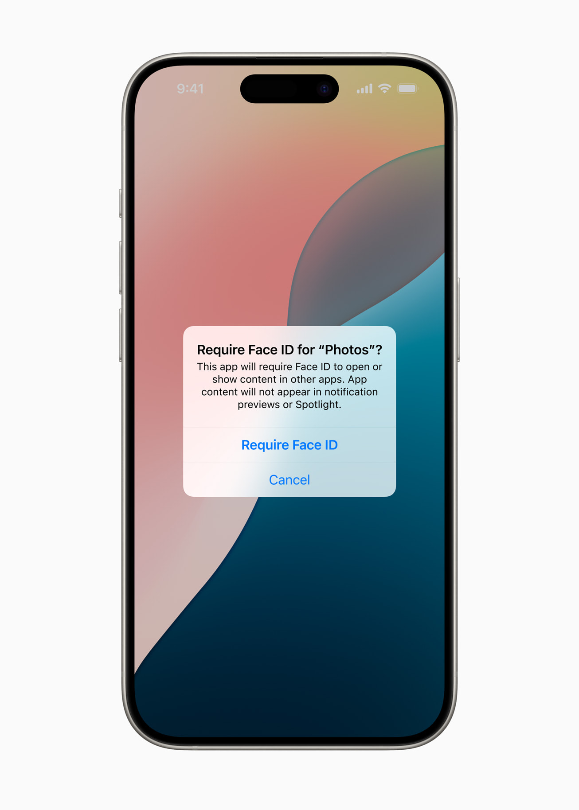

Pernahkah Anda meminjamkan iPhone kepada teman atau anggota keluarga untuk sekadar memperlihatkan foto liburan, tetapi mendadak merasa cemas jika mereka tidak sengaja membuka ruang obrolan pribadi, aplikasi perbankan, atau galeri catatan rahasia?

Kekhawatiran semacam itu sangat manusiawi. Sebagai perangkat yang menemani aktivitas kita dari pagi hingga malam, ponsel pintar menyimpan begitu banyak informasi sensitif. Untuk menjawab kebutuhan privasi tersebut, Apple menyematkan fitur penguncian aplikasi mandiri langsung di dalam sistem operasi iOS. Fitur ini memungkinkan kita mengamankan aplikasi individual menggunakan Face ID, Touch ID, maupun kode sandi perangkat.

Namun, ada kalanya situasi berbalik. Anda mungkin baru saja mengunci beberapa aplikasi penting, lalu merasa repot karena harus memindai wajah setiap kali ingin membuka pesan singkat. Atau mungkin Anda secara tidak sengaja menyembunyikan aplikasi favorit dan kebingungan mencari cara memunculkannya kembali.

Tidak perlu panik jika hal itu terjadi. Memahami cara buka kunci aplikasi iphone sangatlah mudah dan fleksibel, baik untuk sekadar membuka aplikasi sesaat, membuka aplikasi yang disembunyikan, maupun melepas kunci pengaman secara permanen.

## Mengenal Sistem Penguncian Aplikasi di Ekosistem iOS

Sebelum masuk ke panduan langkah demi langkah, ada baiknya kita memahami bagaimana Apple merancang sistem keamanan aplikasi pada iPhone. Berbeda dengan ponsel Android yang sering kali mengandalkan aplikasi pengunci pihak ketiga dengan izin akses sistem yang rumit, iOS menangani pengamanan aplikasi langsung melalui lapisan keamanan perangkat keras Secure Enclave.

Pada sistem operasi iOS terbaru, Apple memperkenalkan fitur bawaan bernama Kunci dan Sembunyikan App (*Lock and Hide Apps*). Saat sebuah aplikasi dikunci:
1. Ikon aplikasi tetap berada di Layar Utama, tetapi memerlukan verifikasi biometrik atau kode sandi setiap kali disentuh.
2. Pratinjau isi notifikasi tidak akan muncul di layar kunci maupun Pusat Pemberitahuan.
3. Konten di dalam aplikasi tidak akan terbaca oleh pencarian Spotlight, riwayat panggilan, maupun saran otomatis dari Siri.

Jika Anda memilih opsi kunci sekaligus sembunyikan, aplikasi bahkan akan lenyap sepenuhnya dari Layar Utama dan hanya bisa diakses lewat folder khusus yang terproteksi. Selain fitur modern ini, sebagian pengguna juga masih memanfaatkan mekanisme pembatasan waktu lewat Durasi Layar (*Screen Time*) yang sudah hadir sejak generasi iOS sebelumnya.

*Sumber: [Apple Newsroom](https://www.apple.com/newsroom/2024/06/ios-18-makes-iphone-more-personal-capable-and-intelligent-than-ever/)*

## Tiga Cara Buka Kunci Aplikasi iPhone Sesuai Kebutuhan

Tergantung pada bagaimana aplikasi tersebut dikunci dan tujuan Anda, ada tiga skenario utama untuk membuka kuncinya. Mari kita bahas satu per satu secara terperinci.

### 1. Cara Buka Kunci Aplikasi iPhone untuk Akses Harian

Jika Anda hanya ingin menggunakan aplikasi yang sedang terproteksi tanpa berniat menghapus pengamanannya, Anda cukup melakukan autentikasi cepat:

1. Temukan ikon aplikasi yang ingin Anda buka di Layar Utama (*Home Screen*) atau di dalam folder.
2. Ketuk ikon aplikasi tersebut sekali. Layar akan langsung menampilkan animasi pemindaian Face ID (atau ikon sensor sidik jari bagi pengguna iPhone model lawas dan iPhone SE).
3. Arahkan layar ke wajah Anda secara wajar. Dalam sepersekian detik, sensor TrueDepth akan memverifikasi identitas Anda dan aplikasi langsung terbuka penuh.
4. Jika Face ID gagal mengenali wajah Anda (misalnya saat mengenakan masker tebal, helm, atau berada di sudut yang terlalu miring), sistem akan otomatis menampilkan opsi **Masukkan Kode Sandi** (*Enter Passcode*). Masukkan enam digit kode sandi layar kunci iPhone Anda untuk masuk ke aplikasi.

Perlu diingat bahwa metode ini memberikan akses sementara. Begitu Anda selesai menggunakan aplikasi dan beralih ke aplikasi lain atau mengunci layar iPhone, sistem iOS akan langsung mengunci kembali aplikasi tersebut secara otomatis demi menjaga kerahasiaan Anda.

### 2. Cara Buka Kunci Aplikasi iPhone Secara Permanen

Jika Anda merasa aplikasi tersebut sudah tidak perlu lagi dilindungi kata sandi, Anda bisa menghapus status kuncinya agar dapat dibuka secara bebas tanpa perlu memindai wajah lagi:

1. Buka Layar Utama iPhone Anda dan cari aplikasi yang terkunci.
2. Sentuh dan tahan (tekan lama atau *long-press*) ikon aplikasi tersebut selama sekitar satu hingga dua detik sampai menu Tindakan Cepat (*Quick Actions*) muncul di layar.
3. Pada deretan menu yang muncul, cari dan ketuk opsi bertuliskan **Jangan Perlukan Face ID** (*Don't Require Face ID*). Bagi pengguna model dengan tombol fisik, opsinya akan tertulis **Jangan Perlukan Touch ID / Kode Sandi**.
4. Sistem keamanan akan meminta Anda melakukan verifikasi terakhir dengan memindai wajah atau memasukkan kode sandi perangkat untuk memastikan bahwa Anda adalah pemilik sah ponsel.
5. Setelah verifikasi berhasil, tanda gembok pengaman akan dilepas dan aplikasi kini bisa dibuka langsung dengan sekali sentuh kapan saja.

### 3. Cara Buka Kunci Aplikasi yang Disembunyikan (Folder Tersembunyi)

Pernahkah Anda mengunci aplikasi lalu memilih opsi sembunyikan, tetapi setelah itu aplikasi tersebut hilang tanpa jejak dari halaman depan? Jangan khawatir, aplikasi Anda tidak terhapus. Aplikasi tersebut hanya dipindahkan ke brankas rahasia bernama folder Tersembunyi (*Hidden folder*).

Berikut langkah-langkah membukanya:

1. Dari Layar Utama iPhone, gesek layar ke arah kiri melewati seluruh halaman beranda hingga Anda tiba di halaman paling akhir, yaitu **Perpustakaan App** (*App Library*).
2. Gulir layar ke bagian paling bawah. Di bawah kategori utilitas, Anda akan menemukan folder khusus bertajuk **Tersembunyi** (*Hidden*) dengan ikon mata terhalang.
3. Ketuk folder Tersembunyi tersebut. Layar akan langsung meminta otentikasi Face ID, Touch ID, atau kode sandi.
4. Lakukan verifikasi wajah atau masukkan kode sandi Anda. Seketika folder akan terbuka dan menampilkan seluruh aplikasi yang Anda sembunyikan di dalamnya.
5. Anda bisa langsung mengetuk aplikasi untuk menggunakannya. Jika Anda ingin mengembalikan aplikasi tersebut ke Layar Utama dan membatalkan status kuncinya, cukup tekan dan tahan ikon aplikasi di dalam folder Tersembunyi, lalu pilih **Jangan Perlukan Face ID**. Aplikasi akan otomatis berpindah kembali ke daftar aplikasi utama Anda.

## Membuka Kunci Aplikasi yang Dibatasi oleh Durasi Layar

Selain fitur penguncian biometrik bawaan iOS terbaru, masih banyak pengguna iPhone yang membatasi akses aplikasi menggunakan fitur Durasi Layar (*Screen Time*), terutama orang tua yang ingin mengontrol waktu bermain anak.

Ketika batas penggunaan harian tercapai, layar aplikasi akan berubah menjadi putih atau hitam dengan logo jam pasir dan pesan Batas Waktu (*Time Limit*). Untuk membuka kunci aplikasi pada kondisi ini:

1. Ketuk teks bertuliskan **Minta Waktu Tambahan** (*Ask For More Time*) atau **Abaikan Batas** (*Ignore Limit*) di bagian bawah layar.
2. Jika perangkat Anda dilindungi oleh kode sandi Durasi Layar, ketuk opsi **Masukkan Kode Sandi Durasi Layar**.
3. Ketikkan empat digit angka kode sandi yang telah Anda atur sebelumnya. Harap dicatat bahwa kode sandi ini bisa berbeda dengan kode pembuka layar kunci utama.
4. Pilih durasi kelonggaran yang diinginkan: **Setujui 15 Menit**, **Setujui Satu Jam**, atau **Setujui Sepanjang Hari**.
5. Jika Anda ingin menonaktifkan pembatasan ini secara permanen, buka **Pengaturan** > **Durasi Layar** > **Batas App**, pilih nama aplikasi yang bersangkutan, lalu matikan tombol geser pembatasan atau ketuk tombol merah **Hapus Batas**.

Bagaimana jika Anda lupa kode sandi Durasi Layar tersebut? Anda cukup mengetuk tautan **Lupa Kode Sandi?** saat diminta memasukkan kode, lalu masukkan nama pengguna dan kata sandi Akun Apple (Apple ID) Anda untuk menyetel ulang kode sandi baru secara aman.

## Tips Menjaga Akses Aplikasi Tetap Mulus dan Aman

Agar pengalaman menggunakan fitur penguncian aplikasi di iPhone tetap nyaman tanpa hambatan teknis, berikut beberapa tips bermanfaat yang bisa Anda terapkan:

- **Daftarkan Penampilan Alternatif di Face ID:** Jika Face ID sering gagal mengenali wajah Anda saat memakai kacamata baca atau topi, masuk ke menu **Pengaturan** > **Face ID & Kode Sandi**, lalu pilih opsi **Atur Penampilan Alternatif** agar pemindaian lebih responsif dalam berbagai kondisi.
- **Pahami Aplikasi yang Tidak Bisa Dikunci:** Demi keselamatan dan fungsi darurat, Apple sengaja tidak mengizinkan beberapa aplikasi utilitas bawaan untuk dikunci atau disembunyikan. Aplikasi tersebut antara lain Kamera, Jam, Kalkulator, Pengaturan, Peta, Pintasan, Lacak (*Find My*), dan Kontak.
- **Penguncian Bersifat Lokal:** Status penguncian dan penyembunyian aplikasi di iPhone hanya berlaku pada perangkat fisik tempat pengaturan dibuat. Status ini tidak disinkronisasikan ke iPad atau perangkat Mac lain melalui iCloud, sehingga Anda memiliki fleksibilitas penuh di tiap gawai.

Dengan menerapkan cara buka kunci aplikasi iphone di atas, Anda memegang kendali penuh atas privasi data tanpa perlu khawatir kehilangan akses terhadap aplikasi penting sehari-hari.

Sumber: [Apple Support](https://support.apple.com/id-id/guide/iphone/iph00f208d05/ios)
