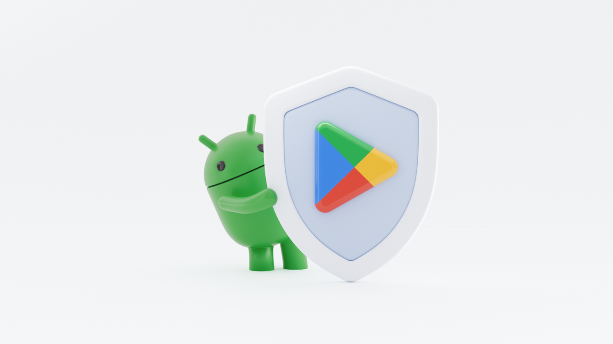

Pernahkah layar HP Samsung Anda tiba-tiba dipenuhi iklan pop-up yang muncul sendiri, bahkan saat Anda sedang berada di halaman utama (*home screen*) atau membuka menu telepon? Gejala seperti ini kerap membuat panik. Sebagian besar pengguna langsung berpikir bahwa satu-satunya jalan keluar adalah melakukan reset data pabrik (*factory reset*), padahal tindakan tersebut akan menghapus seluruh foto keluarga, riwayat percakapan penting, dan dokumen berharga.

Kabar baiknya, Anda tidak perlu terburu-buru menghapus seluruh isi ponsel. Sistem operasi One UI pada perangkat Samsung Galaxy telah dilengkapi serangkaian sistem pertahanan terintegrasi yang mampu mendeteksi dan mengisolasi berkas jahat. Memahami cara hapus malware di hp samsung dengan langkah yang tepat memungkinkan Anda membersihkan ancaman adware, trojan pengintai, maupun aplikasi berbahaya hingga tuntas tanpa mengorbankan file pribadi Anda.

Mari kita bahas tuntas tanda-tanda kehadiran malware di smartphone Galaxy Anda serta langkah demi langkah pembersihannya secara aman.

## Tanda HP Samsung Terinfeksi Malware atau Adware

Malware pada perangkat Android modern jarang merusak fisik perangkat keras secara langsung. Sebagian besar program jahat sengaja menyusup untuk mengeruk keuntungan finansial lewat tayangan iklan agresif (*adware*), mencuri data perbankan, atau menyedot kuota data di latar belakang.

Berikut beberapa indikasi kuat bahwa HP Samsung Anda telah terinfeksi:

- **Iklan Muncul di Luar Aplikasi:** Iklan video atau spanduk promosi tiba-tiba menutupi layar saat Anda membuka papan tombol telepon, memeriksa layar kunci, atau baru selesai membuka kunci ponsel.
- **Baterai Cepat Terkuras dan Bodi Terasa Panas:** Ponsel terasa hangat bahkan ketika sedang tidak digunakan dalam kondisi layar mati. Hal ini terjadi karena proses jahat terus berjalan aktif di sistem latar belakang.
- **Lonjakan Pemakaian Kuota Internet:** Pemakaian data seluler meningkat drastis secara mendadak tanpa adanya aktivitas unduhan berkas besar dari Anda.
- **Aplikasi Asing Muncul Sendiri:** Muncul ikon aplikasi baru yang tidak pernah Anda unduh dari Google Play Store maupun Galaxy Store. Terkadang aplikasi ini sengaja menggunakan nama generik seperti "System Update", "Flashlight", atau bahkan tanpa ikon sama sekali (transparan).
- **Performa Terasa Sangat Lambat:** Perangkat sering mengalami freeze (macet) atau animasi One UI mendadak patah-patah saat berpindah antar menu.

Jika perangkat Anda menunjukkan satu atau beberapa gejala di atas, segera ikuti tahapan pembersihan terstruktur berikut ini.

## Langkah 1: Pindai Sistem via Fitur Perawatan Perangkat (Device Care)

Langkah awal yang paling mudah dan aman adalah memanfaatkan fitur pemindai bawaan Samsung One UI. Samsung telah bermitra dengan penyedia keamanan global untuk menyematkan mesin pendeteksi malware langsung di menu pengaturan tanpa mewajibkan Anda memasang aplikasi antivirus pihak ketiga yang sering kali justru memberatkan sistem.

1. Buka menu **Pengaturan** (*Settings*) di ponsel Samsung Anda.
2. Gulir ke bawah lalu pilih menu **Perawatan perangkat** (*Device care*).
3. Ketuk opsi **Perlindungan perangkat** (*Device protection*).
4. Tekan tombol **Pindai ponsel** (*Scan phone*).

Sistem akan memindai seluruh aplikasi yang terpasang beserta berkas sistem. Apabila ditemukan aplikasi yang mencurigakan atau menunjukkan perilaku anomali, sistem akan memberikan tombol konfirmasi untuk langsung menghapus instalan (*uninstall*) aplikasi tersebut atau memindahkannya ke mode tidur pulas (*deep sleep*) agar aktivitas jahatnya terhenti seketika.

## Langkah 2: Masuk ke Mode Aman (Safe Mode) untuk Mengisolasi Malware

Sering kali malware yang licik dirancang untuk menolak pemindaian atau langsung menutup menu pengaturan saat Anda mencoba menghapusnya. Untuk mengatasinya, Anda wajib mengaktifkan **Mode Aman** (*Safe Mode*).

Di dalam Mode Aman, seluruh aplikasi pihak ketiga yang pernah Anda unduh akan dinonaktifkan sementara oleh sistem Android. Ponsel hanya akan menjalankan modul sistem inti bawaan pabrik. Dalam kondisi ini, malware tidak dapat menjalankan skrip proteksi dirinya, sehingga proses pencopotan aplikasi dapat dilakukan dengan sangat mudah.

Berikut cara masuk ke Mode Aman pada HP Samsung:

1. Tekan dan tahan **tombol Daya** (*Power*) dan **tombol Volume Turun** secara bersamaan selama beberapa detik hingga menu daya muncul di layar.
2. Pada layar, sentuh dan tahan ikon **Daya mati** (*Power off*) selama 2-3 detik.
3. Ikon tersebut akan berubah menjadi tombol hijau bertuliskan **Mode aman** (*Safe mode*). Ketuk tombol hijau tersebut.
4. Ponsel akan melakukan restart secara otomatis. Saat menyala kembali, Anda akan melihat teks tanda air **Mode aman** di pojok kiri bawah layar.

Jika ponsel Anda berhasil masuk ke Mode Aman, perhatikan apakah iklan pop-up masih muncul atau tidak. Jika iklan berhenti total, itu adalah bukti valid bahwa biang keladinya adalah aplikasi pihak ketiga yang Anda pasang sebelumnya.

## Langkah 3: Temukan dan Copot Aplikasi Jahat dari Pengaturan

Setelah berada di lingkungan Mode Aman yang steril, saatnya berburu dan membuang aplikasi biang onar:

1. Buka menu **Pengaturan** lalu ketuk menu **Aplikasi** (*Apps*).
2. Periksa daftar aplikasi secara teliti. Beri perhatian khusus pada aplikasi yang berada di urutan teratas atau yang baru saja terpasang tepat sebelum masalah iklan muncul.
3. Waspadai aplikasi dengan ciri-ciri berikut:
   - Aplikasi tanpa ikon (hanya kotak kosong atau warna putih polos).
   - Aplikasi tanpa nama atau hanya berupa spasi kosong.
   - Aplikasi pembersih sampah palsu, penghemat baterai, penguat sinyal, atau aplikasi kalkulator/kamera abal-abal yang diunduh dari luar toko resmi.
4. Ketuk nama aplikasi mencurigakan tersebut.
5. Ketuk tombol **Hapus instalan** (*Uninstall*) di bagian bawah layar, lalu konfirmasi dengan menekan **Oke**.

*Sumber: [Google Security Blog](https://blog.google/security/keeping-google-play-android-app-ecosystem-safe-2025/)*

## Langkah 4: Cabut Hak Administrator Perangkat yang Dibajak

Terkadang, Anda mungkin menemukan aplikasi jahat yang tombol "Hapus instalan"-nya berwarna abu-abu redup dan tidak bisa ditekan sama sekali. Hal ini terjadi karena aplikasi tersebut telah mengelabui Anda untuk memberikan hak istimewa tingkat tinggi berupa **Administrator Perangkat** (*Device Admin Apps*).

Selama izin administrator ini masih aktif, sistem Android dilarang mencopot aplikasi tersebut. Anda harus mencabut izinnya terlebih dahulu dengan langkah berikut:

1. Masih dalam Mode Aman, buka **Pengaturan**.
2. Pilih menu **Keamanan dan privasi** (*Security and privacy*).
3. Gulir ke bawah dan ketuk **Pengaturan keamanan lainnya** (*More security settings*).
4. Pilih menu **Aplikasi admin perangkat** (*Device admin apps*).
5. Periksa apakah ada aplikasi mencurigakan yang memiliki tanda centang aktif di daftar ini. (Aplikasi resmi yang wajar berada di sini biasanya hanya *Temukan Ponsel Saya* / *Find My Mobile* atau *Google Play Protect*).
6. Ketuk aplikasi mencurigakan tersebut, lalu pilih opsi **Nonaktifkan** (*Deactivate*).
7. Setelah izin administrator dicabut, kembalilah ke menu **Pengaturan > Aplikasi**, cari aplikasi tadi, dan kini tombol **Hapus instalan** sudah dapat ditekan normal untuk dibuang selamanya.

Setelah selesai mencopot seluruh aplikasi yang bermasalah, keluar dari Mode Aman dengan cara merestart ponsel seperti biasa: tekan tombol Daya dan Volume Turun, lalu pilih **Mulai lagi** (*Restart*).

## Langkah 5: Bersihkan Data dan Izin Notifikasi Peramban (Browser)

Tidak semua gangguan iklan pop-up berasal dari aplikasi malware. Dalam banyak kasus di lapangan, pengguna sebenarnya hanya terjebak oleh skrip peramban web (*web push notification*) yang agresif saat mengunjungi situs unduhan gratis. Situs tersebut meminta izin notifikasi dan kemudian terus-menerus mengirimkan pop-up yang menyerupai pesan sistem error.

Untuk membersihkan peramban Samsung Internet dan Google Chrome:

### Pada Samsung Internet:
1. Buka aplikasi **Samsung Internet**.
2. Ketuk ikon garis tiga di sudut kanan bawah, lalu pilih **Pengaturan**.
3. Pilih menu **Situs dan unduhan**, lalu ketuk **Notifikasi**.
4. Periksa daftar situs web di bawah menu tersebut. Jika ada alamat web asing yang mencurigakan berstatus "Diizinkan", segera matikan sakelarnya atau ketuk ikon tempat sampah untuk menghapus situs tersebut.
5. Kembali ke menu pengaturan peramban, pilih **Privasi dan keamanan**, lalu ketuk **Hapus data penjelajahan** untuk membersihkan cache dan cookie.

### Pada Google Chrome:
1. Buka **Chrome**, ketuk titik tiga di pojok kanan atas, lalu masuk ke **Setelan**.
2. Pilih menu **Setelan situs**, lalu ketuk opsi **Notifikasi**.
3. Di bagian situs yang diizinkan, ketuk situs web penyebar iklan yang mencurigakan, lalu pilih opsi **Hapus & setel ulang** (*Clear & reset*).
4. Masuk ke **Privasi dan Keamanan > Hapus data browsing**, pilih rentang waktu *Semua*, lalu ketuk **Hapus data**.

## Langkah 6: Aktifkan Fitur Pemblokir Otomatis (Auto Blocker) One UI

Agar smartphone Galaxy Anda terlindungi dari ancaman serupa di kemudian hari, pastikan Anda memaksimalkan fitur keamanan terbaru bawaan One UI yaitu **Pemblokir Otomatis** (*Auto Blocker*).

Fitur canggih ini dirancang khusus untuk memutus rantai serangan siber modern:
- **Mencegah Instalasi dari Sumber Tidak Sah:** Menghentikan otomatis pemasangan file APK liar yang dikirim lewat pesan obrolan atau diunduh dari browser mencurigakan (*sideloading*).
- **Pemeriksaan Keamanan Aplikasi:** Memindai seluruh aktivitas aplikasi secara berkala untuk mendeteksi potensi trojan atau malware finansial.
- **Memblokir Perintah via Kabel USB:** Mencegah pencurian data atau injeksi skrip jahat saat Anda mengisi daya ponsel di colokan USB fasilitas umum (*juice jacking*).

Cara mengaktifkannya:
1. Buka menu **Pengaturan**.
2. Pilih menu **Keamanan dan privasi**.
3. Ketuk menu **Pemblokir Otomatis** (*Auto Blocker*).
4. Geser sakelar ke posisi **Aktif** (*On*).

Bagi pengguna yang membutuhkan proteksi ekstra tinggi, Anda juga dapat mengaktifkan sub-opsi **Pembatasan maksimum** (*Maximum restrictions*) di halaman yang sama guna memblokir pesan gambar berbahaya (Message Guard) dan menonaktifkan jaringan seluler 2G yang rentan penyadapan.

## Tips Pencegahan Agar HP Samsung Tetap Bebas Malware

Pencegahan selalu lebih baik dan nyaman daripada proses perbaikan. Jadikan beberapa kebiasaan digital sehat berikut sebagai standar perlindungan harian Anda:

- **Hanya Unduh dari Sumber Resmi:** Selalu prioritaskan Google Play Store dan Samsung Galaxy Store. Hindari mengunduh file APK modifikasi (game mod, aplikasi premium bajakan) dari situs web atau forum tidak resmi.
- **Waspadai File Kiriman di WhatsApp dan Telegram:** Jangan pernah mengklik atau memasang berkas berakhiran `.apk` yang dikirim oleh nomor tidak dikenal dengan dalih undangan pernikahan digital, resi paket ekspedisi kurir, maupun surat tilang elektronik.
- **Rutin Perbarui Sistem One UI:** Pembaruan keamanan bulanan dari Samsung membawa tambalan (*patch*) penting untuk menutup celah keamanan (*vulnerability*) yang baru ditemukan peretas.
- **Hindari Memasang Aplikasi Pembersih RAM Tambahan:** Banyak aplikasi "Booster", "Clean Master", atau "Antivirus Gratis" di internet yang sebenarnya adalah sarang adware terselubung. Sistem One UI sudah memiliki mekanisme manajemen memori bawaan yang sangat optimal.

Menerapkan panduan cara hapus malware di hp samsung di atas memastikan smartphone Galaxy kesayangan Anda kembali bersih, responsif, dan dingin seperti sediakala tanpa harus kehilangan satu pun data penting Anda.

> **Baca Juga:**
> - [Cara Hemat Kuota di HP Android agar Paket Data Awet](/cara-hemat-kuota-di-hp/)
> - [Cara Amankan Akun Telegram Dari Hacker](/cara-amankan-akun-telegram-dari-hacker/)

Sumber: [Pusat Bantuan Samsung Indonesia](https://www.samsung.com/id/support/mobile-devices/how-to-protect-your-galaxy-device-from-malware/)
