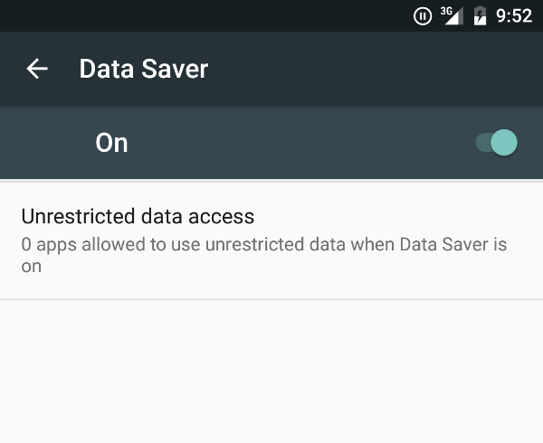

Pernahkah Anda membeli paket data internet bernilai puluhan gigabita, namun baru seminggu berselang kuota tersebut mendadak habis tanpa terasa? Pengalaman menyebalkan seperti ini kerap dialami banyak pemilik ponsel pintar. Anda mungkin merasa hanya sesekali membuka media sosial atau membaca berita ringan, tetapi indikator penggunaan kuota di layar ponsel terus melaju kencang.

Pada perangkat modern, konsumsi data seluler sering kali berlangsung di balik layar tanpa disadari pemiliknya. Puluhan aplikasi yang terpasang tetap aktif mengunduh berkas iklan, menyinkronkan data komputasi awan, memperbarui versi aplikasi, hingga memutar video pratinjau berkualitas tinggi secara otomatis. Mengetahui cara hemat kuota di hp Android secara tepat akan membantu Anda mengendalikan pemakaian internet seluler tanpa harus mengorbankan kenyamanan berkomunikasi harian.

Sistem operasi Android sebenarnya telah membekali pengguna dengan segudang perkakas penghematan jaringan yang sangat ampuh. Melalui sedikit penyesuaian pada menu pengaturan bawaan dan kebiasaan pemakaian aplikasi harian, paket data bulanan Anda dipastikan bisa bertahan jauh lebih lama hingga periode perpanjangan berikutnya.

## Mengaktifkan Fitur Penghemat Data Bawaan Android

Langkah awal paling mendasar sekaligus paling efektif adalah menyalakan fitur Penghemat Data (*Data Saver*) bawaan sistem. Saat mode ini aktif, sistem Android secara otomatis memblokir sebagian besar aplikasi agar tidak mengonsumsi data seluler ketika berjalan di latar belakang (*background data*). Aplikasi hanya diperbolehkan mengakses jaringan secara penuh saat Anda membukanya langsung di layar.

Untuk mengaktifkannya, buka aplikasi **Setelan** di ponsel Anda, lalu pilih menu **Jaringan & internet**. Di dalam menu tersebut, ketuk opsi **Penghemat Data** dan geser tombol ke posisi aktif. Ikon khusus berupa lingkaran dengan tanda tambah di dalamnya akan muncul pada bilah status di bagian atas layar sebagai penanda bahwa perlindungan kuota telah bekerja.

Jika ada aplikasi penting yang tetap harus menerima pesan secara instan seperti WhatsApp atau perbankan, Anda dapat memberikan pengecualian lewat submenu **Data tidak dibatasi** (*Unrestricted data*). Centang aplikasi perpesanan utama Anda di daftar tersebut agar notifikasi darurat tetap masuk tepat waktu.

*Sumber: [Android Developers](https://developer.android.com/develop/connectivity/network-ops/data-saver)*

## Memeriksa dan Membatasi Aplikasi Paling Rakus Kuota

Tidak semua aplikasi memiliki tingkat konsumsi internet yang sama. Beberapa aplikasi media sosial dan gim daring tertentu sering menyedot paket data secara agresif meski layar ponsel sedang terkunci. Anda bisa mengaudit pemakaian data dengan membuka **Setelan**, masuk ke **Jaringan & internet**, pilih nama operator seluler Anda, lalu buka menu **Penggunaan data aplikasi**.

Di sana akan tersaji daftar aplikasi yang diurutkan mulai dari konsumsi kuota terbesar hingga terkecil. Ketuk nama aplikasi media sosial yang menempati peringkat teratas, lalu perhatikan pembagian konsumsi antara *Data latar depan* (saat aplikasi aktif dibuka) dan *Data latar belakang*. Jika angka konsumsi latar belakangnya terlampau besar, matikan opsi **Data latar belakang** (*Background data*). Dengan begitu, aplikasi hanya akan menyedot kuota saat Anda secara sadar menggunakannya.

## Menyetel Pembaruan Aplikasi Google Play Hanya Lewat Wi-Fi

Salah satu penyebab terbesar kuota seluler ludes dalam semalam adalah pembaruan aplikasi secara diam-diam. Pengembang aplikasi di Google Play Store rutin meluncurkan pembaruan berukuran ratusan megabita hampir setiap pekan. Jika pengaturan toko aplikasi dibiarkan baku, ponsel akan langsung mengunduh berkas pembaruan tersebut begitu terhubung ke jaringan internet, termasuk kuota seluler berbayar Anda.

Lakukan penguncian pembaruan dengan langkah berikut:

1. Buka aplikasi **Google Play Store** di ponsel Anda.
2. Ketuk ikon profil akun Google Anda di sudut kanan atas layar, lalu pilih menu **Setelan**.
3. Ketuk bagian **Preferensi jaringan** untuk membuka pilihan setelan konektivitas.
4. Pilih opsi **Update otomatis aplikasi**, kemudian ubah pilihannya menjadi **Hanya melalui Wi-Fi**.
5. Pada opsi **Putar otomatis video**, ubah juga setelannya ke **Hanya melalui Wi-Fi** atau **Jangan putar video otomatis**.

Langkah sederhana ini mencegah ponsel membuang kuota beberapa gigabita sekaligus hanya untuk pembaruan aplikasi yang sebenarnya bisa ditunda hingga Anda menemukan jaringan nirkabel gratis di rumah atau kantor.

## Menentukan Batas dan Peringatan Penggunaan Kuota

Agar pengeluaran kuota tidak melebihi anggaran bulanan, sistem Android menyediakan mekanisme pagar pembatas otomatis. Anda dapat menentukan ambang batas peringatan ketika kuota hampir habis, sekaligus memasang batas pemutus koneksi internet saat jatah kuota telah terpenuhi.

Masuk ke menu **Setelan**, ketuk **Jaringan & internet**, pilih operator kartu SIM Anda, lalu buka bagian **Peringatan & batas penggunaan data**. Aktifkan sakelar **Setel peringatan penggunaan data** dan tentukan angka pengingat, misalnya 10 GB dari total paket 12 GB. Setelah itu, aktifkan sakelar **Setel batas data** dan masukkan batas maksimal pemakaian. Begitu konsumsi jaringan menyentuh angka batas tersebut, koneksi data seluler akan terputus secara otomatis demi menghindari tagihan ekstra atau hilangnya pulsa utama.

## Menyesuaikan Kualitas Streaming dan Mematikan Putar Otomatis

Aplikasi hiburan video seperti YouTube, TikTok, dan Instagram merupakan penyedot kuota paling cepat jika dibiarkan dalam konfigurasi standar. Video resolusi tinggi 1080p atau 4K menghabiskan kuota sekitar 1,5 hingga 3 GB hanya dalam satu jam penayangan.

Anda bisa menghemat kuota secara drastis dengan beberapa trik praktis berikut:

- **YouTube**: Buka Setelan aplikasi YouTube, pilih Preferensi kualitas video, lalu tetapkan opsi **Penghemat data** saat ponsel menggunakan jaringan seluler. Resolusi 480p atau 720p sudah sangat jernih untuk ukuran layar ponsel kecil.
- **Instagram**: Buka Profil, ketuk tombol menu tiga garis di kanan atas, pilih **Penggunaan data dan kualitas media**, kemudian aktifkan sakelar **Penghemat Data**.
- **TikTok**: Masuk ke menu Profil, pilih Pengaturan dan Privasi, lalu centang fitur **Penghemat Data** untuk mengurangi resolusi tayangan secara dinamis pada jaringan seluler.

## Mengalihkan Pencadangan Media Cloud ke Wi-Fi

Fitur pencadangan otomatis pada aplikasi seperti Google Foto atau Google Drive sangat berguna untuk mengamankan momen penting. Namun, mencadangkan puluhan foto beresolusi tinggi dan rekaman video 4K secara langsung lewat koneksi seluler adalah pemborosan kuota yang sangat besar.

Buka aplikasi **Google Foto**, ketuk foto profil Anda di kanan atas, lalu masuk ke **Setelan Foto**. Pilih menu **Cadangkan**, scroll ke bawah hingga menemukan opsi **Penggunaan data seluler**, lalu pilih batas harian menjadi **Tidak ada data** atau batasi maksimal 30 MB per hari. Dengan setelan ini, proses pengunggahan foto liburan berukuran besar hanya akan dieksekusi saat ponsel mendeteksi sinyal Wi-Fi.

Menerapkan kombinasi pengaturan di atas memastikan ponsel pintar Anda tetap responsif, baterai lebih awet karena minimnya aktivitas latar belakang liar, serta paket internet seluler dapat digunakan secara efisien hingga masa aktif berakhir.

Sumber: [Bantuan Ponsel Google](https://support.google.com/pixelphone/answer/7055392?hl=id)
