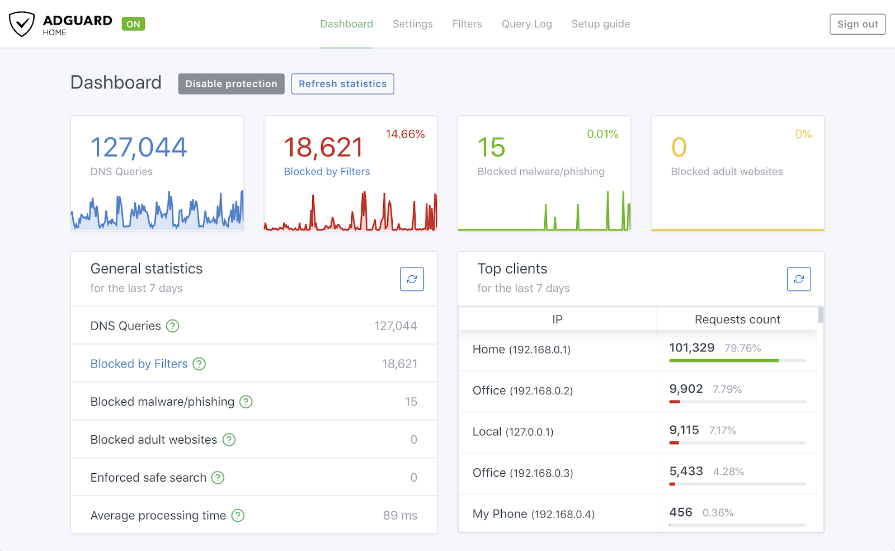

Iklan pop-up yang agresif, banner pelacak yang membebani kuota, dan tautan phishing jebakan di internet sering kali bikin jengkel siapa saja yang sedang asyik berselancar. Memasang ekstensi adblocker di browser laptop memang bisa jadi solusi cepat. Tapi bagaimana dengan perangkat lain yang tidak mendukung ekstensi browser, seperti smart TV, konsol game, tablet anak, atau aplikasi smartphone yang dijejali iklan video tanpa henti?

Solusi paling elegan dan tuntas untuk masalah ini adalah memblokir iklan langsung di pintu gerbang jaringan lokal melalui DNS sinkhole.

Di dunia open source, AdGuard Home menjadi salah satu perkakas primadona yang paling banyak dipakai para penghuni homelab dan sysadmin rumahan. Berbeda dengan Pi-hole yang terkadang membutuhkan instalasi paket web server terpisah, AdGuard Home hadir sebagai paket biner mandiri yang sangat ringan, ditulis dalam bahasa Go, dan sudah menyertakan antarmuka web modern yang responsif. Begitu server ini aktif dan dijadikan DNS utama di router WiFi, seluruh perangkat yang terhubung ke jaringan rumah otomatis terlindungi dari iklan dan pelacak tanpa perlu memasang aplikasi tambahan di masing-masing gawai.

Berikut panduan langkah demi langkah memasang dan mengonfigurasi AdGuard Home di Ubuntu Server, mulai dari trik mengatasi bentrok port 53 bawaan Ubuntu, instalasi biner resmi, penataan firewall UFW, hingga integrasi DNS terenkripsi.

## Mengapa Harus Mengatasi systemd-resolved Terlebih Dahulu

Sebelum mengunduh berkas instalasi AdGuard Home, ada satu jebakan klasik di Ubuntu yang hampir selalu membuat pemula pusing. 

Secara bawaan, Ubuntu Server (mulai dari versi 18.04 LTS, 20.04 LTS, 22.04 LTS, hingga 24.04 LTS) menjalankan layanan bernama `systemd-resolved`. Layanan ini mengaktifkan fitur lokal bernama DNS stub listener yang otomatis mengunci port UDP dan TCP nomor 53 di alamat `127.0.0.53`.

Masalahnya, AdGuard Home bertindak sebagai DNS server utama yang mutlak membutuhkan port 53 agar bisa melayani permintaan domain dari seluruh perangkat lain di jaringan LAN. Jika ente langsung memasang AdGuard Home tanpa menonaktifkan stub listener tersebut, proses instalasi dipastikan gagal dengan pesan galat `listen udp 0.0.0.0:53: bind: address already in use`.

Mari kita selesaikan masalah ini dengan cara yang paling bersih dan aman.

## 1. Bebaskan Port 53 dari systemd-resolved

Langkah pertama adalah memberitahu `systemd-resolved` agar berhenti mengikat port 53. Buka berkas konfigurasi utamanya menggunakan editor teks:

```bash
sudo nano /etc/systemd/resolved.conf
```

Cari dua baris konfigurasi berikut, hapus tanda pagar (`#`) di depannya, dan ubah nilainya menjadi seperti ini:

```ini
DNS=127.0.0.1
DNSStubListener=no
```

Baris `DNSStubListener=no` akan mematikan pendengar port 53 lokal, sedangkan baris `DNS=127.0.0.1` mengarahkan resolusi nama server lokal ke AdGuard Home yang sebentar lagi akan kita pasang. Simpan berkas tersebut lalu keluar dari editor.

Selanjutnya, kita perlu memperbarui tautan simbolik berkas `/etc/resolv.conf` agar sistem operasi tidak bingung mencari nameserver:

```bash
sudo ln -sf /run/systemd/resolve/resolv.conf /etc/resolv.conf
```

Setelah itu, muat ulang layanan `systemd-resolved` agar perubahan langsung berlaku:

```bash
sudo systemctl restart systemd-resolved
```

Untuk memastikan port 53 benar-benar sudah bebas dan tidak ada proses lain yang menggunakannya, jalankan pengecekan soket jaringan:

```bash
sudo ss -tulpn | grep :53
```

Jika perintah di atas tidak memunculkan output apa pun, artinya port 53 di server ente sudah bersih dan siap digunakan oleh AdGuard Home.

## 2. Buka Akses Port di Firewall UFW

AdGuard Home membutuhkan beberapa port terbuka agar fungsinya berjalan normal. Selain port DNS standar untuk melayani lalu lintas jaringan, kita juga butuh port HTTP dan HTTPS untuk mengakses dasbor admin serta port 3000 untuk wizard penyiapan awal.

Jalankan perintah berikut untuk membuka port-port yang relevan di firewall UFW:

```bash
sudo ufw allow 53/tcp comment 'DNS TCP'
sudo ufw allow 53/udp comment 'DNS UDP'
sudo ufw allow 3000/tcp comment 'AdGuard Home Initial Setup'
sudo ufw allow 80/tcp comment 'AdGuard Home Web Dashboard HTTP'
sudo ufw allow 443/tcp comment 'AdGuard Home Web Dashboard HTTPS'
sudo ufw reload
```

Pastikan seluruh aturan sudah aktif dengan mengecek status firewall:

```bash
sudo ufw status verbose
```

## 3. Unduh dan Jalankan Skrip Instalasi Resmi

Pengembang AdGuard menyediakan skrip instalasi otomatis yang sangat praktis. Skrip ini secara cerdas akan mendeteksi arsitektur prosesor server ente (apakah x86_64, ARM64, atau ARMv7), mengunduh arsip biner rilis stabil terbaru, mengekstraknya ke direktori `/opt/AdGuardHome`, dan langsung mendaftarkannya sebagai layanan sistem background systemd.

Jalankan perintah instalasi satu baris ini di terminal:

```bash
curl -s -S -L https://raw.githubusercontent.com/AdguardTeam/AdGuardHome/release/install.sh | sh -s -- -v
```

Tunggu beberapa saat hingga proses pengunduhan selesai. Jika instalasi berhasil, terminal akan menampilkan pesan bahwa AdGuard Home sudah terpasang dan berjalan secara otomatis setiap kali server dinyalakan.

Ente bisa memverifikasi status layanannya kapan saja lewat systemd:

```bash
sudo systemctl status AdGuardHome
```

Bila statusnya menampilkan warna hijau bertuliskan `active (running)`, layanan AdGuard Home sudah beroperasi penuh.

## 4. Inisialisasi Pengaturan Melalui Web Browser

Setelah berkas biner terpasang, tahapan selanjutnya adalah melakukan penyiapan awal melalui peramban web di laptop atau komputer yang berada dalam satu jaringan lokal dengan server.

Buka browser favorit Anda, lalu ketikkan alamat IP server diikuti port 3000 pada bilah alamat:

```text
http://IP_SERVER_UBUNTU:3000
```

Misalnya jika IP server ente adalah `192.168.1.50`, buka `http://192.168.1.50:3000`.

Layar akan menampilkan halaman selamat datang AdGuard Home. Ikuti langkah mudahnya:

1. Klik tombol **Get Started** untuk memulai konfigurasi.
2. Pada bagian **Admin Web Interface**, pilih antarmuka jaringan yang sesuai (pilih *All interfaces*) dan tetapkan port 80 (atau biarkan port 3000 jika port 80 di server sudah terpakai oleh web server lain seperti Nginx atau Caddy).
3. Pada bagian **DNS Server**, pilih antarmuka *All interfaces* dan pastikan mendengarkan port 53.
4. Klik **Next**, lalu buat nama pengguna administrator dan kata sandi baru yang kuat.
5. Klik **Next** kembali hingga muncul konfirmasi bahwa penyiapan telah selesai, lalu klik **Open Dashboard**.


*Sumber: [Canonical Ubuntu Appliance Documentation](https://ubuntu.com/appliance/adguard)*

Dasbor utama AdGuard Home menyajikan ringkasan statistik jaringan secara real-time, mulai dari jumlah total permintaan DNS, persentase kueri yang berhasil diblokir filter, hingga daftar perangkat klien yang paling aktif mengirimkan trafik.

## 5. Konfigurasi Upstream DNS dan DNS over HTTPS

AdGuard Home bertindak sebagai filter perantara. Ketika ada permintaan domain yang tidak termasuk dalam daftar iklan, AdGuard Home akan meneruskan kueri tersebut ke server DNS publik di internet (*upstream DNS*).

Secara bawaan, AdGuard Home menggunakan upstream standar dari Quad9. Supaya koneksi penelusuran lebih kencang dan kueri DNS kita tidak bisa diintip atau dimanipulasi oleh penyedia internet (ISP), kita sangat disarankan memanfaatkan protokol modern seperti DNS-over-HTTPS (DoH) atau DNS-over-TLS (DoT).

Masuk ke menu **Settings** > **DNS settings** di dasbor web AdGuard Home. Pada kolom **Upstream DNS servers**, hapus daftar lama dan masukkan kombinasi server DNS cepat berikut:

```text
https://dns.cloudflare.com/dns-query
https://dns.quad9.net/dns-query
https://dns.google/dns-query
```

Gulir ke bawah ke bagian **Upstream mode**, lalu pilih opsi **Parallel requests**. Mode ini akan mengirim kueri ke seluruh server upstream secara bersamaan dan langsung menggunakan respons yang tercepat sampai, sehingga waktu muat halaman web di perangkat terasa lebih gesit. Klik tombol **Apply** untuk menyimpan perubahan.

## 6. Tambahkan Filter Blocklist Iklan dan Malware

Secara default, AdGuard Home sudah mengaktifkan daftar saring bawaan bernama *AdGuard DNS filter* yang berisi puluhan ribu domain iklan populer. Namun untuk memaksimalkan proteksi dari ancaman siber dan iklan lokal Indonesia, kita bisa menambahkan daftar filter tambahan.

Buka menu **Filters** > **DNS blocklists**, lalu klik tombol **Add blocklist** dan pilih **Add a custom list**:

1. **OISD Blocklist (Sangat Direkomendasikan):** Filter komprehensif yang dirancang minim salah blokir (*false positive*).
   - Nama: `OISD Big`
   - URL: `https://big.oisd.nl`
2. **ABPindo (Khusus Iklan Indonesia):** Menyaring iklan dan pop-up yang sering bersarang di portal media daring lokal.
   - Nama: `ABPindo`
   - URL: `https://raw.githubusercontent.com/ABPindo/indonesianadblockrules/master/subscriptions/adblock.txt`

Setelah ditambahkan, klik tombol **Check for updates** agar AdGuard Home langsung mengunduh dan menyusun indeks basis data domain yang diblokir.

## 7. Mengarahkan Perangkat dan Router ke Server AdGuard Home

Langkah terakhir agar seluruh rumah terlindungi adalah mengarahkan lalu lintas DNS ke IP server Ubuntu ente.

Ada dua cara yang bisa ente pilih:

### Cara 1. Mengubah DNS di Router WiFi (Sangat Praktis)
Masuk ke halaman admin router rumah ente (biasanya di `192.168.1.1`), buka menu pengaturan **DHCP Server** atau **LAN Network**, lalu ganti kolom **Primary DNS** menjadi alamat IP server Ubuntu AdGuard Home ente (misal `192.168.1.50`). Biarkan kolom Secondary DNS kosong agar perangkat tidak membypass server saat kueri iklan diblokir. 

Begitu router disimpan dan dimulai ulang, semua HP, laptop, dan Smart TV yang terhubung ke WiFi otomatis menyaring iklan tanpa konfigurasi manual satu per satu.

### Cara 2. Mengubah DNS di Perangkat Tertentu Saja
Jika router rumah terkunci oleh pihak ISP dan tidak bisa diubah pengaturannya, ente cukup mengatur DNS manual pada masing-masing perangkat:
- **Di Windows:** Buka *Settings* > *Network & Internet* > *Wi-Fi* / *Ethernet* > *DNS server assignment*, pilih manual dan masukkan IP server AdGuard Home.
- **Di Android:** Buka pengaturan Wi-Fi yang sedang terhubung, ubah pengaturan IP dari DHCP menjadi Static, lalu isi kolom DNS 1 dengan IP server AdGuard Home.
- **Di Linux:** Arahkan nameserver di `/etc/resolv.conf` ke IP server AdGuard Home.

## Solusi Kendala Umum dan Troubleshooting

Ketika mengoperasikan server DNS lokal mandiri, ada beberapa situasi umum yang perlu diantisipasi:

1. **Website penting mendadak tidak bisa dibuka:** Terkadang ada domain perbankan atau aplikasi kerja yang tautan analitiknya terblokir filter. Buka menu **Query Log** di dasbor AdGuard Home, cari nama domain berwarna merah yang baru saja diakses perangkat ente, lalu klik tombol **Unblock** untuk memasukkannya ke daftar putih (*allowlist*).
2. **Kueri DNS terasa lambat saat pertama kali dibuka:** Periksa bagian **DNS cache configuration** di menu *DNS settings*. Naikkan ukuran cache menjadi minimal `67108864` (64 MB) dan aktifkan fitur **Optimistic caching** agar AdGuard Home langsung menyajikan data cache sembari memperbaruinya di latar belakang.
3. **Pembaruan biner aplikasi di kemudian hari:** AdGuard Home menyediakan pembaruan otomatis yang sangat mulus. Begitu versi anyar rilis, tombol notifikasi update akan muncul di pojok kanan atas dasbor web dan ente cukup mengekliknya sekali untuk memperbarui sistem tanpa repot mengunduh biner secara manual.

Membangun DNS sinkhole sendiri di jaringan lokal membuktikan bahwa privasi digital dan kenyamanan berselancar tidak selalu membutuhkan langganan aplikasi berbayar yang rumit. Dengan satu unit Ubuntu Server yang tenang bekerja di sudut ruangan, seluruh ekosistem gadget di rumah kita bisa bebas dari polusi iklan dan pelacakan data yang tidak diinginkan.

Sumber: [AdGuard DNS Knowledge Base](https://adguard-dns.io/kb/adguard-home/getting-started/)
