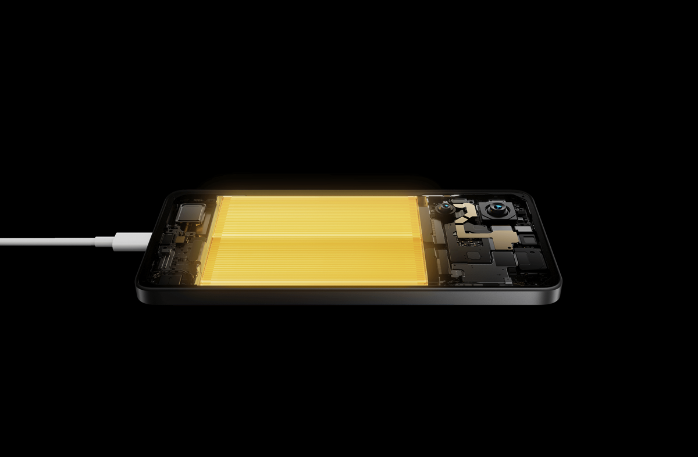

Pernahkah Anda mendapati persentase baterai ponsel tiba-tiba melompat turun secara drastis? Misalnya, beberapa menit lalu indikator masih menunjukkan angka 25 persen, namun saat membuka aplikasi kamera atau bermain game sebentar, angkanya langsung anjlok ke 8 persen atau bahkan ponsel mati mendadak.

Bagi pemilik POCO X7 Pro, kejadian seperti ini kerap menimbulkan kepanikan. Banyak pengguna langsung menduga bahwa unit baterai berkapasitas 6.000 mAh di ponsel mereka mengalami kerusakan fisik atau bocor. Padahal, pada sebagian besar kasus, masalah utamanya bukan terletak pada penurunan kimia sel baterai, melainkan pada ketidaksinkronan antara data pembacaan sistem operasi Xiaomi HyperOS dengan voltase riil sel baterai.

Memahami cara kalibrasi baterai HP POCO X7 Pro yang benar akan membantu memulihkan ketepatan indikator daya tanpa merusak sel baterai silikon karbon yang tertanam di dalamnya.

## Mengapa Indikator Baterai POCO X7 Pro Bisa Tidak Akurat

POCO X7 Pro hadir dengan kombinasi dapur pacu MediaTek Dimensity 8400-Ultra dan pengisian daya super cepat 90W HyperCharge. Untuk mengelola manajemen daya, perangkat ini dilengkapi chip cerdas ganda, yaitu Xiaomi Surge P2 untuk kontrol pengisian dan Surge G1 untuk pemantauan kesehatan baterai (*battery fuel gauge*).

Chip Surge G1 bekerja menggunakan algoritma penghitung arus (*coulomb counter*) yang mencatat setiap arus masuk dan keluar. Namun, ada beberapa kondisi yang bisa membuat algoritma ini kehilangan titik acuan akurat:

1. **Pembaruan Sistem Operasi (OTA HyperOS):** Setelah memasang pembaruan sistem besar, Android akan menyusun ulang file kompilasi di latar belakang. Proses komputasi intensif ini sering kali membuat pembacaan cache baterai lama menjadi tidak sinkron.
2. **Kebiasaan Pengisian Parsial Berulang:** Mengisi daya sedikit demi sedikit, seperti dari 40 persen ke 75 persen lalu dicabut berulang kali selama berminggu-minggu, membuat sistem jarang membaca batas batas atas (100 persen) dan batas batas bawah (0 persen).
3. **Fluktuasi Suhu Ekstrem:** Penggunaan pengisian cepat 90W di ruangan yang panas atau lingkungan dingin dapat mempengaruhi pembacaan voltase sesaat, memicu lompatan persentase palsu.

Kalibrasi baterai pada dasarnya adalah proses menyetel ulang titik nol dan titik seratus persen pada algoritma manajemen baterai, sehingga persentase di bilah status kembali mencerminkan daya riil yang tersimpan.

*Sumber: [Xiaomi Global](https://www.mi.com/global/product/poco-x7-pro/)*

## Mitos dan Fakta Seputar Kalibrasi Baterai

Sebelum memulai langkah teknis, ada baiknya meluruskan satu kesalahpahaman umum. Kalibrasi baterai tidak akan menambah kapasitas fisik atau menyembuhkan baterai yang sudah aus secara kimiawi. Jika baterai sudah berumur beberapa tahun dan kapasitas aslinya memang menurun, kalibrasi tidak akan membuatnya kembali seperti baru.

Tujuan utama kalibrasi murni bersifat perangkat lunak dan sensor, yakni memastikan sistem operasi tidak mematikan ponsel sebelum dayanya benar-benar habis, serta tidak melaporkan angka 100 persen padahal pengisian belum tuntas.

Oleh karena itu, proses kalibrasi sebaiknya hanya dilakukan sesekali saat Anda merasakan kejanggalan pembacaan, bukan dijadikan rutinitas harian atau mingguan.

## Langkah Demi Langkah Cara Kalibrasi Baterai HP POCO X7 Pro

Berikut adalah panduan resmi yang direkomendasikan untuk menormalkan kembali pembacaan persentase baterai pada smartphone Xiaomi dan POCO berbasis HyperOS:

### 1. Habiskan Baterai Hingga Ponsel Mati Sendiri

Gunakan POCO X7 Pro Anda seperti biasa untuk menonton video, mendengarkan musik, atau browsing hingga persentase baterai menyentuh 1 persen dan ponsel mati secara otomatis. Jangan memaksa mematikan ponsel secara manual lewat tombol daya saat baterai masih tersisa beberapa persen.

### 2. Pastikan Titik Nol Tercapai

Setelah perangkat mati, tunggu sekitar satu menit lalu tekan tombol daya sekali lagi. Jika layar hanya menampilkan ikon baterai kosong dengan tanda petir merah kemudian langsung padam kembali, artinya sistem perlindungan voltase rendah telah mencapai batas cut-off yang tepat.

### 3. Isi Daya dalam Keadaan Mati dengan Charger Bawaan

Hubungkan adaptor bawaan 90W HyperCharge beserta kabel USB Type-C original ke stopkontak dinding. Hindari mengisi daya melalui port USB laptop atau power bank selama proses kalibrasi. Biarkan ponsel mengisi daya dalam kondisi layar mati sepenuhnya.

### 4. Tunggu Hingga 100 Persen Plus Waktu Buffer

Layar pengisian akan menampilkan animasi turbo charge. Meskipun POCO X7 Pro mampu mencapai 100 persen dalam kisaran waktu 42 menit, jangan langsung mencabut kabel saat angka 100 persen pertama kali muncul. 

Biarkan charger tetap terhubung selama 30 hingga 60 menit tambahan. Periode ini disebut fase *trickle charge* atau pengisian lambat, di mana chip Surge G1 menyeimbangkan voltase antar-sel ganda dan mencatat nilai tegangan saturasi penuh.

### 5. Nyalakan Ponsel dan Verifikasi Angka Persentase

Setelah jeda waktu buffer selesai, cabut kabel charger kemudian hidupkan POCO X7 Pro Anda seperti biasa. Masuk ke layar beranda dan perhatikan indikator baterai di sudut kanan atas. Angka harus menunjukkan 100 persen secara stabil. Jika angka sempat turun ke 98 atau 99 persen sesaat setelah dinyalakan, colokkan kembali charger dalam keadaan menyala hingga kembali 100 persen.

### 6. Jalankan Satu Siklus Normal

Gunakan ponsel secara normal tanpa menghubungkannya ke charger di tengah jalan hingga baterai berada di kisaran 5 sampai 10 persen. Setelah itu, isi kembali daya hingga penuh 100 persen. Satu siklus penuh ini akan mengunci kurva pembacaan baru di dalam sistem HyperOS.

## Tips Menjaga Baterai POCO X7 Pro Tetap Awet

Setelah indikator baterai kembali akurat, Anda tidak perlu mengulang proses pengosongan total ini secara rutin. Untuk penggunaan sehari-hari, ikuti beberapa kebiasaan berikut agar baterai silikon karbon POCO X7 Pro bertahan optimal dalam jangka panjang:

- **Aktifkan Fitur Pengisian Daya Cerdas:** Buka menu **Setelan** > **Baterai** > **Perlindungan Baterai**. Aktifkan fitur *Optimized Charging* atau *Smart Charging* agar sistem secara cerdas mengatur kurva pengisian saat malam hari.
- **Pertahankan Rentang 20 Persen hingga 80 Persen:** Untuk pemakaian harian yang sehat, mulailah mengisi daya saat baterai menyentuh 20 persen dan cabut ketika mencapai 80 atau 90 persen guna meminimalkan stres kimiawi sel baterai.
- **Jaga Suhu Saat Fast Charging:** Fitur 90W HyperCharge menghantarkan daya yang cukup besar. Usahakan melepas casing tebal jika suhu ruangan terasa hangat, serta hindari meletakkan ponsel di atas kasur atau bantal saat sedang mengisi daya.

Dengan menerapkan langkah kalibrasi yang tepat dan menjaga kebiasaan pengisian yang ramah baterai, performa daya POCO X7 Pro Anda akan selalu terpantau akurat dan siap menemani aktivitas harian dengan optimal.

Sumber: [Xiaomi Support](https://www.mi.com/global/support/faq/details/KA-257450/)
