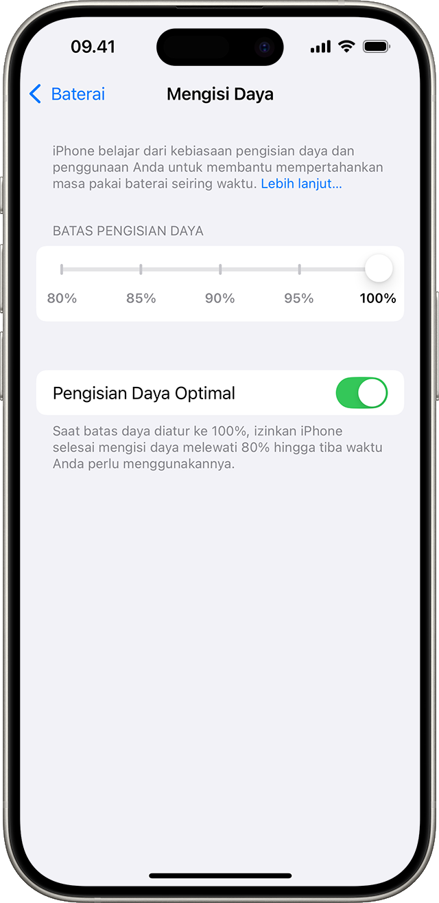

Sensasi membuka kotak iPhone baru selalu menyenangkan. Aroma kemasan yang khas, bodi ponsel yang mulus tanpa noda, serta layar jernih yang menyala pertama kali kerap membuat siapa saja ingin segera memindahkan seluruh data dan memakainya seharian. Namun, di tengah antusiasme tersebut, sering kali muncul pertanyaan klasik yang sudah beredar bertahun-tahun di kalangan pembeli ponsel. Apakah baterai iPhone baru wajib dikalibrasi terlebih dahulu?

Sebagian orang bahkan masih memegang teguh anjuran penjual toko ponsel zaman dulu. Katanya, baterai harus dihabiskan dulu sampai ponsel mati total, lalu dicas selama delapan jam berturut-turut dalam kondisi mati sebelum boleh digunakan secara normal. Anjuran seperti ini begitu melekat di ingatan banyak orang, padahal teknologi baterai sudah berubah drastis dibanding belasan tahun lalu.

Kalau diperhatikan, penerapan metode lama tersebut pada smartphone modern seperti iPhone justru berisiko merugikan kesehatan baterai itu sendiri. Memahami cara kerja sistem daya di iOS dan baterai litium modern akan membantu Anda merawat perangkat baru agar indikator baterainya akurat serta masa pakainya panjang.

## Mitos Kuno Cas Delapan Jam Saat Beli Ponsel Baru

Kebiasaan menguras baterai hingga nol persen lalu mengisi daya selama delapan jam sebenarnya berasal dari era baterai berbahan Nickel-Cadmium (NiCd) atau Nickel-Metal Hydride (NiMH). Baterai generasi lama tersebut memiliki karakteristik yang dikenal sebagai memory effect. Jika baterai nikel sering dicas sebelum benar-benar kosong, sistem kimia baterai akan mengingat titik tersebut sebagai kapasitas terendah, sehingga kapasitas penyimpanan daya yang bisa dipakai menyusut perlahan.

Baterai modern pada iPhone menggunakan teknologi Litium-ion (Li-ion). Sifat kimia litium-ion sama sekali berbeda dengan nikel. Baterai litium tidak memiliki efek memori, memiliki bobot jauh lebih ringan, mengisi daya lebih cepat pada tahap awal, dan menawarkan kerapatan daya yang jauh lebih tinggi.

Memaksa baterai litium-ion terkuras habis sampai nol persen hingga ponsel mati sendiri justru memberikan tekanan kimiawi (deep discharge stress) yang cukup berat pada sel baterai. Jika kebiasaan membiarkan baterai mati total ini dilakukan berulang kali, umur pakai baterai justru bisa menurun lebih cepat dari semestinya. Baterai iPhone baru yang keluar dari kotak kemasan sebenarnya sudah siap langsung digunakan tanpa perlu ritual pengisian delapan jam.

## Apa Sebenarnya yang Dikalibrasi pada iPhone Baru

Lalu mengapa istilah kalibrasi baterai masih sering dibahas oleh teknisi dan pengguna gadget? Yang membuat penasaran justru bagian ini, karena ada kesalahpahaman umum tentang apa yang sebenarnya sedang dikalibrasi.

Banyak orang mengira kalibrasi bertujuan untuk memperbesar daya tampung listrik atau memperbaiki sel baterai yang bocor. Anggapan tersebut keliru. Secara fisik dan kimia, kapasitas sel litium tidak bisa ditambah lewat kalibrasi.

Yang dikalibrasi sebenarnya adalah mikrokontroler digital atau chip pengukur daya (fuel gauge IC) yang tertanam di dalam modul baterai dan terintegrasi dengan sistem operasi iOS. Sensor ini bertugas membaca tegangan (voltage), arus listrik (current), dan suhu secara berkala untuk memperkirakan sisa persentase baterai yang tampil di layar sudut kanan atas iPhone.

Terkadang, iPhone baru yang sudah tersimpan beberapa bulan di gudang distributor sebelum terjual, atau unit iPhone yang baru saja menjalani pergantian modul baterai resmi di tempat servis, memerlukan waktu penyesuaian. Sensor pembacaan daya perlu memetakan kembali titik tegangan terendah dan tertinggi secara presisi agar persentase yang ditampilkan mencerminkan kondisi daya sesungguhnya.

## Tanda Indikator Baterai iPhone Perlu Penyesuaian

Dalam kondisi normal harian, sistem manajemen daya iOS mengelola pembacaan baterai secara otomatis melalui siklus pengisian rutin. Namun, ada beberapa gejala umum yang menandakan sistem pembacaan baterai iPhone baru atau baterai pengganti Anda sedang mengalami desinkronisasi:

- Persentase baterai melompat tiba-tiba, misalnya dari 35 persen mendadak turun ke 20 persen dalam hitungan menit padahal ponsel tidak sedang menjalankan aplikasi berat.
- Angka persentase tertahan sangat lama di 100 persen saat digunakan, tetapi kemudian turun sangat cepat begitu melewati angka 90 persen.
- Ponsel mendadak mati sendiri saat indikator baterai masih menunjukkan angka 10 persen atau 15 persen.
- Kecepatan pengisian terasa tidak wajar, misalnya melompat dari 80 persen langsung ke 100 persen dalam waktu beberapa saat saja.

Jika Anda mendapati tanda-tanda pembacaan yang tidak konsisten seperti itu pada unit iPhone baru, proses kalibrasi digital yang benar dan aman bisa dilakukan untuk menyelaraskan kembali chip pengukur dengan sistem iOS.

*Sumber: [Apple Support](https://support.apple.com/id-id/108055)*

## Langkah Aman Mengkalibrasi Baterai iPhone Baru

Melakukan kalibrasi baterai pada iPhone tidak memerlukan aplikasi pihak ketiga di App Store. Anda cukup memanfaatkan siklus pengisian terkontrol yang aman bagi sel litium-ion:

1. **Gunakan iPhone hingga daya menipis secara wajar**
Pakai ponsel seperti biasa untuk aktivitas sehari-hari hingga persentase baterai turun ke kisaran 5 sampai 10 persen. Anda tidak perlu sengaja membiarkan iPhone mati total sampai layar hitam pekat. Menyisakan sedikit daya di kisaran tersebut sudah cukup bagi sensor untuk mencatat batas tegangan rendah tanpa membebani sel kimia baterai.

2. **Sambungkan ke pengisi daya resmi dan biarkan hingga penuh**
Hubungkan kabel pengisi daya menggunakan adaptor resmi Apple atau adaptor bersertifikasi USB Power Delivery (USB-PD) dan kabel berlabel MFi (Made for iPhone). Hindari mengisi daya lewat port USB komputer yang arusnya lemah. Biarkan iPhone mengisi daya tanpa terputus sampai indikator menunjukkan angka 100 persen. Selama proses ini, usahakan tidak menggunakan ponsel untuk bermain game berat agar suhu perangkat tetap dingin.

3. **Beri waktu tambahan saat mencapai seratus persen**
Ketika angka di layar sudah menyentuh 100 persen, jangan langsung mencabut colokan kabel. Biarkan ponsel tetap terhubung ke charger sekitar 30 hingga 60 menit. Tahap ini memberi kesempatan bagi sistem untuk menjalankan pengisian tetes (trickle charge) hingga setiap sel terisi jenuh secara merata dan pembacaan voltase puncak tercatat stabil.

4. **Lakukan mulai ulang paksa pada perangkat**
Setelah waktu pengisian selesai, lakukan mulai ulang paksa (force restart) untuk membersihkan cache sistem dan menyegarkan register pembacaan baterai di iOS. Caranya sangat praktis: tekan dan lepas cepat tombol Volume Naik, tekan dan lepas cepat tombol Volume Turun, lalu tekan dan tahan tombol Samping (Power) beberapa detik sampai logo Apple muncul di layar, baru lepaskan tombol.

5. **Nyalakan kembali fitur Pengisian Daya Optimal**
Setelah iPhone menyala kembali, masuk ke menu Pengaturan, pilih Baterai, lalu buka bagian Kesehatan & Pengisian Daya Baterai. Pastikan fitur Pengisian Daya Optimal (Optimized Battery Charging) dalam keadaan aktif. Fitur bawaan iOS ini memanfaatkan pembelajaran mesin (machine learning) di perangkat untuk mempelajari rutinitas harian Anda, sehingga iPhone akan menahan pengisian di atas 80 persen saat dicas semalaman dan baru menuntaskannya menjelang Anda bangun tidur.

## Kebiasaan Buruk yang Bikin Kesehatan Baterai Cepat Turun

Kalibrasi hanya perlu dilakukan sekali saat indikator baterai terasa tidak akurat, atau sesekali dalam beberapa bulan. Kalibrasi bukanlah rutinitas mingguan. Menjaga angka Kesehatan Baterai (Battery Health) tetap awet hingga bertahun-tahun lebih banyak dipengaruhi oleh kebiasaan pakai sehari-hari.

Musuh utama baterai litium-ion adalah suhu panas. Mengisi daya iPhone sambil meletakkannya di atas kasur, bantal, atau di bawah paparan sinar matahari langsung di dalam mobil dapat membuat suhu baterai melonjak drastis. Jika Anda menggunakan casing pelindung yang sangat tebal dan merasakan bodi iPhone terasa hangat saat pengisian cepat (fast charging), ada baiknya melepas casing sementara waktu agar panas mudah terbuang.

Selain itu, jika Anda menggunakan model iPhone 15 atau varian yang lebih baru, Apple menyediakan opsi pembatasan pengisian daya maksimal di angka 80 persen. Menahan batas pengisian di angka 80 persen untuk pemakaian harian yang sering berada di dekat colokan terbukti secara teknis mampu memperlambat penuaan kimiawi baterai secara signifikan.

Dengan memahami cara kerja baterai secara tepat, Anda tidak perlu lagi cemas atau terbebani mitos lawas saat menggenggam iPhone baru. Cukup gunakan secara bijak, hindari paparan panas berlebih, dan biarkan sistem cerdas iOS menjaga performa baterai Anda tetap optimal.

Sumber: [Apple Support](https://support.apple.com/id-id/101575)
