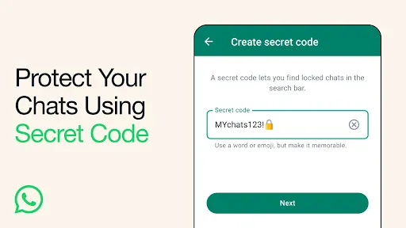

Cara kunci chat WhatsApp dengan kode rahasia menjadi jalan keluar terbaik bagi Anda yang ingin menjaga kerahasiaan percakapan pribadi langsung dari fitur bawaan aplikasi. Tanpa perlu memasang aplikasi pihak ketiga tambahan yang boros memori atau rawan iklan, WhatsApp kini menyediakan perlindungan ganda berupa folder obrolan terkunci dan kode rahasia mandiri. Fitur ini memungkinkan folder chat sensitif disembunyikan sepenuhnya dari tampilan utama beranda chat, sehingga tidak ada seorang pun yang menyadari keberadaan pesan rahasia tersebut kecuali Anda sendiri.

Sering kali kita harus meminjamkan ponsel kepada rekan kerja, teman, maupun anggota keluarga untuk urusan mendesak. Di saat bersamaan, rasa cemas kerap muncul jika mereka tidak sengaja membaca pesan singkat bernada rahasia, obrolan keluarga yang intim, maupun data sensitif seputar pekerjaan. Melalui kombinasi kunci obrolan (*Chat Lock*) dan kode rahasia (*Secret Code*), seluruh percakapan yang Anda tentukan akan langsung terisolasi dan hanya bisa dibuka lewat autentikasi khusus.

## Keunggulan Mengunci Chat Menggunakan Kode Rahasia Bawaan

Banyak pengguna terbiasa memasang aplikasi *app locker* dari toko aplikasi luar saat ingin mengamankan pesan. Padahal, memakai fitur resmi dari WhatsApp jauh lebih aman, praktis, dan memiliki segudang keunggulan:

- **Folder Tersembunyi Sempurna:** Berbeda dari kunci biometrik biasa yang masih memunculkan baris "Obrolan terkunci" di bagian atas daftar pesan, fitur kode rahasia mampu melenyapkan folder tersebut secara total. Folder hanya muncul ke permukaan saat kode rahasia diketikkan di kolom pencarian.
- **Notifikasi Anonim Tanpa Bocoran Pesan:** Saat pesan baru masuk dari obrolan yang dikunci, notifikasi di layar HP tidak akan memperlihatkan nama kontak maupun isi teks. Layar hanya akan menampilkan tulisan umum "WhatsApp: 1 pesan baru".
- **Kode Mandiri yang Terpisah dari Kunci Layar:** Anda bisa membuat kata sandi khusus yang sama sekali berbeda dari PIN atau pola kunci utama ponsel. Bahkan jika orang lain mengetahui PIN layar ponsel Anda, mereka tetap tidak bisa membaca chat yang terlindungi kode rahasia ini.
- **Dukungan Emoji Unik:** Pembuatan kode rahasia tidak terbatas pada susunan huruf atau angka saja, melainkan mendukung kombinasi simbol dan emoji unik sehingga semakin sulit ditebak oleh orang lain.

*Sumber: [Pusat Bantuan WhatsApp](https://faq.whatsapp.com/764072925284841/?locale=id_ID)*

## Syarat Sebelum Mengaktifkan Kunci Chat WhatsApp

Sebelum menerapkan panduan ini, pastikan ponsel dan aplikasi Anda telah memenuhi beberapa persyaratan mendasar berikut:

1. **Kunci Layar HP Aktif:** WhatsApp mewajibkan perangkat Android atau iPhone Anda sudah mengaktifkan perlindungan layar standar, baik sidik jari (*fingerprint*), sensor wajah (*Face ID*), maupun PIN angka.
2. **Versi WhatsApp Terkini:** Lakukan pembaruan aplikasi WhatsApp ke versi paling anyar melalui Google Play Store atau Apple App Store agar fitur kode rahasia berfungsi tanpa kendala.

## Panduan Langkah demi Langkah Mengunci Chat WhatsApp

Penerapan kunci obrolan dan kode rahasia terbagi menjadi dua tahapan praktis, yakni mengunci chat ke folder proteksi lalu menyetel kode rahasia untuk menyembunyikannya.

### 1. Mengunci Chat Personal atau Grup

Langkah pertama adalah memindahkan percakapan yang ingin diamankan ke dalam folder khusus:

1. Buka aplikasi WhatsApp di ponsel Anda.
2. Cari obrolan personal atau grup yang ingin dilindungi.
3. Ketuk dan tahan chat tersebut selama beberapa detik hingga muncul tanda centang.
4. Pada ponsel Android, ketuk ikon titik tiga di pojok kanan atas lalu pilih **Kunci obrolan** (*Lock chat*). Pada pengguna iPhone, gesek chat ke samping atau ketuk profil kontak lalu pilih **Kunci obrolan**.
5. Konfirmasikan tindakan tersebut dengan menempelkan jari pada sensor sidik jari atau memindai wajah melalui Face ID.
6. Chat target seketika berpindah ke folder khusus bernama **Obrolan terkunci**.

### 2. Membuat Kode Rahasia untuk Obrolan Terkunci

Setelah percakapan masuk ke folder proteksi, saatnya Anda membuat kode rahasia mandiri:

1. Pada daftar utama chat WhatsApp, tarik layar perlahan ke arah bawah hingga folder **Obrolan terkunci** muncul di baris paling atas.
2. Ketuk folder tersebut lalu lakukan verifikasi dengan sidik jari atau Face ID.
3. Di dalam folder obrolan terkunci, ketuk ikon titik tiga vertikal di pojok kanan atas untuk pengguna Android, atau ketuk tombol **Pengaturan** bagi pengguna iPhone.
4. Pilih menu **Pengaturan kunci obrolan** (*Chat lock settings*).
5. Ketuk opsi **Kode rahasia** (*Secret code*).
6. Masukkan kata sandi yang Anda inginkan. Anda dapat menggunakan kombinasi kata, deretan angka, atau rangkaian emoji khusus.
7. Ketuk tombol **Lanjut**, ketik ulang kode rahasia yang sama untuk verifikasi, lalu ketuk **Selesai**.

### 3. Menyembunyikan Folder dari Tampilan Utama Beranda

Supaya tidak ada yang mencurigai bahwa Anda memiliki obrolan yang dikunci, sembunyikan foldernya dengan cara berikut:

1. Masuk kembali ke menu **Pengaturan kunci obrolan** di dalam folder obrolan terkunci.
2. Temukan opsi **Sembunyikan obrolan terkunci** (*Hide locked chats*).
3. Geser sakelar tombol ke posisi aktif (berwarna hijau).
4. Kembali ke halaman utama WhatsApp. Kini, folder "Obrolan terkunci" tidak akan lagi terlihat meskipun layar diusap ke bawah berulang kali.

### 4. Cara Menemukan dan Membuka Obrolan yang Disembunyikan

Saat Anda ingin membaca pesan masuk atau memulai obrolan baru di dalam chat yang terkunci, ikuti langkah mudah ini:

1. Buka aplikasi WhatsApp dan pastikan Anda berada di tab **Chat**.
2. Ketuk ikon kaca pembesar atau bilah **Cari** (*Search*) di bagian atas.
3. Ketikkan kode rahasia yang telah Anda buat sebelumnya secara persis.
4. Folder **Obrolan terkunci** akan seketika muncul di bagian hasil pencarian.
5. Ketuk folder tersebut untuk masuk dan membaca obrolan seperti biasa. Begitu Anda mengunci layar ponsel atau menutup WhatsApp, folder obrolan akan kembali terkunci dan tersembunyi secara otomatis.

## Hal Penting yang Perlu Diperhatikan

Pusat dokumentasi resmi WhatsApp memberikan sejumlah catatan penting yang wajib Anda pahami saat memakai fitur ini:

- **Panggilan Tetap Berdering Normal:** Mengunci obrolan tidak memblokir kontak. Panggilan telepon suara maupun panggilan video dari kontak yang berada di dalam chat terkunci tetap akan masuk ke ponsel Anda.
- **Visibilitas Media Dinonaktifkan:** Berkas foto dan video yang dikirimkan di dalam chat terkunci tidak akan otomatis diunduh ke galeri utama ponsel Anda demi menjaga privasi. Namun, Anda tetap dapat menyimpannya secara manual bila diperlukan.
- **Akses di WhatsApp Web dan Desktop:** Untuk membuka obrolan terkunci saat menggunakan WhatsApp Web atau aplikasi desktop, Anda diwajibkan memasukkan kode rahasia yang sebelumnya telah dibuat melalui ponsel utama.
- **Konsekuensi Jika Lupa Kode Rahasia:** Jika Anda menyembunyikan folder obrolan dan lupa kode rahasianya, WhatsApp menyediakan opsi pemulihan melalui menu **Setelan > Privasi > Kunci obrolan > Buka kunci dan bersihkan obrolan terkunci**. Namun, tindakan ini akan menghapus seluruh riwayat pesan dan media di dalam folder tersebut demi alasan integritas privasi.

Dengan memanfaatkan fitur kunci chat dan kode rahasia bawaan ini, privasi percakapan penting Anda kini terlindungi secara maksimal tanpa rasa khawatir saat meminjamkan ponsel kepada siapa pun.

> **Baca Juga:**
> - [Cara Mengatasi Lupa Kunci Chat WA dan Kode Rahasia](/cara-mengatasi-lupa-kunci-chat-wa/)
> - [Cara Sembunyikan Foto Video di iPhone dengan Face ID](/cara-sembunyikan-foto-video-di-iphone/)

Sumber: [Pusat Bantuan WhatsApp](https://faq.whatsapp.com/764072925284841/?locale=id_ID)
