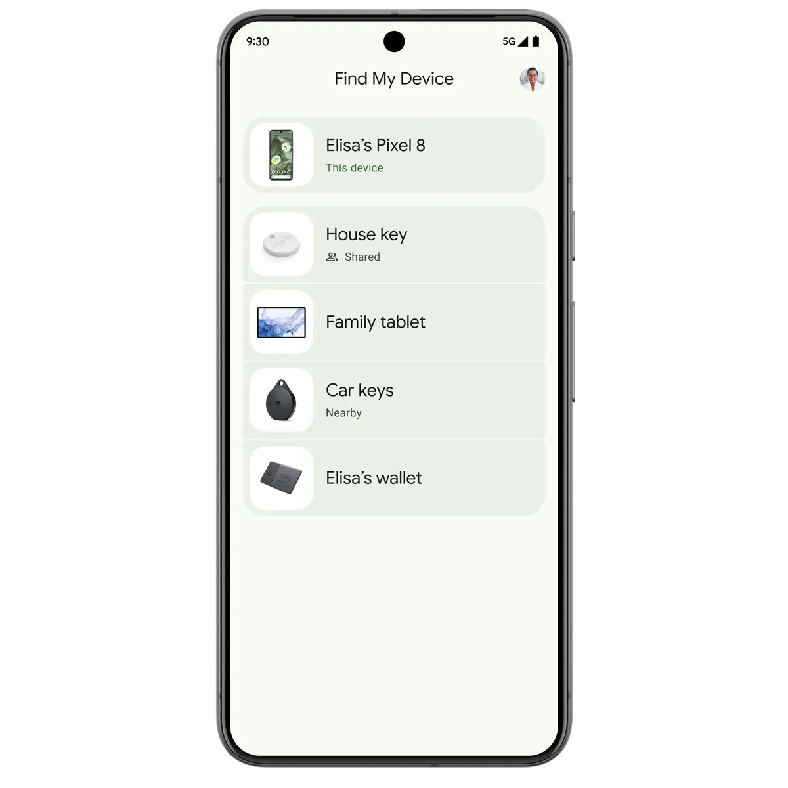

Pernahkah Anda mendadak panik saat meraba saku celana atau tas kerja, lalu menyadari smartphone Android kesayangan Anda tidak ada di tempatnya?

Detak jantung biasanya langsung meningkat kencang. Pikiran kita kerap melayang ke mana-mana, membayangkan dokumen penting pekerjaan, akses perbankan digital, hingga foto-foto pribadi yang tersimpan di dalam perangkat. Rasa khawatir ponsel jatuh di jalan, tertinggal di kedai kopi, atau bahkan terselip di balik bantal sofa rumah memang menjadi pengalaman menegangkan bagi siapa saja.

Kabar baiknya, Anda tidak perlu langsung berputus asa atau terburu-buru mengikhlaskannya. Sistem operasi Android telah dibekali infrastruktur pelacakan canggih bernama Google Find My Device atau yang kini dikenal sebagai Hub Pencari Google. Lewat layanan resmi ini, Anda bisa memantau koordinat geografis ponsel secara langsung, membunyikan alarm panggilan darurat dengan volume kencang, hingga mengunci perangkat dari jarak jauh agar data pribadi tetap aman terlindungi.

Berikut panduan praktis dan teruji mengenai cara melacak hp hilang android dengan mudah, cepat, dan akurat.

## Syarat Utama Agar Ponsel Android Dapat Dilacak

Sebelum memanfaatkan sistem pelacakan Google, ada beberapa persyaratan teknis mendasar yang wajib terpenuhi pada ponsel yang hilang:

1. **Ponsel Terhubung ke Akun Google:** Perangkat wajib sudah masuk ke akun Gmail atau Akun Google utama Anda sebelum kejadian kehilangan berlangsung.
2. **Layanan Lokasi (GPS) Aktif:** Fitur penunjuk lokasi perangkat harus dalam status menyala agar satelit dan jaringan seluler dapat memetakan koordinat secara presisi.
3. **Fitur Temukan Perangkat Saya Menyala:** Pengaturan ini secara *default* sudah aktif pada hampir seluruh ponsel Android modern melalui menu Setelan > Keamanan & Privasi > Temukan Perangkat Saya.
4. **Terhubung ke Jaringan Internet atau Bluetooth Mesh:** Ponsel memerlukan koneksi data seluler atau Wi-Fi aktif. Menariknya, pada sistem Android generasi terbaru, Google telah meluncurkan jaringan pelacak terenkripsi berbasis Bluetooth yang memanfaatkan miliaran perangkat Android di sekitar untuk membantu melacak posisi ponsel meskipun sedang dalam kondisi luring (*offline*).

Jika persyaratan di atas terpenuhi, Anda memiliki peluang sangat besar untuk menemukan kembali ponsel tersebut dalam waktu singkat.

*Sumber: [Google Blog](https://blog.google/products-and-platforms/platforms/android/android-find-my-device/)*

## Langkah demi Langkah Cara Melacak HP Hilang Android

Proses pelacakan dapat dilakukan melalui laptop, komputer kantor, tablet, maupun meminjam smartphone milik anggota keluarga terdekat. Berikut tahapan lengkapnya:

### 1. Buka Portal Resmi Google Find My Device

Langkah awal yang paling mudah adalah membuka peramban web seperti Google Chrome, Mozilla Firefox, atau Safari di komputer maupun ponsel lain. Kunjungi tautan resmi pelacak Google di alamat `google.com/android/find`.

Jika Anda meminjam ponsel Android milik teman atau keluarga, Anda juga bisa langsung membuka aplikasi bawaan bernama **Hub Pencari** (*Find My Device*) yang bisa diunduh gratis melalui Google Play Store.

### 2. Masuk Menggunakan Akun Google Ponsel yang Hilang

Setelah halaman terbuka, masukkan alamat email dan kata sandi Akun Google yang terdaftar pada ponsel yang sedang Anda cari. Pastikan akun yang dimasukkan benar-benar identik, bukan akun email cadangan lain.

Apabila akun Anda mengaktifkan verifikasi dua langkah (2FA) dan meminta konfirmasi ke nomor ponsel yang hilang, klik opsi **Coba cara lain** (*Try another way*) lalu gunakan kode cadangan delapan digit yang pernah Anda simpan, atau lakukan verifikasi melalui email pemulihan.

### 3. Pilih Perangkat dari Daftar

Di sudut kiri atas layar antarmuka Find My Device, Anda akan melihat deretan ikon perangkat yang pernah terhubung dengan akun tersebut. Jika Anda memiliki lebih dari satu gawai, klik pada ikon tipe ponsel Android yang sedang hilang.

Sistem Google akan segera mengirimkan sinyal ping permintaan lokasi secara rahasia ke perangkat Anda di latar belakang.

### 4. Pantau Posisi Koordinat Peta

Tunggu beberapa detik sementara Google Maps memuat titik lokasi ponsel Anda:

- **Jika Ponsel Daring (Online):** Anda akan melihat ikon pin lokasi berwarna hijau atau biru di atas peta interaktif. Pada bilah informasi sebelah kiri, Google akan menampilkan nama jalan, nama jaringan Wi-Fi yang sedang tersambung, serta sisa daya baterai saat ini. Anda dapat menekan tombol **Dapatkan Rute** untuk memandu navigasi langsung ke titik tersebut.
- **Jika Ponsel Luring (Offline):** Layanan akan menampilkan titik lokasi terakhir yang berhasil terekam sistem sesaat sebelum koneksi internet terputus atau baterai habis, lengkap dengan stempel waktu kejadian.

### 5. Gunakan Fitur Putar Suara (Play Sound)

Jika peta menunjukkan posisi ponsel berada di sekitar area rumah, kantor, atau tempat Anda sedang berdiri, pilih tombol **Putar Suara** (*Play Sound*).

Fitur ini akan memaksa ponsel berdering dengan volume maksimal selama lima menit tanpa henti, bahkan jika sebelumnya ponsel Anda disetel pada mode getar atau hening (*silent*). Setelah ponsel berhasil Anda temukan di sela perabot atau bawah tumpukan barang, cukup tekan tombol daya ponsel untuk menghentikan suara dering tersebut.

### 6. Amankan Perangkat dengan Kunci Layar (Secure Device)

Apabila ponsel tertinggal di transportasi umum, kafe, atau lokasi umum yang cukup jauh, segera klik menu **Amankan Perangkat** (*Secure Device*) atau **Tandai Hilang** (*Mark as Lost*).

Tindakan protektif ini berfungsi untuk:
- Mengunci layar ponsel secara instan menggunakan kata sandi, PIN, atau pola pengaman akun Anda.
- Menampilkan pesan pemulihan ramah di layar depan, misalnya *"Ponsel ini tertinggal, mohon hubungi pemiliknya"*.
- Mencantumkan nomor telepon alternatif yang bisa langsung ditekan oleh orang baik yang menemukan ponsel Anda tanpa perlu membuka kunci layar.
- Mengeluarkan (*sign out*) akun Google dari sesi aplikasi umum demi mencegah akses tidak sah ke data email dan cloud storage.

### 7. Hapus Data Jarak Jauh (Erase Device) sebagai Solusi Pamungkas

Jika ponsel telah terlacak di lokasi yang mencurigakan dan Anda meyakini perangkat telah dicuri atau tidak mungkin lagi diambil kembali, opsi terakhir yang wajib diambil adalah memilih **Hapus Perangkat** (*Erase Device*).

Menu ini akan melakukan *factory reset* secara penuh dari jarak jauh dan menghapus seluruh foto, video, kontak, riwayat obrolan, serta file dokumen di penyimpanan internal. Namun perlu dicatat, setelah perintah penghapusan ini dieksekusi, Anda tidak akan bisa lagi melacak posisi ponsel tersebut melalui Find My Device karena seluruh tautan sistem telah terputus.

## Tips Tambahan Agar Ponsel Selalu Siap Dilacak

Sebagai langkah antisipasi untuk masa depan, ada beberapa tips pencegahan yang sangat bermanfaat diterapkan sejak dini pada ponsel Android kesayangan Anda:

- **Aktifkan Opsi Lacak Saat Offline:** Masuk ke menu **Setelan** > **Google** > **Semua Layanan** > **Hub Pencari**, lalu pilih menu **Temukan perangkat Anda yang offline**. Pilih opsi jaringan di semua area agar perangkat tetap bisa terdeteksi oleh jaringan Bluetooth ponsel Android lain di sekitar.
- **Catat Nomor IMEI Perangkat:** Tekan kode panggilan `*#06#` pada tombol telepon dan catat 15 digit nomor IMEI yang muncul di buku catatan fisik Anda. Nomor ini sangat dibutuhkan saat Anda melapor ke kantor kepolisian atau gerai operator seluler untuk pemblokiran sinyal kartu SIM.
- **Waspadai Modus Penipuan Phishing:** Jangan pernah mempercayai situs web atau akun media sosial yang menawarkan jasa pelacak nomor HP bermodalkan nomor WhatsApp dengan meminta bayaran sejumlah uang. Sebagian besar layanan pihak ketiga tersebut hanyalah penipuan berbahaya yang berpotensi mencuri data kredensial Anda.

Menguasai cara melacak hp hilang android memberikan ketenangan pikiran dan kendali penuh dalam menjaga keamanan gadget kesayangan kapan pun insiden tak terduga datang menghampiri.

> **Baca Juga:**
> - [Panduan Lengkap Hapus Riwayat Google di HP](/panduan-lengkap-hapus-riwayat-google-di-hp/)
> - [Cara Hapus Riwayat Suara Google Assistant dan Gemini](/cara-hapus-riwayat-suara-google-assistant-dan-gemini/)

Sumber: [Google Bantuan Akun](https://support.google.com/accounts/answer/6160491?hl=id)
