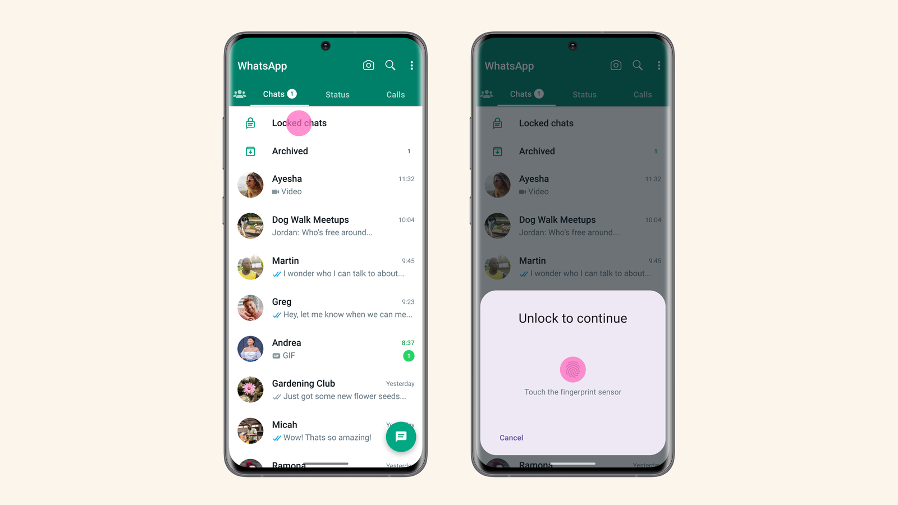

Menjaga privasi percakapan di aplikasi pesan instan kini sudah menjadi kebutuhan mendasar. Sejak WhatsApp merilis fitur Kunci Chat (*Chat Lock*) dan melengkapinya dengan Kode Rahasia (*Secret Code*), kita bisa mengamankan obrolan penting atau pesan rahasia di folder khusus yang benar-benar tersembunyi dari pandangan orang lain.

Namun, situasi membingungkan sering kali muncul ketika kita lupa kombinasi kode rahasia tersebut. Karena folder Chat Terkunci sengaja disembunyikan dari daftar utama, banyak pengguna merasa panik dan mengira seluruh pesan pribadi di dalamnya telah hilang selamanya.

Kabar baiknya, pengembang WhatsApp telah merancang mekanisme pemulihan resmi yang aman. Anda tidak perlu membongkar sistem ponsel atau memasang aplikasi pihak ketiga yang berisiko. Mencari tahu cara mengatasi lupa kunci chat wa lewat jalur resmi memungkinkan Anda membuka kembali akses obrolan dengan langkah yang sangat mudah.

## Memahami Fitur Kunci Chat dan Kode Rahasia WhatsApp

Sebelum masuk ke langkah penyelesaian, ada baiknya memahami terlebih dahulu bagaimana sistem perlindungan ini bekerja di ponsel Anda.

Fitur Kunci Chat memindahkan ruang percakapan yang Anda pilih keluar dari kotak masuk utama ke folder terpisah bernama **Chat terkunci**. Folder ini secara bawaan dilindungi oleh sistem keamanan biometrik perangkat, seperti sensor sidik jari, Face ID, atau kode sandi layar kunci ponsel.

Untuk memperkuat privasi, WhatsApp menambahkan opsi **Kode Rahasia**. Fitur ini memberikan dua proteksi tambahan:

1. **Kata Sandi Khusus:** Anda dapat membuat kode unik (berupa kata, angka, atau bahkan emoji) yang berbeda dari kode pembuka layar ponsel Anda.
2. **Sembunyikan Folder:** Folder Chat Terkunci dapat dihilangkan sepenuhnya dari daftar obrolan. Folder tersebut hanya akan muncul di layar jika Anda mengetikkan kode rahasia yang tepat di kolom pencarian WhatsApp.

Masalah lupa kunci umumnya terjadi saat pengguna memanfaatkan kombinasi emoji unik atau kata sandi yang jarang digunakan, sehingga folder obrolan tidak lagi dapat dimunculkan melalui kolom pencarian.

## Cara Pertama: Akses Menggunakan Autentikasi Biometrik

Jika Anda belum mengaktifkan opsi sembunyikan folder atau folder Chat Terkunci masih terlihat di bagian paling atas daftar percakapan, Anda belum tentu memerlukan proses reset total.

WhatsApp menyediakan alternatif autentikasi perangkat jika Anda kesulitan mengingat kode rahasia:

1. Tarik daftar obrolan utama ke arah bawah secara perlahan hingga folder **Chat terkunci** muncul di bagian atas.
2. Ketuk folder **Chat terkunci**.
3. Saat muncul jendela permintaan kode rahasia, periksa apakah terdapat opsi autentikasi biometrik.
4. Tempelkan jari Anda pada sensor sidik jari ponsel atau gunakan pemindai wajah (Face ID). Pada sebagian perangkat, Anda juga bisa memilih opsi menggunakan PIN layar kunci perangkat.

Apabila folder terbuka, Anda bisa segera masuk ke **Pengaturan Kunci Chat** di dalam folder tersebut untuk mengganti kode rahasia lama dengan kombinasi baru yang lebih mudah diingat.

## Cara Utama: Mengatasi Lupa Kunci Chat WA via Menu Privasi

Bagaimana jika folder obrolan benar-benar tersembunyi dan Anda sama sekali tidak mengingat kode rahasia yang dipasang? Solusi resmi dari Pusat Bantuan WhatsApp adalah menggunakan fitur **Buka kunci dan bersihkan chat terkunci**.

Fitur ini berfungsi mereset proteksi kode rahasia sekaligus mengembalikan seluruh kontak yang terkunci kembali ke daftar obrolan utama.

Berikut langkah-langkah praktisnya di ponsel Android maupun iPhone:

1. **Buka Aplikasi WhatsApp:** Jalankan WhatsApp di ponsel utama tempat akun Anda terdaftar.
2. **Masuk ke Pengaturan:**
   - Di Android: Ketuk ikon titik tiga vertikal di pojok kanan atas, lalu pilih **Setelan**.
   - Di iPhone: Ketuk tab **Pengaturan** (ikon gerigi) di sudut kanan bawah layar.
3. **Pilih Menu Privasi:** Pada daftar setelan akun, ketuk menu **Privasi**.
4. **Buka Pengaturan Kunci Chat:** Gulir layar ke bawah hingga Anda menemukan opsi **Kunci chat**, lalu ketuk menu tersebut.
5. **Pilih Buka Kunci dan Bersihkan:** Di dalam menu ini, Anda akan melihat opsi bertuliskan **Buka kunci dan bersihkan chat terkunci** (*Unlock and clear locked chats*).
6. **Konfirmasi Tindakan:** Sistem akan menampilkan peringatan bahwa seluruh pesan, foto, dan video di dalam chat terkunci akan dibersihkan demi menjaga privasi, sementara kodenya akan dihapus. Ketuk tombol konfirmasi **Buka kunci dan bersihkan**.

Setelah proses selesai, fitur kode rahasia akan nonaktif. Seluruh obrolan yang sebelumnya terkunci kini akan kembali tampil di daftar obrolan utama akun WhatsApp Anda.

*Sumber: [Meta Newsroom](https://about.fb.com/news/2023/05/whatsapp-chat-lock/)*

## Mengapa Riwayat Pesan Dibersihkan Saat Direset?

Sebagian pengguna mungkin bertanya-tanya mengapa WhatsApp membersihkan pesan di dalam chat terkunci saat proses reset dilakukan.

Langkah ini merupakan fondasi keamanan privasi WhatsApp. Bayangkan jika seseorang meminjam ponsel Anda dalam keadaan tidak terkunci. Apabila mereka bisa dengan mudah mereset kode rahasia tanpa menghapus isi obrolan, perlindungan folder rahasia tersebut tentu menjadi sia-sia.

Dengan menghapus isi percakapan saat reset dilakukan tanpa kode, WhatsApp memastikan data sensitif Anda tidak dapat diintip oleh siapa pun yang mencoba membobol folder terkunci Anda dari menu setelan.

## Cara Mengembalikan Pesan yang Bersih Lewat File Cadangan

Pesan yang terhapus akibat proses reset kunci chat ternyata masih bisa diselamatkan, asalkan Anda rutin mencadangkan data ke Google Drive (Android) atau iCloud (iPhone) sebelum proses pembersihan berlangsung.

Menurut dokumentasi resmi WhatsApp, salinan cadangan yang dibuat sebelum tindakan pembersihan memuat riwayat obrolan lengkap. Anda bisa memulihkannya dengan langkah berikut:

1. Pastikan Anda memiliki cadangan obrolan terbaru dengan memeriksa tanggal cadangan di **Setelan > Chat > Cadangan chat**.
2. Hapus instalasi (*uninstall*) aplikasi WhatsApp dari ponsel, atau hapus data aplikasi melalui pengaturan aplikasi di sistem Android.
3. Pasang kembali WhatsApp melalui Google Play Store atau Apple App Store.
4. Buka aplikasi dan lakukan verifikasi nomor telepon seperti biasa.
5. Saat muncul konfirmasi penemuan file cadangan cloud, ketuk opsi **Pulihkan** (*Restore*).
6. Tunggu hingga proses pengunduhan pesan selesai, lalu lanjutkan hingga masuk ke menu utama.

Setelah pemulihan selesai, pesan-pesan yang sebelumnya sempat terhapus saat reset akan kembali muncul di riwayat obrolan Anda.

## Tips Mengatur Kunci Chat WhatsApp Agar Tidak Lupa Lagi

Agar pengalaman mengamankan pesan tetap nyaman tanpa risiko terkunci di masa mendatang, terapkan beberapa tips sederhana berikut:

- **Gunakan Kombinasi yang Bermakna:** Buat kode rahasia yang mudah Anda ingat secara alami, misalnya gabungan kata panggilan unik dan satu karakter emoji favorit.
- **Catat di Pengelola Kata Sandi:** Manfaatkan aplikasi pengelola kata sandi terpercaya seperti Google Password Manager, Apple Keychain, atau Bitwarden untuk mencatat kode rahasia tersebut dalam brankas digital aman.
- **Aktifkan Pencadangan Otomatis:** Atur jadwal pencadangan harian ke akun Google atau iCloud agar Anda selalu memiliki salinan pesan terbaru jika suatu saat perlu melakukan pemulihan.
- **Nyalakan Cadangan Terenkripsi End-to-End:** Lengkapi perlindungan file cadangan Anda dengan enkripsi ujung ke ujung di menu cadangan chat agar file arsip di server cloud tetap aman dari akses pihak lain.

Menerapkan cara mengatasi lupa kunci chat wa di atas membuat Anda tidak perlu panik lagi saat menghadapi kendala kode rahasia. Privasi percakapan tetap terlindungi maksimal, dan Anda memegang kendali penuh atas akun pesan instan Anda setiap hari.

> **Baca Juga:**
> - [Cara Backup Chat WhatsApp ke PC Praktis dan Aman](/cara-backup-chat-whatsapp-ke-pc/)
> - [Panduan Lengkap Hapus Riwayat Google di HP](/panduan-lengkap-hapus-riwayat-google-di-hp/)

Sumber: [Pusat Bantuan WhatsApp](https://faq.whatsapp.com/764072925284841)
