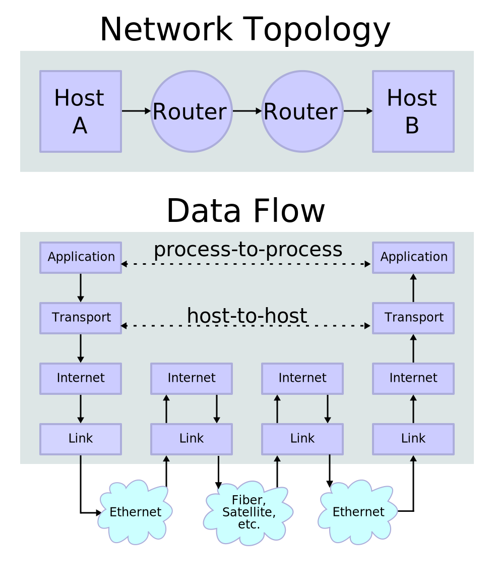

Skenario ini pasti pernah menghentikan alur kerja ente saat mengelola server Linux. Saat sedang melakukan investigasi insiden jaringan di server produksi, memeriksa service web yang baru direload, atau masuk ke dalam kontainer Docker minimalis, salah satu perintah refleks pertama yang ente ketik adalah `ss -tuln` atau `ss -tulpn`. Perintah ini sangat krusial untuk memetakan port jaringan mana saja yang sedang terbuka, mendeteksi layanan yang gagal mengikat socket, serta mengaudit proses di balik koneksi aktif. Namun, alih-alih menampilkan ringkasan socket yang rapi, layar terminal justru melemparkan pesan galat:

```text
bash: ss: command not found
```

Atau bila ente sedang bekerja di dalam shell minimalis seperti ash pada distribusi Alpine Linux atau BusyBox:

```text
sh: ss: not found
```

Bagi pemula atau pengembang yang terbiasa bekerja di lingkungan desktop Ubuntu atau Fedora workstation, kemunculan pesan galat ini kerap membingungkan. Banyak yang mengira bahwa utilitas `ss` merupakan perintah internal bawaan (*shell built-in*) seperti `cd`, `pwd`, atau `echo`. Padahal, kenyataannya `ss` (*Socket Statistics*) adalah biner perkakas mandiri yang dikembangkan di bawah payung paket proyek **iproute2**.

Di server dengan instalasi minimalis (*minimal install*), template cloud VPS yang dipangkas (*cloud-init slim image*), lingkungan *chroot*, hingga *base container image* mikro, utilitas jaringan dasar sengaja tidak disertakan oleh pengembang sistem demi menekan ukuran penyimpanan seminimal mungkin. Di samping itu, ada pula skenario di mana paket sebenarnya sudah terpasang rapi, namun akun pengguna non-root yang ente gunakan tidak memiliki variabel lingkungan `$PATH` yang mengarah ke direktori biner sistem operasi.

Pada panduan kali ini, ane ajak ente mengupas tuntas cara mengatasi kendala **ss command not found linux**. Kita akan membedah akar penyebab masalahnya, memasang paket penyedia yang tepat di berbagai distribusi Linux (Debian, Ubuntu, RHEL, Rocky Linux, Fedora, Arch Linux, hingga Alpine Linux), melakukan optimasi pada kontainer Docker, memperbaiki konfigurasi variabel lingkungan `$PATH`, hingga memverifikasi fungsionalitasnya agar siap dipakai untuk analisis jaringan.

## Mengapa ss Command Not Found Muncul di Linux

Sebelum masuk ke baris perintah eksekusi, penting bagi kita untuk memahami arsitektur di balik perintah `ss` dan alasan mendasar mengapa biner ini bisa lenyap dari sistem Linux yang ente kelola.

Perintah `ss` dirancang sebagai penerus resmi dari perintah legendaris `netstat` yang berasal dari paket usang `net-tools`. Selama bertahun-tahun, `netstat` menjadi andalan para administrator jaringan. Namun, `netstat` memiliki kelemahan arsitektur yang fatal pada server modern. Perintah tersebut bekerja dengan membaca dan mem-parsing berkas teks virtual di subsistem procfs kernel. Ketika server menangani puluhan ribu koneksi konkuren, pembacaan berkas teks raksasa ini sangat lambat, membebani alokasi memori kernel, dan rentan menghasilkan data yang tidak konsisten.

Utilitas `ss` merevolusi pemantauan soket dengan berkomunikasi langsung ke ruang kernel Linux melalui protokol antarmuka Netlink, khususnya modul kernel `sock_diag` (seperti `inet_diag` dan `unix_diag`). Komunikasi biner langsung ini membuat `ss` bekerja jauh lebih cepat, hemat sumber daya, dan sanggup menyajikan data koneksi secara instan bahkan di bawah beban lalu lintas jaringan yang ekstrem.


*Sumber: [Wikimedia Commons Internet Protocol Suite](https://commons.wikimedia.org/wiki/File:IP_stack_connections.svg)*

Meskipun biner `ss` menjadi standar de facto pemantauan jaringan di kernel Linux modern, galat `ss command not found linux` kerap muncul karena dua faktor teknis utama berikut:

1. **Pemangkasan Paket pada Minimal Base Image:** Pengembang distribusi Linux dan penyedia image kontainer (seperti Docker Hub Official Images) berupaya keras meminimalkan ukuran image publik agar proses download dan deployment berjalan kilat. Image seperti `debian:bookworm-slim`, `ubuntu:latest`, atau `rockylinux:minimal` sering kali mencabut paket `iproute2` atau `iproute` dari daftar instalasi dasar. Hasilnya, perkakas diagnostik jaringan seperti `ss`, `ip`, dan `bridge` tidak tersedia secara default.
2. **Ketiadaan Direktori sbin pada Variabel Lingkungan PATH:** Pada beberapa sistem distribusi Linux klasik atau konfigurasi server tertentu yang masih menerapkan pemisahan direktori biner tradisional (*split-usr*), biner `ss` diletakkan di direktori `/usr/sbin/ss` atau `/sbin/ss`. Huruf `s` pada `sbin` menandakan biner administratif (*system binaries*). Jika ente masuk ke sistem menggunakan akun pengguna biasa tanpa hak root, variabel lingkungan `$PATH` bawaan shell sering kali hanya berisi `/usr/local/bin:/usr/bin:/bin`, sehingga shell gagal menemukan biner `ss` meskipun filenya sudah ada di disk.

## Prasyarat Sebelum Melakukan Perbaikan

Sebelum melangkah ke instruksi perbaikan, pastikan ente telah memenuhi beberapa prasyarat teknis berikut:

- Hak akses administratif melalui akun `root` atau pengguna dengan hak akses `sudo`.
- Sambungan internet yang aktif pada mesin target agar sistem dapat mengunduh paket dari repositori mirror resmi.
- Akses antarmuka baris perintah (*command line interface*) melalui konsol fisik, sesi SSH, atau sesi shell interaktif kontainer (`docker exec` atau `podman exec`).

## Langkah 1: Mengidentifikasi Akar Penyebab Pesan Galat

Langkah investigasi awal adalah memastikan apakah berkas biner `ss` benar-benar belum terpasang pada sistem operasi, atau biner tersebut sebenarnya sudah ada namun tersembunyi dari jangkauan sesi terminal ente karena variabel `$PATH`.

Jalankan perintah `type` dan `which` berikut di terminal:

```bash
type -a ss
which ss
```

Jika terminal membalas dengan pesan `not found`, lakukan pencarian fisik langsung ke direktori biner standar tempat file sistem Linux meletakkan program administratif:

```bash
find /usr/sbin /sbin /usr/bin /bin -name ss
```

Atau periksa keberadaan paket pengelola jaringan menggunakan query manajer paket bawaan:

- Pada keluarga Debian atau Ubuntu:
  ```bash
  dpkg -l | grep iproute2
  ```
- Pada keluarga Red Hat, Rocky Linux, atau Fedora:
  ```bash
  rpm -q iproute
  ```

Apabila perintah di atas menghasilkan baris kosong atau menyatakan paket tidak terpasang, artinya paket memang absen dari sistem dan ente harus memasangnya. Namun, jika perintah `find` menemukan berkas di `/usr/sbin/ss`, maka sistem ente hanya mengalami kesalahan jalur variabel lingkungan (langsung lompat ke Langkah 6).

## Langkah 2: Memasang Paket iproute2 pada Debian, Ubuntu, dan Linux Mint

Pada seluruh distribusi Linux turunan Debian (termasuk Ubuntu, Linux Mint, Pop!_OS, dan Kali Linux), utilitas `ss` dikemas secara resmi di dalam paket bernama `iproute2`.

Buka terminal dan lakukan pembaruan basis data indeks paket repositori lokal terlebih dahulu agar manajer paket mengunduh versi rilis stabil paling mutakhir:

```bash
sudo apt update
```

Setelah proses sinkronisasi katalog repositori selesai, pasang paket `iproute2` dengan mengeksekusi perintah berikut:

```bash
sudo apt install -y iproute2
```

Proses instalasi paket ini berlangsung sangat singkat karena ukurannya relatif kecil (berkisar antara 1 hingga 3 megabita). Begitu instalasi selesai, manajer paket APT secara otomatis meletakkan biner `ss` ke direktori biner sistem yang terhubung langsung ke antarmuka terminal. Di samping biner `ss`, paket ini juga melengkapi server ente dengan utilitas penting lain seperti perintah `ip` (untuk konfigurasi IP address, link, dan tabel routing), `rtacct`, serta modul pelengkap antarmuka jaringan Linux lainnya.

## Langkah 3: Menginstal Paket iproute pada RHEL, Rocky Linux, dan Fedora

Bagi ente yang mengelola server berbasis ekosistem Red Hat Enterprise Linux (RHEL), Rocky Linux, AlmaLinux, CentOS Stream, Oracle Linux, atau Fedora, terdapat perbedaan penting yang wajib diperhatikan. Pada keluarga distribusi ini, nama paket resmi yang menaungi utilitas `ss` adalah `iproute`, bukan `iproute2`.

Jika ente mencoba menjalankan `dnf install iproute2`, manajer paket akan menampilkan pesan peringatan bahwa paket tidak ditemukan (*No match for argument: iproute2*).

Gunakan manajer paket DNF untuk memeriksa pembaruan dan memasang paket `iproute`:

```bash
sudo dnf check-update
sudo dnf install -y iproute
```

Apabila ente masih mengelola sistem warisan seperti CentOS 7 yang menggunakan manajer paket YUM, jalankan sintaks berikut:

```bash
sudo yum install -y iproute
```

Manajer paket RPM akan memasang seluruh pustaka dependensi yang dibutuhkan dan mendaftarkan biner `ss` ke direktori `/usr/sbin/ss`.

## Langkah 4: Memperbaiki ss Command Not Found pada Container Docker

Lingkungan kontainer Docker adalah tempat yang paling sering memicu galat `ss: command not found`. Image resmi seperti `ubuntu:latest`, `debian:slim`, atau image basis aplikasi node dan python sengaja menghilangkan seluruh paket diagnostik jaringan demi efisiensi ukuran transfer image di registri.

Jika ente sedang berada di tengah sesi investigasi (*live debugging*) pada kontainer yang sedang berjalan, masuklah ke dalam shell kontainer dengan hak pengguna root:

```bash
docker exec -u 0 -it <nama_atau_id_kontainer> bash
```

Kemudian pasang paket `iproute2` secara manual di dalam sesi tersebut:

```bash
apt-get update && apt-get install -y --no-install-recommends iproute2 && apt-get clean
```

Namun, jika ente sedang merancang *Dockerfile* untuk lingkungan produksi, jangan memasang paket tanpa membersihkan berkas cache. Praktik terbaik (*best practice*) dalam menyusun Dockerfile adalah menggabungkan pembaruan indeks, instalasi paket tanpa rekomendasi paket ekstra, dan pembersihan cache paket dalam satu lapisan (*layer*) RUN tunggal:

```dockerfile
FROM debian:bookworm-slim

# Pasang dependensi dan iproute2 untuk kebutuhan diagnostik container
RUN apt-get update && apt-get install -y --no-install-recommends \
    iproute2 \
    ca-certificates \
    curl \
    && rm -rf /var/lib/apt/lists/*

CMD ["bash"]
```

Dengan teknik ini, kontainer ente tetap memiliki utilitas `ss` yang siap digunakan sewaktu-waktu tanpa membuat ukuran image membengkak akibat timbunan berkas sementara repositori APT.

## Langkah 5: Memasang Utilitas ss pada Alpine Linux dan Arch Linux

Distribusi non-Debian dan non-RHEL memiliki mekanisme paket tersendiri untuk menangani komponen `iproute2`.

### Alpine Linux

Alpine Linux menggunakan pustaka C alternatif (*musl libc*) dan perkakas sistem BusyBox. Perintah bawaan BusyBox pada Alpine sebenarnya menyediakan tiruan sederhana dari perintah `netstat`, namun biner `ss` lengkap tidak disertakan. Di repositori resmi Alpine, pengembang membagi paket jaringan menjadi subpaket khusus bernama `iproute2-ss`.

Untuk memasangnya pada Alpine Linux, jalankan perintah manajer paket APK:

```bash
apk update
apk add iproute2-ss
```

Jika server atau kontainer Alpine ente juga membutuhkan perintah `ip` versi penuh dari proyek iproute2 (bukan versi terbatas dari BusyBox), pasang seluruh modulnya sekaligus:

```bash
apk add iproute2
```

### Arch Linux dan Manjaro

Pada sistem operasi Arch Linux, Manjaro, atau EndeavourOS yang mengandalkan repositori bergulir (*rolling release*), paket utilitas ini bernama `iproute2` dan berada di repositori inti `core`.

Jalankan perintah sinkronisasi dan instalasi Pacman berikut:

```bash
sudo pacman -S --noconfirm iproute2
```

Manajer paket Pacman akan mengunduh dan menempatkan biner `ss` ke `/usr/bin/ss`. Pada Arch Linux modern yang menerapkan struktur direktori terpadu (*merged /usr*), tautan simbolik secara otomatis menghubungkan jalur `/sbin` dan `/usr/sbin` ke `/usr/bin`.

## Langkah 6: Mengonfigurasi Variabel Lingkungan PATH pada Profil Pengguna

Terkadang paket `iproute2` sudah terpasang dengan sukses, tetapi ketika pengguna biasa (non-root) mengetikkan `ss` di terminal, sistem tetap memberikan jawaban ketus `bash: ss: command not found`. Masalah ini berakar pada variabel lingkungan `$PATH`.

Periksa isi variabel `$PATH` sesi aktif ente saat ini dengan perintah:

```bash
echo $PATH
```

Keluaran standar yang bermasalah umumnya terlihat seperti ini:

```text
/usr/local/bin:/usr/bin:/bin:/home/user/.local/bin
```

Perhatikan bahwa direktori `/usr/sbin`, `/sbin`, dan `/usr/local/sbin` tidak tercantum di dalam baris di atas. Karena biner `ss` diletakkan di `/usr/sbin/ss`, shell Bash tidak dapat menemukannya kecuali ente mengetikkan jalur lengkap `/usr/sbin/ss`.

Untuk mengatasi kendala ini secara permanen, daftarkan direktori administratif tersebut ke dalam konfigurasi shell pengguna.

Bagi pengguna shell Bash, tambahkan baris export variabel ke berkas konfigurasi `~/.bashrc`:

```bash
export PATH="$PATH:/usr/local/sbin:/usr/sbin:/sbin"
```

Setelah menyunting berkas tersebut, terapkan perubahan pada sesi terminal aktif dengan menjalankan `source ~/.bashrc`.

Bagi pengguna shell Zsh (yang populer di kalangan pengguna terminal modern), tambahkan baris yang sama ke berkas konfigurasi `~/.zshrc`:

```bash
export PATH="$PATH:/usr/local/sbin:/usr/sbin:/sbin"
```

Kemudian terapkan perubahan menggunakan perintah `source ~/.zshrc`.

Jika ente ingin perubahan jalur direktori ini berlaku secara permanen untuk seluruh pengguna sistem di server, daftarkan direktori `/usr/sbin` dan `/sbin` ke dalam konfigurasi environment global sistem.

Setelah memuat ulang konfigurasi shell, ketikkan kembali perintah `which ss`. Terminal kini akan menampilkan lokasi biner `/usr/sbin/ss` secara instan tanpa hambatan.

## Langkah 7: Memverifikasi Instalasi dan Menjalankan Diagnostik Socket ss

Setelah paket terpasang dan variabel lingkungan tertata rapi, langkah pemungkas adalah memverifikasi bahwa utilitas `ss` dapat berkomunikasi sempurna dengan modul Netlink kernel Linux dan menyajikan data soket jaringan secara akurat.

Lakukan pengujian bertahap menggunakan perintah berikut:

### 1. Memeriksa Versi Biner dan Modul iproute2

Jalankan perintah dengan parameter `-V` (huruf kapital) untuk memastikan biner terpasang dan dapat dieksekusi:

```bash
ss -V
```

Keluaran terminal akan menampilkan identitas utilitas beserta versi paket induknya, contohnya:

```text
ss utility, iproute2-6.8.0, libbpf 1.3.0
```

### 2. Menampilkan Ringkasan Statistik Socket Sistem

Salah satu fitur unggulan yang membuat `ss` sangat disukai sysadmin adalah kemampuannya menyajikan ringkasan agregat seluruh socket sistem tanpa harus menampilkan daftar koneksi yang panjang. Eksekusi perintah:

```bash
ss -s
```

Keluaran akan merangkum jumlah total soket yang dialokasikan, soket TCP yang sedang berada dalam status *established*, soket TCP yang sedang *listening*, soket UDP aktif, hingga soket RAW:

```text
Total: 184
TCP:   14 (estab 2, closed 0, orphaned 0, timewait 0)

Transport Total     IP        IPv6
RAW	  0         0         0        
UDP	  4         2         2        
TCP	  14        8         6        
INET	  18        10        8        
FRAG	  0         0         0        
```

### 3. Memantau Port Pendengar TCP dan UDP Format Numerik

Gunakan kombinasi opsi `-tuln` untuk memeriksa port mana saja yang sedang membuka layanan ke jaringan:

- `-t`: Menampilkan soket protokol TCP.
- `-u`: Menampilkan soket protokol UDP.
- `-l`: Memfilter hanya soket yang sedang berada dalam status mendengarkan (*listening*).
- `-n`: Menampilkan alamat IP dan nomor port dalam bentuk numerik murni tanpa membuang waktu menyelesaikan nama domain (*resolve DNS*) atau nama layanan port sistem.

```bash
ss -tuln
```

### 4. Menampilkan Nama Proses dan Process ID (PID)

Jika sebuah port dicurigai mengalami konflik atau digunakan oleh layanan asing, jalankan perintah dengan kombinasi parameter `-tulpn` menggunakan hak akses superuser:

```bash
sudo ss -tulpn
```

Penambahan opsi `-p` membutuhkan hak akses root atau sudo agar kernel Linux mengizinkan biner `ss` membaca struktur direktori `/proc` milik proses lain guna mengekspos nama daemon dan nomor PID penguasa port tersebut.

## Solusi Kendala Umum dan Troubleshooting

Dalam beberapa kasus khusus di lingkungan produksi, ente mungkin menjumpai anomali teknis tambahan saat mengelola perintah `ss`. Berikut adalah beberapa solusi cepat untuk kendala yang kerap muncul:

1. **Galat Read-Only File System pada Container:** Jika saat menjalankan perintah instalasi paket terminal memunculkan pesan *Read-only file system*, kontainer Docker tersebut dijalankan dengan flag keamanan ketat `--read-only`. Ente tidak dapat memasang paket langsung di dalam runtime kontainer tersebut. Solusinya adalah membangun ulang image kontainer melalui Dockerfile dengan menambahkan paket `iproute2` pada proses build awal, atau melampirkan kontainer diagnostik (*sidecar debug container*) yang berbagi network namespace menggunakan perintah `docker run --net=container:<target_id> ...`.
2. **Repositori Cermin (Mirror) Gagal Diakses:** Jika pembaruan paket mengalami time out saat hendak mengunduh `iproute2`, pastikan konfigurasi resolver DNS mengarah ke nameserver publik yang valid (misalnya `8.8.8.8` atau `1.1.1.1`), dan pastikan lalu lintas outbound tidak diblokir oleh firewall perimeter hosting.
3. **Konflik Alias pada Berkas Profil Shell:** Jika perintah `ss` menampilkan perilaku aneh atau argumen ditolak, periksa apakah ada alias lama yang sengaja atau tidak sengaja dibuat di berkas profil shell pengguna dengan menjalankan `alias ss`. Jika ditemukan baris seperti `alias ss='something_else'`, hapus alias tersebut menggunakan perintah `unalias ss` agar terminal mengeksekusi biner asli di sistem.

Dengan memahami peta distribusi paket Linux dan struktur penataan variabel lingkungan shell, kendala `ss command not found linux` kini dapat ente selesaikan dalam hitungan detik di lingkungan server maupun kontainer produksi.

> **Baca Juga:**
> - [Panduan Lengkap ss tulpn Command in Linux](/panduan-lengkap-ss-tulpn-command-in-linux/)
> - [Panduan Lengkap ip route Linux](/panduan-lengkap-ip-route-linux/)

Sumber: [Linux iproute2 ss Manual](https://man7.org/linux/man-pages/man8/ss.8.html)
