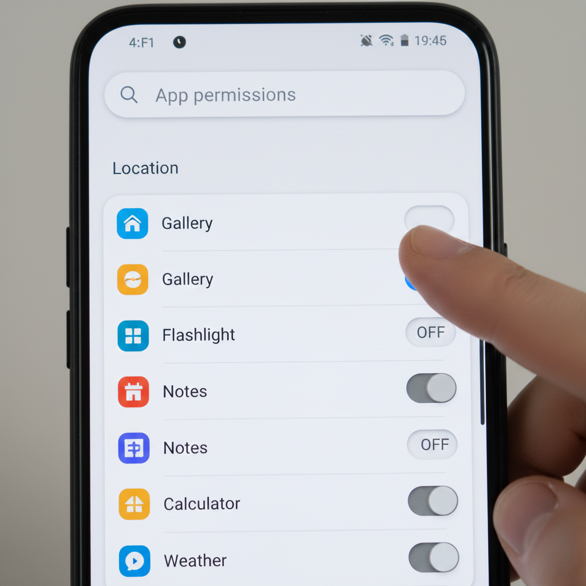

Cara mengunci aplikasi di HP Infinix dapat dilakukan secara praktis melalui fitur bawaan App Lock di menu Pengaturan atau lewat aplikasi Phone Master tanpa perlu mengunduh aplikasi pihak ketiga. Cukup aktifkan App Lock, buat pola atau PIN pengaman, lalu ketuk ikon gembok di samping aplikasi penting yang ingin dilindungi dari akses orang lain.

Pernahkah Anda merasa cemas saat teman, anak, atau kerabat meminjam ponsel untuk bermain gim atau sekadar menelepon? Rasa khawatir bahwa mereka mungkin tidak sengaja membuka obrolan pesan pribadi, galeri foto keluarga, atau bahkan aplikasi perbankan digital adalah hal yang sangat wajar. Data finansial dan komunikasi personal kini tersimpan rapat di dalam genggaman ponsel pintar kita, sehingga perlindungan ganda menjadi kebutuhan penting sehari-hari.

Banyak pengguna ponsel pintar Android bergegas mencari aplikasi pengunci tambahan di Google Play Store saat menghadapi situasi ini. Padahal, memasang aplikasi pihak ketiga sering kali mendatangkan masalah baru, mulai dari banjir iklan pop-up yang mengganggu, boros daya baterai, hingga risiko privasi data yang diragukan. Untungnya, bagi para pengguna perangkat Infinix yang menjalankan antarmuka XOS, Infinix telah menyediakan fitur perlindungan berlapis yang lengkap langsung dari pabrik.

## Keuntungan Menggunakan Pengunci Bawaan XOS Infinix

Antarmuka XOS pada ponsel Infinix dibekali berbagai sarana keamanan mandiri yang terintegrasi langsung dengan kernel Android. Memanfaatkan fitur proteksi internal ini memberikan sejumlah manfaat nyata dibandingkan aplikasi unduhan luar:

- **Performa Ringan dan Stabil:** Fitur App Lock bawaan tidak membebani memori RAM dan tidak menghabiskan baterai di latar belakang karena bekerja langsung di level sistem operasi.
- **Bebas Iklan Menjengkelkan:** Anda tidak akan pernah terganggu oleh iklan layar penuh yang tiba-tiba melompat saat membuka aplikasi penting.
- **Sulit Ditembus:** Berbeda dari aplikasi pengunci pihak ketiga yang bisa dinonaktifkan dengan memaksa berhenti (*force stop*) atau dihapus (*uninstall*), proteksi bawaan XOS tetap aktif melindungi aplikasi bahkan saat ponsel baru saja dinyalakan ulang.
- **Dukungan Biometrik Cepat:** Sistem penguncian dapat diselaraskan langsung dengan pemindai sidik jari (*fingerprint*) maupun sensor pengenalan wajah (*face unlock*) bawaan ponsel.

*Sumber: [Carlcare Service Official](https://www.carlcare.com/id/tips-detail/2786/)*

## Cara Mengunci Aplikasi di HP Infinix Lewat Pengaturan

Jalur pertama yang paling standar untuk mengaktifkan penguncian aplikasi adalah melalui menu Pengaturan (*Settings*). Cara ini berlaku untuk sebagian besar model Infinix Hot, Smart, Note, hingga seri Zero yang menjalankan XOS versi modern.

Berikut langkah demi langkah yang bisa Anda terapkan:

1. Buka aplikasi **Pengaturan** (*Settings*) pada ponsel Infinix Anda.
2. Gulir ke bawah lalu temukan dan pilih menu **Keamanan** (*Security*) atau **Kata Sandi & Keamanan** (*Password & Security*).
3. Cari opsi bertajuk **Kunci Aplikasi** (*App Lock*) dan ketuk opsi tersebut.
4. Pada layar awal, sistem akan meminta Anda menggambar pola sandi (*Pattern*) pertama kali. Gambarlah bentuk pola yang mudah Anda ingat namun sulit ditebak oleh orang lain.
5. Konfirmasikan kembali pola sandi tersebut dengan menggambar pola yang sama persis sekali lagi.
6. Masukkan jawaban untuk pertanyaan keamanan (*Security Question*) atau tautkan akun Infinix ID Anda. Tahap ini sangat krusial sebagai metode pemulihan jika sewaktu-waktu Anda lupa pola kunci.
7. Setelah masuk ke daftar aplikasi, Anda akan melihat semua aplikasi yang terpasang di ponsel. Ketuk ikon gembok abu-abu di samping aplikasi yang ingin Anda lindungi (seperti WhatsApp, Galeri, Dana, Shopee, atau Gmail) hingga ikon berubah warna menjadi hijau dan tertutup rapat.

Sekarang, setiap kali aplikasi tersebut disentuh di layar utama, sistem akan otomatis meminta verifikasi pola keamanan sebelum menampilkan antarmuka aplikasi.

## Cara Mengunci Aplikasi Melalui Aplikasi Phone Master

Selain melalui menu Pengaturan, pengguna Infinix juga dapat memanfaatkan aplikasi bawaan **Phone Master**. Phone Master merupakan pusat utilitas resmi yang selalu terpasang di semua gawai Infinix, TECNO, dan itel.

Jika Anda lebih nyaman mengaksesnya dari layar utama, ikuti tahapan praktis berikut:

1. Temukan dan buka aplikasi **Phone Master** dari laci aplikasi atau layar beranda ponsel Anda.
2. Pada halaman utama Phone Master, gulir sedikit ke bawah menuju bagian kelompok menu **Privasi & Keamanan** (*Privacy & Security*).
3. Ketuk menu bertuliskan **Kunci Aplikasi** (*App Lock*).
4. Masukkan kode sandi atau pola keamanan yang telah Anda buat sebelumnya (atau ikuti instruksi pembuatan sandi baru jika baru pertama kali menggunakannya).
5. Tandai aplikasi yang ingin dikunci dengan menyentuh ikon gembok di sebelah kanan nama aplikasi.
6. Tekan tombol kembali untuk keluar dari aplikasi Phone Master. Pengaturan otomatis tersimpan secara instan.

Kedua metode di atas sebenarnya terhubung pada satu modul sistem yang sama, sehingga perubahan yang Anda buat di Phone Master akan otomatis berlaku pada menu Pengaturan sistem.

## Membuka Aplikasi Terkunci Menggunakan Sensor Sidik Jari

Menggambar pola berulang kali setiap kali membuka aplikasi perpesanan terkadang terasa melelahkan, terutama saat Anda sedang sibuk beraktivitas. Anda bisa mengaktifkan integrasi sensor sidik jari agar proses buka kunci berlangsung sekejap mata.

Langkah mengaktifkannya sangat mudah:

1. Pastikan Anda sudah mendaftarkan minimal satu jari di menu **Pengaturan** > **Keamanan** > **Sidik Jari** (*Fingerprint*).
2. Masuk kembali ke menu **Kunci Aplikasi** (*App Lock*) baik lewat Pengaturan maupun Phone Master.
3. Ketuk ikon **Roda Gigi** (*Settings*) yang terletak di pojok kanan atas layar App Lock.
4. Temukan opsi bertuliskan **Tambahkan sidik jari untuk membuka kunci** (*Add fingerprint to unlock*).
5. Geser sakelar di sampingnya ke posisi **Aktif** (berwarna biru atau hijau).

Mulai saat itu, Anda cukup menempelkan jari yang terdaftar pada sensor sidik jari ponsel untuk membuka aplikasi yang terkunci tanpa perlu repot menggambar pola di layar.

## Pengaturan Lanjutan untuk Privasi Maksimal

Di dalam halaman pengaturan App Lock (ikon roda gigi), XOS menyediakan beberapa setelan privasi tambahan yang sangat berguna untuk disesuaikan:

### 1. Sembunyikan Konten Notifikasi (Hide Notification Content)
Fitur ini mencegah isi pesan pribadi (misalnya pesan WhatsApp atau SMS perbankan) terbaca di panel notifikasi atau layar kunci oleh orang lain. Notifikasi tetap masuk, namun isinya disamarkan sampai Anda membuka aplikasi yang bersangkutan.

### 2. Sembunyikan Jejak Pola (Make Pattern Visible)
Saat Anda mematikan sakelar ini, garis pola yang Anda gambar di layar tidak akan meninggalkan jejak visual. Hal ini sangat efektif melindungi sandi Anda dari pandangan orang lain yang suka melirik dari samping (*shoulder surfing*).

### 3. Waktu Penguncian Kembali (Locking Method)
Anda dapat memilih kapan aplikasi harus terkunci kembali:
- Segera setelah layar terkunci (*After Lock Screen*).
- Segera setelah layar mati atau setelah Anda beralih keluar aplikasi (*After Locking Screen or Exiting App*). Opsi ini paling disarankan untuk menjaga keamanan tingkat tinggi.
- 1 menit setelah Anda meninggalkan aplikasi (*1 Min after Locking Screen or Exiting App*).

## Perbedaan Kunci Aplikasi dan Fitur Sembunyikan Aplikasi (XHide)

Bagi Anda yang menginginkan tingkat privasi yang jauh lebih tersembunyi, Infinix juga melengkapi sistem XOS dengan fitur bernama **XHide** (atau *Private Space* di beberapa versi).

Penting untuk memahami perbedaan kedua fitur ini agar Anda tidak keliru dalam memilih solusi privasi:

- **Kunci Aplikasi (App Lock):** Ikon aplikasi tetap terlihat normal di layar utama dan laci aplikasi ponsel. Siapa pun bisa melihat ikon tersebut, tetapi saat mereka mencoba membukanya, sistem memblokir akses dengan meminta verifikasi PIN, pola, atau sidik jari.
- **Sembunyikan Aplikasi (XHide / Vault):** Ikon aplikasi lenyap sepenuhnya dari layar utama dan daftar aplikasi. Aplikasi hanya bisa dimunculkan dan diakses dengan memasukkan kode panggilan rahasia di menu Dial telepon atau melalui gestur khusus dua jari di layar.

Jika tujuan Anda sekadar mengamankan WhatsApp atau galeri dari tangan usil teman, App Lock sudah lebih dari cukup. Namun bila Anda ingin menyembunyikan dokumen rahasia atau aplikasi kerja tanpa ada yang tahu keberadaannya di perangkat, XHide adalah pilihan pelengkap yang sempurna.

## Cara Mengatasi Lupa Kata Sandi Kunci Aplikasi di Infinix

Bagaimana jika suatu hari Anda lupa bentuk pola atau PIN yang digunakan untuk mengunci aplikasi? Jangan terburu-buru melakukan reset pabrik yang dapat menghapus seluruh data ponsel.

Ada dua jalur pemulihan resmi yang disediakan Infinix:

1. **Jawab Pertanyaan Keamanan:** Saat Anda salah menggambar pola beberapa kali, ketuk opsi **Lupa Kata Sandi** (*Forgot Password*) yang muncul di bawah layar. Jawab pertanyaan pemulihan yang telah Anda buat pada awal konfigurasi (misalnya nama panggilan atau makanan favorit). Jika jawaban benar, Anda akan diarahkan untuk membuat pola baru.
2. **Reset Lewat Akun Infinix ID:** Jika Anda telah menautkan akun Infinix ID, sistem akan mengirimkan tautan atau kode verifikasi ke email yang terdaftar untuk mengatur ulang kata sandi aplikasi secara instan.

Menerapkan cara mengunci aplikasi di HP Infinix merupakan langkah bijak untuk menjaga keamanan privasi dan data finansial Anda dari jangkauan pihak yang tidak berkepentingan. Dengan memanfaatkan fitur internal XOS, gawai Anda tetap terlindungi kokoh tanpa kompromi performa dan tanpa gangguan iklan pihak ketiga.

> **Baca Juga:**
> - [Cara Melacak HP Hilang Android dengan Find My Device](/cara-melacak-hp-hilang-android/)
> - [Cara Hapus Malware di HP Samsung Tanpa Reset Pabrik](/cara-hapus-malware-di-hp-samsung/)

Sumber: [Carlcare Service Official](https://www.carlcare.com/id/tips-detail/2786/)
