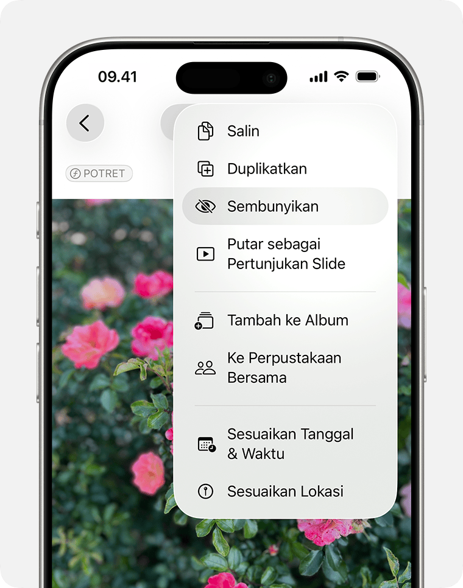

Cara sembunyikan foto video di iPhone dapat dilakukan langsung lewat aplikasi Foto bawaan tanpa aplikasi pihak ketiga. Cukup pilih foto atau video, ketuk ikon menu lainnya, lalu pilih opsi Sembunyikan. Media otomatis dipindahkan ke album Tersembunyi yang terkunci Face ID dan bisa dihilangkan dari menu navigasi lewat Pengaturan sistem.

Pernahkah Anda meminjamkan iPhone ke teman atau kerabat hanya untuk memperlihatkan satu foto liburan, tetapi mendadak merasa cemas jika mereka menggeser layar terlalu jauh? Kekhawatiran semacam ini sangat wajar dirasakan siapa pun. Galeri ponsel sering kali memuat tangkapan layar transaksi perbankan, dokumen identitas, foto keluarga yang privat, atau rekaman video kenangan yang tidak ingin kita bagikan secara terbuka.

Beberapa tahun lalu, banyak pengguna menyiasati masalah ini dengan mengunduh aplikasi kalkulator palsu atau brankas foto pihak ketiga dari App Store. Namun, menyimpan media pribadi di aplikasi semacam itu memiliki risiko tersendiri, mulai dari potensi kebocoran data, iklan mengganggu, hingga risiko file korup saat aplikasi tidak diperbarui. Untungnya, Apple telah membenahi sistem privasi galeri secara menyeluruh sejak pembaruan iOS 16 hingga versi terbaru saat ini. Kini Anda bisa mengunci dan menyamarkan media sensitif secara elegan memanfaatkan fitur keamanan bawaan sistem.

## Mengapa Memanfaatkan Fitur Bawaan Lebih Aman

Aplikasi Foto di iOS kini memperlakukan privasi visual dengan sangat serius. Saat Anda menyembunyikan media, foto dan video tersebut tidak hanya disingkirkan dari kisi pustaka utama (*Library*). Media itu juga otomatis dihilangkan dari tampilan album kenangan (*Memories*), album otomatis, fitur pencarian Spotlight, serta widget Foto yang terpasang di Layar Utama (*Home Screen*).

Lebih menariknya lagi, Apple mengunci album Tersembunyi (*Hidden Album*) secara baku menggunakan Face ID, Touch ID, atau kode sandi perangkat. Siapa pun yang sedang memegang ponsel Anda yang tidak terkunci tetap tidak akan bisa membuka album tersebut tanpa verifikasi wajah atau sidik jari pemilik asli.

*Sumber: [Apple Support](https://support.apple.com/id-id/104987)*

## Langkah Mudah Menyembunyikan Foto dan Video di iPhone

Proses menyembunyikan media dapat dilakukan untuk satu foto secara cepat maupun puluhan video sekaligus. Berikut tahapan yang bisa langsung Anda ikuti:

1. Buka aplikasi **Foto** di iPhone Anda.
2. Cari dan temukan foto atau rekaman video yang ingin Anda amankan.
3. Jika ingin menyembunyikan satu file, sentuh dan tahan foto tersebut hingga menu konteks muncul. Bila ingin menyembunyikan banyak file sekaligus, ketuk tombol **Pilih** di sudut atas layar, lalu tandai semua foto dan video yang diinginkan.
4. Ketuk ikon tombol tiga titik (**...**) yang berada di bagian sudut layar.
5. Pilih opsi bertuliskan **Sembunyikan** (*Hide*).
6. Sebuah jendela konfirmasi akan muncul di bagian bawah layar. Ketuk tulisan **Sembunyikan Foto** atau **Sembunyikan Video** untuk memvalidasi perintah.

Setelah konfirmasi diberikan, seluruh media yang dipilih seketika lenyap dari kisi galeri biasa. Anda tidak perlu khawatir file tersebut terhapus karena status file hanya dialihkan ke ruang penyimpanan privat.

## Cara Mengakses Kembali Album Tersembunyi

Bagi yang baru pertama kali mencoba fitur ini, Anda mungkin sempat bertanya-tanya ke mana perginya foto-foto tersebut. Semua media yang disembunyikan berkumpul di folder khusus bernama Tersembunyi.

Berikut cara membuka dan melihat isinya:

1. Di dalam aplikasi **Foto**, gulir layar ke bagian bawah hingga Anda menemukan bagian bertajuk **Utilitas** (*Utilities*).
2. Anda akan melihat baris bernama **Tersembunyi** (*Hidden*) yang ditandai dengan ikon gembok kecil di sebelahnya.
3. Ketuk album tersebut. Sistem akan langsung mengaktifkan kamera TrueDepth untuk memindai wajah Anda via Face ID (atau meminta Touch ID dan kode sandi pada model iPhone yang relevan).
4. Setelah verifikasi berhasil, seluruh koleksi foto dan video pribadi Anda akan terbuka.

Jika suatu saat Anda ingin mengembalikan media tertentu ke galeri utama, caranya sangat sederhana. Masuk ke dalam album Tersembunyi, sentuh dan tahan foto yang bersangkutan, lalu ketuk opsi **Tunjukkan** (*Unhide*). Foto tersebut akan kembali muncul di posisi tanggal aslinya pada pustaka galeri.

## Trik Menghilangkan Folder Tersembunyi dari Tampilan Aplikasi

Meskipun album Tersembunyi sudah terkunci rapat dengan Face ID, keberadaan tulisan "Tersembunyi" di menu Utilitas terkadang masih bisa memicu rasa penasaran orang lain yang meminjam ponsel Anda. Mereka mungkin tahu bahwa ada sesuatu yang Anda simpan di sana.

Agar privasi Anda benar-benar kedap dari pandangan orang lain, Anda bisa melenyapkan baris album Tersembunyi tersebut dari aplikasi Foto:

1. Buka aplikasi **Pengaturan** (*Settings*) di iPhone Anda.
2. Gulir ke bawah lalu ketuk menu **App**, kemudian pilih **Foto** (pada iOS versi lama, menu Foto dapat langsung diakses di halaman utama Pengaturan).
3. Cari menu opsi bertuliskan **Tampilkan Album Tersembunyi** (*Show Hidden Album*).
4. Geser tombol sakelar di sampingnya ke posisi **Nonaktif** (berubah menjadi abu-abu).

Begitu sakelar dimatikan, baris album Tersembunyi di dalam menu Utilitas aplikasi Foto akan hilang tanpa jejak. Foto dan video Anda tetap aman tersimpan di dalam memori, hanya saja pintu masuknya ditutup rapat. Saat Anda ingin melihat atau menambah foto baru, cukup ulangi langkah di atas dan aktifkan kembali sakelar tersebut untuk sementara waktu.

## Bagaimana Pengaruhnya Terhadap Sinkronisasi iCloud

Bagi Anda yang mengaktifkan fitur Foto iCloud (*iCloud Photos*), sistem penyimpanan Apple bekerja secara terintegrasi antarperangkat. Hal ini memberikan keuntungan sekaligus hal penting yang perlu diperhatikan:

- **Sinkronisasi Status Privasi:** Foto atau video yang Anda sembunyikan di iPhone akan otomatis disembunyikan di iPad, Mac, maupun Apple Vision Pro yang terdaftar pada Akun Apple yang sama. Anda tidak perlu repot menyembunyikannya satu per satu di setiap gawai.
- **Perlindungan di Perangkat Lain:** Di komputer Mac, album Tersembunyi juga dilindungi oleh Touch ID atau kata sandi akun macOS Anda, sehingga media tidak akan terpampang begitu saja saat laptop Anda digunakan orang lain.

## Tips Menjaga Privasi Galeri Tetap Maksimal

Menyembunyikan media ke album privat merupakan langkah perlindungan yang sangat efektif. Untuk menyempurnakannya, berikut beberapa kebiasaan baik yang layak diterapkan:

- **Periksa Folder Baru Dihapus:** Jika Anda berniat menghapus foto sensitif secara permanen, ingatlah bahwa iOS menyimpannya selama 30 hari di folder Baru Dihapus (*Recently Deleted*). Folder ini juga dilindungi Face ID, namun sebaiknya langsung kosongkan folder tersebut jika file memang harus dimusnahkan.
- **Hati-hati dengan Fitur Berbagi Foto:** Saat membagikan foto dari aplikasi pesan instan seperti WhatsApp atau Telegram, menu pemilih gambar sistem terkadang menampilkan seluruh rol kamera. Pastikan Anda tidak salah memilih file saat sedang terburu-buru.
- **Aktifkan Kunci Aplikasi Tambahan:** Pada pembaruan iOS 18 ke atas, Apple juga menambahkan opsi untuk mengunci aplikasi Foto secara menyeluruh langsung dari Layar Utama dengan menahan ikon aplikasi dan memilih Kunci dengan Face ID.

Dengan memahami cara sembunyikan foto video di iphone beserta trik menyamarkan foldernya, Anda tidak perlu lagi panik setiap kali ada rekan kerja atau anggota keluarga yang ingin meminjam ponsel. Privasi pribadi tetap terjaga aman di balik enkripsi dan perlindungan biometrik bawaan Apple.

> **Baca Juga:**
> - [Cara Buka Kunci Aplikasi iPhone Praktis dan Mudah](/cara-buka-kunci-aplikasi-iphone/)
> - [Cara Blokir Panggilan Spam di iPhone Tanpa Ribet](/cara-blokir-panggilan-spam-di-iphone/)

Sumber: [Apple Support](https://support.apple.com/id-id/104987)
