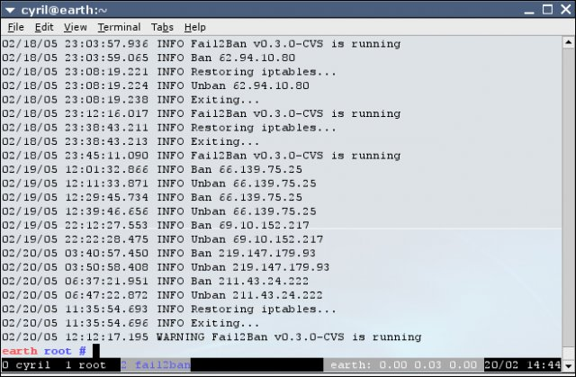

Mengoperasikan server Linux atau Virtual Private Server (VPS) yang terhubung langsung ke internet publik selalu membawa konsekuensi keamanan jaringan yang nyata. Port default 22 untuk protokol Secure Shell (SSH) merupakan sasaran empuk yang terus dipindai oleh automated botnet selama 24 jam sehari. Hanya dalam hitungan jam setelah sebuah mesin publik aktif, berkas log otentikasi biasanya langsung dibanjiri oleh ribuan upaya koneksi ilegal yang mencoba menebak kombinasi username dan password populer menggunakan metode serangan brute force.

Selain menghabiskan sumber daya komputasi CPU dan bandwidth jaringan hanya untuk melayani proses negosiasi cryptographic handshake dari bot jahat, serangan tebak kata sandi tanpa henti ini meningkatkan risiko kompromi akun server. Firewall statis konvensional seperti aturan standar UFW atau iptables hanya mampu membuka atau menutup port secara permanen. Jika port SSH dibuka untuk publik agar administrator dapat bekerja dari mana saja, firewall statis tidak memiliki kecerdasan untuk memilah mana koneksi login sah dan mana lalu lintas serangan yang agresif.

Implementasi **cara setting fail2ban** di Linux menjadi benteng pertahanan lini pertama yang sangat penting bagi administrator jaringan. Fail2ban beroperasi sebagai daemon pencegahan intrusi berbasis host (Host-based Intrusion Prevention System atau IPS). Kerangka kerja ini secara proaktif membaca log sistem atau systemd journal, melacak frekuensi kegagalan otentikasi per alamat IP sumber, dan secara otomatis menyuntikkan aturan blokir (*drop rule*) ke mesin filter paket kernel (seperti nftables, UFW, atau iptables) ketika ambang batas toleransi telah terlampaui.

## Anatomi dan Cara Kerja Fail2ban di Linux

Sebelum melangkah ke tahap instalasi, memahami alur kerja internal Fail2ban akan sangat memudahkan proses debugging dan penyusunan kebijakan isolasi jaringan. Struktur kerja Fail2ban tersusun atas beberapa komponen modular:

1. **Log Source atau Journal:** Sumber berkas tempat Fail2ban membaca rekaman otentikasi. Pada distribusi Linux modern, log otentikasi tidak lagi ditulis ke berkas teks biasa `/var/log/auth.log`, melainkan ditampung langsung di dalam *systemd journal*.
2. **Filter (`filter.d`):** Kumpulan berkas deklarasi regular expression (regex) yang mendeteksi pola baris kegagalan login (seperti `Failed password for ... from <HOST>`).
3. **Fail Ticket dan Counter:** Mesin internal Fail2ban yang mencatat berapa kali sebuah alamat IP gagal melakukan otentikasi dalam rentang waktu evaluasi (`findtime`).
4. **Action (`action.d`):** Perintah shell atau skrip Python yang dieksekusi saat alamat IP harus diblokir (`actionban`) dan saat masa hukuman berakhir (`actionunban`).
5. **Jail (`jail.local`):** Entitas konfigurasi utama yang menggabungkan sumber log, pola filter, ambang batas kegagalan, dan aksi pemblokiran untuk satu layanan spesifik.


*Sumber: [Fail2ban Official Project via Wikimedia Commons](https://commons.wikimedia.org/wiki/File:Fail2ban_screenshot.jpg)*

Pada sistem modern berbasis nftables, Fail2ban bekerja sangat efisien. Ketika aksi blokir dipicu, Fail2ban tidak menambah ratusan baris aturan rantai firewall secara berantakan, melainkan memasukkan alamat IP pelanggar ke dalam satu struktur *address set* pada tabel nftables khusus bernama `inet f2b-table`. Paket data dari IP tersebut langsung ditolak pada prioritas paling awal sebelum membebani aplikasi di server.

## Prasyarat Konfigurasi

Untuk mengikuti panduan teknis ini, pastikan mesin Anda memenuhi kriteria berikut:

- Sistem operasi Linux (Debian 12 Bookworm, Debian 13 Trixie, Ubuntu 22.04 LTS, Ubuntu 24.04 LTS, atau rilis Linux sejenis).
- Hak akses administratif `sudo` atau root penuh pada mesin lokal atau VPS.
- Layanan OpenSSH server yang sedang aktif berjalan.
- Paket filter kernel (nftables atau UFW) yang siap digunakan sebagai backend pemblokiran.

## Langkah Demi Langkah Setting Fail2ban di Linux

Ikuti urutan langkah berikut secara berurutan untuk memasang, mengonfigurasi, dan menguji Fail2ban dengan standar keamanan produksi.

### 1. Instalasi Paket Fail2ban dan Dependensi Journal

Langkah pertama adalah memperbarui basis data paket repositori dan mengunduh komponen Fail2ban beserta dependensi integrasi systemd:

```bash
sudo apt update
sudo apt install fail2ban python3-systemd nftables -y
```

Paket `python3-systemd` sangat penting. Pada Debian 12 ke atas dan Ubuntu versi baru, paket `rsyslog` tidak lagi dipasang secara bawaan, sehingga Fail2ban memerlukan binding Python untuk membaca event dari systemd journal secara langsung.

### 2. Membuat Salinan Konfigurasi jail.local

Fail2ban menyediakan berkas konfigurasi default bawaan di `/etc/fail2ban/jail.conf`. Jangan pernah mengedit berkas `jail.conf` secara langsung. Berkas tersebut akan selalu ditimpa dan dikembalikan ke setelan pabrik setiap kali paket Fail2ban menerima pembaruan dari repositori distro.

Fail2ban membaca berkas konfigurasi dengan hierarki prioritas: `jail.conf` dibaca pertama kali, kemudian ditimpa oleh berkas kustom berekstensi `.local`. Buat berkas baru `/etc/fail2ban/jail.local`:

```bash
sudo cp /etc/fail2ban/jail.conf /etc/fail2ban/jail.local
```

Atau Anda dapat membuat berkas bersih yang hanya memuat parameter yang ingin diubah.

### 3. Mengatur Parameter Global pada Blok DEFAULT

Buka berkas `/etc/fail2ban/jail.local` menggunakan editor teks favorit:

```bash
sudo nano /etc/fail2ban/jail.local
```

Cari bagian `[DEFAULT]` dan sesuaikan parameter keamanan utama berikut:

```ini
[DEFAULT]
# Whitelist alamat IP lokal dan IP publik admin (pisahkan dengan spasi)
ignoreip = 127.0.0.1/8 ::1 192.168.1.0/24 203.0.113.15

# Durasi pemblokiran default (1h = 1 jam, 24h = 1 hari)
bantime = 1h

# Jendela waktu penghitungan percobaan gagal (10m = 10 menit)
findtime = 10m

# Batas toleransi percobaan salah sebelum IP diblokir
maxretry = 5

# Aktifkan perpanjangan waktu otomatis untuk penyerang berulang
bantime.increment = true
bantime.maxtime = 1w
bantime.factor = 2
```

Penjelasan parameter penting:
- `ignoreip`: Sangat penting untuk mencegah Anda terkunci dari server sendiri. Masukkan subnet LAN lokal kantor/rumah serta alamat IP statis yang biasa Anda gunakan untuk remote.
- `bantime.increment`: Fitur canggih Fail2ban yang secara eksponensial melipatgandakan durasi blokir jika IP yang sama kembali melakukan brute force setelah masa ban pertama berakhir (misalnya 1 jam, 2 jam, 4 jam, hingga maksimal 1 minggu).

### 4. Menentukan Mesin Banaction dan Backend Journal

Masih di dalam berkas `/etc/fail2ban/jail.local`, tentukan backend yang digunakan untuk mengeksekusi pemblokiran paket.

Jika server Anda menggunakan **nftables** (rekomendasi modern di Debian dan Ubuntu):

```ini
banaction = nftables
banaction_allports = nftables[type=allports]
backend = systemd
```

Jika server Anda dikelola menggunakan frontend **UFW (Uncomplicated Firewall)**:

```ini
banaction = ufw
backend = systemd
```

Penetapan `backend = systemd` memastikan Fail2ban tidak lagi mencari berkas statis `/var/log/auth.log`, melainkan langsung memantau unit layanan SSH via journalctl.

### 5. Mengaktifkan Jail Layanan SSH

Gulir ke bawah hingga menemukan bagian jail `[sshd]`. Konfigurasikan blok tersebut agar aktif dan menerapkan aturan khusus untuk layanan SSH:

```ini
[sshd]
enabled = true
port = ssh
filter = sshd
backend = systemd
maxretry = 3
bantime = 2h
```

Catatan penting: Jika Anda memindahkan port default SSH ke port kustom (misalnya port 2222 demi keamanan tambahan), ubah baris port menjadi:

```ini
port = 2222
```

Simpan perubahan berkas dengan menekan tombol `Ctrl+O`, lalu keluar dengan `Ctrl+X`.

### 6. Memvalidasi Sintaks dan Mengaktifkan Daemon Fail2ban

Sebelum menjalankan daemon di lingkungan produksi, lakukan validasi sintaks untuk memastikan tidak ada kesalahan ketik pada konfigurasi:

```bash
sudo fail2ban-client -t
```

Jika output terminal menampilkan pesan sukses tanpa galat, lanjutkan dengan menyalakan dan mengaktifkan service Fail2ban agar berjalan otomatis saat sistem booting:

```bash
sudo systemctl enable fail2ban
sudo systemctl restart fail2ban
```

Periksa status operasional service untuk memastikan daemon berjalan sempurna:

```bash
sudo systemctl status fail2ban
```

Output terminal harus berstatus `active (running)`.

## Cara Verifikasi dan Pengujian Operasional

Setelah service aktif, lakukan serangkaian pengujian teknis untuk memverifikasi bahwa Fail2ban benar-benar menjalankan tugas pengawasannya dengan benar.

### 1. Memeriksa Daftar Jail yang Aktif

Gunakan perintah klien Fail2ban untuk melihat ringkasan jail:

```bash
sudo fail2ban-client status
```

Output akan mengonfirmasi daftar jail yang sedang beroperasi:

```text
Status
|- Number of jail:      1
`- Jail list:           sshd
```

### 2. Memeriksa Detail dan Statistik Isolasi SSH

Untuk melihat detail alamat IP yang sedang diblokir pada layanan SSH, jalankan:

```bash
sudo fail2ban-client status sshd
```

Terminal akan menampilkan informasi detail seperti jumlah kegagalan total, jumlah kegagalan saat ini, serta daftar alamat IP penyerang yang sedang menjalani masa ban:

```text
Status for the jail: sshd
|- Filter
|  |- Currently failed: 2
|  |- Total failed:     48
|  `- File list:        
`- Actions
   |- Currently banned: 3
   |- Total banned:     12
   `- Banned IP list:   198.51.100.22 203.0.113.88 192.0.2.14
```

### 3. Memeriksa Aturan Langsung pada Mesin Kernel Firewall

Jika Anda menggunakan backend nftables, periksa apakah tabel aturan Fail2ban sudah terbentuk di tingkat kernel:

```bash
sudo nft list table inet f2b-table
```

Anda akan melihat set alamat IP terisolasi yang diikatkan ke dalam hook chain `input` dengan prioritas -1. Hal ini membuktikan bahwa paket dari alamat IP tersebut di-drop sebelum sempat diproses oleh stack aplikasi OpenSSH.

### 4. Prosedur Membuka Blokir (Unban) Alamat IP Tertentu

Jika ada rekan tim atau pengguna sah yang salah memasukkan kata sandi beberapa kali dan terkunci oleh Fail2ban, Anda dapat membuka blokir alamat IP tersebut secara instan tanpa perlu me-restart service:

```bash
sudo fail2ban-client set sshd unbanip 203.0.113.88
```

Output terminal akan mengonfirmasi alamat IP yang telah berhasil dilepaskan dari daftar isolasi.

### 5. Memantau Log Aktivitas Real-Time

Untuk memantau aktivitas pencocokan pola kegagalan login dan pemicuan aksi ban secara langsung, pantau berkas log Fail2ban:

```bash
sudo tail -f /var/log/fail2ban.log
```

Log akan menampilkan baris informatif setiap kali ada IP yang terdeteksi (`Found`) dan dieksekusi pemblokirannya (`Ban`).

## Solusi Kendala Umum (Troubleshooting)

Berikut adalah beberapa skenario galat yang paling sering ditemui saat mengonfigurasi Fail2ban beserta solusi teknisnya.

### 1. Galat "Have not found any log file for sshd jail"

**Penyebab:** Kesalahan ini muncul pada Debian 12 Bookworm, Debian 13, atau Ubuntu 24.04 karena berkas `/var/log/auth.log` tidak tersedia secara default di sistem tanpa rsyslog.

**Solusi:** Pastikan Anda telah memasang dependensi `python3-systemd` dan menambahkan baris `backend = systemd` di dalam blok `[sshd]` pada berkas `/etc/fail2ban/jail.local`. Hindari menggunakan `backend = auto` jika paket rsyslog tidak terpasang.

### 2. Administrator Terkunci Sendiri dari Server Remote

**Penyebab:** Alamat IP publik administrator tidak dicantumkan pada direktif whitelist dan mengalami beberapa kali kegagalan koneksi SSH.

**Solusi:** Akses server melalui konsol web penyedia VPS (VNC atau serial console). Buka blokir IP Anda menggunakan perintah CLI:

```bash
sudo fail2ban-client set sshd unbanip <ALAMAT_IP_ADMIN>
```

Setelah itu, segera tambahkan alamat IP atau subnet Anda ke dalam opsi `ignoreip` pada blok `[DEFAULT]` di `/etc/fail2ban/jail.local` lalu muat ulang konfigurasi:

```bash
sudo fail2ban-client reload
```

### 3. Ketidaksesuaian Pola Filter pada OpenSSH Versi 9.8 ke Atas

**Penyebab:** Pada rilis OpenSSH 9.8 dan yang lebih baru, proses pemrosesan sesi otentikasi dipisahkan menjadi child process dengan identifier `sshd-session`. Distribusi Linux yang menggunakan paket Fail2ban versi lama mungkin gagal mencocokkan log otentikasi.

**Solusi:** Pastikan filter sshd Anda mendukung identifier `sshd-session`. Anda dapat menguji kecocokan ekspresi reguler terhadap entri journal terkini menggunakan tool bawaan `fail2ban-regex`:

```bash
sudo fail2ban-regex systemd-journal /etc/fail2ban/filter.d/sshd.conf
```

Jika terdeteksi kegagalan tangkapan pola, perbarui paket Fail2ban dari repositori distribusi Anda ke versi 1.0.2 atau 1.1.0 yang sudah menyertakan patch identifikasi `sshd-session` secara baku.

> **Baca Juga:**
> - [Panduan Lengkap Linux Nftables Examples](/panduan-lengkap-linux-nftables-examples/)
> - [Panduan Lengkap Linux Nftables Firewall](/panduan-lengkap-linux-nftables-firewall/)

Sumber: [Fail2ban Official Documentation](https://github.com/fail2ban/fail2ban)
