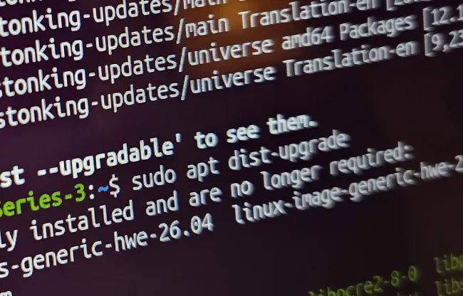

Proyek Debian resmi merilis pembaruan keamanan darurat DSA-6607-1 untuk manajer paket APT guna menambal kerentanan CVE-2026-109518. Celah ini memungkinkan penyerang man-in-the-middle menyusupkan paket berbahaya dan mengeksekusi kode arbitrer dengan hak akses root penuh saat sistem melanjutkan unduhan repositori berbasis protokol HTTP. Pengguna Debian diminta segera memperbarui paket ke APT 3.0.4.

Kabar ini tentu jadi pengingat keras buat para sysadmin dan pengguna Linux, om. Selama ini kita terbiasa menganggap manajer paket turunan Debian sangat kebal dari serangan jaringan berkat tanda tangan digital GPG. Namun celah logika penanganan berkas sementara di dalam kode internal APT membuktikan bahwa celah arsitektur unduhan tetap bisa dimanfaatkan untuk membobol sistem hingga level tertinggi.

## Mekanisme Celah CVE-2026-109518 pada Handler Unduhan HTTP

Celah keamanan ini ditemukan oleh peneliti keamanan Max Justicz, figur yang sebelumnya juga sempat membongkar kerentanan kritis serupa pada ekosistem APT beberapa tahun silam. Masalah berakar pada cara modul worker HTTP internal APT (`/usr/lib/apt/methods/http`) menangani pengalihan tautan (*HTTP redirect*) saat mengambil berkas `.deb` dari server cermin (*mirror*).

Secara teknis, ketika manajer paket meminta berkas dari repositori dan server mirror mengembalikan respons redirect seperti HTTP 302 atau 301, APT berpotensi menggabungkan dua sesi unduhan berkas yang berbeda jika URI tujuan pengalihan tersebut ternyata identik. 

Situasi bertambah runyam ketika proses unduhan sempat terputus di tengah jalan lalu disambung kembali (*resumed download*) memanfaatkan header `Range`. Logika penanganan berkas sementara APT gagal mengisolasi berkas secara ketat, sehingga terjadi kebingungan status internal (*state confusion*) pada deskriptor berkas lokal.

Dalam skenario penyerangan *man-in-the-middle* (MITM), pihak luar yang berada di jalur transmisi jaringan yang sama, misalnya jaringan Wi-Fi publik, router jaringan lokal yang terkompromi, atau ISP nakal, dapat memalsukan respons pengalihan HTTP tersebut. Penyerang menyuntikkan muatan paket tiruan ke dalam penampung unduhan sementara yang sedang aktif.

## Bahaya Manipulasi Berkas Setelah Validasi Tanda Tangan Digital

Pertanyaan mendasar yang sering muncul dari komunitas adalah kenapa verifikasi kriptografi GPG tidak berhasil menahan serangan ini. Debian dan distro turunannya seperti Ubuntu memang mengamankan repositori dengan menandatangani indeks berkas `Release` dan `InRelease` memakai kunci privat resmi proyek.

Masalah fatal dari celah CVE-2026-109518 terletak pada timing penggantian berkas. Penyerang mengeksploitasi celah penggabungan aliran data unduhan untuk menukar isi arsip paket `.deb` tepat setelah tahap validasi integritas selesai diproses, atau dengan mengelabui penunjuk berkas sementara yang diverifikasi. 


*Sumber: [Debian Security Tracker](https://security-tracker.debian.org/tracker/apt)*

Ketika manajer paket menganggap seluruh pemeriksaan checksum telah lolos, APT akan menyerahkan berkas `.deb` tersebut ke utilitas `dpkg` untuk diekstrak. Pada tahap inilah masalah besar terjadi. 

Arsip paket Debian berisi skrip pemelihara sistem seperti `preinst` dan `postinst`. Skrip tersebut berjalan langsung di bawah akun `root` (`UID 0`) guna memasang layanan ke sistem operasi. Begitu paket hasil manipulasi dieksekusi, penyerang otomatis mengantongi kendali penuh atas mesin server atau komputer desktop tanpa perlu mengetahui kata sandi administrator.

Selain eksploitasi logika pengalihan unduhan, rilis penambal kali ini juga menutup sejumlah celah akses di luar batas memori (*out-of-bounds access*) yang berisiko memicu kerusakan memori (*memory corruption*) pada pustaka APT.

## Langkah Mitigasi dan Pembaruan Paket APT di Debian

Bagi pengelola infrastruktur server berbasis Debian 13 "Trixie", langkah penyelamatan terbaik adalah tidak menunda pembaruan paket. Penambal resmi telah digulirkan ke repositori stabilitas Debian melalui paket `apt` versi `3.0.4`.

Ente bisa mengecek versi paket APT yang saat ini terpasang di komputer dengan menjalankan perintah pemeriksaan kebijakan:

```bash
apt-cache policy apt
```

Bila sistem masih menjalankan versi sebelum 3.0.4, jalankan proses pembaruan repositori dan pasang tambalan khusus untuk komponen APT terlebih dahulu:

```bash
sudo apt update
sudo apt --only-upgrade install apt apt-utils libapt-pkg*
```

Penggunaan argumen `--only-upgrade` di atas sangat berguna di lingkungan server produksi agar pembaruan langsung fokus mengamankan mesin inti APT tanpa sengaja menarik perubahan besar dari paket layanan lain yang belum teruji.

Sebagai langkah pertahanan berlapis (*defense-in-depth*), pengelola jaringan juga disarankan untuk mengevaluasi daftar repositori paket sistem. Mengalihkan cermin repositori dari protokol HTTP biasa ke HTTPS (`https://`) atau memanfaatkan jaringan terisolasi seperti Tor Onion service sangat efektif menggagalkan skenario manipulasi lalu lintas data di level jaringan transit. Walau demikian, pembaruan biner paket APT tetap menjadi kewajiban mutlak karena HTTPS saja tidak menggantikan penambalan kode rentan di sisi klien.

> **Baca Juga:**
> - [Debian 13 “Trixie” Dapat Update Kernel, Tutup 1.313 CVE](/debian-13-update-kernel-1300-cve/)
> - [Kmorph Pulihkan Kernel Linux dari Crash Tanpa Perlu Reboot](/kmorph-pulihkan-kernel-linux-tanpa-reboot/)

Sumber: [Debian Security Advisory](https://lists.debian.org/debian-security-announce/2026/msg00526.html)
