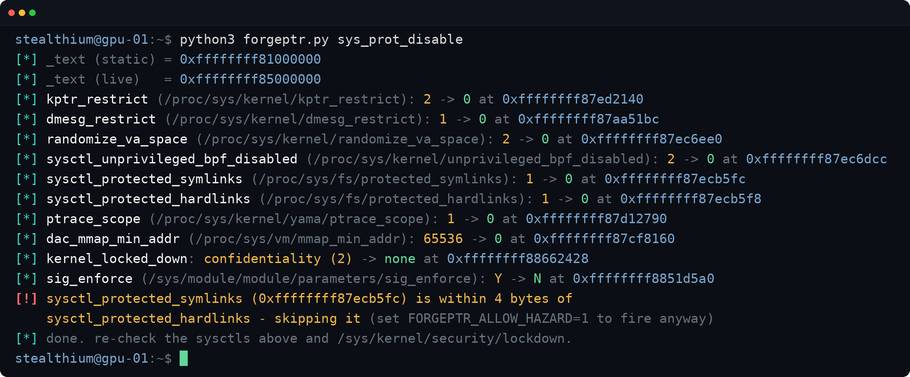

Kabar mengejutkan datang bagi para sysadmin dan pengelola infrastruktur komputasi kecerdasan buatan. Dua kerentanan keamanan berisiko tinggi bernama NvRoot dan ForgePtr resmi diungkap ke publik setelah masa embargo informasi berakhir. Celah ini bersarang langsung di dalam modul kernel driver grafis NVIDIA untuk sistem operasi Linux.

Dua kerentanan berisiko tinggi bernama NvRoot (CVE-2026-47591) dan ForgePtr (CVE-2026-47501) ditemukan bersarang pada driver GPU Linux NVIDIA selama empat tahun terakhir. Celah ini memungkinkan proses tanpa hak istimewa di dalam kontainer cloud melompat keluar, menimpa berkas sistem di memori, dan menguasai akses root pada sistem operasi host secara deterministik.

Kondisi ini menjadi peringatan keras bagi siapa saja yang menyewakan atau memakai mesin GPU bersama. Kalau ente perhatikan tren sewa komputasi GPU belakangan ini di berbagai penyedia neocloud, pemisahan lingkungan kerja antar pengguna biasanya hanya mengandalkan kontainer biasa tanpa isolasi virtualisasi tingkat perangkat keras penuh. Temuan ini membuktikan bahwa batas isolasi tersebut runtuh seketika ketika driver GPU di tingkat host memiliki cacat logika mendasar.

## Memahami Anatomi Bahaya NvRoot dan ForgePtr

Dalam arsitektur komputasi modern, driver GPU memegang peran yang sangat istimewa sekaligus berbahaya. Demi mengejar performa akselerasi beban kerja AI dan pembelajaran mesin tanpa beban tambahan (zero copy), driver grafis kerap mengambil memori milik proses biasa di ruang pengguna lalu memberi izin kepada prosesor grafis untuk membaca dan menulis area tersebut secara langsung.

Pola kerja seperti ini menuntut kehati-hatian tingkat tinggi. Sayangnya, dua celah yang ditemukan oleh tim peneliti Stealthium memperlihatkan kelalaian fatal pada logika validasi perizinan memori internal driver NVIDIA.

Kerentanan pertama diberi nama NvRoot dengan kode registrasi CVE-2026-47591. Celah ini tergolong sebagai kelemahan otorisasi yang tidak tepat (CWE-863). NVIDIA memberikan skor CVSS sebesar 7.8 kategori Tinggi. Namun bagi penyedia komputasi awan yang membagi satu GPU fisik ke banyak penyewa (multi tenant), risikonya berada di level kritis karena siapa pun yang menyewa pecahan GPU dapat merebut hak kendali penuh atas komputer induk.

Sementara kerentanan kedua dinamai ForgePtr dengan kode CVE-2026-47501. Celah ini memberikan kemampuan kepada proses tanpa hak istimewa untuk menulis bita data sembarang ke alamat memori kernel mana pun yang ditargetkan. Bahaya semacam ini mirip dengan rentetan [penemuan ratusan celah privilege escalation di kernel Linux oleh OpenAI](/openai-temukan-948-celah-lpe-kernel-linux/) beberapa waktu lalu, namun kali ini terjadi langsung di dalam modul perangkat keras milik vendor kartu grafis raksasa.

## Cara NvRoot Memaksa GPU Menimpa File Read Only

Bagaimana proses pengguna biasa bisa berubah menjadi akun root tanpa perlu memanipulasi celah race condition yang rumit? Kunci eksploitasi NvRoot terletak pada permintaan penguncian halaman memori (memory pinning) ke driver NVIDIA.

Ketika suatu aplikasi meminta driver untuk mengunci memori agar GPU bisa mengaksesnya, aplikasi tersebut menyertakan dua parameter izin yang berbeda, yakni izin akses untuk sisi CPU dan izin akses untuk sisi GPU. Secara aturan semestinya kedua izin ini diverifikasi secara ketat dan saling mengikat.

Driver NVIDIA versi lawas ternyata hanya melihat izin pada kolom CPU saja tanpa pernah memeriksa kesesuaian kolom GPU di seberangnya. Jika sebuah aplikasi mengirimkan instruksi yang menyatakan sisi CPU hanya boleh membaca (read only) tetapi sisi GPU boleh menulis (writable), driver langsung meloloskannya begitu saja.

Karena sistem operasi Linux menggunakan memori bersama yang didukung oleh cache berkas (page cache) untuk berkas yang berstatus hanya baca, kartu GPU akhirnya mendapatkan jalur tulis langsung ke memori berkas sistem asli. Penyerang cukup mengarahkan pemetaan memori ini ke program binary dengan bit setuid yang bisa dibaca semua orang, seperti berkas `/usr/bin/su`.

GPU lantas menimpa salinan berkas `/usr/bin/su` yang tersimpan di dalam memori cache dengan baris perintah berbahaya buatan penyerang. Ketika program `/usr/bin/su` dipanggil, kernel Linux melihat bit setuid asli di piringan disk masih utuh sehingga kernel tetap memberikan hak istimewa root. Namun instruksi yang dijalankan oleh prosesor adalah instruksi palsu yang sudah diselipkan penyerang di memori. Dalam sekejap, pengguna dengan identitas UID 1001 berubah menjadi root sejati tanpa mengubah satu bita pun berkas fisik di media penyimpanan.

## ForgePtr dan Manipulasi Event Buffer Mematikan Pertahanan Kernel

Jika NvRoot bekerja dengan memanfaatkan kelalaian pemeriksaan izin memori, ForgePtr justru berpangkal dari ketiadaan validasi galat (missing error check) yang tampak sangat sepele pada jalur penyiapan penyangga kejadian (event buffer) driver NVIDIA.

Pengguna mengirimkan pegangan identifikasi (handle) yang gagal diurai ke driver. Karena tidak ada validasi apakah konversi handle tersebut berhasil atau gagal, driver tetap menyimpan nilai mentah kiriman penyerang seolah olah itu adalah penunjuk memori kernel yang valid. Begitu objek tersebut dibebaskan dari memori, kernel secara otomatis mengurangi angka pencacah (counter decrement) tepat pada alamat yang ditentukan penyerang.

Operasi pengurangan angka berulang kali pada satu bita akan membuat nilainya bergulir (wrap around) melewati semua kemungkinan angka hingga mendarat pada nilai yang diinginkan. Digabungkan dengan teknik pembacaan tata letak alamat kernel, penyerang memperoleh senjata penulisan memori kernel sembarang (arbitrary write primitive).

*Sumber: [Stealthium Research](https://stealthium.io/blog/forgeptr)*

Senjata penulisan memori ini dipakai untuk menimpa variabel kernel global bernama `core_pattern`. Di Linux, `core_pattern` menentukan program apa yang harus dijalankan sistem saat sebuah aplikasi mengalami gangguan fatal atau crash. Variabel ini bersifat global dan tidak diisolasi oleh ruang nama (namespace) kontainer.

Penyerang tinggal menyetel `core_pattern` agar memanggil skrip berbahaya di dalam kontainer melalui tautan simbolik khusus `/proc/%P/root/`. Ketika proses sengaja digugurkan, kernel sistem induk akan mengeksekusi skrip tersebut dengan hak root langsung di tingkat sistem operasi host.

Lebih parahnya lagi, ForgePtr terbukti sanggup melucuti seluruh sistem pertahanan modern Linux yang selama ini diandalkan para administrator. Mulai dari mematikan pengacakan memori (ASLR) lewat variabel `randomize_va_space`, melumpuhkan fitur Kernel Lockdown dengan mengubah nilai `kernel_locked_down` menjadi kosong, hingga mematikan kewajiban tanda tangan modul digital pada variabel `sig_enforce`. Akibatnya, modul kernel liar tanpa sertifikat resmi bisa disusupkan masuk meskipun fitur Secure Boot aktif di tingkat firmware motherboard.

Perlindungan perangkat keras seperti IOMMU pun tidak berkutik menghadapi ForgePtr. IOMMU hanya membatasi akses jalur DMA milik periferal, sementara pada kasus ForgePtr, pihak yang mengeksekusi penulisan memori adalah prosesor CPU dan kernel itu sendiri akibat tertipu oleh instruksi driver.

## Dampak Nyata pada Ekosistem Neocloud dan Multi Tenant

Celah ini bukan sekadar teori di atas kertas. Tim peneliti berhasil membuktikan bahwa eksploitasi NvRoot maupun ForgePtr berjalan konsisten dari dalam kontainer Docker biasa tanpa parameter istimewa (`--privileged`) dan tanpa wewenang tambahan seperti `CAP_SYS_ADMIN`. Cukup dengan menyediakan akses perangkat grafis ke `/dev/nvidiactl` dan `/dev/nvidia*`, kontainer sudah bisa menjebol batasan isolasi.

Dalam lanskap komputasi kecerdasan buatan saat ini, banyak perusahaan rintisan menyewa mesin GPU dengan sistem potong biaya bersama penyewa lain. Di lingkungan seperti ini, tetangga kontainer ente berpotensi membaca bobot model AI (model weights), mencuri cache percakapan inferensi, menyadap data rahasia pelatihan model, atau menanamkan pintu belakang (backdoor) permanen di tingkat kernel sistem host.

Kerapuhan pada komponen tingkat rendah ini mengingatkan kita pada dinamika pemeliharaan kode kernel yang semakin berat di tengah gempuran otomatisasi, sebagaimana terlihat pada [insiden pengunduran diri pengembang kernel akibat banjir kode AI](/banjir-patch-ai-lorenzo-stoakes-mundur-reviewer-linux/) yang menyulitkan peninjauan kode mendalam. Cacat logika pada modul driver terbuka NVIDIA ini bahkan tercatat sudah bercokol selama empat tahun penuh sejak rilis perdana versi 515.43.04 pada Mei 2022.

## Langkah Mitigasi dan Ancaman 25 Celah Berikutnya

Tidak ada jalan pintas berupa pengaturan sysctl, konfigurasi seccomp, maupun aturan grup kendali (cgroup) yang mampu memblokir kedua eksploitasi ini. Selama aplikasi atau kontainer diizinkan membuka berkas antarmuka perangkat GPU NVIDIA, celah ini tetap dapat dijangkau.

Satu-satunya langkah pencegahan yang wajib diambil sekarang juga adalah memperbarui driver NVIDIA ke versi terbaru yang sudah memuat perbaikan resmi:

- **Perbaikan NvRoot:** Diperbaiki pada driver versi 610.57.04, versi 595.91.07 (atau 595.44.14 pada lini 595.44.x), dan versi 580.178.04.
- **Perbaikan ForgePtr:** Diperbaiki pada driver rilis 615.71.09 ke atas.

Bagi pengelola server atau kluster komputasi yang belum sempat memperbarui versi driver, tindakan darurat yang paling bijak adalah mencabut akses pemetaan perangkat `/dev/nvidia*` dari seluruh kontainer atau pengguna yang tidak sepenuhnya dipercaya.

Pihak Stealthium menegaskan bahwa NvRoot dan ForgePtr barulah permulaan. Peneliti keamanan tersebut mengonfirmasi masih memegang lebih dari 25 kerentanan berisiko Tinggi dan Kritis lainnya di seluruh ekosistem piranti lunak komputasi AI milik NVIDIA yang kini sedang menunggu giliran untuk diungkapkan secara bertahap.

> **Baca Juga:**
> - [Celah APT Debian Buka Akses Eksekusi Kode Root via MITM](/celah-apt-debian-buka-akses-root-mitm/)
> - [Kmorph Pulihkan Kernel Linux dari Crash Tanpa Perlu Reboot](/kmorph-pulihkan-kernel-linux-tanpa-reboot/)

Sumber: [Stealthium Research](https://stealthium.io/blog/nvroot)
