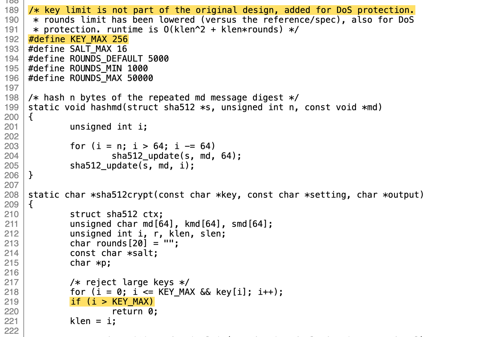

Tim pengembang OpenSSH merilis pembaruan darurat versi 10.6p2 untuk menambal celah bypass autentikasi kritis yang menyerang sistem Linux berbasis musl libc seperti Alpine Linux. Kerentanan ini memungkinkan penyerang mendapatkan akses shell SSH tanpa mengetahui password asli sama sekali pada akun tanpa sandi, hanya dengan mengirimkan string password acak sepanjang lebih dari 256 karakter dalam satu kali percobaan koneksi.

Kalau ane perhatikan arsitektur sistem operasi belakangan ini, perpaduan komponen perangkat lunak sering kali melahirkan perilaku tak terduga di luar skenario pengujian standar, om. Kerentanan yang dijuluki para peneliti keamanan sebagai *sshole ini bukan lahir dari kesalahan algoritma kriptografi yang rumit, melainkan akibat pertemuan dua keputusan desain lawas yang masing-masing tampak masuk akal pada masanya. Ketika OpenSSH yang dikompilasi tanpa dukungan modul autentikasi PAM bertemu dengan implementasi fungsi hashing musl libc, mekanisme keamanan justru membuka pintu lebar-lebar bagi siapa pun di internet yang bisa menjangkau port SSH.

## Kronologi dan Logika di Balik Karakter Bintang

Akar masalah ini bisa ditarik mundur sangat jauh ke masa awal Unix pada tahun 1980. Saat itu berkas `/etc/passwd` mulai memanfaatkan tanda bintang (`*`) pada kolom sandi untuk menandai akun sistem yang tidak boleh dimasuki menggunakan password konvensional, misalnya akun daemon. Karena tanda bintang bukanlah hasil enkripsi yang valid, sistem operasi menjamin tidak ada password apa pun yang bisa cocok. Pola tersebut tetap dipertahankan hingga era berkas bayangan modern `/etc/shadow`.

Pada tahun 2012, pengembang musl libc memperbarui fungsi bawaan `crypt()` agar tidak lagi mengembalikan nilai NULL ketika terjadi kegagalan pemrosesan. Pasalnya, banyak aplikasi C di ekosistem open source langsung mengalami crash fatal saat membandingkan string jika fungsi tersebut menghasilkan pointer kosong. Pengembang musl lantas memutuskan agar fungsi `crypt()` mengembalikan karakter string bintang (`"*"`) saat terjadi galat, dengan asumsi tanda bintang adalah hasil hash palsu yang mustahil ditembus oleh tebakan pengguna biasa.

Tidak lama setelah itu, musl menambahkan algoritma hashing modern berbasis SHA-512 ke dalam fungsi `crypt()`. Demi melindungi server dari serangan penolakan layanan (*denial of service*) akibat pemrosesan sandi yang terlalu panjang dan rakus daya komputasi, musl membatasi panjang input maksimal sebesar 256 bita (`KEY_MAX 256`). Jika ada permintaan hashing dengan panjang sandi di atas batas tersebut, fungsi otomatis gagal dan langsung menyemburkan string bintang.

*Sumber: [musl libc](https://git.musl-libc.org/cgit/musl/tree/src/crypt/crypt_sha512.c)*

Masalah meledak ketika OpenSSH menerapkan tambalan keamanan CVE-2016-6210 pada tahun 2016 untuk menangkal serangan pencocokan waktu (*timing attack*). Agar penyerang tidak bisa menebak keberadaan suatu nama pengguna lewat kecepatan respons server, OpenSSH meminjam garam acak (*salt*) dari akun lokal lain yang aktif ketika memeriksa akun tanpa hash valid. Begitu penyerang memasukkan sandi sepanjang 257 karakter atau lebih untuk akun bertanda bintang, musl menganggapnya galat dan mengembalikan karakter bintang. OpenSSH yang menganggap karakter bintang itu sebagai hasil komputasi yang sah langsung membandingkannya dengan kolom sandi akun di `/etc/shadow` yang kebetulan juga berisi karakter bintang. Karena kedua string itu identik, pintu autentikasi langsung terbuka seketika.

## Kondisi Serangan dan Sistem yang Berpotensi Terdampak

Meski dampaknya sangat fatal, celah keamanan ini tidak bisa dieksekusi secara sembarangan di semua mesin Linux. Ada beberapa parameter lingkungan spesifik yang harus terpenuhi sekaligus agar eksploitasi berjalan mulus:

- Daemon `sshd` berjalan di atas sistem Linux berbasis musl libc tanpa mengaktifkan PAM, yang merupakan konfigurasi bawaan paket `openssh-server` di Alpine Linux.
- Pengaturan `PasswordAuthentication` dibiarkan aktif bernilai `yes`, yang merupakan nilai standar OpenSSH bila tidak diubah oleh sysadmin.
- Mesin memiliki akun target dengan tanda bintang (`*`) pada kolom sandi di berkas bayangan, seperti akun root bawaan Alpine sejak rilis 3.16 atau akun pengguna yang hanya diatur memakai autentikasi kunci SSH (*key-only*).
- Mesin memiliki minimal satu akun lokal lain yang aktif dan memiliki sandi sah berformat hash modern SHA-256 (`$5$`) atau SHA-512 (`$6$`), karena garam acak dari akun inilah yang dipinjam oleh OpenSSH.

Kalau server memenuhi seluruh kriteria tersebut, penyerang hanya perlu satu koneksi langsung ke port 22. Tidak butuh teknik brute force berulang-ulang maupun komputasi tinggi. Cukup kirimkan nama akun dan rentetan karakter acak sepanjang 257 hingga 1024 karakter, akses shell langsung didapatkan.

Untuk sistem berbasis glibc seperti Ubuntu, Debian, CentOS, AlmaLinux, maupun Fedora, ente bisa bernapas lega karena implementasi pustaka C mereka berbeda dan umumnya memanfaatkan modul PAM. Begitu pula bagi pengguna OpenBSD atau server yang memakai daemon SSH alternatif seperti Dropbear di OpenWRT standar, kerentanan ini tidak berlaku.

## Ancaman Nyata pada Mesin Virtual dan Citra Awan

Satu titik paling rawan yang banyak disoroti komunitas keamanan adalah penggunaan citra resmi awan seperti `tiny-cloud` di platform AWS dan Azure untuk Alpine Linux versi 3.18.11 hingga 3.24.3. Citra ini secara bawaan menyertakan akun pengguna `alpine` dengan tanda bintang pada kolom sandi serta memiliki hak istimewa mengeksekusi `doas` tanpa sandi untuk eskalasi hak akses.

Meskipun pada kondisi awal instalasi akun tersebut relatif aman karena belum ada akun lokal lain dengan hash aktif, kondisinya berubah drastis begitu admin membuat sandi konsol atau menambahkan akun kedua lewat konfigurasi cloud-init. Begitu hash SHA-512 pertama tercipta di sistem berkas bayangan, akun `alpine` otomatis terbuka untuk disusupi lewat celah ini. Dari titik tersebut, penyerang bisa langsung menaikkan hak akses menjadi root penuh menggunakan perintah `doas su`.

Begitu pula pada kontainer Docker. Jika kontainer Alpine ente hanya menjalankan aplikasi web mandiri tanpa mengaktifkan daemon SSH di dalamnya, kontainer tersebut aman dari jangkauan penyerang luar. Namun jika ente membangun lingkungan server jump host atau kontainer pengembangan berbasis Alpine yang mengekspos port SSH ke jaringan publik, risiko pengambilalihan sistem menjadi sangat nyata.

## Langkah Penanganan dan Mitigasi yang Harus Dijalankan

Bagi rekan-rekan sysadmin dan pengguna rumahan yang mengelola server atau router berbasis Alpine Linux, ada dua opsi tindakan yang bisa diambil segera:

1. Perbarui Paket OpenSSH dan Mulai Ulang Layanan: Tim Alpine telah menerbitkan paket perbaikan darurat untuk cabang edge serta versi stabil mulai dari 3.16 hingga 3.24. Jalankan perintah pembaruan repositori dan paket melalui perintah apk upgrade openssh lalu mulai ulang layanan sshd. Perlu dicatat bahwa memutakhirkan paket biner saja tidak otomatis mengganti proses daemon yang sedang berjalan di memori RAM, sehingga memuat ulang daemon sshd adalah kewajiban mutlak.

2. Matikan Autentikasi Sandi: Jika pembaruan paket belum memungkinkan untuk dilakukan saat ini, langkah pengamanan tercepat adalah mematikan opsi login sandi dan mewajibkan sepenuhnya kunci publik SSH. Tambahkan arahan PasswordAuthentication no pada berkas konfigurasi sshd dan lakukan reload layanan.

Untuk memeriksa apakah server pernah menjadi korban eksploitasi sebelum perbaikan diterapkan, periksa log sistem di direktori pencatatan pesan sistem. Cari baris pencatatan sshd yang memuat frasa Accepted password for pada nama akun yang seharusnya tidak pernah memiliki kata sandi, seperti akun alpine, root, atau akun khusus kunci SSH. Bila jejak tersebut ditemukan, perlakukan sistem sebagai mesin yang telah disusupi secara penuh.

> **Baca Juga:**
> - [Kmorph Pulihkan Kernel Linux dari Crash Tanpa Perlu Reboot](/kmorph-pulihkan-kernel-linux-tanpa-reboot/)
> - [OpenAI Temukan 948 Celah LPE di Kernel Linux](/openai-temukan-948-celah-lpe-kernel-linux/)

Sumber: [Alpine Linux](https://alpinelinux.org/posts/2026-11-05-openssh-password-authentication-bypass/)
