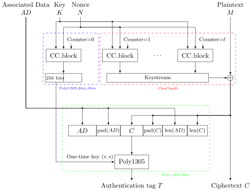

Kernel Linux 7.5 resmi menyiapkan optimasi instruksi AVX-512 untuk subsistem kriptografi simetris ChaCha di libcrypto. Pembaruan yang digarap Martin Willi ini memanfaatkan jalur eksekusi 512-bit penuh guna memproses 16 blok data secara paralel, menghasilkan lonjakan kecepatan hingga 99 persen pada prosesor AMD Zen 5 dan 39 persen pada arsitektur Zen 4.

Kalau ente sering berkutat dengan lalu lintas jaringan terenkripsi di server Linux, nama algoritma ChaCha tentu sudah sangat akrab di telinga. Cipher stream ini menjadi andalan utama protokol modern seperti WireGuard dan IPsec karena karakternya yang gesit tanpa bergantung pada instruksi khusus AES-NI. Namun, selama hampir satu dekade terakhir, potensi penuh instruksi vektor AVX-512 pada implementasi ChaCha di kernel Linux sengaja ditahan akibat kendala arsitektur prosesor x86 generasi lawas.

Kabar baiknya, belenggu teknis tersebut akhirnya resmi dilepas di cabang pengembangan kernel terbaru, om.

## Beban Sejarah Skylake dan Batasan Register 256-Bit

Alasan di balik lambatnya adopsi instruksi AVX-512 secara penuh pada kode ChaCha bermula dari era kelam arsitektur Intel Skylake-X pada tahun 2017. Kala itu, unit eksekusi 512-bit (register zmm) membutuhkan pasokan daya listrik yang sangat masif. Setiap kali prosesor mendeteksi instruksi 512-bit berjalan, unit kontrol daya CPU secara otomatis menurunkan frekuensi kerja (*frequency down-clocking*) pada inti yang bersangkutan demi menjaga stabilitas termal.

Penurunan frekuensi tersebut tidak hanya memperlambat tugas enkripsi yang sedang berlangsung, tetapi juga menyeret performa seluruh proses lain yang kebetulan dieksekusi pada inti CPU yang sama. Untuk menghindari kerugian performa sistem secara keseluruhan, para pengembang kernel Linux mengambil langkah kompromi yang sangat hati-hati.

Implementasi ChaCha AVX-512 di subsistem kriptografi kernel sengaja dibatasi hanya memakai subset AVX-512VL. Kode ini hanya memproses maksimal 8 blok data sekaligus menggunakan register 256-bit (ymm). Skema tersebut sukses menghindari penalti penurunan frekuensi di era Skylake, namun pada saat bersamaan menyia-nyiakan separuh kapasitas lebar vektor yang sejatinya dimiliki perangkat keras modern.

Seiring berjalannya waktu, lanskap perangkat keras komputer telah berubah total. Prosesor modern saat ini, terutama jajaran mikroarsitektur AMD Zen 4 dan Zen 5, mampu mengeksekusi instruksi vektor lebar tanpa perlu mengorbankan frekuensi inti sedikit pun. Pada arsitektur Zen 5, AMD bahkan menghadirkan jalur pipa data floating-point dan vektor berkapasitas 512-bit murni secara ganda. Membatasi pemrosesan hanya pada 256-bit di atas silikon secanggih ini jelas menjadi kerugian komputasi yang sia-sia.

## Solusi 16-Blok Martin Willi dan Pembuktian di Zen 5

Menjawab tantangan tersebut, pengembang proyek strongSwan Martin Willi mengajukan serangkaian patch pembaruan ke cabang `libcrypto` kernel Linux. Martin menambahkan fungsi eksekusi 16-blok berbasis AVX-512 untuk kode ChaCha dengan memanfaatkan lebar vektor 512-bit penuh (VL=64).

Dalam penjelasan teknisnya, Martin memaparkan bahwa fungsi baru ini menginstansiasi makro blok bersama untuk kedua kalinya pada tingkat VL=64. Kode ini berjalan di atas jalur `avx512vl` yang sudah ada, namun kini dikawal oleh penanda `X86_FEATURE_PREFER_YMM`. Jika beban data kriptografi yang masuk berukuran lebih besar dari 8 blok dan prosesor tidak memiliki preferensi terhadap register 256-bit, kernel akan langsung mengalihkan pemrosesan ke jalur 512-bit dengan 16 blok per eksekusi.

*Sumber: [Wikimedia Commons](https://commons.wikimedia.org/wiki/File:ChaCha20-Poly1305_Encryption.svg)*

Hasil pengujian dunia nyata menunjukkan lompatan performa yang luar biasa impresif. Pada sistem uji coba bertenaga prosesor AMD Ryzen AI Max Strix Halo yang mengusung arsitektur Zen 5 dengan pipa data 512-bit murni, throughput pemrosesan ChaCha melonjak hingga 99 persen untuk lalu lintas data massal (*bulk traffic*). Kecepatan enkripsi praktis berlipat ganda dibandingkan implementasi kernel sebelumnya.

Bahkan pada prosesor AMD Zen 4 yang mengandalkan eksekusi ganda (*double-pumping*) melalui jalur 256-bit, patch ini masih sanggup memeras peningkatan performa hingga 39 persen. Patch penyempurnaan ini telah resmi diterima dan masuk ke dalam antrean cabang `libcrypto-next` yang dikelola maintainer kriptografi kernel Eric Biggers, untuk kemudian diajukan dalam jendela penggabungan (*merge window*) Linux 7.5 mendatang.

## Dampak Langsung ke WireGuard, IPsec, dan Keamanan Server

Bagi kalangan administrator sistem dan teknisi infrastruktur, lonjakan angka persentase ini bukan sekadar pemanis tolok ukur di atas kertas. Algoritma ChaCha, khususnya dalam konfigurasi AEAD ChaCha20-Poly1305, memegang peranan krusial sebagai urat nadi keamanan di berbagai subsistem inti Linux.

Protokol VPN modern seperti WireGuard mengandalkan ChaCha20-Poly1305 sebagai satu-satunya skema kriptografi untuk enkripsi paket data. Pada gerbang VPN (*VPN gateway*) kantor atau server proxy dengan volume lalu lintas padat, pemrosesan kriptografi sering kali menjadi titik penghambat (*bottleneck*) yang menyedot utilisasi CPU. Dengan efisiensi dua kali lipat yang dihadirkan Linux 7.5 pada prosesor Zen 5, kapasitas transfer data tunneling dapat terdongkrak signifikan tanpa perlu menambah jumlah server fisik.

Manfaat serupa juga dirasakan pada terowongan IPsec berbasis strongSwan, enkripsi sistem berkas Adiantum pada media penyimpanan tanpa akselerasi AES, hingga subsistem pembangkit bilangan acak kriptografis (*CSPRNG*) milik kernel yang memasok entropi ke `/dev/urandom`. Seluruh aplikasi ruang pengguna yang bergantung pada pustaka kriptografi kernel secara otomatis menikmati akselerasi ini secara cuma-cuma tanpa memerlukan kompilasi ulang kode aplikasi.

Langkah pengembang kernel menyegarkan kembali jalur kode AVX-512 ini membuktikan bahwa optimasi tingkat rendah di lapisan sistem operasi masih menyimpan ruang peningkatan performa yang sangat masif. Begitu Linux 7.5 meluncur stabil kelak, para pengguna mesin komputasi modern berbasis AMD Zen 5 dipastikan langsung memetik buah efisiensi enkripsi yang jauh lebih bertenaga.

Sumber: [Linux Kernel Git](https://git.kernel.org/pub/scm/linux/kernel/git/ebiggers/linux.git/commit/?id=afd8c98fbd6caa42e0d5ca2c6284ca0ea11c2c50)
