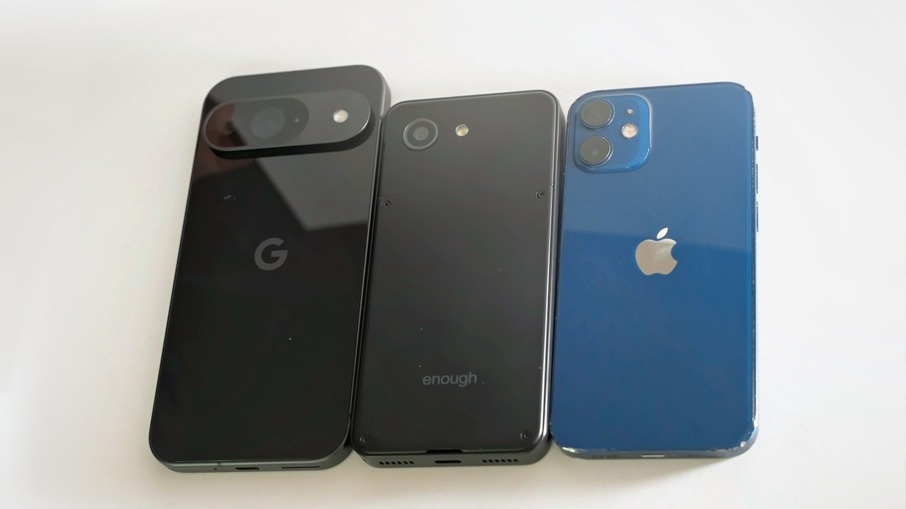

Enough Phone resmi membuka pemesanan awal untuk ponsel pintar kompak berlayar 5,3 inci yang dilengkapi baterai lepas pasang 3.500 mAh. Perangkat seharga mulai $399 ini ditenagai prosesor MediaTek Dimensity 7500, kamera utama 50 MP Sony IMX766, bodi polikarbonat berdimensi seukuran iPhone 13 Mini, serta opsi sistem operasi Android 17 atau OdysseyOS.

Kalau sering membaca forum gawai atau kolom komentar media sosial, keluhan tentang bodi ponsel pintar modern yang semakin bongsor rasanya hampir selalu muncul setiap kali ada peluncuran produk baru. Ponsel zaman sekarang rata-rata dibekali bentang layar 6,7 inci ke atas dengan bobot yang menembus lebih dari 200 gram. Di tengah kejenuhan terhadap perangkat berukuran besar tersebut, sebuah jenama pendatang baru bernama Enough Phone melangkah maju untuk menguji seberapa besar minat nyata konsumen terhadap perangkat berukuran saku.

## Jawaban Buat Pengguna yang Rindu Ukuran iPhone Mini

Awalnya saya mengira ponsel ini sekadar proyek konsep yang belum tentu memiliki wujud fisik nyata. Namun setelah membaca dokumentasi teknis dan melihat demonstrasi unit produksinya, pengembang Enough Phone benar-benar merancang cetak biru perangkat keras dari nol. Mereka memilih panel layar LCD 5,3 inci dengan resolusi HD+ (1520 x 720 piksel), yang diklaim sebagai panel terkecil di pasaran saat ini dengan efisiensi daya dan akurasi warna yang memadai.

Dimensi fisik Enough Phone tercatat pada angka 133 x 64 x 12 milimeter. Untuk memberikan gambaran nyata di tangan, jejak telapak tangan ponsel ini hampir persis dengan iPhone 13 Mini milik Apple yang memiliki panjang 131,5 milimeter dan lebar 64,2 milimeter. Perbedaan yang langsung terasa hanya terletak pada ketebalannya, di mana Enough Phone sengaja dibuat sedikit lebih tebal demi mengakomodasi ruang mekanis khusus.

*Sumber: [Enough Phone](https://www.kickstarter.com/projects/theenoughphone/enough-phone-bringing-back-the-small-smartphone)*

Dengan lebar bodi yang hanya 64 milimeter, jempol tangan dapat dengan mudah menyapu seluruh sudut layar dari ujung bawah hingga batas atas tanpa perlu menggeser posisi telapak tangan. Bagi pengguna yang sering beraktivitas dengan satu tangan saat berjalan atau berada di transportasi umum, kepraktisan genggaman seperti ini adalah kemewahan langka yang sudah lama hilang dari pasar gawai arus utama.

## Bodi Polikarbonat dan Baterai yang Bisa Diganti Sendiri

Alasan utama di balik profil bodi setebal 12 milimeter tersebut bermuara pada keputusan desain yang sangat ramah perbaikan. Alih-alih mengelem rapat panel kaca belakang dengan perekat industri yang menyulitkan pembongkaran, Enough Phone menggunakan material polikarbonat bertekstur tangguh dengan penutup belakang yang dapat dilepas mandiri.

Pendekatan ini mirip dengan filosofi perangkat Fairphone. Pengguna hanya perlu membuka beberapa sekrup pengunci standar untuk mengangkat penutup belakang dan mengganti modul baterai 3.500 mAh secara langsung. Desain ini menghilangkan kekhawatiran klasik mengenai degradasi baterai setelah dua atau tiga tahun pemakaian, karena baterai cadangan dapat dipasang sendiri di rumah tanpa perlu bantuan teknisi servis maupun peralatan pemanas lem khusus.

Selain kemudahan penggantian catu daya, bodi Enough Phone tetap mempertahankan slot kartu memori microSD untuk ekspansi ruang simpan, sensor sidik jari kapasitif yang terintegrasi rapi pada tombol daya samping, serta dukungan konektivitas nirkabel modern yang mencakup 5G, Wi-Fi 6, Bluetooth, NFC untuk pembayaran digital, dan kombinasi kartu SIM fisik berdampingan dengan eSIM.

## Spesifikasi Cukup untuk Kebutuhan Harian Tanpa Gimmick

Nama Enough Phone dipilih bukan tanpa alasan, melainkan merefleksikan prinsip bahwa spesifikasi ponsel harus berada pada takaran yang cukup bagi aktivitas nyata, bukan sekadar mengejar angka tolok ukur sintetis yang melambung tinggi.

Di sektor dapur pacu, Enough Phone mempercayakan kinerja sistem pada chipset MediaTek Dimensity 7500 berfabrikasi hemat daya, dipadukan bersama memori RAM 8 GB dan kapasitas penyimpanan internal 128 GB. Kombinasi ini sudah lebih dari cukup untuk menjalankan navigasi peta, komunikasi harian, multitasking aplikasi perbankan, hingga konsumsi multimedia secara lancar.

Yang membuat penasaran justru pilihan pada sektor fotografi. Enough Phone menolak tren modul kamera majemuk berisi sensor makro atau sensor kedalaman berpiksel rendah yang sering dicap sebagai hiasan belaka. Bagian punggungnya hanya memuat satu sensor kamera utama berkekuatan 50 MP menggunakan sensor ternama Sony IMX766 dengan stabilisasi gambar optik, didukung kamera depan 32 MP untuk panggilan video dan swafoto. Penggunaan sensor tunggal berkualitas terbukti jauh lebih fungsional menghasilkan foto tajam dibanding memasang tiga sensor medioker.

Ringkasan spesifikasi utama Enough Phone meliputi:

- Layar: 5,3 inci LCD HD+ (1520 x 720 piksel)
- Prosesor: MediaTek Dimensity 7500
- Memori: RAM 8 GB dan penyimpanan internal 128 GB (tersedia slot microSD)
- Kamera Belakang: 50 MP Sony IMX766 dengan OIS
- Kamera Depan: 32 MP
- Baterai: 3.500 mAh (dapat dilepas dan diganti mandiri)
- Konektivitas: 5G, LTE, Wi-Fi 6, Bluetooth, NFC, SIM fisik dan eSIM
- Dimensi: 133 x 64 x 12 milimeter

## Kebebasan Memilih Antara Android 17 dan OdysseyOS

Daya tarik yang tidak kalah penting datang dari aspek perangkat lunak. Pembeli Enough Phone diberikan kebebasan menentukan sistem operasi yang ingin dijalankan sejak dari kotak penjualan.

Pilihan pertama adalah Android 17 murni yang sudah mengantongi sertifikasi resmi Google, lengkap dengan akses ke Google Play Store dan ekosistem aplikasi standar. Pilihan kedua yang sangat unik adalah OdysseyOS, sistem operasi berbasis Android hasil perampingan mandiri yang dirancang khusus tanpa layanan pelacakan Google (de-Googled).

OdysseyOS berfungsi layaknya antarmuka ponsel minimalis untuk detoks digital. Di dalamnya bahkan tidak tersedia peramban web bawaan untuk mencegah pengguna menghabiskan waktu tanpa sadar menggulir linimasa internet. Pengguna tetap dapat berkomunikasi melalui panggilan suara, pesan instan, dan aplikasi esensial tanpa terganggu notifikasi agresif. Menariknya lagi, tim pengembang berkomitmen memberikan dukungan pembaruan sistem dan keamanan jangka panjang hingga tahun 2032.

## Skema Pendanaan Kickstarter dan Realitas Jadwal Rilis

Pemesanan awal Enough Phone dibuka melalui platform urun dana Kickstarter dengan banderol promosi awal $399 atau berkisar Rp6,3 jutaan untuk pendukung gelombang pertama. Harga tersebut akan meningkat bertahap ke angka $449 dan $499, sebelum akhirnya menyentuh harga ritel resmi $599 atau sekitar Rp9,5 jutaan saat beredar bebas di pasaran kelak.

Tantangan terbesar tentu berada pada garis waktu pengiriman. Perangkat ini dijadwalkan baru mulai dikirimkan kepada konsumen pada Mei 2027 mendatang. Rentang waktu sekitar setengah tahun menuju produksi massal kerap menjadi titik rawan pada proyek urun dana perangkat keras, meski tim di balik Enough Phone menegaskan bahwa mereka memiliki pengalaman panjang sebagai produsen desain asli (ODM) yang sudah sering merakit komponen gawai bagi sejumlah merek elektronik kenamaan dunia.

Kehadiran Enough Phone menjadi pembuktian nyata bagi pasar teknologi seluler. Jika kampanye ini berhasil mengumpulkan banyak peminat, produsen ponsel raksasa lain mungkin akan kembali menaruh perhatian pada segmen ponsel berdimensi saku yang selama ini dianaktirikan.

Sumber: [Kickstarter](https://www.kickstarter.com/projects/theenoughphone/enough-phone-bringing-back-the-small-smartphone)