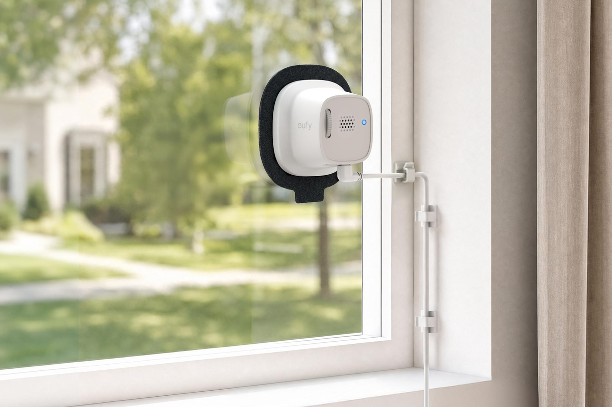

Memasang kamera pengawas di luar rumah sering kali memicu rasa malas, terutama bagi mereka yang tinggal di rumah kontrakan atau apartemen. Menembus dinding luar dengan bor semen, menyambung kabel tahan air, sampai memikirkan risiko kamera dirusak atau digondol orang asing kerap menjadi pertimbangan panjang. Anker lewat lini rumah pintarnya baru saja meluncurkan Eufy Window Camera E10, sebuah kamera pengawas dalam ruangan yang sengaja dirancang menghadap ke luar menempel langsung pada panel kaca jendela.

Konsep mengintip halaman dari balik kaca sebenarnya bukan hal baru, namun siapa saja yang pernah mencoba mengarahkan kamera CCTV biasa ke jendela pasti tahu kendala utamanya. Ketika malam tiba dan lampu inframerah menyala, pantulan kaca justru membuat rekaman silau total dan luar ruangan berubah menjadi layar putih pekat. Eufy mencoba mengatasi masalah klasik tersebut dengan racikan optik dan dudukan khusus.

## Jawaban Ringkas Fitur Eufy Window Camera E10

Eufy Window Camera E10 adalah kamera pengawas beresolusi 2,5K bukaan lensa lebar f/1.0 yang dipasang di bagian dalam kaca jendela menggunakan stiker perekat bebas residu. Kamera seharga $79,99 ini mengandalkan teknologi MaxColor Night Vision tanpa lampu inframerah untuk merekam situasi luar rumah malam hari tanpa pantulan cahaya pada kaca, lengkap dengan deteksi kecerdasan buatan lokal dan sudut kemiringan vertikal manual 25 derajat.

Awalnya saya kira kamera ini sekadar kamera mini indoor biasa yang diberi tempelan perekat dua sisi. Kalau diperhatikan, ternyata rancangannya memikirkan detail optik yang selama ini membuat orang jengkel saat menaruh kamera di ambang jendela.

## Menghilangkan Pantulan Kaca dan Rekaman Silau di Malam Hari

Alasan utama mengapa kamera keamanan standar gagal total saat diarahkan ke luar jendela adalah keberadaan lampu LED inframerah. Pada kondisi gelap, sensor CCTV konvensional memancarkan sinar inframerah agar kamera bisa melihat dalam mode hitam putih. Namun kaca jendela bertindak layaknya cermin bagi gelombang inframerah tersebut, memantulkan kembali seluruh cahaya ke sensor dan menghasilkan lingkaran putih yang menutup seluruh gambar.

E10 membuang pendekatan inframerah tradisional dan menggantinya dengan teknologi yang mereka sebut MaxColor Night Vision. Kamera ini dibekali sensor sensitivitas tinggi dengan bukaan lensa luar biasa besar, yaitu f/1.0. Bukaan lebar tersebut mampu mengumpulkan cahaya redup dari lampu jalan, teras tetangga, atau penerangan teras sendiri untuk menyusun rekaman berwarna yang tajam tanpa bantuan lampu sorot tambahan.

Selain urusan sensor, bentuk fisik corong lensa kamera juga dibuat menempel rapat ke permukaan kaca jendela. Konstruksi rapat ini mencegah cahaya lampu dari dalam kamar bocor masuk ke sudut pandang lensa, sehingga bayangan orang yang sedang berjalan di dalam ruangan tidak akan ikut terpantul ke dalam rekaman luar rumah.

## Sudut Kemiringan Manual dan Pemasangan Tanpa Alat

Salah satu kekurangan kamera tempel kaca generasi terdahulu, seperti Wyze Window Cam yang meluncur tahun lalu, adalah keterbatasan sudut pandang statis. Jika jendela rumah Anda berada di lantai dua atau posisinya agak tinggi dari permukaan tanah, rekaman CCTV sering kali lebih banyak memperlihatkan langit atau atap rumah tetangga ketimbang teras dan pagar utama.

*Sumber: [The Verge](https://www.theverge.com/tech/1026360/anker-eufy-window-camera-e10-indoors-security-ai-color-night-vision)*

Pada Eufy Window Camera E10, Anker menyematkan sebuah roda putar mekanis di bagian belakang bodi. Lewat kenop kecil ini, pengguna dapat mengatur kemiringan modul kamera secara manual mulai dari posisi datar 0 derajat hingga menunduk minus 25 derajat. Pengaturan ini membuat pengawasan paket di depan pintu, kendaraan di garasi, atau hewan peliharaan di halaman bawah tetap masuk ke dalam bingkai rekaman secara presisi tanpa perlu membongkar tempelan stiker.

Proses pemasangannya pun tidak memerlukan bor, sekrup, atau peralatan tukang. Unit kamera menggunakan stiker dudukan khusus bebas residu yang bisa dilepas dan ditempel kembali tanpa meninggalkan bekas lem di permukaan kaca. Bobot bodinya yang hanya 64 gram memastikan kamera tetap melekat kuat dan tidak mudah merosot saat terpapar perubahan suhu ruangan.

## Rincian Spesifikasi Teknis Eufy Window Camera E10

Kamera pengawas ini menghadirkan perbaikan signifikan dibanding pesaing sekelasnya yang masih bertahan di resolusi Full HD. Berikut rincian spesifikasi utama yang dibawanya:

- Resolusi Video: 2,5K (2688 × 1520 piksel) pada kecepatan 15 fps
- Bukaan Lensa: f/1.0 dengan teknologi MaxColor Night Vision tanpa lampu sorot
- Bidang Pandang Kamera: Diagonal 125 derajat, Horisontal 105 derajat, Vertikal 57 derajat
- Penyesuaian Sudut: Kemiringan vertikal 0 derajat hingga minus 25 derajat via roda putar manual
- Identifikasi Cerdas: Kecerdasan buatan lokal untuk mendeteksi manusia, kendaraan, dan hewan
- Opsi Penyimpanan: Slot kartu microSD hingga kapasitas 256 GB serta opsi cadangan awan
- Koneksi Nirkabel: Wi-Fi pita ganda 2,4 GHz dan 5 GHz
- Sumber Daya: Colokan USB-C dengan kabel bawaan sepanjang 3 meter dan klip perapi kabel
- Dimensi dan Bobot: 68,28 × 68,28 × 41,8 mm dengan bobot 64,1 gram
- Integrasi Asisten: Mendukung perintah suara Amazon Alexa dan Google Assistant
- Skema Biaya: Fitur dasar deteksi kecerdasan buatan dan rekaman lokal 24 jam bebas biaya bulanan

Yang membuat penasaran justru bagian pengolahan kecerdasan buatannya. Seluruh pemrosesan identifikasi objek, baik itu mendeteksi ada kurir pengantar paket, mobil masuk ke carport, maupun kucing melompat pagar, dijalankan langsung secara mandiri di dalam perangkat (on-device processing). Artinya, pengguna tidak dipaksa membayar biaya langganan bulanan hanya untuk mendapatkan notifikasi spesifik di ponsel mereka.

## Kompromi dan Hal yang Perlu Diperhatikan

Meski menawarkan kepraktisan bagi penghuni rumah sewa, kamera yang memantau dari balik jendela tetap memiliki beberapa kompromi fisik yang perlu dipahami sebelum membeli.

Pertama adalah urusan sumber daya. Eufy Window Camera E10 tidak dibekali baterai isi ulang dan harus terus tersambung ke sumber listrik lewat kabel USB-C sepanjang 3 meter. Di satu sisi, Anda tidak perlu repot melepas kamera setiap beberapa minggu sekali hanya untuk mengisi daya baterai. Namun di sisi lain, Anda tetap harus memikirkan jalur kabel yang rapi dari jendela menuju stopkontak terdekat agar tidak bergelantungan dan mengganggu pemandangan ruangan.

Kedua adalah kualitas kaca jendela itu sendiri. Karena kamera mengandalkan pandangan tembus pandang, kebersihan kaca luar dan dalam menjadi faktor penentu ketajaman gambar. Jika kaca jendela berdebu tebal atau terkena cipratan air hujan yang mengering, sensor kamera bisa sedikit kesulitan memfokuskan objek di kejauhan. Selain itu, kaca film penolak panas dengan tingkat kegelapan tinggi (tinted glass) berpotensi memotong pasokan cahaya malam hari yang masuk ke sensor f/1.0.

Ketiga menyangkut rekaman audio. Mikrofon bawaan kamera berada di dalam ruangan, sehingga suara percakapan luar yang pelan akan diredam oleh ketebalan kaca. Fitur mikrofon ini lebih efektif menangkap suara benturan keras, klakson kendaraan, atau pecahan kaca daripada menyadap obrolan orang di luar pagar.

Secara keseluruhan, kehadiran Eufy Window Camera E10 menjadi angin segar bagi pengguna yang membutuhkan pengawasan area luar rumah tanpa kerumitan instalasi kabel luar gedung atau ancaman perusakan perangkat oleh pihak yang tidak bertanggung jawab.

> **Baca Juga:**
> - [Amazon Rilis Alexa Photo Frame, Bingkai Digital Tanpa Iklan](/amazon-alexa-photo-frame-tanpa-iklan/)
> - [Razer Hammerhead V3 Chroma Bawa ANC ke Earbud Kabel USB-C](/razer-hammerhead-v3-chroma-earbud-kabel-usb-c/)

Sumber: [eufy US](https://www.eufy.com/products/t8404121)
