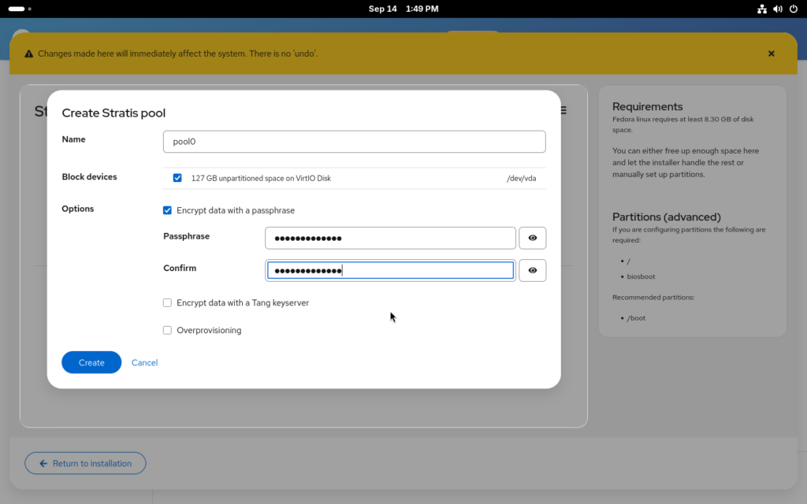

Proyek Fedora resmi merilis Fedora Linux 45 untuk seluruh varian mulai dari Workstation, Server, Cloud, hingga Atomic Desktops. Pembaruan enam bulanan ini membawa konsol virtual berbasis KMSCON, integrasi manajemen volume Stratis langsung di dalam installer Anaconda, restriksi ptrace bawaan untuk keamanan memori, serta desktop GNOME 51 yang ditenagai kernel Linux terbaru.

Bagi komunitas open source dan sysadmin, rilis kali ini bukan sekadar pembaruan versi rutin aplikasi harian. Fedora kembali memposisikan dirinya sebagai laboratorium inovasi hulu (upstream) Linux dengan merombak komponen yang sudah berumur puluhan tahun, memodernisasi arsitektur konsol terminal, hingga memperketat standar keamanan sistem operasi.

## Konsol Virtual Anyar KMSCON Gantikan Driver TTY Kernel Lawas

Salah satu perubahan paling signifikan di balik layar adalah keputusan tim Fedora mengadopsi KMSCON sebagai konsol virtual bawaan. Selama beberapa dekade, konsol teks Linux (VT console atau fbcon) berjalan langsung di ruang kernel (kernel space) dengan kode vt102 warisan masa lalu. Pendekatan lama ini punya banyak keterbatasan teknis, seperti rendering font resolusi rendah yang kaku, dukungan karakter Unicode terbatas, serta risiko sistem *hang* jika driver kartu grafis mengalami *kernel panic* saat menangani teks.

KMSCON memindahkan seluruh tugas emulasi terminal teks ke ruang pengguna (user space) dengan memanfaatkan subsistem DRM/KMS (Direct Rendering Manager / Kernel Mode Setting). Hasilnya terasa langsung saat ente berpindah dari sesi grafis ke konsol TTY lewat kombinasi tombol keyboard (Ctrl+Alt+F3). 

Tampilan teks konsol kini mendukung rendering font modern yang tajam, akselerasi perangkat keras kartu grafis, gulir riwayat baris (scrollback) yang mulus, dan dukungan penuh karakter internasional UTF-8 tanpa galat kotak-kotak. Kalau menurut ane, om, pemindahan konsol ke ruang pengguna ini adalah langkah cerdas buat mencegah bug tampilan teks meruntuhkan stabilitas kernel Linux secara menyeluruh.

## Integrasi Stratis Storage Langsung di Menu Partisi Anaconda

Pembaruan besar berikutnya menyasar para administrator sistem yang membutuhkan manajemen penyimpanan fleksibel setara ZFS atau Btrfs, tetapi tetap mengandalkan tumpukan stabil Device Mapper dan XFS khas Red Hat. Fedora 45 kini mengintegrasikan Stratis Storage langsung ke dalam installer Anaconda.

Sebelumnya, pengguna yang ingin memakai Stratis harus mengonfigurasi kumpulan pool diska lewat perintah CLI secara manual setelah sistem terpasang. Pada Fedora 45, modul penyimpanan Cockpit disematkan langsung ke dalam jendela partisi manual Anaconda.

*Sumber: [Fedora Magazine](https://fedoramagazine.org/installing-fedora-45-on-stratis-storage/)*

Melalui integrasi ini, pengguna dapat membuat *pool* Stratis dari satu atau beberapa drive fisik sekaligus, mengaktifkan alokasi dinamis (*thin provisioning*), mengenkripsi volume dengan LUKS, serta mengatur partisi sistem root (/) dan home (/home) secara instan.

Bagi sysadmin yang menangani otomatisasi server skala besar, instalasi otomatis via Kickstart kini juga mengenali parameter `--type=stratis` pada opsi autopart, lengkap dengan perintah deklaratif `stratispool` dan `stratisfs`. Fleksibilitas ini memangkas waktu *provisioning* server secara drastis saat mengelola puluhan kluster komputasi di *data center*.

## Penguatan Keamanan Sistem dari Restriksi Ptrace hingga oo7 Secrets

Keamanan menjadi fokus sentral di Fedora 45 melalui serangkaian kebijakan pengerasan (*hardening*) bawaan. Fedora kini mengaktifkan pembatasan `ptrace` secara default melalui modul pengamanan kernel Yama LSM (Linux Security Module).

Secara teknis, panggilan sistem `ptrace` kerap dimanfaatkan oleh perkakas *debugging* seperti GDB untuk memeriksa memori proses yang berjalan. Namun di sisi lain, penyerang bisa menyalahgunakan hak akses `ptrace` yang longgar untuk menyuntikkan kode jahat ke proses lain milik pengguna yang sama, misalnya membaca token browser atau kunci SSH yang tersimpan di memori. Dengan membatasi cakupan ptrace bawaan, proses biasa dilarang memata-matai proses tetangga kecuali diizinkan secara eksplisit oleh administrator.

Selain restriksi memori, sistem kini mewajibkan verifikasi tanda tangan digital paket RPM sebelum dipasang, mencegah insiden paket yang tidak terverifikasi atau rusak menyusup ke sistem produksi. Di level desktop, Fedora beralih mengadopsi `oo7`, daemon pengelola kredensial dan *secret service* berbasis bahasa Rust. Pustaka `oo7` menggantikan komponen lawas seperti GNOME Keyring dan KWallet untuk menyatukan standar penyimpanan sandi aplikasi lintas lingkungan desktop secara lebih aman dan terisolasi.

Arsitektur sistem berkas juga dirapikan dengan memindahkan seluruh konfigurasi repositori RPM bawaan dari direktori `/etc/yum.repos.d/` ke hierarki `/usr`. Kebijakan ini menyelaraskan sistem dengan konsep *hermetic usr*, di mana berkas bawaan sistem operasi terpusat di `/usr`, sementara direktori `/etc` murni disediakan untuk *override* konfigurasi lokal milik administrator tanpa risiko tertimpa saat paket diperbarui.

## Pembaruan Tumpukan Toolchain Pengembang dan Desktop GNOME 51

Untuk pengguna harian edisi Workstation, Fedora 45 membawa desktop GNOME 51 yang lebih responsif dengan perbaikan manajemen gestur layar sentuh Wayland dan penskalaan fraksional (*fractional scaling*) yang makin tajam pada monitor beresolusi 4K. Varian KDE Plasma Desktop juga diperbarui ke edisi Plasma 6.6 yang lebih hemat sumber daya memori.

Fitur menarik lainnya adalah penyempurnaan tampilan DRM Panic. Bila terjadi kegagalan fatal pada driver kartu grafis atau kernel, sistem tidak lagi sekadar mati kaku dengan layar hitam kosong. Fedora menampilkan layar pesan kesalahan berlatar biru ramah pengguna yang dilengkapi kode QR diagnostik, sehingga pengguna dapat memindai log kesalahan langsung lewat ponsel pintar untuk pelaporan bug cepat ke komunitas.

Di sektor fondasi pengembangan, tumpukan *compiler* dan *runtime* diperbarui secara menyeluruh:

- GCC 16.2 dan LLVM Clang 23 sebagai fondasi kompilasi kode biner modern.
- Pustaka inti Glibc 2.44 dan Binutils 2.47 untuk optimalisasi instruksi CPU terkini.
- Bahasa pemrograman Python 3.15, Golang 1.27, dan Perl 5.44.
- Container engine Podman 6 dengan performa isolasi *rootless* yang lebih kencang.
- Dukungan konfigurasi jaringan *IPv6-mostly* pada NetworkManager untuk kesiapan infrastruktur masa depan.

Secara bawaan Fedora 45 dikapalkan bersama kernel Linux 7.2, tetapi pengembang memastikan pembaruan kernel stabil Linux 7.3 bakal digulirkan ke repositori resmi dalam waktu dekat. Bagi yang sudah memasang Fedora 44, pembaruan sistem operasi dapat langsung dijalankan lewat modul DNF system-upgrade tanpa perlu menginstal ulang dari awal.

> **Baca Juga:**
> - [Kmorph Pulihkan Kernel Linux dari Crash Tanpa Perlu Reboot](/kmorph-pulihkan-kernel-linux-tanpa-reboot/)
> - [Linux Mint Kembalikan Fitur Hibernasi untuk Laptop](/linux-mint-kembalikan-fitur-hibernasi-laptop/)

Sumber: [Fedora Magazine](https://fedoramagazine.org/announcing-fedora-linux-45/)
