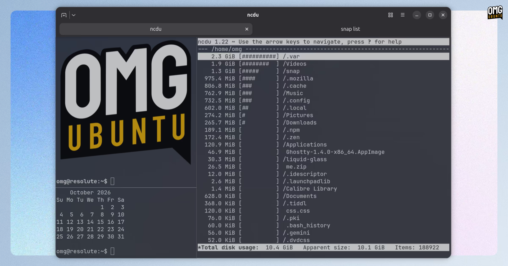

Bagi pengguna Linux yang banyak menghabiskan waktu di lingkungan baris perintah (CLI), emulator terminal yang gesit, hemat sumber daya, dan responsif bukan lagi sekadar pelengkap, melainkan senjata kerja harian utama. Setelah tujuh bulan proses pengembangan intensif dengan melibatkan 172 kontributor dan 2.889 commit, proyek terminal open source berbasis bahasa Zig besutan Mitchell Hashimoto, Ghostty, resmi meluncurkan pembaruan besar ke versi 1.4.0.

Rilis anyar ini membawa lompatan arsitektur yang sangat signifikan, khususnya bagi para pengguna Linux dan FreeBSD. Dua fokus utama yang langsung terasa di pemakaian nyata adalah efisiensi alokasi memori kerja (RAM) lewat mekanisme kompresi riwayat teks otomatis, serta perombakan menyeluruh pada subsistem rendering grafis GTK yang kini mengandalkan pipa EGL mandiri dan teknologi DMA-BUF.

## Arsitektur Rendering Baru dengan Jalur EGL dan DMA-BUF

Perubahan paling fundamental pada Ghostty 1.4 di lingkungan Linux terletak pada cara aplikasi menggambar antarmuka ke layar monitor. Selama ini, varian aplikasi GTK pada Ghostty memanfaatkan komponen bawaan `GtkGLArea` untuk menangani render OpenGL. Pendekatan tersebut sering kali memicu hambatan performa karena panggilan OpenGL harus berbagi ruang dengan thread utama antarmuka pengguna (*main GUI thread*), yang berisiko menimbulkan lag mikro ketika sistem sedang sibuk.

Pada versi 1.4.0, tim pengembang membongkar total pipa tersebut. Ghostty kini meniadakan ketergantungan pada `GtkGLArea` dan beralih ke mesin render EGL yang berjalan di atas thread terpisah (*dedicated thread*). Setiap frame grafis yang digambar kemudian diekspor sebagai objek *DMA-BUF* (Direct Memory Access Buffer) dari lapisan kernel grafis, lalu diserahkan langsung ke GTK untuk disajikan ke layar secara *zero-copy*.

Pipa rendering baru ini juga menerapkan mekanisme *triple-buffered*, sehingga gejala *screen tearing* dan stuttering dapat dipangkas drastis. Berkat isolasi thread ini, operasi OpenGL tidak lagi membebani proses GUI utama. Keuntungan lainnya terlihat jelas pada pengguna layar monitor beresolusi tinggi (HiDPI) yang menerapkan penskalaan pecahan (*fractional scaling*) seperti 125 persen atau 150 persen. Ghostty 1.4 sekarang merender langsung pada skala pecahan piksel sebenarnya (*true fractional scale*), sehingga teks terminal dan karakter gambar kotak (*box-drawing characters*) tampak tajam sempurna tanpa blur. Bagi komputer atau kartu grafis lawas yang driver-nya belum mendukung ekspor DMA-BUF, Ghostty secara otomatis menyediakan mekanisme cadangan (*fallback*) berupa penyalinan frame lewat CPU.

## Kompresi Riwayat Scrollback Pangkas Konsumsi Memori Hingga 90 Persen

Selain kecepatan rendering, konsumsi RAM kerap menjadi keluhan klasik ketika sebuah terminal dibiarkan berjalan berhari-hari dengan ribuan baris log yang menumpuk. Menjawab persoalan ini, Ghostty 1.4 memperkenalkan fitur kompresi riwayat *scrollback* transparan yang bekerja otomatis ketika terminal berada dalam kondisi diam (*idle*).

Halaman-halaman teks riwayat yang posisinya berada di luar tampilan layar (*off-screen*) akan dikompresi di latar belakang. Pada skenario penggunaan riwayat teks standar, teknik ini sanggup memangkas penggunaan memori fisik (resident RAM) antara 70 persen hingga 90 persen. Begitu pengguna melakukan penelusuran kata (search) atau menggulir layar ke atas untuk memeriksa log lama, halaman teks tersebut didekompresi secara instan sesuai kebutuhan tanpa menimbulkan latensi input yang terasa pada aktivitas I/O terminal.

Karena efisiensi kompresi yang terbukti stabil, batas default riwayat *scrollback* per terminal dinaikkan lima kali lipat, dari yang sebelumnya 10 MB kini menjadi 50 MB. Menariknya, pemakaian memori fisik saat batas 50 MB terisi penuh justru masih lebih hemat dibandingkan limit 10 MB tanpa kompresi pada versi terdahulu. Fitur ini aktif secara bawaan untuk macOS dan Linux 64-bit, serta tetap dapat dinonaktifkan lewat opsi konfigurasi `scrollback-compression = false` jika pengguna memang tidak menginginkannya.

*Sumber: [Ghostty Documentation](https://ghostty.org/docs/install/release-notes/1-4-0)*

## Implementasi Grafis Kitty Terlengkap dan Pengaturan Split Interaktif

Kabar gembira berikutnya datang bagi pencinta aplikasi terminal modern berbasis grafis (TUI). Ghostty 1.4 kini mencatatkan diri sebagai emulator terminal pertama di luar Kitty yang berhasil mengimplementasikan 100 persen spesifikasi *Kitty graphics protocol*, lengkap dengan dukungan animasi bergerak serta penempatan posisi relatif (*relative placements*). Hal ini membuka peluang bagi para pengembang skrip CLI untuk menyajikan grafik, gambar pratinjau kode, hingga visualisasi diagram data secara mulus langsung di jendela terminal tanpa memerlukan pustaka perantara yang lambat.

Kemudahan navigasi kerja juga ditingkatkan pada jendela pembagian layar (*tab splits*). Pengguna varian GTK kini dapat mengatur ulang posisi split secara interaktif cukup dengan menyeret gagang penarik (*drag handle*) ke area split lain yang dituju. Fitur manajemen tab kini turut dilengkapi parameter `gtk-horizontal-tab-scroll` untuk mematikan pergantian tab saat menggulir dengan dua jari pada touchpad, serta opsi `gtk-tabs-inverted` guna memindahkan tombol tutup ke awal judul tab.

Di balik layar, Ghostty 1.4 menyertakan pembungkus SSH mandiri (*standalone SSH wrapper*) yang lebih andal, integrasi pembukaan tautan URL melalui portal desktop XDG, perbaikan rendering urutan glif emoji Noto, hingga peningkatan performa modul penanganan teks berkecepatan tinggi. Ekosistem Ghostty pun kian diperhitungkan setelah JetBrains mengonfirmasi bahwa pustaka inti `libghostty` bakal menjadi mesin penggerak terminal internal pada rilis masa depan IDE populer mereka.

## Konsekuensi Dependensi GTK Modern dan Opsi Pasang Pengguna Ubuntu

Kendati membawa segudang lompatan fitur, ada satu konsekuensi teknis penting yang perlu diperhatikan oleh komunitas pengguna Linux desktop, khususnya para pengguna Ubuntu LTS. Agar dapat menjalankan arsitektur antarmuka terbarunya, Ghostty 1.4 menetapkan syarat minimal pustaka GTK versi 4.18 dan libadwaita versi 1.7.

Ketentuan dependensi ini membuat sistem operasi Ubuntu 24.04 LTS resmi gugur dari daftar dukungan paket biner bawaan. Repositori paket DEB maupun PPA komunitas di Ubuntu 24.04 tidak lagi dapat mengompilasi rilis 1.4.0 karena versi GTK dan libadwaita bawaan sistem LTS tersebut sudah terlalu tertinggal. 

Bagi pengguna yang menjalankan Ubuntu 24.04 LTS namun tetap ingin mencicipi performa Ghostty 1.4, jalan keluar praktis yang direkomendasikan adalah memanfaatkan format kontainer Flatpak atau AppImage yang mengemas pustaka dependensi secara mandiri. Sementara itu, bagi pengguna distribusi dengan siklus rilis mutakhir seperti Ubuntu 26.10, Fedora 42 ke atas, maupun Arch Linux, paket pembaruan ini sudah dapat dinikmati secara langsung lewat repositori resmi masing-masing.

Kalau ane amati secara keseluruhan, keputusan tim pengembang Ghostty memprioritaskan efisiensi memori fisik dan arsitektur rendering berbasis thread EGL mandiri adalah langkah rekayasa perangkat lunak yang sangat matang. Menangani ribuan baris keluaran kompilasi kode atau log server seharian kini tidak lagi membuat komputer megap-megap kehabisan RAM.

Sumber: [Ghostty](https://ghostty.org/docs/install/release-notes/1-4-0)
