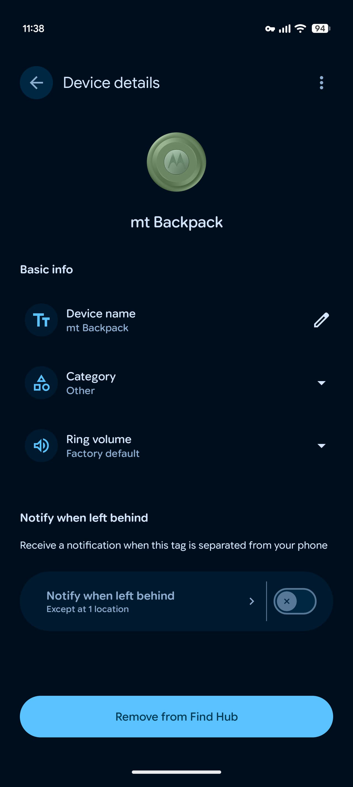

Google akhirnya mulai menggulirkan fitur pengingat barang tertinggal atau Left-Behind Reminders untuk aplikasi Find Hub di perangkat Android. Fitur ini dirancang untuk mendeteksi ketika gantungan kunci, dompet, atau ransel yang dipasangi pelacak pintar mulai menjauh dari jangkauan ponsel, lalu lekas membunyikan notifikasi sebelum Anda melangkah terlalu jauh dari lokasi tersebut.

Bagi pengguna ekosistem Android, kehadiran fitur ini merupakan salah satu fungsi dasar pelacak yang paling lama ditunggu. Sejak jaringan pencarian barang milik Google diluncurkan, kemampuan mengirim sinyal peringatan saat tag pelacak tertinggal di kafe, restoran, atau transportasi umum sempat menjadi tanda tanya besar. Padahal, pengguna Apple AirTag sudah lama mengandalkan fitur serupa di aplikasi Find My.

## Jawaban Ringkas Fitur Left-Behind Reminders di Find Hub

Fitur *Left-Behind Reminders* di Google Find Hub mengirimkan peringatan otomatis ke ponsel Android ketika perangkat pelacak pintar terpisah dari koneksi Bluetooth ponsel dan pengguna berpindah lokasi. Pembaruan ini berjalan lewat Google Play services serta aplikasi Find Hub versi 3.1.787 ke atas, lengkap dengan pengecualian otomatis untuk alamat rumah agar tidak membunyikan alarm palsu saat berada di dalam rumah.

Awalnya saya kira fitur ini bakal langsung aktif begitu aplikasi Find Hub diperbarui dari Play Store. Kalau diperhatikan, ternyata pengaturannya bersifat manual untuk setiap perangkat pelacak yang sudah tersambung ke akun Google. Artinya, kita tetap memegang kendali penuh atas barang mana saja yang perlu dijaga ketat dengan notifikasi real-time dan barang mana yang sengaja ditinggal di rumah tanpa perlu memicu dering peringatan.

## Cara Kerja Notifikasi Pemisah Antara HP dan Pelacak

Cara kerja sistem pengingat ini cukup cerdik. Google memanfaatkan kombinasi pantauan jarak koneksi Bluetooth hemat energi (Bluetooth Low Energy) serta sensor pergerakan lokasi ponsel. Saat ponsel Android Anda mendeteksi bahwa sambungan langsung ke pelacak terputus dan ponsel mulai berpindah ke koordinat baru di luar radius aman, aplikasi Find Hub akan mengirimkan pemberitahuan instan di bar notifikasi.

Pemberitahuan tersebut mengabarkan bahwa tag pelacak tertentu telah terpisah dari genggaman Anda, lengkap dengan penanda waktu dan perkiraan titik lokasi terakhir saat kedua perangkat masih saling terhubung.

*Sumber: [9to5Google](https://9to5google.com/2026/11/05/google-find-hub-tracker-alerts/)*

Yang membuat penasaran justru cara Google menangani alarm palsu. Siapa pun pasti kesal kalau setiap kali keluar kamar atau pergi ke warung tanpa membawa ransel, ponselnya terus bergetar panik. Untuk mengatasi masalah itu, Google menambahkan integrasi cerdas dengan data alamat rumah (Home) yang sudah tersimpan di akun Google Maps pengguna.

Secara default, saat barang pelacak berada di dalam radius rumah tempat tinggal Anda, Find Hub tidak akan mengirimkan notifikasi barang tertinggal meski Anda melangkah pergi meninggalkan rumah. Jika Anda ingin menambahkan zona aman tambahan seperti meja kantor atau rumah orang tua, aplikasi ini juga menyediakan opsi penambahan alamat pengecualian secara khusus.

## Perangkat yang Sudah Mendukung Pengingat Ini

Berdasarkan laporan pengguna di Amerika Serikat dan Eropa yang sudah menerima pembaruan aplikasi Find Hub versi 3.1.787-06 serta Google Play services versi 26.41, fitur pengingat ini sudah berfungsi lancar pada sejumlah perangkat pelacak berbasis Android pihak ketiga.

Beberapa pelacak yang langsung terkonfirmasi mendukung antara lain:
- Moto Tag dari Motorola yang dibekali tombol pintar dan dukungan Ultra-Wideband (UWB).
- Chipolo ONE Point untuk gantungan kunci dan Chipolo CARD Point untuk dompet.
- Pixel Tag buatan Google yang disiapkan meluncur dengan dukungan Bluetooth Channel Sounding.

Namun perlu dicatat, fitur ini untuk sementara waktu baru aktif khusus bagi kategori *locator tags* atau pelacak fisik barang. Aksesoris nirkabel lain seperti earphone TWS atau headphone Bluetooth yang terdaftar di Find Hub belum mendapatkan tombol pengaktifan pengingat tertinggal tersebut.

Ada pula batasan privasi dan akun yang diterapkan Google. Notifikasi barang tertinggal hanya akan dikirimkan ke perangkat milik pengguna utama (owner). Jika sebuah pelacak dibagikan akses pantauannya ke anggota keluarga lain melalui fitur Family Share, anggota keluarga tersebut tidak akan dibanjiri notifikasi saat barang tersebut tertinggal. Selain itu, sistem pengingat otomatis dijeda saat ponsel Android berada dalam mode hemat baterai (Battery Saver) guna menghemat konsumsi daya latar belakang.

## Menutup Celah Fitur dengan Ekosistem Tetangga

Langkah Google merilis pembaruan ini terasa seperti kepingan puzzle yang akhirnya terlengkapi. Banyak pengguna gawai di Indonesia belakangan mulai melirik pelacak pintar seperti Moto Tag untuk mengamankan tas kerja saat bepergian naik kereta komuter atau bus kota. Kelemahan terbesar sebelumnya adalah kita baru sadar barang hilang setelah membuka peta manual berjam-jam kemudian.

Dengan adanya notifikasi langsung saat terpisah dari jangkauan, risiko dompet atau kunci tertinggal di meja kasir maupun ruang rapat bisa ditekan sejak detik-detik pertama. Anda cukup memastikan aplikasi Find Hub dan layanan Google Play di ponsel selalu berada pada versi paling mutakhir agar menu pengaturan ini segera muncul di gawai Anda.

Sumber: [Google Help](https://support.google.com/accounts/answer/3265955)
