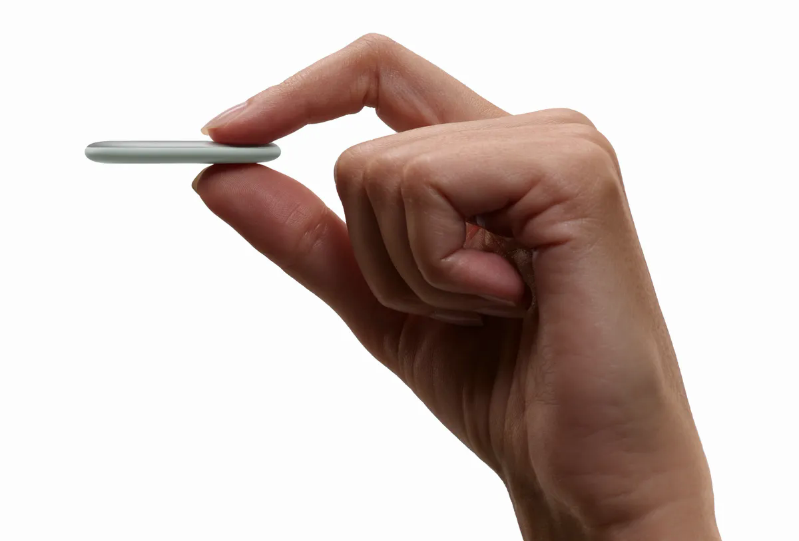

Setelah penantian yang cukup panjang sejak pertama kali diumumkan pada gelaran Made by Google beberapa bulan lalu, pelacak barang pintar perdana buatan raksasa Mountain View akhirnya resmi menyapa pasar. Dinamai Google Pixel Tag, aksesori pelacak mandiri ini dirancang khusus untuk mengisi kekosongan gawai penemu barang resmi di kubu Android, ranah yang selama bertahun-tahun didominasi oleh Apple AirTag serta beberapa merek pihak ketiga.

Kehadiran Pixel Tag terasa sangat penting bagi pemilik perangkat Android yang menginginkan pelacak terintegrasi penuh tanpa repot memasang aplikasi tambahan dari vendor pihak luar. Google membekali perangkat mungil ini dengan kemampuan pencarian presisi serta koneksi langsung ke ekosistem jaringan pelacak global miliknya.

## Jawaban Ringkas Fitur dan Spesifikasi Google Pixel Tag

Google Pixel Tag adalah pelacak barang pintar seharga $29 yang memanfaatkan jaringan Find Hub lebih dari satu miliar perangkat Android. Memiliki bodi baja tahan karat berbentuk lonjong pipih setebal 0,2 inci, Pixel Tag mengandalkan Bluetooth dan Ultra-Wideband (UWB) untuk panduan arah presisi, speaker bersuara 80 dB, tombol fisik dua arah untuk menderingkan ponsel, sertifikasi tahan air IP67, serta baterai koin CR2032 yang dapat diganti sendiri dengan ketahanan hingga satu tahun.

Awalnya saya kira Google hanya akan membuat tiruan bulat menyerupai AirTag yang sekadar ditempeli logo perusahaan. Kalau diperhatikan lebih jauh, ternyata tim desainer Google mengambil jalur bentuk fisik yang sangat kontras. Pixel Tag dibuat lebih ramping dan memanjang seperti bentuk pil atau kapsul lonjong dengan balutan pelat baja tahan karat yang kokoh.

## Desain Pipih Lonjong dan Keberadaan Tombol Fisik Dua Arah

Bentuk fisik Pixel Tag memiliki dimensi tinggi 1,8 inci, lebar 1,1 inci, serta ketebalan hanya 0,2 inci. Jika disejajarkan langsung dengan AirTag yang memiliki ketebalan 0,31 inci, pelacak milik Google ini terasa jauh lebih pipih saat diselipkan ke dalam saku dompet kartu maupun saku koin ransel kerja. Bobot totalnya pun sangat ringan, hanya sekitar 0,4 ons atau 11,3 gram termasuk baterai koin di dalamnya.

Salah satu pembeda paling fungsional yang langsung terasa adalah keberadaan tombol fisik di bagian tengah bodi. Pada kebanyakan tag pelacak kompetitor, permukaannya dibuat polos dan hanya berfungsi searah untuk dicari lewat ponsel. Di Pixel Tag, tombol tersebut bekerja secara dua arah.

Jika Anda lupa menaruh ponsel di sekitar meja kamar, Anda cukup menekan tombol fisik Pixel Tag sebanyak dua kali. Seketika ponsel Android Anda akan berdering nyaring meski sedang disetel dalam kondisi senyap. Fungsi timbal balik ini melengkapi fitur pencarian dasar yang sebelumnya biasa kita jalankan lewat [panduan melacak HP Android yang hilang](/cara-melacak-hp-hilang-android/).

*Sumber: [Google Blog](https://blog.google/products-and-platforms/devices/pixel/google-pixel-tag/)*

Tingkat kenyaringan speaker internalnya dapat disesuaikan hingga tiga tingkatan volume melalui aplikasi, dengan batas maksimal mencapai 80 desibel. Angka ini terbilang cukup lantang untuk menembus tumpukan pakaian kotor atau celah bantalan sofa ruang tamu.

## Pelacakan Presisi UWB dan Ekosistem Jaringan Find Hub

Untuk urusan pencarian jarak dekat, Pixel Tag menggabungkan teknologi Bluetooth Low Energy dengan Ultra-Wideband (UWB) serta Bluetooth Channel Sounding. Saat berada dalam radius beberapa meter, ponsel yang mendukung UWB seperti lini Pixel Pro akan memunculkan jarum kompas visual dan indikator jarak sentimeter di layar, menuntun langkah pengguna secara akurat menuju titik persembunyian barang.

Yang membuat penasaran justru keputusan Google yang tidak menyematkan chip NFC di dalam Pixel Tag. Pada AirTag, orang asing yang menemukan barang bisa menempelkan tag tersebut ke bodi ponsel pintar apa pun untuk membaca laman web kontak pemilik. 

Sebagai gantinya, Google memaksimalkan integrasi Lost Mode di aplikasi Find Hub. Ketika Anda menandai Pixel Tag sebagai barang hilang di aplikasi, jaringan Find Hub akan menampilkan pesan kontak darurat dan nomor telepon Anda saat ada perangkat Android lain yang mendeteksi sinyal Bluetooth dari tag tersebut. Jaringan pencarian urun daya (crowdsourced) ini ditopang oleh lebih dari satu miliar gawai Android aktif di seluruh dunia dengan perlindungan enkripsi lokasi ujung ke ujung (end-to-end encryption).

Integrasi sistem ini berjalan beriringan dengan [fitur pengingat barang tertinggal di Google Find Hub](/google-find-hub-pengingat-barang-tertinggal/) yang baru saja digulirkan. Begitu Anda melangkah keluar dari kafe dan sambungan Bluetooth antara ponsel dengan gantungan kunci terputus, sistem akan lekas mengirimkan notifikasi peringatan di layar sebelum Anda pergi terlalu jauh.

Pengguna jam tangan pintar Pixel Watch juga bisa memantau posisi Pixel Tag langsung dari pergelangan tangan, atau meminta asisten Gemini di earphone Pixel Buds untuk membunyikan dering pelacak tanpa perlu menyentuh layar gawai sama sekali.

## Rincian Spesifikasi Teknis Google Pixel Tag

Bagi yang penasaran dengan detail komponen dan kemampuan teknis peranti keras pelacak ini, berikut rangkuman spesifikasi resminya:

- Material Bodi: Baja tahan karat (stainless steel) dengan finishing matte tahan tekukan
- Dimensi Fisik: 1,8 x 1,1 x 0,2 inci (tinggi x lebar x tebal)
- Bobot: 11,3 gram (0,4 ons sudah termasuk baterai)
- Pilihan Warna: Silver dan Pale Green
- Konektivitas: Bluetooth Low Energy, Ultra-Wideband (UWB), dan Bluetooth Channel Sounding
- Fitur Suara: Speaker terintegrasi dengan 3 tingkat volume hingga 80 desibel
- Tombol Fisik: Tombol tengah multifungsi dengan fitur dering balik ponsel (Reverse Find)
- Tipe Baterai: Baterai koin CR2032 yang dapat diganti mandiri oleh pengguna
- Daya Tahan Baterai: Hingga 1 tahun pemakaian normal
- Ketahanan Air dan Debu: Sertifikasi resmi IP67 (tahan air hingga kedalaman 1 meter selama 30 menit)
- Kompatibilitas Sistem: Perangkat Android versi 9 ke atas dengan dukungan Fast Pair
- Integrasi Tambahan: Pixel Watch, Pixel Buds dengan Gemini, serta berbagi lokasi hingga 10 pengguna di Find Hub
- Harga Ritel: $29,99 untuk paket tunggal dan $99,99 untuk paket isi empat unit

## Harga dan Ketersediaan Perangkat Pelacak Google

Google mematok harga Pixel Tag sebesar $29,99 atau setara kisaran Rp470 ribuan untuk pembelian satu unit. Bagi konsumen yang ingin menandai beberapa barang bawaan sekaligus seperti ransel, koper, dan kunci kendaraan, tersedia paket bundling berisi empat unit seharga $99,99 atau sekitar Rp1,5 jutaan. 

Pelacak ini mulai dijual secara bebas melalui toko resmi Google Store per tanggal 11 November 2026. Bersamaan dengan penjualan perdana ini, Google juga menggandeng produsen aksesori Bellroy untuk menyediakan casing gantungan kunci berbahan kulit premium dalam aneka pilihan warna menarik.

Setelah membaca lebih jauh mengenai arsitektur peranti kerasnya, langkah Google memakai baterai koin standar CR2032 patut diapresiasi karena pengguna tidak perlu membuang perangkat saat daya habis setahun kemudian. Ditambah sertifikasi IP67 dan bodi baja pipih yang tahan benturan, Pixel Tag menjadi opsi pelacak yang sangat matang bagi para pengguna Android yang ingin barang berharganya tetap terpantau rapi.

> **Baca Juga:**
> - [Google Find Hub Hadirkan Fitur Pengingat Barang Tertinggal](/google-find-hub-pengingat-barang-tertinggal/)
> - [XREAL AURA Meluncur Resmi, Kacamata Android XR Pertama](/xreal-aura-kacamata-android-xr-pertama/)

Sumber: [Google Blog](https://blog.google/products-and-platforms/devices/pixel/google-pixel-tag/)
