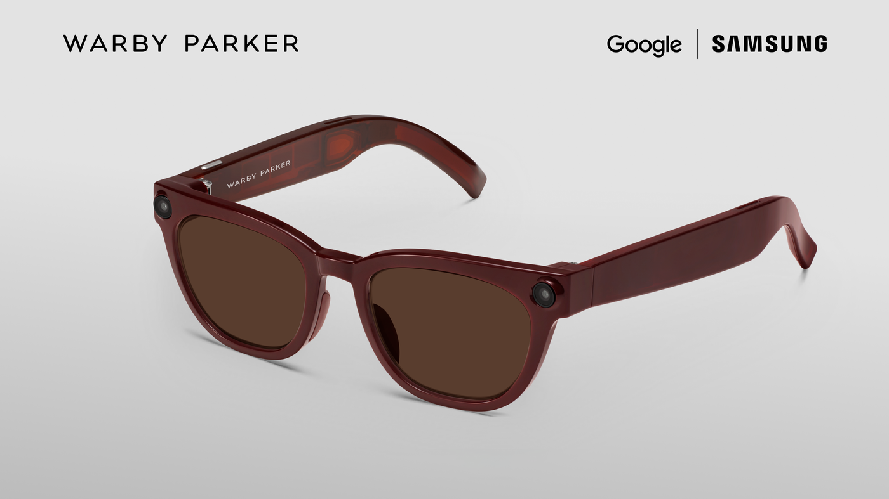

Setelah bertahun-tahun menyimpan ambisi perangkat komputasi di wajah sejak masa Google Glass, raksasa Mountain View kini kembali terjun ke ranah kacamata pintar dengan pendekatan yang jauh lebih matang. Google secara resmi membuka masa pemesanan untuk lini perangkat Intelligent Eyewear, kacamata pintar berbobot ringan bertenaga kecerdasan buatan Gemini dan platform Android XR.

Langkah baru ini terwujud lewat kolaborasi lintas industri yang melibatkan empat nama besar sekaligus. Perangkat lunak dan asisten kecerdasan buatan ditangani langsung oleh Google, modul perangkat keras komputasi dirancang oleh Samsung, sementara bingkai fisik bergaya kasual dan modis dikerjakan oleh dua jenama kacamata ternama, Warby Parker dan Gentle Monster.

## Jawaban Ringkas Spesifikasi dan Fitur Kacamata Gemini Google

Google Intelligent Eyewear adalah lini kacamata cerdas bertenaga Gemini dan platform Android XR hasil kolaborasi dengan Samsung, Warby Parker, dan Gentle Monster seharga mulai $395. Membawa bobot ringan sekitar 41 gram dengan ketahanan baterai 9 jam, kacamata ini dibekali kamera 12 MP, speaker open-ear, terjemahan langsung lintas 70 bahasa, serta sensor privasi pemblokir wajah otomatis.

Awalnya saya kira Google akan kembali tergoda membuat purwarupa futuristik yang penuh tonjolan teknologi canggih tetapi tampak canggung saat dipakai berjalan di tempat umum. Kalau diperhatikan lebih dekat, ternyata strategi kali ini berbalik total. Google menyadari bahwa kacamata pada hakikatnya adalah aksesori fesyen dan kesehatan mata, sehingga urusan estetika sepenuhnya diserahkan kepada perancang kacamata profesional.

## Pilihan Gaya Warby Parker dan Gentle Monster untuk Penggunaan Harian

Kerja sama dengan Warby Parker melahirkan tiga varian siluet klasik bernama Alden, Reid, dan Wren. Ketiganya hadir dalam opsi lensa optik biasa maupun lensa pelindung matahari dengan balutan warna Pine, Saddle, dan Jet Black. Koleksi Warby Parker dibanderol dengan harga mulai $395, menyasar pengguna yang menginginkan kacamata cerdas dengan nuansa elegan yang membaur mulus saat dipakai bekerja maupun bersosialisasi.

Bagi mereka yang menyukai tampilan lebih mencolok dan ekspresif, Gentle Monster menyiapkan enam desain berani bernuansa Y2K. Tersedia beragam pilihan warna bingkai seperti merah tua, merah muda, abu-abu, hingga kuning cerah dengan pilihan lensa berwarna biru, cokelat, maupun gelap. Koleksi dari Gentle Monster dipasarkan dengan harga mulai $449 di wilayah Amerika Serikat dan Korea Selatan.

Meski menyimpan komponen elektronik canggih, bobot seluruh bingkai ini hanya berkisar di angka 41 gram. Bobot tersebut terbilang sangat nyaman untuk ukuran kacamata cerdas harian. Daya tahan baterainya diklaim sanggup menemani aktivitas hingga 9 jam pemakaian aktif. Setiap pembelian juga sudah disertai kotak pengisi daya portabel ramping yang mampu menyuplai daya baterai tambahan hingga tujuh kali siklus pengisian penuh.

*Sumber: [Warby Parker](https://www.warbyparker.com/intelligent-eyewear)*

Pada sudut bingkai depan, terpasang sebuah kamera sudut ultra-lebar 12 megapiksel dengan dukungan pemrosesan HDR dan stabilisasi gambar elektronik. Kamera ini dirancang untuk mendokumentasikan foto maupun video singkat dengan perspektif sudut pandang pemakai tanpa harus repot menarik ponsel dari saku celana.

## Integrasi Asisten Gemini Multimodal dan Sistem Operasi Android XR

Kekuatan utama dari kacamata pintar ini bertumpu pada kehadiran Gemini Live yang berjalan di atas platform Android XR. Berbeda dari kacamata dengan layar proyektor kecil di depan mata, perangkat ini mengandalkan interaksi suara alami serta kemampuan penglihatan komputer. Pengguna cukup mengucapkan "Hey Gemini" atau mengetuk bantalan sentuh di gagang kacamata untuk mulai berinteraksi.

Berkat kemampuan multimodal, Gemini dapat memahami konteks visual yang sedang dilihat oleh pemakainya secara langsung. Anda bisa menatap poster konser di pinggir jalan lalu meminta Gemini memeriksa jadwal ketersediaan di Google Calendar, menanyakan ringkasan buku saat berdiri di depan rak toko buku, hingga mendapatkan panduan arah belokan demi belokan dari Google Maps melalui speaker telinga terbuka.

Fitur terjemahan percakapan langsung juga menjadi sorotan penting. Kacamata ini dapat mendeteksi ucapan dalam lebih dari 70 bahasa secara otomatis dan menerjemahkannya ke telinga pengguna secara langsung tanpa mewajibkan kita mengunduh paket bahasa manual terlebih dahulu di ponsel.

Bagi pengguna tunanetra atau mereka yang memiliki keterbatasan penglihatan, Google menyematkan fitur Gemini Guided Vision untuk mendeskripsikan kondisi lingkungan sekitar lewat audio interaktif. Terdapat pula kolaborasi dengan layanan Aira Explorer, di mana pengguna dapat mengalirkan umpan visual kamera kacamata ke pemandu visual manusia profesional secara langsung saat membutuhkan bantuan darurat di tempat baru.

Sebelumnya, Google memang sudah mulai merintis ekosistem sistem operasi ini ke berbagai bentuk gawai komputasi spasial, termasuk perangkat seperti [kacamata komputasi spasial Android XR XREAL Aura](/xreal-aura-kacamata-android-xr-pertama/). Namun kehadiran Intelligent Eyewear ini menawarkan pendekatan yang jauh lebih membumi karena ditujukan murni sebagai kacamata gaya hidup sehari-hari.

Untuk urusan konektivitas ponsel, perangkat ini mendukung ekosistem lintas platform yang cukup luas. Pengguna iPhone dapat menghubungkannya mulai dari seri iPhone 13 Pro ke atas, sementara pengguna Android dapat memasangkannya dengan lini Google Pixel 7 ke atas atau jajaran ponsel pintar Samsung Galaxy seri S dan Z yang menjalankan antarmuka One UI 9 ke atas.

## Proteksi Privasi Berlapis untuk Mengikis Stigma Kacamata Pintar

Yang membuat penasaran justru komitmen Google dalam menangani isu privasi di ruang publik. Selama ini kacamata berkamera kerap dicap mengganggu kenyamanan orang lain di tempat umum. Keraguan publik terhadap etika perangkat sandang pintar ini kian beralasan setelah mencuatnya kabar mengenai [isu privasi kacamata pintar Ray-Ban Meta](/ray-ban-meta-rekam-suara-tanpa-izin/) yang sempat menuai perdebatan hangat akibat tangkapan suara di latar belakang.

Menjawab kekhawatiran tersebut, Google memperkenalkan prinsip perlindungan di kedua sisi lensa dengan sejumlah batasan teknis yang sangat ketat. Salah satu fitur yang paling menonjol adalah sensor penyensor wajah otomatis. Setiap kali kamera menangkap visual orang lain di sekitar pengguna, sistem secara lokal akan menyamarkan wajah orang tersebut sebelum data dikirimkan ke server pemrosesan Gemini.

Google juga secara tegas menghapus kemampuan pengenalan identitas wajah secara langsung. Ketika asisten Gemini diminta mengenali wajah orang yang tertangkap kamera, sistem akan menolak perintah tersebut demi mematuhi kebijakan privasi. Selain itu, mikrofon directional beamforming hanya difokuskan untuk menangkap suara pemilik kacamata, sehingga percakapan orang asing di sekitar pengguna otomatis disaring.

Dari sisi keamanan data pribadi, seluruh visual foto dan video yang diproses oleh Gemini tidak akan disimpan ke dalam riwayat percakapan Gemini History, tidak digunakan untuk melatih model kecerdasan buatan, dan tidak dimanfaatkan untuk personalisasi target iklan. Kebijakan toko aplikasi Google Play juga melarang keras segala bentuk aplikasi yang mencoba melakukan siaran langsung media sosial secara terbuka dari kamera kacamata ini.

Lampu indikator rekaman LED di bagian luar bingkai pun dipasangi sensor pendeteksi manipulasi fisik. Jika lampu indikator tersebut sengaja ditutupi stiker atau dimodifikasi agar tidak menyala, kamera kacamata akan menolak beroperasi secara otomatis. Tersedia pula tombol sakelar fisik pemutus daya di bagian bodi sehingga pengguna bisa mematikan seluruh modul pintar kapan saja dan memakainya sebagai kacamata konvensional biasa.

## Jadwal Ketersediaan dan Distribusi Pasar

Masa pra-pesan untuk lini Intelligent Eyewear dari Warby Parker dan Gentle Monster telah dibuka mulai hari ini melalui situs resmi masing-masing merek serta gerai terpilih. Pengiriman perdana ke tangan konsumen serta penjualan fisik di etalase toko dijadwalkan meluncur mulai tanggal 10 Desember 2026.

Melihat peta persaingan kacamata pintar yang selama ini didominasi oleh satu ekosistem saja, kemunculan perangkat kolaborasi Google dan Samsung ini menghadirkan alternatif yang sangat menarik bagi konsumen teknologi. Keberhasilan perangkat ini ke depan tentu akan bergantung pada sejauh mana pengguna merasa nyaman mengandalkan bantuan kecerdasan buatan langsung di depan mata tanpa harus mengorbankan privasi orang-orang di sekitarnya.

> **Baca Juga:**
> - [XREAL AURA Meluncur Resmi, Kacamata Android XR Pertama](/xreal-aura-kacamata-android-xr-pertama/)
> - [Google Pixel Tag Resmi Dijual, Pesaing Ramping AirTag](/google-pixel-tag-resmi-dijual-pesaing-airtag/)

Sumber: [Google Blog](https://blog.google/innovation-and-ai/technology/xr-ar/google-intelligent-eyewear-collections-pre-order/)
