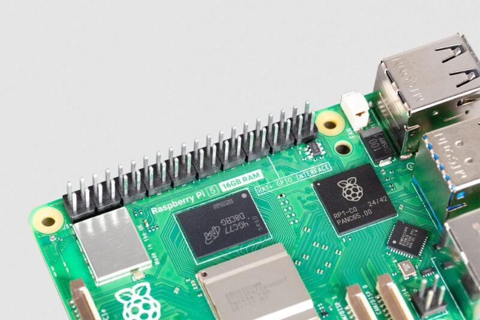

Kabar mengejutkan datang bagi siapa pun yang gemar merakit proyek berbasis komputer papan tunggal. Raspberry Pi baru saja mengumumkan penyesuaian harga baru yang cukup membuat kening berkerut. Varian tertinggi Raspberry Pi 5 dengan kapasitas memori 16GB kini mengalami kenaikan harga signifikan, menyusul tekanan rantai pasok komponen memori global yang belum kunjung mereda.

Bagi sebuah perangkat yang lahir dari semangat komputasi murah dan ramah kantong, lonjakan angka ini jelas memicu perbincangan hangat di kalangan penggiat hardware dan komunitas perakit mandiri di seluruh dunia.

## Lonjakan Harga Drastis dan Jawaban Resmi Raspberry Pi

Raspberry Pi resmi menaikkan harga Raspberry Pi 5 varian 16GB sebesar $80 menjadi $385 imbas krisis pasokan chip DRAM global yang belum mereda. Kenaikan drastis hingga lebih dari tiga kali lipat harga rilis awal ini dipicu oleh keterbatasan pasokan komponen memori berdensitas tinggi serta minimnya alternatif pemasok bagi manufaktur perangkat keras tersebut.

Awalnya saya kira kabar kenaikan harga ini sekadar rumor musiman atau ulah spekulan di lokapasar daring. Namun saat membaca rilis resmi yang ditulis langsung oleh Eben Upton selaku pucuk pimpinan Raspberry Pi, perusahaan asal Inggris tersebut memang terpaksa mengambil keputusan pahit demi menjaga kelangsungan jalur produksi.

## Dari Komputer Murah Menjadi Seharga Mini PC Desktop

Kalau kita menengok kembali ke belakang, varian 16GB dari Raspberry Pi 5 pertama kali diperkenalkan ke pasaran dengan banderol resmi $120. Dengan revisi harga terbaru di angka $385 (atau setara Rp6 jutaan sebelum pajak dan ongkos kirim ke Indonesia), nilainya kini sudah melompat lebih dari tiga kali lipat dari harga perkenalannya.

Angka tersebut menempatkan sebuah single-board computer tanpa casing, tanpa kabel daya, dan tanpa media penyimpanan pada rentang harga yang bersenggolan langsung dengan komputer mini x86 siap pakai. Di pasaran saat ini, bujet sebesar itu bahkan sudah cukup untuk memboyong mini PC bertenaga prosesor Intel Core generasi modern atau AMD Ryzen yang sudah dilengkapi pendingin aktif, penyimpanan NVMe terpasang, serta adaptor daya resmi.

Kondisi ini tentu memicu dilema besar bagi perakit rumahan yang awalnya memilih ekosistem Pi karena pertimbangan efisiensi biaya.

## Dilema Pasokan Chip DRAM Berdensitas Tinggi

Yang membuat penasaran justru akar masalah teknis di balik keputusan tersebut. Dalam penjelasannya, pihak Raspberry Pi membeberkan bahwa industri saat ini sedang menghadapi kelangkaan parah untuk modul DRAM berkapasitas 16GB berdensitas tinggi.

*Sumber: [Raspberry Pi](https://www.raspberrypi.com/app/uploads/2025/01/16GB-CU-800x533.jpg)*

Berbeda dengan varian RAM berkapasitas lebih rendah seperti 4GB atau 8GB yang memiliki banyak pabrikan pemasok alternatif di kawasan Asia, chip DRAM 16GB tunggal yang kompatibel dengan arsitektur papan sirkuit Pi 5 jumlahnya sangat terbatas di pasar global. Lonjakan harga bahan mentah semikonduktor dan permintaan masif dari pusat data berbasis kecerdasan buatan menyedot alokasi memori berdensitas tinggi dari para produsen silikon utama.

Dampak kelangkaan ini tidak hanya menimpa Raspberry Pi 5 versi reguler. Lini industri Raspberry Pi Compute Module 5 (CM5) varian 16GB juga ikut terkerek naik sebesar $40, membuat harga jualnya kini bertengger di rentang $375 hingga $415 tergantung konfigurasi modul nirkabel serta memori eMMC bawaan.

## Raspberry Pi 500 Plus Justru Tidak Mengalami Kenaikan

Setelah membaca pengumuman tersebut lebih detail, ada satu hal yang menarik perhatian saya. Raspberry Pi secara tegas tidak menaikkan harga Raspberry Pi 500 Plus. Komputer meja all-in-one berwujud keyboard mekanikal premium tersebut juga mengusung kapasitas RAM 16GB, namun banderol resminya tetap dipertahankan pada harga lama.

Langkah ini menunjukkan bahwa manajemen Raspberry Pi sengaja menghindari kenaikan harga secara merata di seluruh lini produk. Perusahaan tampak memanfaatkan stok kontrak jangka panjang untuk lini 500 Plus guna melindungi konsumen segmen edukasi dan pengguna workstation desktop terintegrasi dari gejolak fluktuasi pasar komponen.

Selain itu, varian Raspberry Pi 5 dengan kapasitas RAM 2GB, 4GB, dan 8GB untuk saat ini tidak mengalami revisi harga susulan, meski varian 2GB sempat mengalami sedikit penyesuaian pada bulan sebelumnya.

## Tips Menghemat Memori dan Antisipasi Spekulan Nakal

Menyikapi lonjakan biaya yang tidak terhindarkan ini, Eben Upton menyampaikan pesan khusus kepada para pembuat proyek dan developer. Beliau menyarankan agar konsumen mengevaluasi kembali kebutuhan proyek mereka secara objektif dan menghindari pembelian kapasitas memori yang melebihi kebutuhan riil.

Ada beberapa langkah rasional yang dapat dipertimbangkan sebelum memutuskan membeli modul 16GB saat ini:

- Menimbang varian 4GB atau 8GB yang jauh lebih terjangkau untuk kebutuhan server rumahan, automasi, atau pemutar media.
- Mengoptimalkan alokasi memori pada Raspberry Pi OS melalui panduan resmi dokumentasi pengembang tanpa perlu menambah modul fisik.
- Menggunakan model lawas seperti Raspberry Pi 4 jika beban kerja komputasi tidak menuntut pemrosesan grafis dan I/O generasi terbaru.
- Menghindari pembelian lewat tengkulak daring yang menjual perangkat di atas harga anjuran resmi.

Eben Upton juga memperingatkan munculnya pihak-pihak tidak bertanggung jawab yang memanfaatkan momentum kelangkaan ini untuk menjual perangkat tiruan atau memasang tarif di luar batas wajar. Konsumen diimbau untuk selalu memeriksa ketersediaan stok melalui jaringan resmi Raspberry Pi Approved Reseller.

Pihak Raspberry Pi menegaskan bahwa badai kenaikan harga memori ini bersifat sementara. Mereka berjanji akan segera mengembalikan harga jual ke angka semula begitu biaya produksi komponen DRAM di pasar global kembali normal. Namun hingga momen itu tiba, siapa pun yang mengincar papan komputasi mungil bertenaga besar ini tampaknya harus merogoh kocek jauh lebih dalam.

> **Baca Juga:**
> - [Layar iPhone Duo Retak, Apple Kirim Panduan Resmi ke Toko](/apple-kirim-panduan-layar-iphone-duo-retak/)
> - [Apple Rilis MacBook Pro 14 Inci M6, Baterai Tahan 24 Jam](/macbook-pro-14-inci-m6-baterai-24-jam/)

Sumber: [Raspberry Pi](https://www.raspberrypi.com/news/price-rises-for-some-16gb-raspberry-pi-products/)
