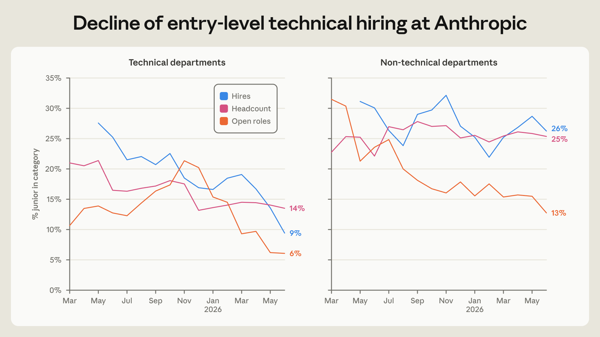

Awalnya saya mengira kalau sebuah perusahaan teknologi sudah mempekerjakan asisten kecerdasan buatan di hampir seluruh lini kerjanya, suasana kantor bakal jadi serba sunyi dan otomatis. Bayangan saya, para insinyur cukup memasukkan beberapa perintah singkat, lalu duduk santai menunggu kode selesai tanpa perlu banyak koordinasi atau rapat yang membuang waktu.

Namun setelah membaca laporan riset internal yang baru saja dibagikan oleh The Anthropic Institute, kenyataan di lapangan justru berbalik 180 derajat. Laporan bertajuk *How employment is changing at Anthropic* ini memotret dapur internal sang pengembang Claude secara apa adanya. Data yang diolah bukan sekadar perkiraan atau opini semata, melainkan rekaman aktivitas nyata dari log sistem, riwayat rekrutmen, kalender kerja, hingga wawancara mendalam dengan karyawan di berbagai divisi.

Ada begitu banyak temuan menarik yang membuka mata tentang bagaimana tempat kerja modern berubah saat teknologi AI diadopsi secara menyeluruh.

## Rekrutmen Posisi Junior Terjun Bebas

Salah satu sorotan terbesar dalam laporan ini adalah pergeseran pola penerimaan karyawan baru. Jika biasanya perusahaan rintisan teknologi getol merekrut lulusan baru atau staf tingkat awal untuk menangani tugas teknis dasar, kebiasaan tersebut kini berubah drastis di Anthropic.

Berdasarkan data internal mereka, proporsi karyawan tingkat junior di departemen teknis menyusut dari 21 persen menjadi 14 persen. Penurunan pada angka rekrutmen baru bahkan jauh lebih curam. Dari total perekrutan staf teknis, porsi pelamar tingkat junior yang diterima anjlok dari 27 persen menjadi tinggal 9 persen saja.

Porsi departemen teknis secara keseluruhan juga mengalami penurunan tipis dari 61 persen menjadi 56 persen dari total tenaga kerja. Menariknya, hal ini bukan disebabkan oleh pengurangan karyawan teknis, melainkan karena laju penambahan staf di divisi non-teknis seperti penjualan, keuangan, dan rekrutmen bergerak jauh lebih agresif. 

Selain itu, berkat kehadiran berbagai perkakas coding berbasis AI, para pekerja non-teknis di Anthropic kini dilaporkan sanggup merancang dan membangun perkakas perangkat lunak internal mereka sendiri tanpa harus selalu bergantung pada antrean tim insinyur.

## Jam Kerja Agent Lampaui Staf Manusia Enam Banding Satu

Ketergantungan terhadap agen otomatis di Anthropic meningkat dalam tempo yang sangat kilat. Hingga Agustus 2026, catatan waktu operasional interaktif AI agent telah melampaui total jam kerja seluruh staf manusia dengan rasio mencapai 6 banding 1.

Percepatan ini berdampak langsung pada produktivitas angka mentah. Jumlah commit kode per insinyur melonjak hingga lima kali lipat dibandingkan catatan enam bulan sebelumnya. Alur pemrosesan kontrak hukum, verifikasi dokumen penjualan, hingga penanganan tiket operasional harian melonjak ke tingkat yang belum pernah terjadi sebelumnya.

Akan tetapi, laju produksi yang luar biasa cepat ini memicu masalah baru yang tidak kalah rumit di sisi manusia.

## Botol Leher Berpindah ke Daya Tampung Manusia

Ketika mesin mampu menghasilkan ribuan baris teks dan kode dalam hitungan detik, siapa yang bertugas membaca dan memverifikasinya? Di sinilah titik hambat baru muncul. Laporan Anthropic menyebutkan bahwa keterbatasan atensi dan daya serap manusia kini menjadi penghalang utama dari keluaran kerja para agen.

Bahkan untuk karyawan non-teknis sekalipun, membaca seluruh rangkuman interaksi yang dihasilkan oleh agen Claude milik mereka diperkirakan bisa memakan waktu hingga separuh dari total jam kerja seminggu penuh. Akibat banjir teks ini, para agen AI justru sering kali menganggur.

Data pelacakan sesi interaktif menunjukkan bahwa sekitar 80 persen dari total waktu sesi Claude dihabiskan hanya untuk *idle*, alias menunggu arahan atau persetujuan berikutnya dari manusia. Istilah sederhananya, bukan AI yang lambat, melainkan manusianya yang kewalahan mengimbangi aliran keluaran tugas tersebut.

## Dari Menulis Kode Bergeser Jadi Mengasuh Claude

Situasi tersebut perlahan mengubah hakikat pekerjaan sehari-hari para karyawan. Salah seorang insinyur Anthropic menggambarkan situasi kerjanya seperti sedang mengasuh sepasukan Claude. Setiap agen mengajukan pertanyaan atau meminta persetujuan pada saat yang bersamaan, menuntut tingkat perhatian yang sama besarnya.

Sebanyak 20 persen karyawan dalam survei internal mengakui bahwa peran utama mereka kini telah bergeser dari mengerjakan tugas langsung menjadi mengelola dan menyortir agen Claude. Fenomena ini melahirkan apa yang disebut tim peneliti sebagai *meta-work*, yaitu pekerjaan untuk mengatur pekerjaan itu sendiri.

Bentuk *meta-work* ini bermacam-macam. Jumlah panduan dan instruksi kerja tertulis (SOP) yang dibuat karyawan untuk memandu para agen melonjak dari hanya beberapa ratus instruksi pada pertengahan 2025 menjadi lebih dari 8.500 instruksi setahun berselang. Karyawan juga disibukkan dengan pembuatan dasbor pemantau pipa kerja agen, membuat agen perantara khusus untuk menyaring permintaan Claude lain, hingga menyusun tinjauan evaluasi performa kerja bagi sang agen.

## Kenapa Rapat Tatap Muka Malah Makin Ramai

Bagian ini yang menurut saya paling mengejutkan sekaligus menggelitik. Banyak ramalan teknologi menyebut kecerdasan buatan bakal melenyapkan budaya rapat di kantor karena semua koordinasi bisa ditangani algoritma. Nyatanya, data kalender internal Anthropic menunjukkan hal yang bertolak belakang.

Rata-rata waktu yang dihabiskan seorang karyawan untuk mengikuti rapat justru melonjak 20 persen dibandingkan tahun lalu. Bagi para kontributor teknis individual yang biasanya jarang menyentuh agenda pertemuan, waktu rapat mereka juga naik sebesar 16 persen.

Alasannya sangat masuk akal saat ditelaah lebih dalam. Ketika urusan eksekusi teknis tingkat bawah sudah didelegasikan ke AI, peran manusia bergeser penuh ke ranah pertimbangan strategis, penyelarasan visi produk, etika, dan penyelesaian perdebatan tingkat tinggi. Anthropic secara tegas tidak memberikan wewenang eksekutif atau pengambilan keputusan akhir kepada model AI mereka. 

Setiap kali para karyawan merasa jenuh mengawasi antrean tugas Claude, pelarian alami mereka adalah berkumpul dengan sesama manusia untuk berdiskusi, berdebat secara langsung, dan memastikan arah kerja tetap selaras. Rapat tatap muka bukan lagi sarana membagi tugas mekanis, melainkan benteng akuntabilitas dan kepercayaan antarmanusia.

## Keterbukaan Komunikasi di Ruang Kerja Digital

Perubahan budaya kerja ini juga merembes ke cara berkomunikasi lewat platform perpesanan tim. Di ruang obrolan Slack internal Anthropic, agen Claude kini telah hadir di hampir separuh saluran publik yang aktif.

Namun, kehadiran AI ini menuntut transparansi total. Bekerja secara diam-diam melalui pesan pribadi (DM) atau pertemuan tertutup tanpa catatan resmi sangat tidak dianjurkan. Alasannya sederhana, para agen AI membutuhkan konteks percakapan yang terbuka dan terus diperbarui dari obrolan publik agar bisa memahami arah kerja tim secara akurat.

Melihat fakta yang dipaparkan dalam laporan ini, masa depan dunia kerja bersama AI ternyata tidak sepenuhnya tentang otomatisasi tanpa henti. Di balik mesin yang bekerja siang dan malam, kebutuhan akan penilaian manusia, koordinasi langsung, dan komunikasi terbuka justru menjadi jauh lebih mahal dan berharga.

Sumber: [The Anthropic Institute](https://www.anthropic.com/research/employment-at-anthropic)
