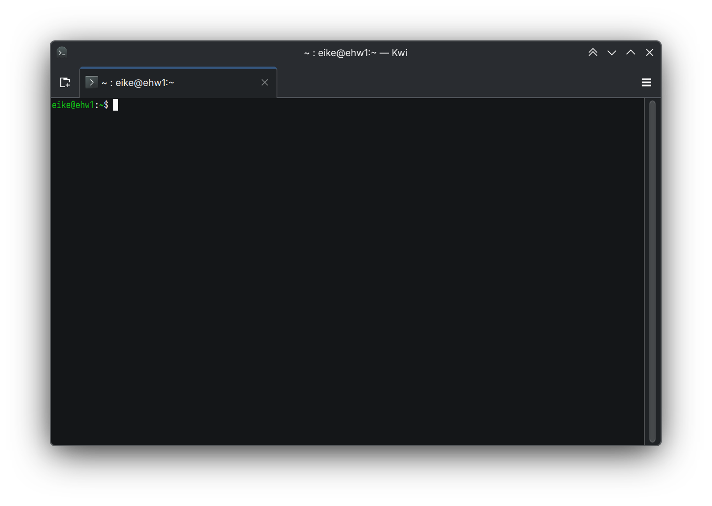

Pengembang kawakan lingkungan desktop KDE, Eike Hein, resmi mengumumkan proyek emulator terminal eksperimental bernama Kwi (dilafalkan *kwee*). Aplikasi ini dirancang dari nol menggunakan fondasi pustaka *backend* `libghostty-vt` milik proyek Ghostty yang dipadukan dengan *framework* modern KDE Kirigami serta Qt Quick, menghadirkan lompatan performa olah teks hingga puluhan kali lipat lebih kencang daripada Konsole tradisional.

Kabar ini menjadi angin segar buat ente yang sehari-hari akrab dengan lingkungan KDE Plasma. Selama berpuluh tahun, Konsole telah setia menemani jutaan pengguna Linux. Namun, keterikatan arsitektur lawasnya mulai terasa membatasi inovasi antarmuka modern, terutama saat berhadapan dengan akselerasi grafis berbasis GPU dan tuntutan protokol terminal masa kini.

## Akar Masalah Arsitektur Konsole dan Kebutuhan Era Qt Quick

Kalau ane perhatikan ekosistem aplikasi KDE belakangan ini, Konsole tergolong aplikasi legendaris yang usianya sudah menginjak 29 tahun. Konsole dibangun di atas tumpukan teknologi *toolkit* lawas Qt, yaitu QWidget. Karakteristik utama QWidget adalah seluruh proses rendering antarmukanya ditangani oleh prosesor utama (CPU).

Di sisi lain, KDE Plasma versi anyar beserta sebagian besar aplikasi modern di ekosistemnya telah bermigrasi ke Qt Quick dan pustaka Kirigami. Tumpukan teknologi baru ini memanfaatkan akselerasi perangkat keras kartu grafis (GPU) melalui perantara Vulkan atau OpenGL pada lapisan Qt Scene Graph. Di sinilah letak jurang pemisah yang coba dijembatani oleh Kwi.

Selain persoalan mesin render, ada kendala arsitektur klasik yang selama ini merepotkan para pengembang. Konsole menyediakan komponen sematan (*embeddable component*) bernama KPart yang dipakai oleh aplikasi seperti manajer berkas Dolphin, penyunting teks Kate, dan terminal tarik-turun Yakuake. Anehnya, aplikasi utama Konsole sendiri justru tidak mengonsumsi KPart buatannya sendiri.

Dampaknya terasa nyata bagi pengguna. Pengaturan profil di Yakuake sering kali berperilaku beda dengan jendela Konsole mandiri. Menu konfigurasi Konsole pun terkenal rumit karena beberapa opsi diletakkan di dialog utama sementara opsi lain tersembunyi di dalam pengaturan profil aktif. Melalui proyek Kwi, arsitektur ini dirombak total. Kwi menyediakan modul publik QML berbasis Qt Quick yang dapat langsung diimpor oleh aplikasi lain tanpa drama ketidaksinkronan konfigurasi.

*Sumber: [KDE Blogs](https://blogs.kde.org/2026/11/01/introducing-kwi/)*

## Lompatan Performa Berkat Mesin libghostty dan Qt Scene Graph

Langkah cerdas dari Eike Hein adalah tidak membuang energi untuk menulis ulang pengurai perintah terminal dari nol. Proyek Kwi memanfaatkan `libghostty-vt`, pustaka *headless* mandiri yang dipisahkan dari proyek terminal Ghostty. Pustaka ini menangani seluruh kerumitan penguraian karakter VT (*virtual terminal state machine*) dengan standar keandalan tinggi.

Kwi menggabungkan mesin `libghostty-vt` dengan kerangka kerja KDE yang sudah sangat matang seperti KPty. Hasilnya luar biasa ketika dipadukan dengan mesin render Qt Scene Graph berakselerasi GPU. Pada pengujian animasi terminal yang berat seperti tolok ukur *DOOM-fire-zig*, Kwi sanggup menyemburkan angka hingga 870 *frames per second* (fps). Sebagai pembanding, Konsole pada sistem uji yang sama hanya sanggup menghasilkan sekitar 23 fps.

Peningkatan performa berkisar antara 3 hingga 35 kali lipat ini bukan sekadar angka di atas kertas tolok ukur sintesis, om. Buat ente yang sering menjalankan keluaran log peladen berkecepatan tinggi, kompilasi kode berskala masif, atau aplikasi antarmuka teks (TUI) interaktif, pergerakan teks di layar bakal terasa jauh lebih mulus tanpa ada gejala tersendat (*stuttering*). Pengalihan beban render teks dari CPU ke GPU juga berkontribusi positif menghemat konsumsi daya baterai pada laptop.

## Dukungan Fitur Modern TUI dan Integrasi Mulus Desktop Plasma

Keunggulan lain dari adopsi mesin Ghostty adalah kelengkapan dukungan terhadap protokol terminal modern yang selama ini sulit diwujudkan secara sempurna di Konsole. Kwi menghadirkan integrasi mendalam yang mengikuti panduan desain antarmuka KDE Human Interface Guidelines (HIG) terbaru.

Berikut adalah beberapa fitur unggulan yang sudah tersedia pada Kwi:

- Penyesuaian tema warna secara otomatis (*live color scheme sync*) yang langsung sinkron mengikuti skema palet KDE Plasma ketika berganti mode gelap atau terang.
- Penanganan fraksional skala (*fractional scaling*) pada protokol Wayland tanpa buram atau teks pecah.
- Dukungan protokol grafis Kitty secara penuh dan berkecepatan tinggi, mencakup rendering gambar mini, animasi, hingga bentuk kursor interaktif.
- Kemampuan protokol papan klip Kitty (*OSC 5522* dan *OSC 1337*) serta indikator progres bilah tugas (*OSC 9;4*).
- Kerapian tata letak tipografi canggih, termasuk ligatur font pemrograman, simbol Powerline, hingga penyesuaian proporsi ikon Nerd Font.
- Peningkatan aksesibilitas bagi pengguna pembaca layar (*screen reader*) dengan ekstraksi teks dan pelacakan kursor tetikus yang jauh lebih presisi.

## Status Eksperimental dan Visi Jangka Panjang Pengembang

Perlu dicatat bahwa saat ini Kwi masih berada pada tahap pengembangan eksperimental awal. Proyek ini belum merilis tag versi v0.1.0 resmi dan baru diuji coba oleh lingkaran pengembang internal. Eike Hein menegaskan bahwa Kwi belum diajukan sebagai pengganti resmi Konsole dalam waktu dekat. Konsole tetap menjadi terminal bawaan yang stabil dengan rekam jejak kematangan pengujian selama puluhan tahun.

Namun, visi ke depan Kwi sangat menarik untuk dicermati. Di masa mendatang, Kwi dapat menjadi landasan bagi KDE untuk merancang alternatif emulator terminal virtual di ruang pengguna (*userspace VT*) sebagai penerus proyek Kmscon, lengkap dengan dukungan tata letak karakter *Input Method Engine* (IME) dan aksesibilitas menyeluruh pada sistem operasi Linux.

Bagi ente yang penasaran ingin membedah kode sumber atau menjajal kompilasi secara mandiri, repositori proyek Kwi kini sudah dibuka untuk publik di peladen resmi GitLab KDE.

Sumber: [KDE Blogs](https://blogs.kde.org/2026/11/01/introducing-kwi/)
