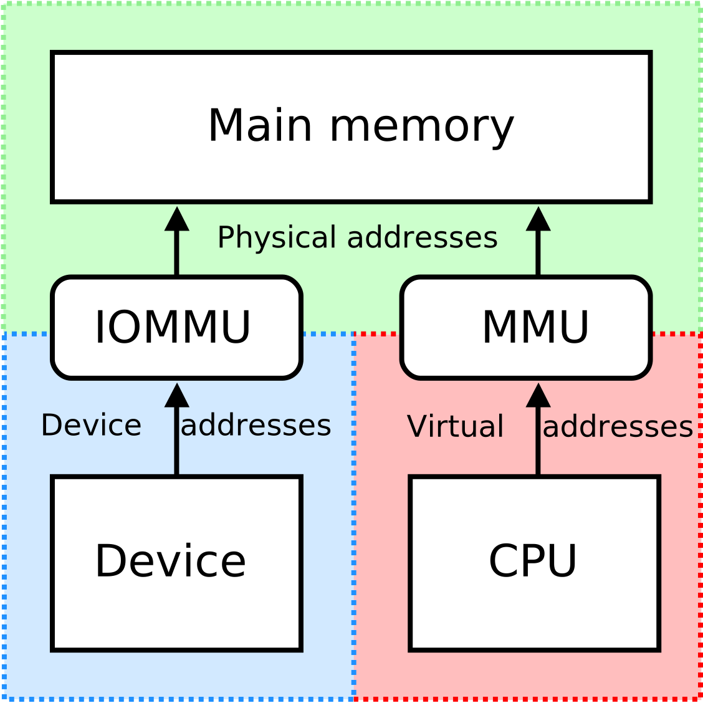

Maintainer subsistem inti kernel Linux, Greg Kroah-Hartman, resmi menarik kembali patch fitur TAINT_FORCED_BIND pada ranting utama Linux 7.4. Keputusan pembatalan ini diambil setelah fitur penanda kernel kotor tersebut memicu protes keras dari komunitas virtualisasi karena secara keliru mencap sistem normal pengguna VFIO dan PCI passthrough sebagai sistem bermasalah.

Kabar ini tentu melegakan buat ente yang gemar membangun mesin virtual dengan alur kerja passthrough GPU atau kartu jaringan. Pasalnya, jika fitur ini dibiarkan melenggang ke rilis stabil, setiap kali ente melepaskan perangkat keras dari sistem host untuk diteruskan ke guest VM, status kernel ente langsung dianggap cacat (*tainted*) oleh sistem operasi.

## Niat Awal Menangkal Serangan Bot dan Fuzzing AI

Kalau ane telusuri akar masalahnya, langkah awal Greg KH sebenarnya lahir dari niat baik untuk melindungi para pengembang kernel dari banjir spam laporan kutu (*bug reports*). Selama beberapa bulan terakhir, milis Linux Kernel Mailing List (LKML) kerap kebanjiran tumpukan laporan kerusakan palsu yang dipicu oleh alat uji otomatis (*fuzzing tools*) seperti Syzbot serta bot pengujian berbasis model bahasa besar (LLM).

Bot dan skrip otomatis ini mencoba membobol stabilitas kernel dengan cara memaksa driver sembarangan mengendalikan perangkat keras yang sama sekali tidak kompatibel. Jalur yang mereka salah gunakan adalah antarmuka bawaan sysfs, tepatnya melalui berkas virtual `/sys/bus/pci/drivers/<nama_driver>/bind` dan `unbind`.

Lewat berkas tersebut, ruang pengguna (*userspace*) dengan hak akses root memang diizinkan mencopot perangkat secara paksa dari satu modul driver lalu mengaitkannya ke modul lain. Ketika bot AI sengaja mengikatkan kartu suara atau modem ke driver kartu grafis, kernel tentu saja mengalami galat fatal (*panic* atau *null pointer dereference*). Masalahnya, bot ini kemudian melaporkan galat tersebut ke milis publik seolah-olah terjadi kecacatan serius pada kode kernel, padahal skenario pengujiannya murni ngawur dan tidak pernah ada di dunia nyata.

Gerah dengan kebisingan laporan palsu itu, Greg KH pada September lalu merancang fitur bernama `TAINT_FORCED_BIND`. Idenya sederhana, setiap kali ada proses ruang pengguna yang menulis ke berkas sysfs `bind` atau `unbind`, kernel akan langsung mengaktifkan bit penanda ke-20 bertanda `Y` pada `/proc/sys/kernel/tainted`. Ketika ada laporan kerusakan masuk, maintainer bisa langsung menyaring dan membuang laporan tersebut ke tong sampah jika mendapati status kernel pengirim sudah tercemar.

## Senggolan Fatal dengan Alur Kerja Passthrough VFIO

Rencana di atas terlihat logis di atas kertas, tapi kenyataan di lapangan berkata lain. Di dunia administrasi server dan virtualisasi Linux, berkas sysfs `bind` dan `unbind` bukan sekadar perkakas *debugging* biasa, melainkan urat nadi dari subsistem VFIO (Virtual Function I/O).

Bagi para pengguna KVM, QEMU, maupun platform Proxmox yang mengandalkan isolasi perangkat keras langsung, memindahkan kepemilikan periferal PCIe dari kontrol host ke modul `vfio-pci` adalah prosedur standar sehari-hari. Ente yang pernah setup kartu grafis sekunder buat diserahkan ke mesin virtual Windows pasti akrab dengan perintah pelepasan driver display host sebelum mengikatkannya ke alamat bus VFIO.

*Sumber: [Wikimedia Commons](https://commons.wikimedia.org/wiki/File:MMU_and_IOMMU.svg)*

Di bawah payung arsitektur IOMMU, isolasi kelompok perangkat (*IOMMU groups*) menjamin bahwa transaksi Direct Memory Access (DMA) antara guest dan perangkat fisik tidak akan mengotori memori host. Namun, agar driver `vfio-pci` bisa mengambil alih kendali kartu, sistem wajib menjalankan operasi sysfs `unbind` pada driver lama lalu memanggil sysfs `bind` pada driver VFIO.

Akibat fitur `TAINT_FORCED_BIND` yang sempat digabungkan ke ranting Linux 7.4 beberapa hari lalu, jutaan instalasi virtualisasi di seluruh dunia tiba-tiba terancam menyandang status kernel kotor. Dampaknya bukan main, pengguna VFIO yang benar-benar menemukan kutu orisinal pada sistem mereka tidak akan lagi dilayani oleh para perawat modul kernel karena laporan mereka otomatis ditolak mentah-mentah akibat status *taint* tersebut.

## Kutipan Humor Greg Kroah-Hartman dan XKCD 1172

Protes terhadap fitur ini bergulir cepat dari para pengembang kawakan subsistem jaringan dan virtualisasi kernel, termasuk Jason Gunthorpe, Leon Romanovsky, Uwe Kleine-König, hingga Michal Pecio. Mereka serempak mengingatkan bahwa memblokir atau menodai sysfs bind sama saja dengan merusak standar orkestrasi virtualisasi modern.

Mendengar masukan teknis yang solid tersebut, Greg Kroah-Hartman bergerak cepat dan berjiwa besar mengakui kekeliruannya. Pada Jumat malam, Greg resmi meneken *patch revert* berkode `fcbfaffee51a` untuk mencabut seluruh logika `TAINT_FORCED_BIND` dari pohon kernel Linux 7.4.

Catatan komit yang ditulis Greg bahkan dibumbui humor khas komunitas hacker yang sangat menghibur. Greg menyebut subsistem VFIO sebagai binatang liar yang tidak terduga:

> "Turns out that vfio is a crazy beast and people have been 'relying' on the bind/unbind debugging feature as a way to handle passing through devices to guest instances. Because of this (https://xkcd.com/1172/), let's revert the feature for now until we can figure out a more agreeable way to handle this such that normal workflows do not taint the kernel."

Rujukan komik web XKCD nomor 1172 yang disisipkan Greg merujuk pada paradoks klasik rekayasa perangkat lunak, bahwa perubahan apa pun pada suatu sistem, betapapun anehnya alur kerja yang disentuh, pasti akan merusak rutinitas seseorang yang sudah telanjur menggantungkan hidupnya pada perilaku tersebut. Greg juga menambahkan kalimat penutup ramah dengan menyampaikan terima kasih kepada seluruh pihak yang telah mengingatkan kekeliruannya secara lugas.

## Rencana Pengganti Bersama Opsi Driver Override

Lantas, bagaimana nasib upaya membendung banjir spam dari bot penguji berbasis AI? Greg menjelaskan bahwa alat fuzzer utama Syzbot saat ini sudah memperbarui aturan pengujian internalnya sehingga tidak lagi mengulang kebiasaan mengikat perangkat sembarangan.

Meski demikian, komunitas kernel tetap menyiapkan benteng pertahanan jangka panjang yang lebih elegan tanpa mengorbankan alur kerja VFIO. Salah satu jalan tengah yang diusulkan oleh pengembang Uwe Kleine-König adalah memanfaatkan mekanisme `driver_override`. Alih-alih menghukum berkas `bind` dan `unbind` secara global, kernel masa depan setelah seri 7.4 kemungkinan akan memperkenalkan flag `TAINT_DRIVER_OVERRIDE` yang hanya terpicu jika ada modul yang secara agresif menimpa aturan pengikatan baku tanpa izin eksplisit dari driver terkait.

Drama singkat ini memberi gambaran menarik soal bagaimana ekosistem kernel Linux berkembang. Di tengah gempuran otomatisasi dan fuzzer bertenaga kecerdasan buatan yang kerap menghasilkan kebisingan data, komitmen para maintainer untuk tetap mendengar keluhan komunitas pengguna di garda depan terbukti menjadi filter paling tangguh untuk menjaga kestabilan sistem operasi open source ini.

Sumber: [Linux Kernel Mailing List](https://lore.kernel.org/all/20261028-bind_taint-revert-v1-1-7c6b9cef30c9@linuxfoundation.org/)
