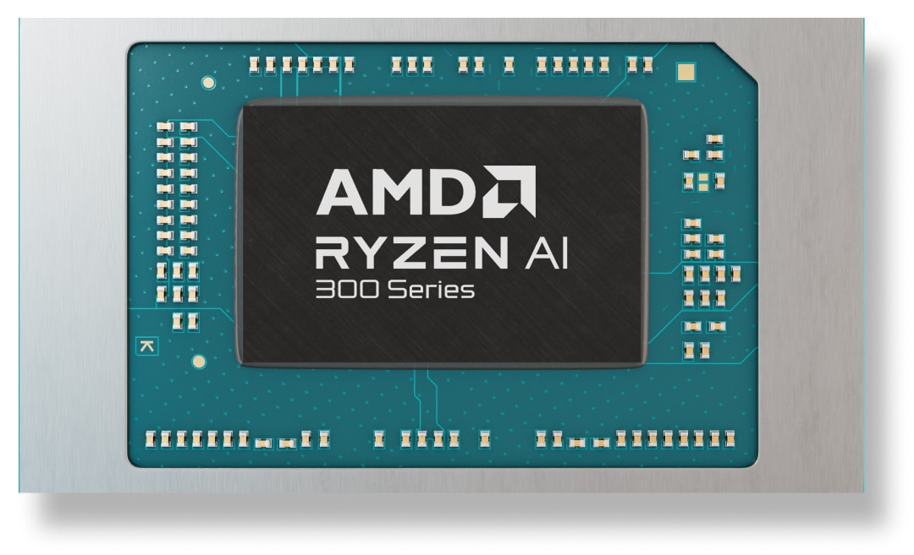

Kalau ente baru saja meminang laptop anyar bertenaga prosesor AMD Ryzen AI 300 series dengan kode Strix Point, ada kabar teknis yang cukup melegakan dari dapur kernel Linux. Selama beberapa pekan terakhir, sejumlah pengguna yang gemar mengompilasi paket software dari kode sumber mengeluhkan penurunan performa yang aneh. Laptop berotot tebal dengan kombinasi core CPU generasi terbaru justru terasa tersenggal-senggal saat disuruh mengeksekusi beban kerja berat secara maraton.

Pangkal masalahnya ternyata bukan berasal dari cacat silikon atau kesalahan manajemen daya firmware, melainkan benturan logika pada penjadwal tugas (*task scheduler*) kernel Linux itu sendiri. Penjadwal yang seharusnya bertugas membagi beban secara adil tanpa sengaja mengunci proses berat di dalam klaster core hemat daya. Beruntung, rangkaian perbaikan resmi telah ditarik langsung oleh Linus Torvalds ke dalam ranting utama Linux 7.4 dan segera diboyong ke cabang kernel stabil.

## Misteri Kompilasi Lambat di Laptop Flagship

Keluhan ini pertama kali mencuat dari laporan seorang pengguna Gentoo Linux bernama Klaus Kusche di milis resmi Linux Kernel Mailing List. Saat melakukan kompilasi proyek besar menggunakan compiler Clang dengan opsi optimasi tautan penuh (*full Link-Time Optimization* atau LTO), waktu kompilasi di mesin Ryzen AI 9 HX 370 melonjak tajam dibanding kernel generasi terdahulu.

Bagi yang belum sempat membedah arsitektur Strix Point, prosesor ini menerapkan pendekatan desain prosesor hibrida yang unik. Di dalamnya terdapat total 12 core dan 24 thread yang dibagi menjadi dua klaster fisik (*Core Complex* atau CCX) berbeda. Klaster pertama berisi 4 core Zen 5 performa tinggi dengan *boost clock* mencapai 5,1 GHz dan kolam L3 cache sebesar 16 MB. Sementara klaster kedua menampung 8 core Zen 5c yang dioptimalkan untuk kerapatan daya dengan frekuensi puncak hanya 3,3 GHz serta L3 cache yang dipangkas menjadi 8 MB.

Saat proses kompilasi Clang LTO yang sangat rakus memori dan instruksi CPU berjalan, tugas-tugas berat yang kebetulan bermula di core Zen 5c menolak berpindah ke core Zen 5 yang lebih bertenaga. Padahal pada saat yang bersamaan, empat core Zen 5 utama terpantau menganggur. Kondisi ini membuat prosesor seolah berjalan dengan rem tangan aktif, mengorbankan separuh potensi komputasi yang seharusnya bisa dinikmati pengguna.

*Sumber: [AMD](https://www.amd.com/en/products/processors/laptop/ryzen/ai-300-series/amd-ryzen-ai-9-hx-370.html)*

## Benturan Dua Filosofi Penjadwal di Ruang Kernel

Setelah ditelusuri oleh para pengembang subsistem penjadwal kernel, fenomena ini dipicu oleh perang dingin antara dua fitur optimasi di dalam berkas kode `kernel/sched/fair.c`, yaitu fitur *Cache Aware Scheduling* (CAS) dan *Asymmetric Packing*.

Fitur *Cache Aware Scheduling* dirancang dengan niat baik, om. Fitur ini berusaha keras menjaga agar rangkaian thread yang berasal dari satu proses yang sama tetap berkumpul di domain cache tingkat akhir (*Last Level Cache* atau LLC) yang serupa. Logikanya, kalau thread-thread tersebut saling berbagi data di cache lokal yang sama, latensi komunikasi antar-core bisa ditekan sekecil mungkin tanpa harus bolak-balik melintasi jalur interkoneksi Infinity Fabric.

Namun di sisi lain, subsistem Linux juga mengenal strategi *Asymmetric Packing*. Strategi ini sengaja disiapkan khusus untuk topologi CPU asimetris atau heterogen seperti kombinasi core besar dan core kecil. Prinsip kerja *asymmetric packing* sangat tegas, yaitu setiap kali ada tugas komputasi berat, tugas tersebut harus segera dilarikan ke core CPU dengan prioritas tertinggi yang sedang bebas.

Di sinilah letak bencananya. Pada kernel sebelumnya, logika CAS dipasang terlalu kaku dan mengabaikan prioritas core. Ketika *asymmetric packing* berniat memindahkan tugas Clang LTO ke core Zen 5 yang sedang longgar, logika CAS menghadang niat tersebut. CAS bersikeras bahwa mempertahankan lokalisasi cache pada klaster LLC 8 MB Zen 5c jauh lebih penting daripada memindahkan tugas ke CCX sebelah. Akibatnya, tugas berat itu terkurung di core kecil berkecepatan 3,3 GHz.

## Logika Baru yang Memenangkan Core Kencang

Melihat anomali tersebut, insinyur perangkat lunak Intel, Tim Chen, bersama dukungan teknis dari Mario Limonciello dan para pengembang AMD segera menyusun patch perbaikan. Inti dari patch ini adalah memberikan hierarki wewenang yang tegas di dalam fungsi migrasi cache `can_migrate_llc_task()`.

Pada arsitektur hibrida, keuntungan performa dari core yang berjalan di frekuensi 5,1 GHz dengan L3 cache 16 MB terbukti jauh lebih dominan ketimbang penghematan latensi dari sekadar menjaga thread tetap berkumpul di cache kecil yang lambat. Oleh karena itu, aturan penjadwal kini diubah secara fundamental, jika *asymmetric packing* hendak memindahkan tugas ke core prioritas lebih tinggi yang sedang menganggur, maka *asymmetric packing* wajib dimenangkan secara mutlak atas pertimbangan CAS.

Ingo Molnar selaku pengelola subsistem penjadwal telah menyetujui perubahan ini dan meneruskannya ke Linus Torvalds dalam penarikan kode perbaikan darurat akhir pekan lalu. Hasil pengujian ulang di lapangan membuktikan bahwa waktu kompilasi Clang LTO pada Ryzen AI 9 HX 370 langsung pulih normal dan tidak lagi tersendat di klaster hemat daya.

## Implikasi untuk Distro dan Cabang Kernel Stabil

Langkah cepat komunitas kernel patut diacungi jempol karena perbaikan ini tidak hanya dicadangkan untuk rilis Linux 7.4 mendatang. Tim pengembang telah menandai patch ini dengan tag rujukan `Cc: stable@vger.kernel.org`, yang artinya rangkaian patch yang sama sedang di-backport ke ranting kernel stabil yang aktif saat ini, yaitu Linux 7.2 dan Linux 7.3.

Bagi pengguna distro *rolling release* seperti Arch Linux, openSUSE Tumbleweed, Fedora, maupun Gentoo, pembaruan ini bakal mendarat otomatis lewat rilis poin stabil dalam hitungan hari. Perbaikan ini juga diprediksi bakal menguntungkan lini prosesor Ryzen generasi mendatang lainnya yang mengadopsi racikan core heterogen serupa.

Mengatur lalu lintas instruksi di atas arsitektur prosesor modern memang bukan perkara gampang, om. Namun komitmen para insinyur lintas vendor untuk terus menyempurnakan perilaku penjadwal Linux memastikan perangkat keras mutakhir bisa mengeluarkan taring aslinya tanpa tertahan belenggu kode lawas.

Sumber: [Linux Kernel Mailing List](https://lore.kernel.org/all/b29badede27bb6bfb4a759e06754cb19657f0778.1791308631.git.tim.c.chen@linux.intel.com/)
