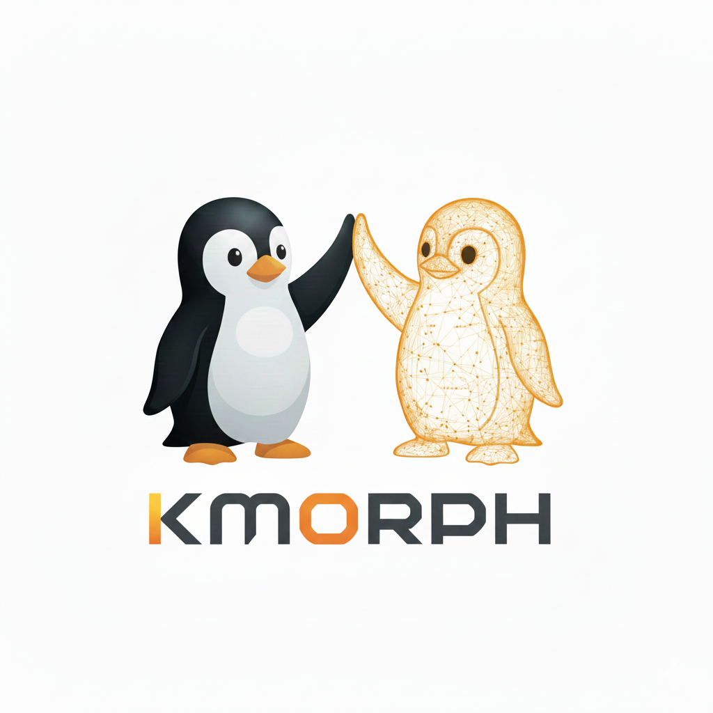

Proyek open source Kmorph resmi diperkenalkan sebagai terobosan arsitektur yang mampu memulihkan sistem operasi Linux dari kondisi kernel panic tanpa perlu reboot mesin fisik sama sekali. Memanfaatkan konsep multikernel yang menjalankan dua kernel berdampingan secara bare metal, Kmorph sanggup memulihkan layanan vital seperti web server Nginx hanya dalam tempo dua detik setelah insiden crash terjadi.

Kalau ente berkecimpung di dunia server atau mengelola klaster bare metal, kernel panic adalah salah satu mimpi buruk paling menguras energi, om. Begitu kernel mogok di tengah jalan, seluruh layanan yang sedang melayani ribuan pengguna langsung rontok seketika. Selama puluhan tahun, mekanisme standar yang diandalkan komunitas Linux untuk menangani bencana ini hanyalah kdump, sebuah mekanisme warisan yang mengharuskan server menelan pil pahit berupa downtime berkepanjangan.

## Keterbatasan Kdump Klasik dan Beban Reboot Ganda

Mekanisme kdump yang umum dipakai di distribusi server seperti RHEL, Debian, maupun Ubuntu sebenarnya bekerja lewat prosedur penyelamatan yang sangat lambat. Begitu terjadi crash, kernel yang sedang panik memicu mekanisme kexec untuk memuat citra kernel penyelamat (*capture kernel*) dari nol. Kernel darurat ini hidup di blok memori khusus yang sengaja disisihkan sejak komputer menyala, dengan tugas tunggal menyalin rekaman memori (*vmcore*) ke media penyimpanan untuk kebutuhan analisis bedah bangkai (*post-mortem*).

Setelah tugas pencatatan berkas vmcore selesai, mesin server tidak otomatis langsung pulih. Server wajib melakukan reboot ulang penuh melalui lapisan firmware BIOS atau UEFI. Di lingkungan server enterprise modern yang dijejali modul RAM ECC berkapasitas ratusan gigabyte hingga deretan kartu akselerator PCIe, proses self-test perangkat keras (*POST*) saja bisa memakan waktu hingga lima sampai sepuluh menit. Setelah firmware selesai berurusan dengan hardware, kernel utama baru mulai boot dari awal, disusul systemd yang membangkitkan tumpukan daemon satu demi satu.

Kelemahan lain dari pendekatan konvensional ini terletak pada efisiensi sumber daya. Blok RAM yang dialokasikan untuk capture kernel harus terus dikunci dan tidak boleh dipakai oleh aplikasi produksi apa pun. Memori tersebut dibiarkan menganggur sepanjang tahun hanya untuk bersiap-siap menghadapi satu insiden crash yang belum tentu terjadi setiap bulan.

## Cara Kerja Kmorph dan Konsep Kernel Successor

Kmorph mengambil jalan memutar yang radikal berkat fondasi proyek multikernel. Dalam arsitektur multikernel, beberapa instance kernel Linux independen dapat berbagi perangkat keras fisik yang sama secara berdampingan tanpa perantara hypervisor seperti KVM atau QEMU. Setiap kernel memiliki kepemilikan mutlak atas sejumlah inti CPU, blok memori RAM, dan fungsi perangkat PCI miliknya sendiri, serta saling terhubung melalui soket virtual ringan (*vsock*).

Dalam skenario Kmorph, ada dua pihak yang memainkan peran penting, yaitu kernel *predecessor* dan kernel *successor*. Kernel predecessor adalah kernel aktif yang memikul seluruh beban kerja komputasi harian. Sementara itu, kernel successor adalah kernel cadangan yang sudah dinyalakan lebih awal (*pre-booted*) di samping kernel utama dengan modal satu atau dua inti CPU serta sepotong kecil memori sekitar 128 MB hingga 512 MB.

*Sumber: [Kmorph](https://github.com/multikernel/kmorph)*

Selama sistem beroperasi normal, daemon `kmorphd` di dalam kernel successor secara rutin mengirimkan sinyal detak jantung (*heartbeat probe*) ke predecessor lewat vsock sebanyak sepuluh kali dalam satu detik. Pemeriksaan ini berjalan langsung di level kernel tanpa melibatkan ruang pengguna, sehingga tidak membebani kinerja aplikasi. Bila kernel predecessor tetap menjawab sinyal tersebut, successor tetap diam dalam posisi siaga. Namun jika predecessor tiba-tiba bungkam lima kali berturut-turut atau mengalami kernel panic, successor langsung mengambil alih kendali mesin secara mandiri tanpa menunggu campur tangan operator manusia.

## Delapan Tahapan Pengambilalihan Kilat Saat Insiden Crash

Proses pengambilalihan (*takeover*) yang dieksekusi oleh Kmorph dirancang sangat presisi agar integritas data di memori tidak rusak. Ketika keheningan predecessor terkonfirmasi, ada tahapan terstruktur yang berlangsung dalam hitungan detik:

1. Deteksi Kegagalan Cepat: Kegagalan respons probe dalam jendela waktu 500 milidetik langsung menandai bahwa kernel predecessor berada dalam kondisi macet total atau hang.

2. Pagar Inti CPU atau CPU Fencing: Kernel successor segera mengirimkan instruksi penghentian paksa ke seluruh inti CPU milik predecessor menggunakan sinyal NMI dan INIT pada arsitektur x86, atau interupsi stop IPI dan PSCI pada ARM64. Langkah pemagaran ini menjamin tidak ada instruksi liar dari kernel yang sekarat yang berpotensi merusak struktur memori bersama.

3. Adopsi dan Reset Perangkat Keras: Seluruh perangkat PCI seperti kartu jaringan (NIC) dan pengontrol NVMe yang tadinya dikuasai predecessor langsung diadopsi oleh successor. Sebelum driver baru dipasang, setiap perangkat di-reset secara instan melalui Function Level Reset (FLR) demi menghentikan transaksi Direct Memory Access (DMA) yang masih menggantung.

4. Pengambilalihan Unit IOMMU: Successor mengambil alih kendali unit IOMMU dan mengalihkan tabel pemetaan alamat fisik ke tabel miliknya sendiri, menjaga isolasi perangkat keras tetap aman.

5. Restorasi Identitas Jaringan: Daemon kmorphd langsung mengembalikan alamat IP, MAC address, MTU, dan tabel rute jaringan ke antarmuka kartu jaringan yang baru diadopsi. Karena identitas jaringan ini sudah disinkronkan secara kontinu saat sistem sehat, mesin tidak perlu membuang waktu meminta alamat baru lewat DHCP.

6. Penggabungan Inti CPU dan Memori: Inti-inti CPU yang sebelumnya diparkir langsung dibangunkan dan digabungkan ke pool kernel successor. Bersamaan dengan itu, seluruh sisa RAM fisik diadopsi secara bertahap dalam ukuran blok memori 4 MB pada sistem x86.

7. Penyimpanan Berkas Dump Opsional: Jika fitur pencatatan crash diaktifkan, memori predecessor dapat dialirkan keluar atau disimpan ke berkas vmcore yang kompatibel dengan perkakas kdump dan crash utility sebelum ruangnya direklamasi sepenuhnya.

8. Pengaktifan Konsol Serial: Layanan konsol serial langsung dialihkan ke login shell successor, memungkinkan sysadmin memantau log insiden tanpa kehilangan jejak histori kernel sebelumnya.

## Layanan Standby Bikin Web Server Nginx Menyala dalam 2 Detik

Salah satu aspek paling mengesankan dari arsitektur Kmorph adalah dukungannya terhadap layanan siaga (*standby services*). Dalam penanganan downtime tradisional, hal yang paling memakan waktu sebenarnya bukanlah proses booting kernel semata, melainkan tahapan menginisialisasi tumpukan aplikasi pengguna yang berat di ruang pengguna.

Untuk mengatasi persoalan ini, berkas konfigurasi `/etc/kmorph/kmorph.conf` menyediakan opsi deklarasi layanan siaga, misalnya `standby = nginx.service`. Dengan opsi ini, citra sistem berkas EROFS ringan yang membungkus dependensi Nginx dan systemd sudah dijalankan lebih dahulu di lingkungan kernel successor. Nginx sudah dalam kondisi berjalan dan mengikat port jaringan ke alamat mesin, kendati saat siaga perangkat fisik kartu jaringan dan disk belum terpasang.

Begitu kernel predecessor mengalami panic, successor yang mengambil alih kartu jaringan langsung menjalankan perintah `pivot_root` ke sistem berkas disk utama. Systemd lantas membangkitkan sisa layanan sistem lainnya mengelilingi proses Nginx yang sama sekali tidak pernah dihentikan. Berdasarkan hasil pengujian laboratorium pengembang, Nginx sudah dapat kembali melayani permintaan HTTP dari klien luar hanya dalam waktu sekitar dua detik pasca-crash. Catatan waktu ini berbanding terbalik dengan kdump yang kerap memakan waktu downtime hingga beberapa menit.

## Perbedaan Signifikan dengan KHO dan Live Update Orchestrator

Beberapa pengembang kernel mungkin membandingkan pendekatan Kmorph dengan inisiatif Kexec HandOver (KHO) dan Live Update Orchestrator (LUO) yang belakangan gencar dikembangkan di kernel Linux arus utama. Meski sama-sama bertujuan mempercepat pemulihan dan pembaruan kernel, arsitektur dasar keduanya sangat bertolak belakang.

Pertama, KHO dan LUO masih berpijak pada alur kexec reboot konvensional. Artinya, proses inisialisasi kernel baru tetap berada di dalam jalur kritis waktu henti sistem, sedangkan pada Kmorph kernel successor sudah dalam kondisi aktif dan bernapas sebelum peralihan dimulai.

Kedua, KHO dan LUO menuntut kernel lama berada dalam kondisi sehat prima agar dapat melakukan serialisasi status sistem ke memori sebelum kexec dijalankan. Karakteristik ini membuat KHO sama sekali tidak berdaya saat menghadapi kernel panic yang terjadi tiba-tiba. Sebaliknya, Kmorph memperlakukan insiden crash tak terduga dan pembaruan terencana dengan prosedur seragam, di mana perintah `kmorph upgrade` dapat mengeksekusi pembaruan kernel tanpa reboot dengan memanfaatkan mekanisme handover yang sama.

Ketiga, urusan pelestarian memori pada KHO mengharuskan setiap subsistem kernel mengimplementasikan kode serialisasi khusus. Sementara pada Kmorph, memori sistem secara alami terlindungi karena isolasi fisik multikernel memisahkan ruang kendali antar-kernel sejak awal.

## Dukungan Arsitektur dan Langkah Menuju Kernel Mainline

Perkakas Kmorph sendiri ditulis dalam bahasa pemrograman C murni dan dirancang agar mudah bersanding dengan infrastruktur distribusi Linux modern. Alat ini terintegrasi langsung dengan dracut, initramfs-tools, kernel-install, serta unit layanan systemd, sehingga alur kerjanya terasa akrab bagi para pengelola sistem yang terbiasa menangani kdump.

Saat ini Kmorph sudah mendukung penuh mesin berbasis x86_64 dan ARM64, sementara dukungan untuk arsitektur RISC-V dilaporkan sedang dalam tahap pengerjaan aktif. Meski demikian, ada catatan penting yang perlu dipahami para praktisi infrastruktur. Kmorph saat ini masih bergantung pada patchset multikernel yang berada di luar pohon kernel resmi (*out-of-tree*). 

Masa depan adopsi Kmorph di distro skala enterprise seperti RHEL, SUSE, atau Ubuntu Server akan sangat bergantung pada seberapa cepat komunitas pengembang kernel Linux menyepakati integrasi modul multikernel ke dalam pohon mainline Linus Torvalds. Apabila konsep pemisahan kernel ini kelak berhasil masuk ke upstream, cara industri memandang downtime akibat kernel panic dan jendela pemeliharaan server dipastikan bakal berubah selamanya.

> **Baca Juga:**
> - [Celah APT Debian Buka Akses Eksekusi Kode Root via MITM](/celah-apt-debian-buka-akses-root-mitm/)
> - [Linux 7.4 Batalkan Taint Bind Usai Diprotes Pengguna VFIO](/kernel-linux-7-4-batalkan-taint-bind-vfio/)

Sumber: [Multikernel Kmorph](https://github.com/multikernel/kmorph)
