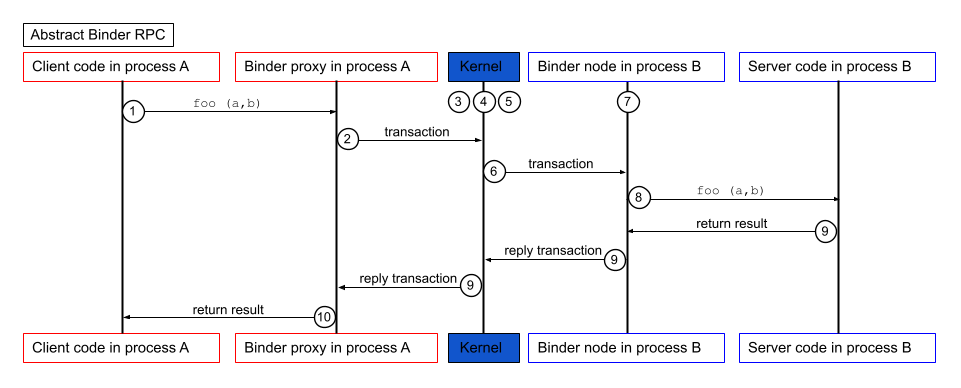

Pekan penggabungan fitur untuk kernel Linux 7.4 menghadirkan momen bersejarah yang bakal dikenang lama oleh komunitas open source dan pengembang sistem operasi bergerak. Linus Torvalds resmi menarik rangkaian patch untuk subsistem karakter dan miscellaneous dari cabang yang dipelihara Greg Kroah-Hartman. Sorotan utama dari pembaruan ini bukan penambahan driver periferal baru, melainkan pembersihan kode besar-besaran dengan dihapusnya implementasi driver Binder berbasis bahasa C yang selama belasan tahun menjadi tulang punggung komunikasi antar-proses pada sistem operasi Android.

Sebagai gantinya, kernel Linux kini mempercayakan seluruh beban kerja Binder kepada implementasi baru yang ditulis sepenuhnya menggunakan bahasa Rust. Langkah radikal ini menandai babak baru bagi ekosistem Linux, membuktikan bahwa adopsi Rust bukan lagi proyek eksperimen sampingan, melainkan pondasi produksi nyata yang siap menopang miliaran gawai di seluruh dunia.

## Warisan Belasan Tahun yang Semakin Melelahkan Dirawat

Kalau ente mengamati perjalanan arsitektur Android sejak masa awal kemunculannya, Binder adalah komponen paling vital di balik layar. Berbeda dari distro Linux desktop atau server yang lazim menggunakan soket UNIX atau memori bersama POSIX, Android mengandalkan mekanisme Binder untuk hampir setiap interaksi antar-aplikasi dan layanan sistem. Saat aplikasi membuka kamera, meminta izin lokasi, bertukar pesan antar-proses, atau menampilkan jendela antarmuka ke layar melalui SurfaceFlinger, transaksi data tersebut dipompa melewati berkas virtual `/dev/binder` di ruang kernel.

Mekanisme ini bekerja dengan memanfaatkan pemetaan memori bersama lewat panggilan sistem `mmap()`, memungkinkan transaksi data antar-proses berlangsung sangat cepat dengan metode *single copy*. Namun, kode sumber Binder C yang dirintis sejak era OpenBinder di BeOS sudah berusia lebih dari 15 tahun. Seiring bertambahnya fitur keamanan, isolasi sandbox, dan kompleksitas perangkat modern, berkas `binder.c` menjelma menjadi monster kode yang sangat rumit dan penuh jebakan logika.

Dalam catatan komit penghapusan kode tersebut, Carlos Llamas selaku insinyur Google mengungkapkan bahwa merawat driver C Binder sudah menjadi pekerjaan yang sangat melelahkan bagi tim pengembang. Mengelola hierarki penguncian bertingkat, siklus hidup referensi objek, dan alokasi buffer transaksi secara manual di bahasa C kerap berujung petaka.

Sejarah eksploitasi keamanan Android mencatat bahwa kondisi balapan (*race condition*), inkonsistensi penguncian memori, serta galat pemakaian memori setelah dibebaskan (*use-after-free*) pada driver Binder C kerap menjadi ladang empuk bagi para peneliti keamanan untuk membuat eksploitasi kenaikan hak akses (*privilege escalation*). Lebih dari 9.000 baris kode C warisan tersebut kini resmi disingkirkan tanpa sisa dari pohon kode kernel utama.

*Sumber: [Android Open Source Project](https://source.android.com/docs/core/architecture/ipc/binder-overview)*

## Pembuktian Dingin Alice Ryhl dan Kematangan Driver Rust

Peralihan total ini tidak terjadi dalam semalam, om. Proyek penulisan ulang Binder ke bahasa pemrograman Rust dipimpin secara intensif oleh Alice Ryhl bersama tim Android Kernel di Google selama beberapa tahun terakhir. Implementasi Rust Binder awalnya masuk ke ranting uji coba dan mulai diintegrasikan ke kernel utama sejak seri Linux 6.18 sebagai proyek percontohan inisiatif Rust for Linux.

Tantangan terberat menulis ulang driver serumit Binder adalah menjaga kompatibilitas mutlak dengan tatanan ruang pengguna (*userspace*). Driver ini harus lolos uji ketat rangkaian Vendor Test Suite dan Compatibility Test Suite Android tanpa boleh ada deviasi perilaku sekecil apa pun terhadap panggilan IOCTL yang sudah ada. 

Alice Ryhl tidak hanya sukses menyamai fungsionalitas driver lama secara bita demi bita, tetapi juga membuktikan performa driver Rust mampu menandingi bahkan melampaui versi C pada sejumlah skenario transaksi bervolume tinggi. Sistem kepemilikan (*ownership*) dan manajemen sumber daya berbasis RAII bawaan Rust secara otomatis menjamin pelepasan kunci serta alokasi buffer transaksi tepat waktu tanpa meninggalkan kebocoran memori.

Jaminan keamanan memori yang ditawarkan Rust meniadakan sebagian besar beban pengecekan pointer manual yang selama ini membebani pengembang C. Setelah diuji langsung di perangkat konsumen nyata seperti lini Google Pixel, Google merasa percaya diri bahwa driver Rust ini sudah mencapai kematangan penuh untuk dijadikan standar produksi tunggal.

## Miliaran Perangkat Siap Ditopang Fondasi Baru

Dukungan penuh dari para maintainer senior kernel Linux menegaskan solidnya keputusan ini. Greg Kroah-Hartman menyambut langkah ini dengan antusiasme tinggi saat menyerahkan *pull request* ke Linus Torvalds. Greg menegaskan bahwa versi Rust sudah stabil dan akan digunakan untuk masa depan miliaran perangkat di dunia, sembari menyampaikan apresiasi tinggi kepada para pengembang yang mewujudkannya.

Penghapusan driver C ini menjadi pukulan telak bagi pihak yang selama ini meragukan masa depan inisiatif Rust di kernel Linux. Selama ini, suara skeptis sering terdengar dengan anggapan bahwa modul Rust di kernel hanya sekadar pemanis atau contoh mainan yang tidak akan pernah menggantikan komponen inti yang sudah teruji puluhan tahun. Kini faktanya berbicara lain, jalur komunikasi utama yang mengalirkan miliaran transaksi per detik di kantong pengguna Android global resmi dikendalikan oleh biner hasil kompilasi Rust.

Melalui arsitektur Generic Kernel Image yang diterapkan Google pada Android modern, kernel Linux 7.4 ini akan menjadi basis pembaruan sistem operasi generasi berikutnya. Bagi pengguna biasa, perubahan ini mungkin tidak kasat mata secara visual di layar sentuh. Namun bagi ketahanan sistem operasi, penghapusan ribuan baris kode lawas ini menutup tumpukan celah keamanan bersejarah dan menempatkan Android di atas fondasi yang jauh lebih kokoh.

Sumber: [Git Kernel Org](https://git.kernel.org/pub/scm/linux/kernel/git/torvalds/linux.git/commit/?id=fd2bc059ed466bdd95347a4f7891d150d94e7de2)
