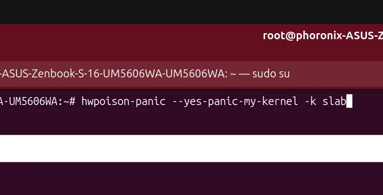

Pernahkah terpikir di benak ente kalau ada developer yang sengaja menulis program resmi ke dalam pohon kode kernel Linux hanya untuk menumbangkan sistem seketika? Kedengarannya seperti lelucon atau kode jahat, tapi langkah ini nyata adanya. Pada siklus pengembangan Linux 7.5, sebuah perkakas pengujian baru resmi dimasukkan ke dalam subsistem manajemen memori untuk menguji skenario terburuk yang bisa menimpa sebuah server.

Kernel Linux 7.5 resmi kedatangan tool pengujian baru bernama hwpoison-panic di dalam direktori tools/mm. Tool ini sengaja dirancang untuk memaksa kernel mengalami crash atau panic secara terkendali lewat injeksi kesalahan memori fisik (hardware poison) pada halaman milik kernel, guna memvalidasi ketahanan sistem terhadap kerusakan RAM tanpa perlu menunggu kegagalan perangkat keras riil.

Bagi kalangan sysadmin maupun teknisi infrastruktur cloud, membiarkan sistem crash bukanlah hal yang menyenangkan. Namun, dalam pengujian ketahanan kluster berskala besar, memastikan sistem tumbang secara bersih dan terprediksi saat menghadapi korupsi data jauh lebih aman ketimbang membiarkan mesin tetap hidup dengan memori yang cacat.

## Mengenal Tool hwpoison-panic dan Alasan Kernel Perlu Sengaja Dibuat Panik

Tool baru ini bernama `hwpoison-panic`, dikembangkan oleh Breno Leitao dan telah masuk ke dalam antrean cabang *for-next* pada pohon Git subsistem memori (MM) yang dikelola Andrew Morton sebelum digabungkan ke rilis utama Linux 7.5. Bersanding dengan berbagai peningkatan subsistem lain seperti [optimasi ChaCha AVX-512 di Linux 7.5](/chacha-avx-512-linux-7-5-melesat-99-persen-amd-zen-5/), pembaruan di lini manajemen memori ini berfokus pada keandalan infrastruktur.

Fungsi utama `hwpoison-panic` adalah menguji opsi konfigurasi kernel `vm.panic_on_unrecoverable_memory_failure`. Parameter sysctl ini bertugas memaksa kernel langsung membunyikan sirine bahaya (*kernel panic*) ketika terjadi kegagalan memori fisik yang tidak dapat dipulihkan (*unrecoverable memory failure*) pada halaman-halaman kritis milik kernel sendiri.

Selama ini, menguji mekanisme penanganan galat memori fisik bukanlah perkara sepele. Ente harus menunggu sampai keping modul RAM server mengalami galat muti-bit ECC (Error-Correcting Code) secara alami, atau menggunakan perangkat keras penginjeksi galat yang harganya luar biasa mahal dan sulit disimulasikan di laboratorium virtual. Kehadiran perkakas ini memangkas kerumitan tersebut dengan memanfaatkan antarmuka perangkat lunak internal Linux.

Satu hal menarik yang ane temukan pada penempatan kodenya, tool ini sengaja diletakkan di bawah direktori `tools/mm/memory-failure/` dan bukan di dalam suite pengujian otomatis `tools/testing/selftests/mm/`. Alasannya sangat masuk akal, setiap kali tool ini sukses dieksekusi, komputer target dijamin langsung mati dan tumbang seketika. Jika dimasukkan ke dalam pipeline pengujian otomatis (CI/CD), mesin pengujian milik komunitas pengembang kernel tentu akan terus-menerus tumbang tanpa henti.

## Mekanisme Injeksi Error Memori pada Rodata, Slab, dan Page Table

Lalu bagaimana cara kerja perkakas ini merobohkan sistem operasi dari dalam? Alurnya cukup elegan dan sepenuhnya memanfaatkan fasilitas bawaan kernel Linux.

Pertama, `hwpoison-panic` akan mengaktifkan parameter sysctl `/proc/sys/vm/panic_on_unrecoverable_memory_failure`. Selanjutnya, program membaca peta penanda halaman memori dari `/proc/kpageflags` untuk mencari nomor bingkai halaman fisik (*Page Frame Number* atau PFN) yang sedang dialokasikan khusus untuk kebutuhan kernel.

Ente bisa memilih target halaman memori yang ingin dirusak menggunakan opsi baris perintah `-k` dengan tiga jenis alokasi:

1. **rodata (bawaan):** Menargetkan area memori baca-saja (*read-only data*) milik kernel tempat kode dan konstanta sistem disimpan.
2. **slab:** Menargetkan memori pengalokasi slab (*slab allocator*) yang digunakan kernel untuk menyimpan struktur data internal dinamis.
3. **pgtable:** Menargetkan halaman tabel pemetaan alamat memori virtual ke fisik (*page table*).

Setelah PFN target terpilih, tool mengonversi alamat tersebut menjadi alamat fisik absolut lalu menulis nilainya ke dalam antarmuka berkas khusus `/sys/devices/system/memory/hard_offline_page`. Begitu kernel menerima instruksi tersebut, subsistem memory-failure langsung menandai halaman itu sebagai *hwpoison* atau memori rusak permanen.


*Sumber: [Phoronix Media](https://www.phoronix.com/news/Linux-7.5-hwpoison-panic)*

Karena halaman yang diracuni merupakan komponen vital yang sedang aktif dipakai oleh inti sistem dan tidak bisa dipindahkan atau dipulihkan (*unrecoverable*), kernel langsung memutuskan eksekusi dan mencatat pesan kegagalan di *dmesg*:

```text
Memory failure: 0x100032: unhandlable page.
Memory failure: 0x100032: recovery action for reserved kernel page: Ignored
Kernel panic - not syncing: Memory failure: 0x100032: unrecoverable page
```

Sistem yang tumbang secara seketika ini memastikan bahwa tidak ada instruksi CPU liar yang membaca data korup dari RAM yang rusak. Berbeda dari solusi pemulihan berbasis perangkat lunak dinamis seperti [KMorph pulihkan kernel Linux dari crash](/kmorph-pulihkan-kernel-linux-tanpa-reboot/) yang berusaha menambal status proses, pada tingkat kerusakan silikon fisik, jalan paling selamat bagi integritas data adalah menghentikan sistem sepenuhnya.

## Sistem Pengaman Argumen Wajib dan Pemanfaatan Konsol Serial VM

Mengingat daya rusaknya yang langsung merobohkan mesin yang sedang berjalan, pengembang tentu memikirkan faktor keselamatan operator. Ente tidak bisa menjalankan program ini begitu saja tanpa sengaja.

Jika ada admin atau developer yang iseng mengetikkan perintah ini di terminal server tanpa membaca dokumentasi, program akan menolak berjalan. Program mewajibkan penyertaan parameter khusus `--yes-panic-my-kernel` pada baris argumennya:

```bash
# ./hwpoison-panic -k slab --yes-panic-my-kernel
injecting hwpoison at phys 0x100032000 (pfn 0x100032, kind=slab)
expecting kernel panic: 'Memory failure: <pfn>: unrecoverable page'
```

Bahkan dari sisi kode pengembalian status (*exit code*), program ini dirancang unik. Jika program mengembalikan kode keluar apa pun ke shell, berarti pengujian dianggap gagal atau tidak meyakinkan, karena eksekusi yang sukses semestinya membuat mesin langsung mati sebelum program sempat menyelesaikan siklus keluarnya.

Skenario pengujian utama dari `hwpoison-panic` ditujukan untuk lingkungan mesin virtual (VM) dan hipervisor. Di lingkungan virtualisasi, teknisi dapat menangkap keluaran dari konsol serial (*serial console*) atau virtio-console secara eksternal. Dari log serial tersebut, sistem otomasi dapat memverifikasi apakah string pesan *Kernel panic - not syncing* benar-benar muncul sesuai spesifikasi standar penanganan kegagalan perangkat keras.

## Mengapa Ketahanan Memory Failure Krusial untuk Server Produksi

Bagi pengguna desktop harian, keberadaan tool semacam ini mungkin terasa terlalu jauh dari kebutuhan sehari-hari. Namun di pusat data komputasi awan dan server perbankan yang menampung ribuan mesin virtual, kegagalan memori fisik adalah peristiwa harian yang tak terhindarkan.

Keping RAM berkapasitas ratusan gigabita atau terabita bekerja di bawah tekanan panas tinggi tanpa henti. Saat partikel kosmis atau degradasi silikon memicu bit-flip pada sel memori yang tidak mampu dikoreksi oleh mekanisme ECC, membiarkan mesin terus memproses transaksi dapat menyebabkan korupsi database yang tidak kasat mata (*silent data corruption*).

Bencana terbesar dalam tata kelola basis data adalah ketika data rusak tersimpan ke dalam media piringan disk tanpa disadari oleh administrator. Dengan memaksa sistem mengalami panic seketika melalui kebijakan `panic_on_unrecoverable_memory_failure`, beban kerja virtual machine dapat langsung dialihkan ke node server lain lewat mekanisme failover tingkat kluster.

Kehadiran `hwpoison-panic` di Linux 7.5 membuktikan bahwa ekosistem kernel Linux terus menyempurnakan perkakas validasi tingkat rendah. Sekarang, para perekayasa keandalan sistem (*Site Reliability Engineer*) tidak perlu lagi menebak-nebak apakah sistem failover mereka sanggup bereaksi cepat saat modul memori server mereka mendadak rusak di lapangan.

> **Baca Juga:**
> - [Celah NvRoot dan ForgePtr di Driver NVIDIA Jebol Host Linux](/celah-nvroot-forgeptr-driver-nvidia-linux/)
> - [Kmorph Pulihkan Kernel Linux dari Crash Tanpa Perlu Reboot](/kmorph-pulihkan-kernel-linux-tanpa-reboot/)

Sumber: [Linux Kernel Git](https://git.kernel.org/pub/scm/linux/kernel/git/mm/linux.git/commit/?h=for-next&id=0a936c44f2dcfbc95ffcdec30b04cc9a59c84e86)
