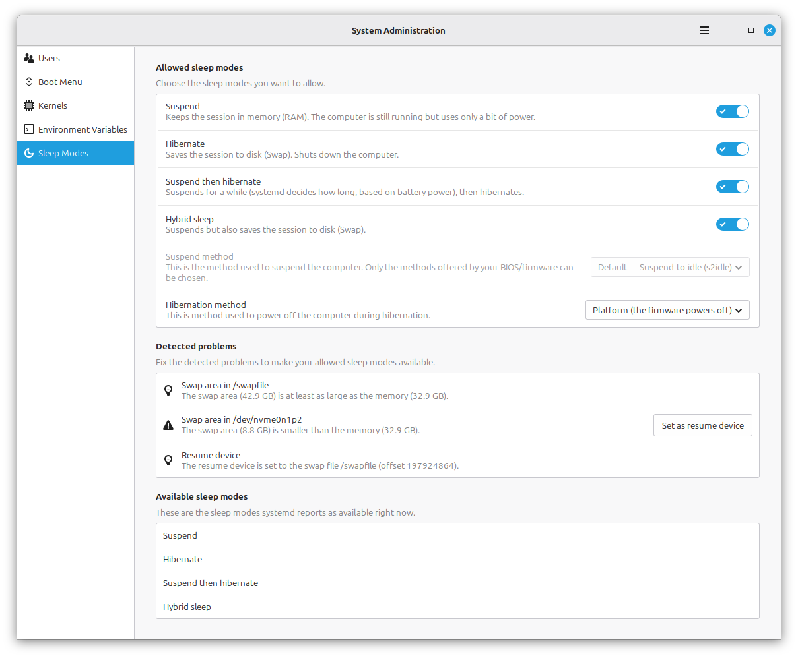

Pengembang Linux Mint resmi mengumumkan kembalinya fitur hibernasi (*hibernation*) untuk perangkat laptop melalui menu pengaturan sistem terbaru. Fitur yang sempat dihilangkan oleh Ubuntu dan banyak distribusi modern ini kini diintegrasikan langsung ke dalam modul *Sleep Modes* pada perkakas administrasi sistem, memberikan kontrol daya yang jauh lebih fleksibel bagi pengguna tanpa harus menyunting konfigurasi berkas secara manual.

Bagi pengguna laptop Linux, kehadiran pembaruan ini memecahkan dilema klasik kehabisan baterai saat perangkat ditinggal bepergian. Linux Mint menyediakan tiga mode manajemen daya utama, yaitu hibernasi penuh, *Hybrid Sleep*, serta *Suspend-then-Hibernate* yang otomatis mengalihkan sistem ke penyimpanan diska ketika daya baterai menyentuh level kritis.

## Dilema Suspend Tradisional dan Alasan Hilangnya Hibernasi

Kalau ente sering memakai laptop bertenaga Linux buat mobilitas harian, menutup layar (*clamshell lid*) biasanya langsung memicu status *Suspend*. Mode ini memang sangat cepat karena seluruh sesi komputasi disimpan di memori RAM dan laptop bisa langsung menyala dalam hitungan detik saat dibuka kembali. Namun, RAM tetap membutuhkan pasokan daya listrik terus-menerus.

Masalah muncul ketika laptop dibiarkan tertidur selama berhari-hari di dalam tas. Begitu daya baterai terkuras habis, sesi kerja yang belum sempat disimpan bakal langsung lenyap seketika. Kondisi mati mendadak seperti ini jauh lebih buruk daripada proses *shutdown* normal karena berpotensi merusak integritas sistem berkas.

Sebenarnya hibernasi adalah penangkal jitu untuk masalah tersebut. Pada mode hibernasi, seluruh isi RAM disalin ke diska penyimpanan sebelum sistem benar-benar mematikan daya secara total tanpa memakan energi baterai sedikit pun. Sayangnya, Ubuntu menonaktifkan hibernasi secara bawaan sejak belasan tahun lalu karena tingkat keandalannya yang bervariasi pada konfigurasi perangkat keras yang beragam. Karena Linux Mint dibangun di atas basis Ubuntu, fitur praktis ini ikut lenyap dari antarmuka bawaan.

*Sumber: [Linux Mint Official Blog](https://blog.linuxmint.com/?p=5093)*

## Tiga Pilihan Fleksibel pada Menu Pengaturan Sleep Modes

Pemimpin proyek Linux Mint, Clement Lefebvre, menjelaskan bahwa tim pengembang kini menambahkan tab khusus bernama *Sleep Modes* di dalam perkakas *System Administration*. Antarmuka grafis ini memungkinkan pengguna memilih skema tidur yang paling pas dengan profil pemakaian mereka tanpa perlu repot mengedit aturan konfigurasi systemd secara manual.

Ada tiga opsi utama yang disematkan ke dalam sistem:

1. **Hibernation Klasik**: Menyalin seluruh sesi kerja aktif dari RAM ke partisi atau berkas swap di media penyimpanan, kemudian mematikan daya laptop secara penuh. Waktu untuk masuk dan keluar dari mode ini memang lebih lambat dibanding suspend biasa, tetapi baterai dijamin tetap utuh meski laptop ditinggal berminggu-minggu.
2. **Hybrid Sleep**: Menggabungkan kecepatan suspend dengan keamanan hibernasi. Sistem menangguhkan pekerjaan ke RAM sekaligus menyalin datanya ke diska secara bersamaan. Jika baterai masih ada, laptop langsung menyala seketika. Namun jika baterai habis di tengah jalan, sesi kerja tetap bisa dipulihkan dari diska begitu pengisi daya dicolokkan.
3. **Suspend-then-Hibernate**: Mode paling ideal untuk pengguna komuter. Laptop awalnya akan masuk ke mode suspend hemat daya biasa agar bangun dengan instan. Namun saat indikator baterai turun hingga ambang kritis, sistem otomatis memicu proses hibernasi ke diska sebelum daya benar-benar mati.

Menurut pandangan ane, mode *Suspend-then-Hibernate* adalah titik tengah paling rasional buat pengguna modern, om. Ente tetap menikmati respons kilat saat berpindah ruang rapat, sekaligus mengantongi jaring pengaman jika lupa mengisi daya baterai saat akhir pekan tiba.

## Hambatan Partisi Swap dan Restriksi Kernel Secure Boot

Meskipun antarmuka grafis Linux Mint mempermudah aktivasinya, penerapan hibernasi di ekosistem Linux tetap menuntut kesiapan teknis di level sistem operasi. Perkakas *Sleep Modes* Linux Mint dirancang cerdas dengan menyertakan modul deteksi masalah (*Detected Problems*) untuk memandu pengguna.

Kendala utama yang sering menjegal proses hibernasi adalah kapasitas ruang simpan swap. Agar seluruh kondisi RAM saat ini bisa disimpan utuh, ukuran ruang swap pada diska minimal harus setara atau lebih besar dari kapasitas memori fisik yang sedang terpakai. Distribusi modern umumnya hanya membuat berkas swap berukuran kecil atau mengandalkan modul kompresi memori zram yang berada di dalam RAM, sehingga tidak bisa dipakai menampung citra hibernasi.

Tantangan kedua datang dari fitur keamanan Secure Boot pada motherboard UEFI modern. Saat Secure Boot aktif, kernel Linux secara otomatis mengunci diri ke dalam mode pengamanan ketat (*kernel lockdown mode*). Pada status terkunci ini, kernel menolak memuat citra hibernasi dari diska karena ruang swap dianggap belum terotentikasi secara kriptografis dan berpotensi disusupi kode berbahaya.

Linux Mint mengatasi konfigurasi ini secara terisolasi. Pengaturan yang dipilih pengguna akan ditulis ke dalam berkas konfigurasi systemd khusus milik Linux Mint sendiri, sehingga tidak akan merusak tatanan konfigurasi paket hulu (*upstream*) saat pembaruan berkala dijalankan.

## Kejutan Ekosistem Baru dari Velocitty hingga Superlight

Kabar kembalinya hibernasi ini merupakan bagian dari persiapan rilis besar Linux Mint mendatang yang dijadwalkan meluncur menjelang akhir tahun. Menariknya, pembaruan ini juga ditemani oleh sejumlah inovasi perkakas bawaan baru yang dirancang langsung oleh komunitas pengembang Mint.

Salah satu yang paling menyita perhatian adalah kehadiran Velocitty, emulator terminal anyar yang mengusung konsep visual modern mirip tren Ghostty dan Ptyxis. Velocitty dilengkapi antarmuka tinjauan tab (*tab overview*), penyesuaian warna otomatis berbasis status sesi (*root*, SSH, atau proses aktif), serta kemampuan menyimpan profil perintah kustom.

Selain terminal, Linux Mint juga memperkenalkan Superlight, aplikasi monitor sistem terintegrasi yang mampu melacak penggunaan CPU, RAM, swap, sensor suhu kipas, serta menganalisis alokasi ruang penyimpanan aplikasi Flatpak dan game Steam secara transparan.

Langkah Linux Mint mengembalikan fitur fungsional yang sempat ditinggalkan membuktikan bahwa fokus mereka tetap pada kenyamanan pengguna desktop nyata, bukan sekadar mengejar tren perangkat lunak yang rumit.

> **Baca Juga:**
> - [systemd Resmi Dukung Rust, Siapkan Utilitas Baru Tanpa Cargo](/systemd-resmi-dukung-rust-komponen-baru-tanpa-cargo/)
> - [Kmorph Pulihkan Kernel Linux dari Crash Tanpa Perlu Reboot](/kmorph-pulihkan-kernel-linux-tanpa-reboot/)

Sumber: [Linux Mint Official Blog](https://blog.linuxmint.com/?p=5093)
