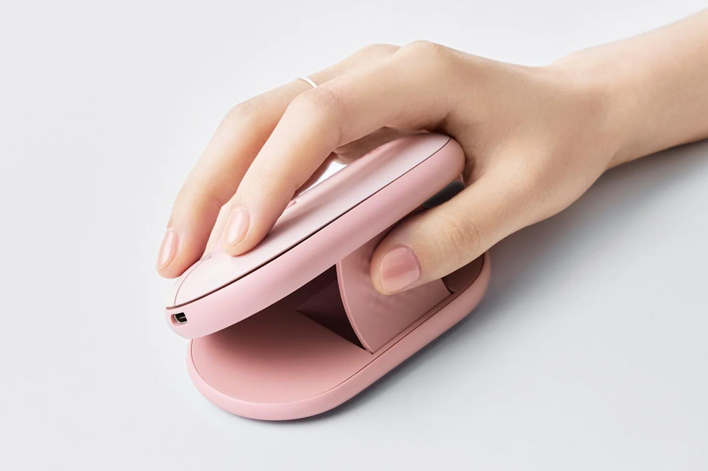

Setiap kali harus bekerja berpindah tempat di kedai kopi atau ruang komunal, memilih perlengkapan kerja selalu diwarnai kompromi yang menjengkelkan. Mouse tipis seperti lini Pebble klasik sangat praktis diselipkan ke saku laptop tanpa membuat tas menggelembung, tapi pergelangan tangan cepat pegal kalau dipakai mengetik dan navigasi seharian. Sebaliknya, mouse vertikal ergonomis seperti seri Lift terasa sangat nyaman di tangan, namun bentuknya yang gendut memakan ruang dan rawan rusak kalau dipaksa masuk ke tas jinjing tipis.

Dilema klasik itu ternyata mendapat jawaban yang cukup tidak terduga dari Logitech. Produsen periferal asal Swiss ini diam-diam memperkenalkan Pebble Up, sebuah mouse nirkabel portabel dengan konsep dua bentuk atau *dual-form*. Saat dibawa bepergian, perangkat ini berwujud pipih layaknya mouse travel biasa. Begitu ditaruh di atas meja kerja, bagian atas bodinya bisa terangkat ke atas (*pop-up*) dan berubah menjadi mouse dengan sudut kemiringan ergonomis.

## Konsep Dua Bentuk dan Rahasia Mekanisme Engsel Bodi

Awalnya saya mengira Logitech hanya menyegarkan warna atau menambah fitur software pada seri Pebble yang sudah ada. Namun setelah melihat mekanisme fisiknya lebih dekat, rancangan Pebble Up justru meminjam pendekatan mekanis lipat. Bagian punggung mouse ini terhubung dengan engsel dan penyangga internal khusus yang bisa dinaikkan secara manual.

*Sumber: [Logitech](https://www.logitech.com/zh-cn/shop/p/pebble-up-wireless-mouse)*

Ketika bodi atasnya dinaikkan, posisi tombol klik kiri, klik kanan, dan scroll wheel ikut terangkat miring ke satu sisi. Sudut elevasi ini sengaja dirancang agar telapak tangan pengguna berada pada posisi jabat tangan (*natural handshake position*), mirip seperti posisi memegang Logitech Lift meski dengan profil yang lebih ringkas. Sudut miring ini membantu mengurangi ketegangan pada otot lengan bawah serta pergelangan tangan yang kerap menekuk datar saat memakai mouse tipis biasa.

Saat jam kerja selesai dan laptop harus dirapikan, pengguna cukup menekan kembali bagian punggung mouse ke bawah sampai mengunci rata. Dalam mode datar (*slim mode*), ketebalan fisiknya kembali ke angka 30 milimeter saja, sehingga tidak mengganjal saat diselipkan berdampingan dengan adaptor charger di kantong tas.

## Spesifikasi Teknis dan Dimensi Bodi

Walaupun mengusung mekanisme bodi yang bisa bergerak naik turun, bobot keseluruhan perangkat ini tetap terjaga sangat ringan. Berdasarkan data teknis resmi dari Logitech, Pebble Up hanya berbobot 79 gram sudah termasuk komponen baterai di dalamnya.

Berikut adalah rincian dimensi fisik dan spesifikasi teknis utama Logitech Pebble Up:

- Dimensi fisik saat mode datar: tinggi 30 mm, lebar 59,6 mm, dan panjang 105,8 mm
- Bobot keseluruhan: 79 gram
- Sensor navigasi: optik TCOB (3266) dengan resolusi hingga 4.200 CPI
- Rentang sensitivitas: 400 sampai 4.000 DPI (nilai bawaan pabrik 1.000 DPI)
- Jumlah tombol: 4 tombol fisik (klik kiri, klik kanan, tombol scroll wheel, dan tombol pintasan DPI)
- Konektivitas nirkabel: Bluetooth Low Energy dan Logi Bolt USB Receiver
- Jangkauan nirkabel: hingga 10 meter melalui frekuensi 2,4 GHz ISM
- Baterai: lithium polymer isi ulang berkapasitas 290 mAh
- Daya tahan baterai: hingga 90 hari pemakaian dalam satu kali pengisian penuh
- Kompatibilitas sistem: Windows, macOS, iPadOS, Linux, ChromeOS, dan Android

Satu peningkatan yang patut diapresiasi dari Pebble Up adalah beralihnya Logitech ke baterai tanam isi ulang (*rechargeable*). Pengguna seri Pebble pendahulu biasanya harus mengandalkan baterai alkaline AA yang harus diganti berkala. Dengan baterai 290 mAh yang tahan hingga tiga bulan, pengguna cukup mencolokkan kabel pengisi daya ketika indikator baterai mulai menipis tanpa perlu repot membeli baterai cadangan.

## Konektivitas Logi Bolt dan Integrasi Pintasan AI

Urusan menghubungkan ke perangkat kerja juga dibuat fleksibel. Logitech menyertakan dongle USB Logi Bolt langsung di dalam kotak kemasan, mendampingi koneksi nirkabel Bluetooth Low Energy. Lewat fitur Easy-Switch, mouse ini bisa dipasangkan ke maksimal tiga perangkat sekaligus, misalnya laptop kantor, PC meja, dan tablet, lalu berpindah antar layar hanya dengan menekan satu tombol pemilih.

Dukungan aplikasinya menggunakan Logi Options+ yang tersedia untuk Windows dan macOS. Lewat aplikasi ini, pengguna bisa mengatur fungsi tombol pintasan tambahan di bawah roda scroll. Logitech bahkan menyematkan integrasi langsung ke fitur AI Launchpad, memungkinkan pengguna memanggil perintah asisten cerdas atau pintasan teks otomatis hanya dengan satu sentuhan jari. Bagi pengguna Linux atau sistem operasi lain yang belum didukung aplikasi Logi Options+, fungsi dasar navigasi, klik, dan scroll tetap berjalan mulus lewat driver standar nirkabel.

Bahan plastik yang membungkus bodi mouse ini juga memanfaatkan material daur ulang pascakonsumen (*post-consumer recycled plastic*). Untuk varian warna Putih (Off-White) dan Merah Muda (Rose), kandungan plastik daur ulangnya mencapai 43 persen. Sementara untuk varian warna Abu-abu (Graphite), porsi plastik daur ulangnya lebih tinggi lagi di angka 56 persen.

## Catatan Menarik untuk Pengguna yang Sering Bekerja Mobile

Kalau diperhatikan, keberanian Logitech menggabungkan konsep portabel dan ergonomi lewat engsel mekanis ini merupakan eksperimen yang sangat segar di pasar periferal. Selama bertahun-tahun, produsen aksesori seolah memberi dua pilihan kaku bagi pekerja mobile, mau nyaman bekerja berjam-jam tetapi tas harus tebal, atau tas tetap rapi tetapi tangan cepat lelah.

Hal yang membuat penasaran tentu saja adalah ketahanan jangka panjang dari engsel penopang bodinya. Komponen mekanis yang sering ditekan dan dinaik-turunkan setiap hari tentu butuh engsel yang kokoh agar tidak mudah kendur atau oblak seiring waktu. Jika rancangan engsel plastiknya terbukti tangguh dalam penggunaan nyata, konsep seperti ini berpeluang besar diadopsi ke lini mouse travel lainnya.

Logitech saat ini mulai memasarkan Pebble Up di kawasan Asia, terpantau di katalog resmi wilayah Tiongkok dan Hong Kong dengan harga jual sekitar 269 RMB atau berkisar 38 dolar AS (sekitar 600 ribuan rupiah). Meski Logitech belum mengumumkan jadwal ketersediaan untuk pasar global maupun Indonesia, kehadiran Pebble Up menjadi angin segar bagi siapa saja yang mendambakan kenyamanan mouse ergonomis tanpa harus mengorbankan ruang di dalam tas ransel.

Sumber: [Logitech](https://www.logitech.com/zh-cn/shop/p/pebble-up-wireless-mouse)
