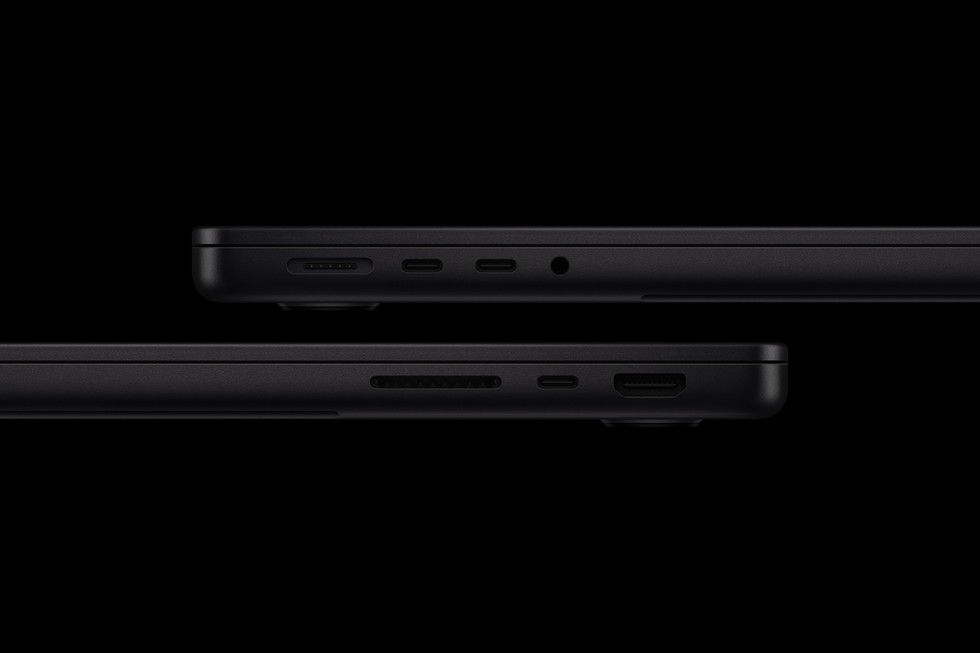

Apple kembali memperbarui lini laptop profesional entry-level miliknya tanpa banyak gembar-gembor acara panggung besar. Lewat rilis pers resmi yang baru saja meluncur malam ini, Apple memperkenalkan MacBook Pro 14 inci generasi terbaru yang kini ditenagai oleh chip M6. Langkah ini melengkapi debut prosesor berbasis fabrikasi 2 nanometer tersebut yang pertama kali hadir pada Mac mini beberapa bulan lalu.

Awalnya saya sempat mengira Apple hanya akan memberikan pembaruan minor seperti yang terjadi pada generasi sebelumnya. Kalau masih ingat, saat peralihan dari M4 ke M5 setahun lalu, perubahannya tergolong tipis karena bodi, tata letak porta, kamera web, maupun speakernya praktis identik. Namun setelah membaca lebih jauh lembar spesifikasi MacBook Pro 14 inci M6 ini, ternyata ada beberapa peningkatan mendasar yang cukup signifikan, terutama pada sektor efisiensi daya tahan baterai, arsitektur akselerator kecerdasan buatan lokal, dan konektivitas nirkabel.

## Lompatan Arsitektur 2 Nanometer dan Peningkatan Grafis M6

Dapur pacu utama laptop ini menjadi bintang utamanya. Chip Apple M6 dibangun di atas fabrikasi mutakhir 2 nanometer, membawa konfigurasi 12-core CPU yang terdiri dari core performa bertenaga tinggi dan core efisiensi. Jumlah ini bertambah dua core dibandingkan CPU 10-core yang ada pada M5 generasi terdahulu. Apple mengklaim lompatan ini mendongkrak performa multithreaded hingga 1,2 kali lipat lebih gesit saat menangani kompilasi kode pemrograman berat di Xcode maupun rendering grafis.

Sektor pengolah grafis (GPU) juga mendapatkan jatah perombakan serupa. GPU 12-core pada M6 kini dilengkapi Neural Accelerator terdedikasi di setiap intinya, dipadukan dengan mesin ray tracing generasi ketiga dan teknologi Dynamic Caching. Kombinasi perangkat keras ini menjanjikan lonjakan performa grafis hingga 30 persen lebih kencang dibanding pendahulunya. Bagi pengguna yang masih bertahan dengan MacBook Pro M1 generasi lawas, lonjakan kecepatan grafisnya bahkan diklaim mencapai 11 kali lipat.

Berikut ringkasan spesifikasi utama MacBook Pro 14 inci M6:

- Prosesor: Apple M6 (fabrikasi 2nm, 12-core CPU)
- Pengolah Grafis: 12-core GPU dengan Neural Accelerator di setiap core dan ray tracing generasi ketiga
- Kecerdasan Buatan: Dual 16-core Neural Engine untuk pemrosesan AI lokal
- Memori Terpadu: 16 GB standar (tersedia opsi 24 GB dan 32 GB) dengan bandwidth hingga 170 GB/s
- Penyimpanan: SSD mulai dari 1 TB hingga 4 TB
- Layar: Liquid Retina XDR 14,2 inci (kecerahan puncak HDR 1.600 nits, rasio kontras 1.000.000:1, opsi nano-texture)
- Konektivitas Nirkabel: Apple N1 (Wi-Fi 7 dan Bluetooth 6)
- Porta Fisik: 3x Thunderbolt 4 USB-C, HDMI ukuran penuh, slot kartu SDXC, MagSafe 3, audio jack 3,5 mm
- Baterai: Daya tahan hingga 24 jam penggunaan, pengisian cepat 50 persen dalam 30 menit
- Sistem Operasi: macOS 27 Golden Gate dengan integrasi Siri AI

## Fokus Kuat pada Pemrosesan AI Lokal Tanpa Cloud

Yang membuat penasaran justru bagian akselerator kecerdasan buatannya. Alih-alih hanya mengandalkan pemrosesan komputasi awan yang butuh kuota internet stabil dan berisiko terhadap privasi data, Apple membenamkan Dual 16-core Neural Engine pada chip M6. Artinya, ada 32 core NPU yang siap diajak bekerja lembur menjalankan model bahasa besar (LLM) secara mandiri di perangkat.

Apple mencatat bahwa waktu pemrosesan prompt LLM (time to first token) pada MacBook Pro 14 inci M6 ini hingga 1,3 kali lebih lekas dibanding model M5, atau melesat hingga 13 kali lipat jika diadu dengan MacBook Pro 13 inci M1. Unit NPU ganda ini bekerja berdampingan dengan akselerator saraf di setiap inti GPU untuk mempercepat fitur-fitur seperti pembuatan gambar, peningkatan resolusi cerdas (Super Resolution), dan fitur Apple Intelligence pada sistem operasi macOS 27 Golden Gate.

Pengguna dapat menjalankan asisten Siri AI untuk mencari dokumen, merangkum percakapan panjang, atau membedah konteks visual pada layar secara instan lewat pintasan keyboard khusus, tanpa perlu khawatir data sensitif dikirim ke server pihak ketiga.

## Daya Tahan Baterai 24 Jam dan Chip Nirkabel Apple N1

Peningkatan berikutnya yang menurut saya paling berdampak untuk aktivitas harian adalah efisiensi daya. Berkat lompatan litografi 2nm yang semakin hemat energi per watt, Apple mengklaim laptop ini sanggup bertahan hingga 24 jam dalam sekali pengisian penuh. Ini adalah angka daya tahan baterai terpanjang yang pernah tercatat dalam sejarah komputer jajaran Mac.

Karakteristik efisiensi silikon Apple juga memastikan laptop tetap memberikan performa penuh yang sama persis, baik ketika dicolokkan ke adaptor pengisi daya 96W maupun saat bekerja mengandalkan daya baterai murni di luar ruangan. Untuk pengisian daya kilat, fitur fast charging mampu mengisi baterai dari posisi kosong hingga 50 persen hanya dalam kurun waktu 30 menit.

*Sumber: [Apple Newsroom](https://www.apple.com/newsroom/2026/10/apple-introduces-the-new-14-inch-macbook-pro-with-m6/)*

Selain baterai, Apple akhirnya menurunkan chip jaringan rancangannya sendiri, Apple N1, ke varian entry-level 14 inci ini. Sebelumnya, chip N1 yang mendukung standar Wi-Fi 7 dan Bluetooth 6 hanya disematkan pada varian yang lebih mahal dengan prosesor M5 Pro dan M5 Max. Kehadiran Wi-Fi 7 menawarkan kecepatan transmisi nirkabel yang jauh lebih stabil dengan latensi sangat rendah, sangat membantu ketika harus mentransfer berkas video berukuran gigabita antar perangkat di jaringan lokal atau menyambungkan perangkat audio nirkabel generasi baru.

## Kelengkapan Porta dan Pilihan Warna

Untuk urusan layar dan bodi luar, Apple tetap mempertahankan sasis aluminium daur ulang 100 persen yang kokoh. Layar Liquid Retina XDR 14,2 inci masih mengusung kecerahan puncak 1.600 nits untuk konten HDR dan opsi kaca nano-texture guna mengurangi pantulan silau cahaya lampu ruangan. Kamera depan 12MP Center Stage kini mendukung fitur Desk View untuk menampilkan dokumen di atas meja secara otomatis saat panggilan video.

Pilihan porta terbilang sangat komprehensif untuk ukuran laptop 14 inci tanpa perlu repot membawa dongle tambahan. Pengguna mendapatkan tiga porta Thunderbolt 4 USB-C yang seluruhnya mendukung transfer data kilat, pengisian daya, serta output ke dua layar monitor eksternal resolusi tinggi sekaligus. Di sisi sampingnya, tetap tersedia porta HDMI ukuran penuh, slot kartu memori SDXC untuk fotografer, colokan audio 3,5 mm dengan dukungan headphone berimpedansi tinggi, dan porta magnetik MagSafe 3.

Laptop ini tersedia dalam dua balutan warna klasik, yaitu Silver dan Space Black. Khusus untuk kelir Space Black, Apple memberikan lapisan anodisasi khusus guna meminimalisir bekas sidik jari yang sering menempel pada bodi laptop gelap.

## Harga dan Ketersediaan

Apple membuka masa pra-pesan untuk MacBook Pro 14 inci M6 mulai tanggal 28 Oktober 2026, dengan ketersediaan unit di toko ritel Apple Store serta reseller resmi mulai tanggal 6 November 2026 di puluhan negara.

Untuk harga resmi di pasar Amerika Serikat, varian dasar dengan RAM 16 GB dan penyimpanan SSD 1 TB dibanderol mulai $1.999 (sekitar Rp31,5 jutaan jika dikonversi secara langsung). Pengguna yang membutuhkan memori lebih besar dapat memilih opsi RAM 24 GB seharga $2.199 atau RAM 32 GB seharga $2.399. Sedangkan peningkatan kapasitas media penyimpanan ke 2 TB dikenakan biaya tambahan $500, dan opsi 4 TB memerlukan biaya ekstra $1.500.

Sumber: [Apple Newsroom](https://www.apple.com/newsroom/2026/10/apple-introduces-the-new-14-inch-macbook-pro-with-m6/)
