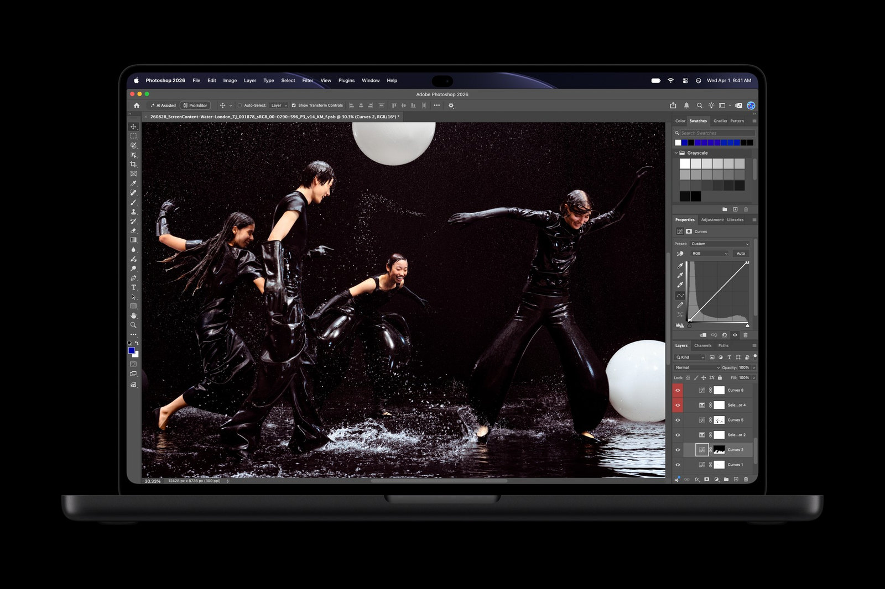

Apple akhirnya mengambil langkah yang selama belasan tahun dihindari oleh para petingginya. Pada acara panggung Pro and Tell di Los Angeles, Apple resmi meluncurkan MacBook Pro berlayar sentuh pertamanya. Laptop kerja ini memadukan panel tandem OLED bernama PROLED XDR, sensor sentuh in-cell terintegrasi, Dynamic Island, dan sokongan prosesor kencang M5 Pro serta M5 Max.

Keputusan ini menjadi tonggak penting bagi ekosistem komputer Mac. Bagi pengguna yang mengikuti sejarah panjang komputer Apple, kehadiran sentuhan jari di laptop profesional ini terasa seperti babak baru yang mematahkan dogma lama perusahaan.

## Ringkasan Spesifikasi MacBook Pro Layar Sentuh

MacBook Pro layar sentuh hadir dalam ukuran 14,2 inci dan 16,3 inci dengan panel tandem OLED PROLED XDR berkecerahan puncak 2.000 nits. Apple menanamkan sensor sentuh langsung ke dalam panel kaca display, didukung engsel bodi baru yang kokoh, Dynamic Island, prosesor M5 Pro atau M5 Max, dan optimalisasi sentuhan jari pada sistem operasi macOS 27.

Awalnya saya sempat mengira Apple hanya akan menempelkan lapisan digitizer biasa di atas layar MacBook lama. Namun setelah membaca lembar spesifikasi resminya lebih teliti, pendekatan yang diambil para teknisi Apple ternyata jauh lebih mendalam.

## Mendobrak Pantangan Lama Steve Jobs Soal Layar Sentuh di Laptop

Kalau ditarik ke belakang, Apple termasuk pabrikan komputer yang paling keras kepala menolak interaksi sentuh pada laptop. Pada tahun 2010, Steve Jobs secara terbuka menyebut layar sentuh di laptop memiliki masalah ergonomi yang parah. Menurutnya, mengangkat tangan terus menerus ke layar vertikal akan membuat lengan cepat pegal, kondisi yang populer disebut *gorilla arm*.

Sikap skeptis tersebut sempat ditegaskan kembali oleh Tim Cook pada tahun 2012. Cook mengibaratkan gabungan tablet dan laptop seperti memaksakan perpaduan antara pemanggang roti dan lemari es, sebuah kompromi yang dinilai tidak memuaskan siapa pun. Alih-alih memasang layar sentuh penuh, Apple sempat merilis Touch Bar pada MacBook Pro tahun 2016. Namun bilah sentuh kecil di atas papan ketik itu menuai kritik sebelum akhirnya dicabut permanen beberapa tahun kemudian.

Kini lewat MacBook Pro PROLED XDR, Apple membuktikan sikap itu bisa bergeser ketika teknologinya dianggap siap. Pendekatan barunya bukan mengubah Mac menjadi iPad, melainkan tetap memposisikan keyboard dan trackpad sebagai kendali utama, sementara sentuhan layar difungsikan sebagai pelengkap interaksi cepat.

## Panel PROLED XDR Tandem OLED dan Integrasi Sensor In-Cell

Sorotan utama tentu terletak pada kualitas visualnya. Apple menyematkan teknologi tandem OLED bernama PROLED XDR. Struktur ini menumpuk dua lapisan pemancar cahaya OLED untuk melipatgandakan tingkat kecerahan sekaligus memperpanjang usia pakai panel dari risiko degradasi piksel.

Panel ini mampu mencapai kecerahan puncak 2.000 nits pada konten HDR maupun SDR. Rasio kontrasnya tembus 10.000.000:1 dengan kepekatan warna hitam khas OLED. Untuk kebutuhan desainer dan kreator visual, cakupan warnanya mencakup standar P3 dan Adobe RGB, dengan cakupan ruang warna Rec. 2020 di atas 80 persen. Refresh rate adaptif ProMotion bergerak dinamis mulai 10 Hz saat membaca dokumen statis hingga 120 Hz saat menampilkan animasi bergerak.

Yang membuat penasaran justru cara Apple menanamkan sensor sentuhnya. Layar sentuh laptop konvensional kerap memantulkan bayangan karena ada lapisan kaca sensor tambahan di atas panel display. Di laptop ini, Apple mengadopsi teknologi in-cell touch, di mana sensor kapasitif dirajut langsung menyatu ke dalam struktur panel OLED. Hasilnya, jari terasa langsung menyentuh piksel gambar tanpa jeda optik dengan latensi sentuhan yang sangat rendah.

*Sumber: [Apple Newsroom](https://www.apple.com/newsroom/2026/10/apple-unveils-groundbreaking-macbook-pro-with-proled-xdr-display/)*

Apple juga menyediakan opsi lapisan kaca nano-texture yang dietsa langsung ke permukaan kaca luar untuk meredam pantulan cahaya silau di ruang kerja terbuka.

## Engsel Baru dan Penyesuaian Antarmuka macOS 27

Kelemahan umum laptop berlayar sentuh adalah layar yang bergoyang ke belakang setiap kali ditekan jari. Mengantisipasi hal itu, mekanisme engsel layar dirancang ulang dengan resistensi pegas khusus. Engsel ini tetap enteng dibuka dengan satu tangan, namun memiliki daya tahan mekanis yang kokoh menahan panel tetap tegak saat disentuh.

Pada sisi perangkat lunak, sistem operasi macOS 27 langsung menerjemahkan sentuhan jari menjadi perintah klik. Pengguna dapat menggulir halaman web dengan sapuan jari, memperbesar gambar lewat cubitan dua jari, menyeret jendela dokumen antar layar, atau mengetuk dua kali bilah atas untuk memperbesar jendela aplikasi hingga penuh.

Bagi pengembang aplikasi iOS dan iPadOS, layar sentuh ini memudahkan pengujian antarmuka aplikasi seluler langsung di layar komputer tanpa perlu perangkat uji fisik tambahan. Apple juga menambahkan penstabil video berbasis kecerdasan buatan pada webcam 12 megapiksel miliknya. Bila pengguna menyentuh layar saat sedang panggilan video, getaran fisik di bagian atas layar diredam secara digital agar rekaman wajah tetap stabil.

## Dynamic Island dan Kembalinya Logo Menyala

Perubahan fisik lain yang terlihat jelas adalah kehadiran Dynamic Island di bagian tengah atas layar, menggantikan takik hitam statis generasi terdahulu. Dynamic Island di Mac berfungsi sebagai rumah notifikasi cepat untuk Spotlight, status panggilan, Live Activities, dan Siri AI. Menjeda lagu di Apple Music atau menyetujui transfer data AirDrop kini bisa dilakukan cukup dengan mengetuk pulau interaktif tersebut.

Kalau diperhatikan pada bagian punggung laptop, Apple juga mengembalikan fitur legendaris yang sempat dirindukan pengguna. Logo apel di penutup belakang kini kembali menyala putih saat laptop aktif, memanfaatkan efisiensi pendaran cahaya dari panel OLED internal tanpa membuat bodi bertambah tebal.

Secara bobot dan dimensi, struktur panel OLED yang ramping justru memangkas ketebalan laptop:

- Varian 14,2 inci: Bobot turun menjadi 1,36 kilogram dengan ketebalan menyusut 0,5 milimeter.
- Varian 16,3 inci: Bobot berkurang menjadi 1,81 kilogram dengan ketebalan menyusut hampir 1 milimeter penuh.

## Tenaga M5 Pro dan M5 Max Serta Banderol Harga

Pada sektor performa komputasi, Apple membekali lini layar sentuh ini dengan prosesor kelas atas M5 Pro dan M5 Max. Kedua silikon ini ditujukan bagi beban kerja berat seperti pemodelan animasi 3D, pengolahan data ilmiah, dan penyuntingan video 8K ProRes.

Setiap inti GPU pada M5 Pro dan M5 Max dibekali Neural Accelerator khusus untuk mempercepat komputasi kecerdasan buatan lokal, seperti menjalankan agen kode mandiri tanpa ketergantungan server cloud. Mesin ray tracing generasi ketiga dan teknologi Dynamic Caching turut mempercepat proses render di aplikasi Blender dan Cinema 4D. Kapasitas RAM terpadu dapat dikonfigurasi hingga 128 GB, sementara penyimpanan SSD kini menyediakan opsi hingga 16 TB.

Daya tahan baterai diklaim sanggup menemani kerja hingga 24 jam pemakaian. Pilihan porta kabel meliputi tiga Thunderbolt 5, HDMI, pembaca kartu SDXC, porta pengisian daya MagSafe 3, dan colokan headphone 3,5 milimeter.

Soal banderol harga, spesifikasi tinggi ini hadir dengan nominal yang tidak sedikit:

- Model 14,2 inci dengan M5 Pro dijual mulai dari $2.899 (sekitar Rp45 jutaan).
- Model 16,3 inci dengan M5 Pro dijual mulai dari $3.399 (sekitar Rp53 jutaan).
- Konfigurasi tertinggi dengan M5 Max, RAM 128 GB, dan SSD 16 TB menyentuh $14.549 (sekitar Rp228 jutaan).

Sesi pemesanan awal sudah dibuka sejak 28 Oktober 2026, dengan jadwal distribusi dan penjualan langsung di Apple Store dimulai pada Jumat, 6 November 2026.

Langkah Apple ini mempertegas bahwa batasan antara laptop kerja konvensional dan interaksi sentuhan layar kini makin memudar. Menarik ditunggu apakah sentuhan di layar Mac ini benar-benar praktis dipakai sehari-hari atau sekadar pemanis navigasi saat unitnya mulai dipakai pengguna di meja kerja pekan depan.

Sumber: [Apple Newsroom](https://www.apple.com/newsroom/2026/10/apple-unveils-groundbreaking-macbook-pro-with-proled-xdr-display/)
