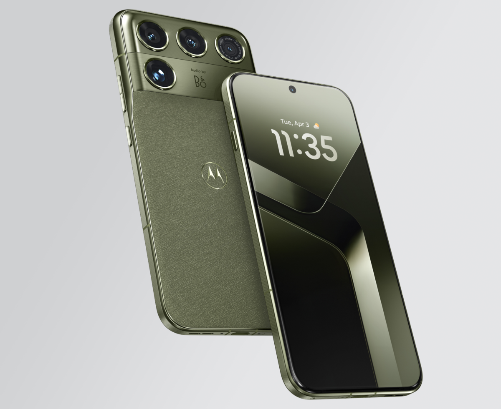

Motorola resmi mengumumkan Signature 27, ponsel flagship non-lipat kelas ultra premium yang dibanderol seharga $1.599,99 atau sekitar Rp25 jutaan. Perangkat ini ditenagai prosesor Qualcomm Snapdragon 8 Elite Extreme Gen 6, baterai silikon karbon jumbo 7.000 mAh, layar tandem AMOLED Duo berdaya terang 12.000 nits, serta dukungan resmi pemasangan sistem operasi berorientasi privasi GrapheneOS.

Langkah Motorola kali ini terasa berani dan cukup mengejutkan. Selama beberapa tahun terakhir, Motorola lebih banyak dikenal lewat lini ponsel lipat Razr atau lini Edge yang menyasar kelas menengah atas dengan harga kompetitif. Namun lewat Signature 27, perusahaan yang bernaung di bawah Lenovo ini memutuskan untuk menembus batas segmen ultra premium yang selama ini didominasi oleh seri Ultra milik Samsung dan lini Pro Max milik Apple.

## Desain Berani dan Tekstur Bodi Bernuansa Otomotif

Kalau diperhatikan dari segi tampilan fisik, Motorola tidak berusaha meniru gaya minimalis datar yang sedang menjamur di kalangan produsen ponsel lain. Signature 27 memadukan rangka aluminium kelas kedirgantaraan, kaca keramik tangguh, dan lapisan bodi belakang polikarbonat bertekstur khusus hasil kolaborasi bersama Pantone.

Ada dua varian warna yang ditawarkan ke pasar, yaitu Coal Smoke dengan sentuhan akhir Tactical Weave yang terinspirasi dari material serat pada interior mobil sport, serta Capulet Olive yang mengusung tekstur tenun kain lembut. Bodi ponsel ini juga telah mengantongi sertifikasi ketahanan air dan debu ganda IP68 dan IP69, sehingga tahan terhadap rendaman air maupun semprotan air bertekanan tinggi dengan suhu hangat.

*Sumber: [Motorola](https://www.motorola.com/us/en/motorola-signature/motorola-signature-2027)*

Walau memiliki profil bodi yang tergolong ramping dengan ketebalan sekitar 7,99 mm, bagian atas ponsel sedikit menebal untuk menampung konfigurasi modul kamera dan sistem pendingin termal berbasis gel berlian.

## Performa Snapdragon 8 Elite Extreme dan Baterai Silikon Karbon 7.000 mAh

Di sektor dapur pacu, Signature 27 mengandalkan silikon tercepat Qualcomm saat ini, yakni Snapdragon 8 Elite Extreme Gen 6. Guna menjaga kestabilan kinerja prosesor saat dipacu bermain game berat atau memproses kecerdasan buatan, Motorola memasang sistem pendingin 3D vapor chamber yang dipadukan dengan thermal gel berbahan dasar partikel berlian untuk menyalurkan panas lebih cepat keluar dari papan sirkuit utama.

Kapasitas memorinya berada di angka 12 GB RAM dengan penyimpanan internal berkecepatan UFS 4.1 sebesar 512 GB. Yang membuat penasaran justru kapasitas catu dayanya. Motorola berhasil membenamkan baterai berteknologi silikon karbon berkapasitas 7.000 mAh ke dalam ponsel dengan bobot 227 gram. Kapasitas ini terpaut sekitar 1.000 mAh lebih besar dibanding kebanyakan ponsel flagship kelas atas tahun ini.

Daya tahan baterainya diklaim mampu bertahan hingga dua hari penuh untuk pemakaian wajar. Pengisian dayanya mengandalkan adaptor kabel 90 Watt yang mampu memberikan daya pakai sekitar 12 jam hanya dalam tempo pengecasan 12 menit, didampingi pengisian nirkabel standar Qi sebesar 15 Watt.

## Layar Tandem OLED 12.000 Nits dan Kolaborasi Audio Bang & Olufsen

Beralih ke bagian visual, Signature 27 dibekali panel Extreme AMOLED Duo berukuran 6,8 inci dengan kecepatan refresh 120 Hz. Panel ini memanfaatkan arsitektur tandem OLED, yaitu teknik menumpuk dua lapisan pemancar cahaya organik untuk melipatgandakan intensitas kecerahan tanpa mempercepat keausan komponen piksel.

Hasilnya, tingkat kecerahan puncak layar ini diklaim mampu menyentuh angka 12.000 nits pada konten HDR. Angka tersebut melompat jauh melampaui rata-rata layar ponsel flagship yang umumnya berada di kisaran 3.000 hingga 4.500 nits, membuat konten di layar tetap terlihat kontras meski berada di bawah terik matahari siang bolong.

Untuk urusan tata suara, Motorola bermitra langsung dengan maestro audio asal Denmark, Bang & Olufsen. Speaker stereo pada Signature 27 dikalibrasi secara khusus dengan profil akustik natural, baik saat mendengarkan musik resolusi tinggi, menonton film, maupun melakukan panggilan konferensi.

## Sensor Gerak EVS dan Kamera Telefoto Periskop 200 MP

Sektor kamera menjadi sorotan utama berikutnya. Modul belakang ponsel ini memuat kombinasi sensor yang cukup unik dibanding ponsel kamera konvensional:

- Sensor utama 50 MP Sony LYTIA L910 dengan bukaan lensa f/1.6 dan stabilisasi optik.
- Sensor sudut ultra lebar 50 MP dengan bukaan f/2.0.
- Sensor telefoto periskop 200 MP dengan perbesaran optik 3x dan pembesaran digital hingga 100x berbasis AI generatif Super Zoom Pro.
- Sensor Event-Based Vision khusus untuk fitur Action Shot pelacak objek bergerak cepat.
- Kamera depan 50 MP dengan bukaan f/1.9 untuk swafoto resolusi tinggi.

Kehadiran sensor Event-Based Vision (EVS) menjadi pembeda yang sangat menarik. Berbeda dengan sensor kamera biasa yang merekam frame secara keseluruhan pada interval waktu tertentu, sensor EVS membaca perubahan intensitas cahaya pada tingkat sub-piksel secara independen. Ketika mendeteksi adanya gerakan cepat di dalam bingkai, sensor langsung mengunci koordinat objek sehingga tangkapan foto Action Shot terbebas dari efek bayangan kabur atau blur.

## Opsi Privasi Melalui Dukungan Resmi GrapheneOS

Bagian yang paling mencuri perhatian komunitas teknologi justru datang dari sektor perangkat lunak. Secara bawaan, Motorola Signature 27 meluncur dengan sistem operasi Android 17 berbalut antarmuka Hello UI, lengkap dengan jaminan pembaruan sistem dan keamanan selama tujuh tahun. Fitur kecerdasan buatan seperti Google Gemini Intelligence dan Motorola Qira juga tersedia untuk integrasi lintas perangkat ke komputer Lenovo.

Namun, bagi pengguna yang enggan terikat dengan ekosistem pelacakan data dan layanan Google, Motorola mengumumkan kemitraan resmi bersama pengembang GrapheneOS. Ini merupakan kali pertama ponsel produksi Motorola mendapatkan dukungan resmi instalasi GrapheneOS langsung dari komunitas pengembangnya.

Pembeli yang menghendaki sistem operasi independen dapat membuka kunci bootloader dan memasang GrapheneOS secara mandiri. Langkah ini memecahkan hegemoni perangkat Google Pixel yang selama bertahun-tahun menjadi satu-satunya basis perangkat keras utama untuk instalasi sistem operasi tanpa Google tersebut.

## Harga dan Ketersediaan di Pasar Global

Motorola mematok harga ritel Signature 27 sebesar $1.599,99 untuk satu-satunya konfigurasi memori 12 GB RAM dan penyimpanan 512 GB. Sesi pemesanan awal dibuka mulai 19 November, disusul penjualan perdana secara resmi pada 26 November mendatang melalui kanal penjualan langsung situs resmi, Best Buy, serta Amazon.

Dengan label harga yang menembus kisaran Rp25 jutaan, Signature 27 jelas bukan perangkat yang ditujukan untuk semua orang. Harganya bahkan hanya berselisih tipis dari ponsel lipat format buku. Namun perpaduan antara baterai 7.000 mAh, layar tandem ultra terang, sensor kamera berbasis pergerakan cahaya, serta kebebasan memilih sistem operasi GrapheneOS menjadikan Signature 27 sebagai salah satu inovasi perangkat keras paling berani dari Motorola di penghujung tahun ini.

Sumber: [Motorola](https://www.motorola.com/us/en/motorola-signature/motorola-signature-2027)
