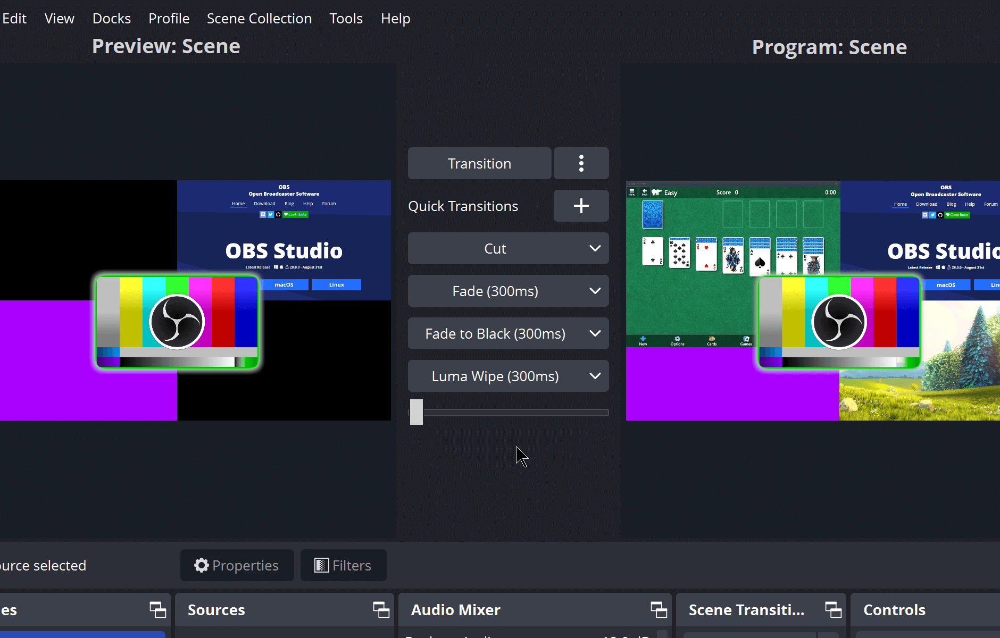

Bagi siapa saja yang sering memproduksi konten siaran, melakukan live streaming di Twitch, atau sekadar merekam tutorial teknis di Linux, OBS Studio sudah menjadi perkakas wajib yang terpasang di sistem. Proyek open source legendaris ini baru saja meresmikan rilis mayor terbarunya, OBS Studio 33.0. Rilis kali ini bukan sekadar pembaruan rutin penambal kutu, melainkan membawa perombakan pondasi arsitektur yang cukup masif bagi ekosistem kreator dan developer.

Dua perubahan paling mencolok berpusat pada pembaruan mesin peramban web internal Chromium Embedded Framework (CEF) yang melompat jauh setelah lebih dari dua tahun tertahan di versi lawas, serta penataan ulang menyeluruh pada sistem pemuatan plugin. Di samping itu, komunitas pengguna Linux mendapatkan kabar gembira berkat hadirnya akselerasi perangkat keras NVENC pada mesin berbasis prosesor Arm64 serta perbaikan integrasi pada peladen tampilan PipeWire.

## Lompatan Raksasa Chromium CEF 127 ke Versi 150

Kalau ente sering memasang overlay interaktif, widget notifikasi saweran, bot obrolan, maupun custom browser dock di jendela OBS, semua elemen visual tersebut dirender langsung oleh komponen bernama Chromium Embedded Framework. Di balik layar, CEF bertindak layaknya peramban web mandiri berkecepatan tinggi yang ditanamkan langsung ke dalam antarmuka OBS Studio.

Pada rilis versi sebelumnya, OBS Studio tertahan cukup lama pada CEF versi 127 yang berbasis kode sumber Chromium keluaran pertengahan tahun 2024. Akibatnya, banyak pengembang plugin dan penyedia layanan overlay siaran yang mengeluhkan keterbatasan fitur CSS modern, masalah konsumsi memori yang boros saat menjalankan banyak animasi WebGL, serta ketiadaan API JavaScript mutakhir.

Melalui rilis 33.0 ini, tim pengembang melompati puluhan generasi versi sekaligus dengan langsung mengadopsi CEF 150 keluaran September 2026. Lompatan raksasa ini menghadirkan efisiensi alokasi memori yang jauh lebih ketat, akselerasi GPU perangkat keras yang lebih stabil untuk elemen kanvas web, serta kompatibilitas penuh terhadap standar web modern. Seluruh peningkatan ini berjalan senyap di lapisan backend, namun ente akan merasakan kinerja rendering widget siaran yang jauh lebih enteng tanpa lonjakan beban CPU secara mendadak.

*Sumber: [OBS Project](https://obsproject.com)*

## Rombak Total Arsitektur Plugin dan Folder Core Baru

Masalah klasik yang kerap dihadapi pengguna OBS Studio saat memperbarui aplikasi adalah kerusakan modul akibat plugin pihak ketiga yang tidak kompatibel. Sering kali, satu plugin usang yang bermasalah bisa membuat keseluruhan program gagal booting (crash on startup). Menjawab kendala struktural tersebut, tim pengembang merancang ulang arsitektur pemuatan plugin secara fundamental.

Kini, seluruh modul dan plugin bawaan resmi (first-party) dipisahkan ke dalam direktori terisolasi bernama `core`. Sementara itu, plugin eksternal dari pihak ketiga (third-party) dialihkan ke skema folder instalasi baru yang tidak lagi mencampuri pustaka inti aplikasi. Pemisahan lingkungan ini memastikan sistem utama tetap terlindungi saat ada plugin tambahan yang mengalami galat memori.

Bagi ente yang masih mengandalkan plugin lawas, tim pengembang masih memberikan masa toleransi. Direktori instalasi warisan (legacy location) tetap didukung dan dibaca oleh sistem hingga siklus rilis OBS Studio 34.0 mendatang. Selain itu, proteksi Safe Mode ditingkatkan secara cerdas. Jika aplikasi mendeteksi kegagalan sistem pada peluncuran sebelumnya, OBS Studio akan otomatis mengabaikan pemuatan seluruh plugin pihak ketiga serta menonaktifkan server internal WebSocket, sehingga kita bisa membuka antarmuka dengan lancar untuk mencopot modul yang bermasalah.

## Dukungan NVENC di Arm64 dan Peningkatan Stabilitas Linux

Peningkatan menarik lainnya menyasar ekosistem perangkat keras modern. OBS Studio 33.0 resmi mengaktifkan dukungan akselerasi encoder perangkat keras NVENC untuk platform Linux dan Windows berbasis Arm64 yang menggunakan kartu grafis NVIDIA. Langkah ini sangat dinanti oleh pengguna workstation maupun perangkat komputasi kompak berarsitektur Arm, karena beban kompresi video H.264 dan HEVC kini dapat dialihkan sepenuhnya ke chip silikon khusus tanpa membebani inti CPU utama.

Bagi pengguna desktop Linux sehari-hari, ada beberapa tambalan krusial yang membuat pengalaman produksi video semakin solid:

- Integrasi tangkapan layar PipeWire diperbaiki sehingga sumber tangkapan tidak lagi terduplikasi ganda saat berpindah di Studio Mode.
- Mengatasi kutu kritis yang sebelumnya memicu crash seketika saat mikrofon eksternal USB dicabut secara tiba-tiba dari port komputer di Linux.
- Penambahan penanda versi pada titik ekstensi plugin Flatpak guna memastikan kompatibilitas dependensi runtime terisolasi.
- Menghentikan pemeliharaan paket biner untuk rilis lawas Ubuntu 24.04 LTS, guna memusatkan optimasi pada lingkungan distro modern seperti Ubuntu 26.04 dan Fedora terbaru.

Dukungan pustaka multimedia di balik layar juga ikut dirapikan dengan mewajibkan pustaka kriptografi MbedTLS 3 serta menanggalkan dukungan modul usang FFmpeg versi 6 dan 7 demi mengoptimalkan alur pemrosesan video berkecepatan tinggi.

## Kontrol Kanvas Lebih Presisi dan Ekosistem Modern

Selain urusan dapur pacu backend, kenyamanan interaksi pengguna saat menata elemen siaran juga mendapatkan sentuhan perbaikan. Sistem snapping atau perataan posisi sumber di kanvas kini bekerja jauh lebih intuitif. Sumber visual tidak lagi hanya mengunci saat bersentuhan langsung, melainkan mampu mengunci posisi di sepanjang sumbu kanvas secara penuh dengan indikator garis panduan visual yang jelas. Sumber yang disembunyikan (hidden) juga tidak akan mengganggu pergerakan elemen aktif lainnya.

Bagian kotak input angka (spinbox) kini merespons lebih rapi. Nilai hanya akan diperbarui saat tombol Enter ditekan tanpa menutup jendela properti secara mendadak, serta mendukung kombinasi tombol Shift dan tombol panah untuk menaikkan atau menurunkan angka dalam kelipatan besar secara instan.

Bagi para kreator yang membutuhkan isolasi audio tingkat lanjut, OBS Studio 33.0 menyematkan dukungan ke SDK NVIDIA Broadcast terbaru guna menghadirkan filter peredam kebisingan latar belakang dan efek mikrofon berbasis kecerdasan buatan.

Perombakan arsitektur pemuatan modul dan lompatan versi CEF ini menjadi fondasi penting bagi stabilitas OBS Studio ke depan. Kalau ane perhatikan, pemisahan pustaka inti dari modul tambahan membuat alur kerja siaran di Linux terasa jauh lebih tangguh menghadapi potensi crash di tengah produksi langsung, om.

Sumber: [OBS Project](https://github.com/obsproject/obs-studio/releases/tag/33.0.0)
