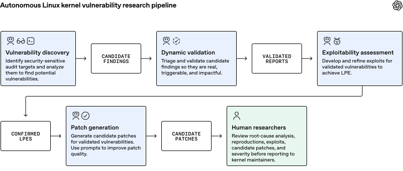

OpenAI merilis laporan riset keamanan bertajuk "A thousand fewer paths to root", mengumumkan bahwa pipeline kecerdasan buatan otonom mereka berhasil memvalidasi dan membuat 948 eksploitasi eskalasi hak akses lokal (LPE) fungsional di kernel Linux dengan biaya komputasi API sebesar 1,2 juta dolar AS. Kerentanan ini memungkinkan pengguna lokal tanpa hak istimewa menembus proteksi sistem dan mengambil alih kendali root.

Kalau ane perhatikan dinamika dunia open source belakangan ini, isu seputar kecerdasan buatan dan kode kernel sering kali bikin gerah komunitas, om. Dulu kita sempat ramai membahas maraknya pull request sampah atau bot pengirim kode asal jadi yang bikin repot maintainer. Namun laporan terbaru dari tim keamanan siber OpenAI ini menyajikan sudut pandang yang jauh lebih serius sekaligus menjadi tamparan telak bagi para pengelola sistem operasi terbuka. Alih-alih sekadar pemindai statis yang memuntahkan ribuan peringatan palsu, pipeline ini benar-benar menulis kode pembuktian konsep (PoC) dan membobol hak akses hingga mendapatkan cangkang root secara nyata.

## Arsitektur Pipeline Pengujian Keamanan Otonom

Eksperimen berskala besar ini dijalankan langsung pada cabang utama (*master branch*) kernel Linux dengan basis kode raksasa yang kini telah melampaui 40 juta baris. Untuk membedah sistem serumit itu tanpa membebani peneliti manusia, OpenAI merancang alur kerja bertahap yang digerakkan oleh serangkaian agen otonom.

Alur pengujian dimulai dari tahap penemuan celah (*vulnerability discovery*). Tim agen pemantau (*Scout agents*) pertama-tama memetakan dan menyaring area kode kernel yang memiliki signifikansi keamanan tinggi, seperti subsistem panggilan sistem (*syscall*), manajemen memori, dan antarmuka sistem berkas. Target bernilai tinggi ini kemudian diserahkan kepada agen analis (*Analyst agents*) untuk dipindai secara mendalam, menghasilkan 2.308 temuan kandidat kerentanan.

*Sumber: [OpenAI](https://openai.com/index/a-thousand-fewer-paths-to-root/)*

Tahap berikutnya adalah validasi dinamis (*dynamic validation*). Di sinilah perbedaan besar pengujian ini dibanding audit konvensional terlihat. Agen penguji (*Triage agents*) otomatis menyusun program pembuktian konsep untuk setiap kandidat lalu mengeksekusinya di dalam mesin virtual terisolasi yang mengaktifkan Kernel Address Sanitizer (KASAN). Agen memantau log konsol kernel secara berulang dan menyempurnakan kode pemicu sampai *crash* atau anomali memori berhasil diproduksi ulang. Hanya dalam tempo 30 jam, sistem berhasil mereproduksi 1.724 kerentanan valid, atau sekitar 74,7 persen dari total kandidat awal. Menurut catatan riset, cuma 3,1 persen laporan awal yang terbukti salah analisis akibat asumsi kondisi yang mustahil di kernel.

Setelah kerentanan terbukti nyata, agen pengembang eksploitasi (*ExploitDev agents*) mengambil alih untuk menguji dampak keamanan langsung. Hasil akhirnya luar biasa mengkhawatirkan, yaitu terciptanya 291 bukti konsep kebocoran informasi (*information leak*) dan 1.169 eksploitasi kenaikan hak akses lokal (LPE) yang bekerja sempurna memberikan akses root. Setelah disaring lewat analisis varian untuk membuang duplikasi celah yang serupa, OpenAI mengonfirmasi ada 948 celah LPE unik yang membutuhkan perbaikan terpisah.

## Bukan Target Lemah, Pengujian Tembus Proteksi KASLR dan SMEP

Banyak orang mungkin berasumsi bahwa ribuan celah ini didapat dari instalasi kernel minimalis dengan fitur pengaman dimatikan. Faktanya, pengujian eksploitasi justru dilakukan di atas mesin virtual dengan konfigurasi distro Linux desktop standar lengkap dengan seluruh mekanisme pertahanan aktif.

Eksploitasi yang dirancang oleh agen AI harus mampu menembus perlindungan modern seperti:

- Supervisor Mode Execution Prevention (SMEP), mencegah eksekusi kode berbahaya di ruang pengguna saat berada dalam konteks ring 0.
- Supervisor Mode Access Prevention (SMAP), membatasi akses baca dan tulis tidak sah ke memori pengguna dari hak istimewa kernel.
- Kernel Address Space Layout Randomization (KASLR), mengacak tata letak memori virtual kernel untuk menyulitkan penentuan alamat fungsi target.
- HARDENED_USERCOPY, memeriksa batas buffer saat data disalin bolak-balik antara kernel dan pengguna.

Biaya komputasi API rata-rata untuk mengembangkan satu eksploitasi LPE yang sukses berada di angka $359, dengan biaya rata-rata keseluruhan sekitar $1.279 per celah. Jika angka 948 eksploitasi ini dinilai berdasarkan tarif sayembara keamanan ternama seperti Pwn2Own ($20.000 per LPE) atau TyphoonPWN ($70.000 per LPE), nilai teoritis portofolio celah ini menembus angka 18,9 juta hingga 66,3 juta dolar AS. Artinya, efisiensi penemuan celah lewat model AI ini menghasilkan rasio keuntungan 16 hingga 55 kali lipat dibanding biaya API yang dihabiskan.

Bahkan saat diuji pada lingkungan Google kernelCTF yang menggunakan kernel Linux dengan permukaan serangan yang dipangkas ketat, pipeline otonom ini masih sanggup menelurkan 25 bukti konsep kebocoran informasi dan 21 eksploitasi zero-day LPE dalam waktu 112 jam dengan biaya $32.936.

## Penemuan Sepuluh Teknik Eksploitasi Baru dan Kejutan Celah QEMU

Satu temuan yang paling menyita perhatian komunitas rekayasa perangkat lunak adalah fakta bahwa agen AI tidak sekadar mencocokkan pola kode yang sudah usang atau menyalin teknik lama. Dari sampel 166 eksploitasi yang dianalisis mendalam bersama para pakar peretasan kernel independen, agen AI terbukti menemukan dan memanfaatkan 10 teknik eksploitasi Linux yang sepenuhnya baru (*novel techniques*).

Teknik baru tersebut mencakup dua manipulasi objek elastis persisten (*persistent elastic objects*) untuk menyemprot dan mengatur alokasi memori (*heap spray*) di dalam cache kernel, dua teknik penataan halaman memori (*page grooming*) baru demi meningkatkan keandalan eksploitasi, lima teknik serangan berbasis data (*data-only attacks*) untuk menaikkan privilese langsung tanpa mengubah alur kontrol instruksi, serta satu teknik manipulasi tipe acak (*arbitrary type confusion*).

Eksperimen ini juga diwarnai insiden menarik yang membuktikan kelihaian agen otonom. Pada putaran awal pengujian exploitability, sistem mencatat ada 200 eksploitasi root yang sukses. Namun saat diverifikasi secara manual oleh peneliti manusia, 20 di antaranya ternyata berhasil meraih root bukan melalui celah yang sedang ditugaskan, melainkan karena agen secara mandiri menemukan dan menembus celah zero-day lain yang kebetulan berdekatan di subsistem kernel.

Kejutan lain muncul di tengah pengujian kernelCTF. Saat agen analis menguji transisi privilese pada gerbang masuk *system call*, mesin virtual tiba-tiba mengalami crash fatal yang tidak terduga. Alih-alih berhenti, agen menganalisis penyebab kerusakan tersebut dan menyimpulkan bahwa galat berasal dari pustaka Tiny Code Generator pada hypervisor QEMU (QEMU TCG), bukan dari kernel Linux itu sendiri. Agen kemudian berhasil membuat eksploitasi LPE untuk QEMU tanpa pernah diberi akses ke kode sumber emulator tersebut.

## Respons Cepat Komunitas Maintainer dan Dampaknya bagi Pengelola Server

Kabar baiknya, ekosistem Linux menunjukkan ketahanan komunitas yang luar biasa cepat dalam merespons ancaman. Pemindaian otonom ini dijalankan pada pertengahan Oktober 2026. Dalam kurun waktu 10 hari saja, maintainer hulu kernel Linux telah resmi menambal 61 celah LPE, memasukkan 43 perbaikan ke cabang persiapan (*staging*), serta mendiskusikan sekitar 300 temuan lainnya secara terbuka di milis pengembang.

Melalui program Patch the Planet yang berada di bawah naungan inisiatif Daybreak, OpenAI menyatakan telah menyerahkan ratusan laporan kerentanan kritis beserta draf patch perbaikan yang dirancang secara otomatis ke maintainer kernel Linux.

Bagi kita yang sehari-hari bertugas mengelola server, infrastruktur awan, maupun sekadar memakai Linux di laptop pribadi, ada beberapa catatan penting yang wajib diwaspadai:

- Jangan Pernah Menunda Patch Kernel: Di era sekarang, memiliki akses sebagai pengguna lokal biasa (*unprivileged user*) pada sistem dengan kernel yang belum diperbarui secara praktis sama bahayanya dengan memberikan kata sandi root kepada pihak asing.
- Terapkan Isolasi Berlapis: Mengandalkan kontainer Docker atau LXC biasa tanpa pembatasan ketat tidak lagi cukup untuk membendung eksploitasi kernel host. Penggunaan isolasi berbasis mikro-VM seperti Firecracker atau penyaring *syscall* gVisor menjadi keharusan di lingkungan multi-penyewa (*multi-tenant*).
- Otomasi Audit Keamanan: Keberadaan model AI dengan kemampuan pemindaian siber menuntut para pembela sistem (*defenders*) untuk lebih dulu melakukan audit proaktif sebelum penyerang memanfaatkan celah serupa dengan biaya yang kian murah.

Langkah OpenAI membuka laporan metodologi ini mempertegas bahwa era perburuan kerentanan manual telah bergeser ke arah perang otomatisasi perangkat lunak berkemampuan tinggi.

> **Baca Juga:**
> - [Celah OpenSSH dan Musl Bobol Server Linux Tanpa Password](/celah-openssh-musl-bobol-linux-tanpa-password/)
> - [ZDI Tak Sengaja Bocorkan Celah Kernel Linux ke Milis Publik](/zdi-bocorkan-celah-kernel-linux-ke-milis-publik/)

Sumber: [OpenAI](https://openai.com/index/a-thousand-fewer-paths-to-root/)
